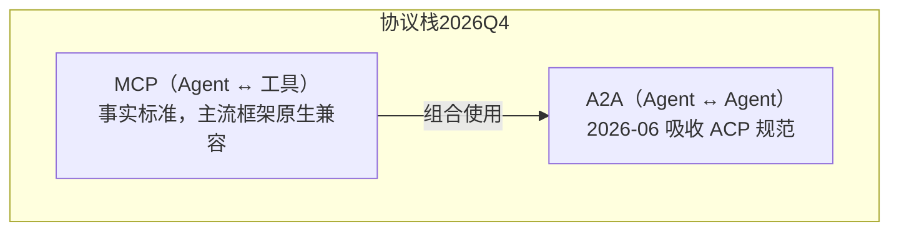

# LLM 前沿格局 2026 Q4：模型、推理与训练范式速览

> 中文简称：LLM 前沿格局 2026 Q4

> **一句话理解**: 2026 年第四季度开场，闭源阵营完成代际切换（GPT-6、Claude 5.5、Gemini 4），开源阵营进入「多强混战」（GLM-5.2 / Kimi K3 / DeepSeek V4 / Qwen3.8），推理与训练的工程范式也换了一轮。

---

## 1. 闭源前沿：三代同堂后的代际切换

| 厂商 | 最新旗舰 | 发布/上线 | 定位与亮点 |
|------|---------|-----------|-----------|
| **OpenAI** | GPT-6 Astra | 2026 下半年 | 「最智能且最对齐」：计算机使用、编码、网络安全、科学任务全面 SOTA |
| **OpenAI** | GPT-6 Sol / Luna | 2026-10-07 | 面向日常工作的双档位（能力/成本不同平衡），10-08 起全量推送 ChatGPT |
| **Anthropic** | Claude Opus 5.5 | 2026-09-22 | 5.5 家族首个模型：大多数任务达到 Fable 5.1 水平，运行成本比 Opus 5 低 40% |
| **Anthropic** | Claude Fable 5.1 / Mythos 5.1 | 2026 年中 | Fable 5（06-09）曾上线三天即暂停、随后以 5.1 恢复；Mythos 级首度公开 |
| **Google** | Gemini 4 Argon | 09-30 发布 / 10-13 上线 | 面向真实世界编码、企业知识工作与网络防御的新旗舰，全面超过 3.1 Pro |
| **xAI** | Grok 4.5 | 2026-07 | 社区报道称与 Cursor 联合训练，编码取向明显（细节待官方口径） |

**格局解读**：

- 「旗舰 + 档位化副线」成为标配：OpenAI 用 Sol/Luna/Instant 切分价位，Anthropic 用 Opus/Fable/Mythos 分层，Google 用 3.1 Pro 承接日常、4 Argon 冲前沿；
- **计算机使用（computer use）与网络安全**首次成为旗舰模型的一级卖点（GPT-6 Astra、Gemini 4 Argon 均强调）；
- 详细单家分析见：[[05_大模型/13_全球LLM生态/09_OpenAI_深入分析|OpenAI 深入分析]]、[[05_大模型/13_全球LLM生态/01_Anthropic_Claude_深入分析|Anthropic Claude 深入分析]]、[[05_大模型/13_全球LLM生态/05_Google_Gemini_深入分析|Google Gemini 深入分析]]。

---

## 2. 开源阵营：从「追赶」到「多强混战」

| 模型 | 厂商 | 时间线 | 许可证 | 强项 |
|------|------|--------|--------|------|
| **DeepSeek V4 家族** | 深度求索 | Preview 04-24 → V4-Flash 开源 07-31 → V4-Pro GA 08-13 → V4.1-Flash 10 月 | MIT | 1M 上下文、成本效率、SWE-bench 原始分 |
| **Kimi K3** | 月之暗面 | 2026-07-27 | Modified MIT（超规模使用触发署名条款） | 前端编码 Arena 领先、多模态与知识工作 |
| **GLM-5.2** | 智谱 | 2026 年中 | 开放权重 | 编码与 agentic 场景性价比 |
| **Qwen3.8（Max / 27B）** | 阿里通义 | 2026 Q3 | 开放权重（部分档位） | 长上下文与综合基准 |
| **gpt-oss-120b / Gemma 4** | OpenAI / Google | 2026 | 开放权重 | 端侧与轻量部署 |

**格局解读**：

- 开源第一梯队从「单标杆」（DeepSeek 一家独大）变成「三强互搏」（Kimi K3 前端、GLM-5.2 性价比、DeepSeek V4 综合），与闭源差距在编码场景已明显收窄；
- **许可证开始「带条件」**：Kimi K3 的 Modified MIT（超 100M MAU 触发署名）预示开源协议正在向「防御性开放」演化；
- 国内生态全景见 [[05_大模型/14_中国LLM生态/08_深度Seek_深入分析|DeepSeek 深入分析]] 与 [[05_大模型/16_Kimi_K3技术报告/README|Kimi K3 技术报告]]。

---

## 3. 推理部署： disaggregated serving 成为主旋律

| 动态 | 时间 | 要点 |
|------|------|------|
| vLLM **v0.26.0** | 2026 Q4 | 411 commits / 212 contributors；新增 Inkling 模型族支持 |
| DeepSeek-V4.1-Flash on vLLM | 2026-10-07 | 官方博客：Day 0 支持，agentic 吞吐较上代 **5x** |
| Disaggregated Serving 实践指南 | 2026-09-29 | prefill/decode 分离部署从论文走向工程标配 |

- **PD 分离（prefill/decode 分离）** 从可选优化变成高吞吐服务的默认架构选项，配合 [[10_部署推理/02_推理引擎/29_vLLM_深入分析|vLLM]]、[[10_部署推理/02_推理引擎/23_SGLang_深入分析|SGLang]]、[[10_部署推理/02_推理引擎/25_TensorRT_LLM_深入分析|TensorRT-LLM]] 三家引擎各有实现；
- Agentic 负载（长上下文、多轮工具调用、KV 复用）取代纯 chat 成为新的优化基准场景。

---

## 4. 训练范式：RLVR 家族取代 RLHF 成为主流后训练栈

| 方法 | 定位 | 2026 状态 |
|------|------|-----------|
| **GRPO / DAPO** | 组相对策略优化及其改进 | 推理模型后训练标配，替代 PPO-on-RLHF |
| **RLVR** | 可验证奖励（数学/代码可自动判分） | 从推理任务扩展到更多领域 |
| **RLVRR** | 参考式可验证奖励（2026-01 提出） | 缓解「验证器难题」：无客观答案的任务用参考解打分 |
| **合成自我博弈** | 自生任务 + 自评 | 与 RLVR 组合，减少人工标注依赖 |

- 一句话：**「奖励从人偏好（RLHF）转向可验证信号（RLVR 系）」**，详细机制见 [[07_模型训练/06_对齐训练/02_GRPO_and_新型_对齐_Methods|GRPO 与新型对齐方法]] 与 [[概念/LLM/rlvr|RLVR 概念页]]。

---

## 5. Agent 协议：从「三国杀」到「两层栈」

上图说明：2026 年中的关键变化是 **ACP（Agent Communication Protocol）并入 A2A**，行业收敛为「MCP 管工具连接、A2A 管智能体互联」的两层协议栈；WebMCP 等浏览器侧扩展开始兴起。

- 协议全景见 [[15_智能体/16_Agent协议/02_AG-UI_ACP_协议_2025|AG-UI/ACP 协议分析]] 与 [[概念/Agent/agent-protocols|Agent 协议栈完全指南]]；
- RAG 侧同步演进为 **Agentic RAG**（检索即工具、多跳规划），综述见 [[14_RAG系统/README|14_RAG系统]]。

---

## 6. 相关文档

- [[05_大模型/13_全球LLM生态/README|全球 LLM 生态总览]] — 各家厂商深入分析的入口
- [[05_大模型/08_推理模型/README|推理模型]] — 推理模型技术与演进路线
- [[10_部署推理/README|部署推理]] — vLLM/SGLang/TensorRT-LLM 工程实践
- [[07_模型训练/06_对齐训练/README|对齐训练]] — RLHF → GRPO/DAPO/RLVR 全谱系

---

*Last updated: 2026-10-14*
