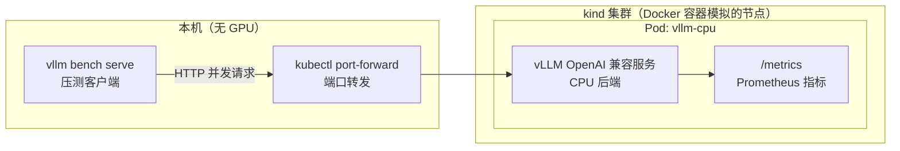

> [!warning] 生产安全提示 · Production Safety
> 本文档含可执行命令/操作步骤。执行前请核对风险等级（🟢低/🔶中/🔴高），高危命令必须 dry-run 并确认回滚方案。完整策略见 [生产安全策略](../../治理/Production_Safety_Policy.md)。
<!-- op-safety-banner v1 -->
# vLLM CPU + kind 无 GPU 实验指南

> 中文简称：vLLM CPU kind 实验

> **一句话理解**: 没有显卡也能完整跑通 vLLM 推理服务——在 kind 集群里用 CPU 版镜像起一个 OpenAI 兼容服务，排队、批处理、KV cache 指标全部真实可见，是零成本的推理教学实验室。

---

## 为什么需要这个实验

知识博主、培训师、自学者最常见的困境：**讲 vLLM/SGLang 却没有 GPU**。租卡按小时烧钱，直播时卡一断课程就断。

关键洞察是：vLLM 的价值不在「算得快」，而在「**调度得聪明**」——continuous batching（连续批处理）、KV cache 管理、请求排队与抢占，这些行为在 CPU 上**同样完整存在、同样可以被观测**。慢的只是 token 生成速度。对教学来说，这恰恰够用：学生要看的是「多个并发请求如何被合批、队列如何涨落、cache 如何复用」，而不是每秒几千 token。

本实验在本地 kind（Kubernetes in Docker）集群中部署 vLLM 官方 CPU 镜像，配套真实压测与指标观测，全程 **0 GPU、0 云费用**。适合：

- 培训师/知识博主做 vLLM 与「K8s 上的 LLM 推理」课程的动手环节
- K8s 工程师在笔记本上预习推理服务运维（扩缩容指标、Pod 资源配置）
- 面试准备者需要「真跑过推理服务」的经验素材

> 前置阅读：[vLLM 深入分析](29_vLLM_深入分析.md)（引擎全貌）、[vLLM PagedAttention 架构](30_vLLM_Paged注意力_架构.md)（为什么 KV cache 管理是核心）。

---

## 实验架构



整体链路：压测客户端从本机发并发请求 → port-forward 进入 kind 集群 → vLLM Pod 内的 CPU 推理服务处理请求 → 通过 /metrics 端点观测队列、批处理与 cache 行为。所有组件都跑在一台没有 GPU 的笔记本上。

---

## 能学到什么 vs 学不到什么

| 维度 | ✅ CPU + kind 能学到 | ❌ 需要 GPU 才能学到 |
|------|---------------------|---------------------|
| **服务层** | OpenAI 兼容 API、参数（temperature、max_tokens）语义 | — |
| **调度行为** | continuous batching、请求排队、抢占（preemption） | — |
| **KV cache** | cache 分配/复用水位、`--max-model-len` 与内存权衡 | PagedAttention 的 CUDA kernel 细节 |
| **K8s 集成** | Pod 资源限制、安全上下文、port-forward、指标采集 | GPU device plugin、time-slicing、MIG |
| **性能工程** | 压测方法、TTFT/吞吐指标解读 | 真实吞吐调优、量化对比、CUDA graph |
| **多卡** | — | 张量并行/流水线并行、PD 分离 |

结论：本实验覆盖教学内容的约 80%；剩下 20%（性能调优类）建议采用「租卡录播」策略，见文末[SGLang 与录播策略](#sglang-与录播策略)。

---

## 环境要求

| 依赖 | 最低要求 | 说明 |
|------|---------|------|
| Docker | 8GB+ 可用内存 | kind 与 vLLM Pod 都跑在 Docker 里 |
| kind | 任意近期版本 | `brew install kind` / `go install` |
| kubectl | 与集群版本匹配 | 集群版本 ≥1.24 更佳 |
| 磁盘 | 约 15GB 空闲 | CPU 镜像 + 模型缓存 |
| CPU 指令集（x86 主机） | AVX2（AVX512 更佳） | Linux 上 `grep -c avx512f /proc/cpuinfo` 检查；Apple Silicon（ARM）原生支持，无需检查 |

> 注意：Apple Silicon Mac 上 Docker 原生运行 linux/arm64 容器，vLLM 官方 Dockerfile.cpu 支持 ARM 构建，本实验可直接跑；x86 服务器上若只有 AVX2，功能可用但部分优化受限。

---

## Step 0：创建 kind 集群

```bash
# 🟢 — 本地新建容器集群，无外部影响 [rollback: kind delete cluster --name vllm-lab]
kind create cluster --name vllm-lab
kubectl get nodes   # 确认 vllm-lab-control-plane Ready
```

---

## Step 1：构建 vLLM CPU 镜像

vLLM 官方 Docker Hub 镜像（`vllm/vllm-openai`）只含 CUDA 后端；CPU 后端需要用仓库自带的 `Dockerfile.cpu` 构建（官方文档推荐路径）：

```bash
# 🔶 — 克隆 vLLM 仓库（约 300MB）并构建镜像，首次 20-60 分钟、产出 4-6GB 镜像 [rollback: docker rmi vllm-cpu-env]
git clone --depth 1 https://github.com/vllm-project/vllm.git
cd vllm

# 构建开源 CPU 镜像（x86 与 Apple Silicon 均自动适配架构）
docker build -f docker/Dockerfile.cpu \
  --tag vllm-cpu-env:latest \
  --target vllm-openai .
```

教学提示：镜像只需构建一次，可以 `docker save` 分发给学员（或推到内部 registry），把「等构建」从课堂时间中拿掉。

> 官方另有 ECR 预构建 CI 镜像（`public.ecr.aws/q9t5s3a7/vllm-ci-postmerge-repo`），但数天即过期、仅供 CI 使用，教学场景不要依赖。

---

## Step 2：把镜像装进 kind

kind 节点是容器，抓不到本机 Docker 镜像，必须显式导入：

```bash
# 🟢 — 将本地镜像加载进 kind 节点 [rollback: kind 集群销毁即消失]
kind load docker-image vllm-cpu-env:latest --name vllm-lab
```

导入后 Pod 必须声明 `imagePullPolicy: IfNotPresent`，否则 kubelet 会去远端 registry 拉一个不存在的镜像。

---

## Step 3：部署 vLLM Pod

官方 CPU 文档的 `docker run` 参数需要逐项翻译成 Pod 规格，这个「翻译」本身就是最好的 K8s 教学素材：

| docker run 参数 | Pod spec 对应 |
|-----------------|---------------|
| `--cap-add SYS_NICE` | `securityContext.capabilities.add` |
| `--security-opt seccomp=unconfined` | `securityContext.seccompProfile.type: Unconfined` |
| `--shm-size=4g` | `emptyDir`（`medium: Memory`）挂载到 `/dev/shm` |
| `--cpus 4` | `resources.limits.cpu` |
| `-e VLLM_CPU_KVCACHE_SPACE=4` | `env` 环境变量 |
| `-p 8000:8000` | `ports` + port-forward（Step 4） |

保存为 `vllm-cpu-pod.yaml`：

```yaml
apiVersion: v1
kind: Pod
metadata:
  name: vllm-cpu
  labels:
    app: vllm-cpu
spec:
  containers:
    - name: vllm
      image: vllm-cpu-env:latest
      imagePullPolicy: IfNotPresent        # 必须：kind load 的镜像只存在于本地
      args:
        - "--model"
        - "facebook/opt-125m"              # 125M 参数的无门槛小模型，下载快、教学够用
        - "--dtype"
        - "bfloat16"                       # CPU 上推荐 bf16；float16 在 CPU 后端不稳定
        - "--max-model-len"
        - "1024"                           # 压小上下文，降低 KV cache 内存压力
      ports:
        - containerPort: 8000
      env:
        - name: VLLM_CPU_KVCACHE_SPACE     # KV cache 预算，单位 GB
          value: "4"
        - name: VLLM_CPU_NUM_OF_RESERVED_CPU   # 给 vLLM 前端进程预留 1 个 CPU
          value: "1"
      resources:
        limits:
          cpu: "4"                         # 与线程绑定配合：4 核 = 1 预留 + 3 推理
          memory: 8Gi
      securityContext:
        capabilities:
          add: ["SYS_NICE"]                # 允许线程优先级调度
        seccompProfile:
          type: Unconfined                 # CPU 后端需要放宽的 seccomp 配置
      volumeMounts:
        - name: shm
          mountPath: /dev/shm              # PyTorch 共享内存
    # 可选：挂一个缓存卷避免每次重启重新下载模型（emptyDir 生命周期同 Pod）
  volumes:
    - name: shm
      emptyDir:
        medium: Memory                     # 用内存模拟 /dev/shm，上限 2Gi
        sizeLimit: 2Gi
```

```bash
# 🟢 — 本地集群创建 Pod [rollback: kubectl delete pod vllm-cpu]
kubectl apply -f vllm-cpu-pod.yaml
kubectl get pod vllm-cpu -w                # 看 IMAGE → ContainerCreating → Running
kubectl logs -f vllm-cpu                   # 首次启动会下载模型，看到 "Uvicorn running" 即就绪
```

> 模型选择：`facebook/opt-125m` 是官方文档的 CPU 示例模型，无门槛、秒下，但它是**基座模型**（无 chat 模板），只能用 `/v1/completions`。想要中文对话演示，换 `Qwen/Qwen2.5-0.5B-Instruct`（同样无门槛、自带 chat 模板），再以官方文档的 CPU 支持模型列表为准。
> 国内网络可在 env 里加 `HF_ENDPOINT=https://hf-mirror.com` 加速模型下载。

---

## Step 4：验证 OpenAI 兼容 API

```bash
# 🟢 — 本地端口转发与请求测试 [rollback: Ctrl-C 结束 port-forward]
kubectl port-forward pod/vllm-cpu 8000:8000

# 另开一个终端，先测健康检查
curl -s http://127.0.0.1:8000/health && echo OK

# 基座模型用 completions 接口
curl -s http://127.0.0.1:8000/v1/completions \
  -H "Content-Type: application/json" \
  -d '{"model": "facebook/opt-125m", "prompt": "Artificial intelligence is", "max_tokens": 32}' | python3 -m json.tool
```

预期返回 JSON 中 `choices[0].text` 是英文续写片段——**质量无所谓，链路通了就是胜利**。

---

## Step 5：观测 /metrics——本实验的灵魂

vLLM 在同一端口暴露 Prometheus 格式指标：

```bash
# 🟢 — 只读查询
curl -s http://127.0.0.1:8000/metrics | grep -E "num_requests|cache_usage|preemption" | grep -v "^#"
```

配合压测观察这些指标的变化（以实际输出为准，不同版本命名可能带 `vllm:` 等前缀）：

| 指标（关键词） | 含义 | 教学话术 |
|---------------|------|---------|
| `num_requests_waiting` | 排队中的请求数 | 「超过并发上限的请求在这里排队」 |
| `num_requests_running` | 正在推理的请求数 | 「continuous batching 的实时批大小」 |
| `cache_usage`（cpu/gpu） | KV cache 占用水位 | 「水位逼近 1.0 时会触发抢占」 |
| `preemption` 计数 | 被抢占/重算的请求数 | 「内存不够时 vLLM 不是拒绝请求，而是抢占重算」 |
| `time_to_first_token` / TTFT | 首 token 延迟分布 | 「排队越长 TTFT 越差」 |

进阶：装一个 Prometheus + Grafana 抓这些指标，大盘截图就是现成的课件素材。

---

## Step 6：压测，亲眼看见 continuous batching

用 vLLM 自带的基准 CLI 发并发请求（复用同一个镜像，覆盖 entrypoint）：

```bash
# 🔶 — 本机压测，占用数分钟 CPU [rollback: Ctrl-C 中断]
docker run --rm \
  --entrypoint vllm \
  vllm-cpu-env:latest \
  bench serve \
  --backend vllm \
  --base-url http://host.docker.internal:8000 \
  --model facebook/opt-125m \
  --dataset-name random \
  --random-input-len 128 \
  --random-output-len 64 \
  --num-prompts 16 \
  --request-rate 4
```

> Linux 上需追加 `--add-host=host.docker.internal:host-gateway`；macOS 的 Docker Desktop 自带该域名。

实验设计（两轮对比）：

1. **第一轮** `--request-rate 1`：低并发，`num_requests_waiting` 基本为 0，running 数个位数
2. **第二轮** `--request-rate 8`：高并发，waiting 队列明显堆积，`cache_usage` 水位抬升；把 `--max-model-len` 调大或 `VLLM_CPU_KVCACHE_SPACE` 调小，有机会看到 preemption 计数上涨

压测结束会输出吞吐、TTFT 等汇总——指标定义与解读方法详见 [LLM 推理基准测试指南](15_LLM推理_基准测试_指南.md)。进阶作业：把压测改写成 K8s Job，教学员「压测即工作负载」。

---

## 进阶：无 GPU 也能教的 K8s×LLM 课题

- **伪 GPU 调度演示**：给 kind 节点伪造 `nvidia.com/gpu` 资源（`kubectl patch --subresource=status`），再部署一个请求 GPU 的 Pod，观察调度器的 bin-packing 与碎片化决策——容器起不来不重要，要看的是调度行为。规模化模拟用 KWOK（无 Kubelet 的假节点/假 Pod）。
- **llm-d**：K8s 原生的分布式推理项目（Gateway API 路由、prefix cache 感知调度），官方 quickstart 就支持 kind 部署，是无 GPU 研究「K8s 上的 LLM 推理」的下一站。
- **KServe**：标准化模型服务的多运行时与自动扩缩，见 [KServe 深入分析](11_KServe_深入分析.md)。
- **迁移视角**：从 vLLM 到其他引擎的决策框架，见 [LLM 推理引擎迁移指南](16_LLM_推理引擎_迁移_指南.md)。

## SGLang 与录播策略

SGLang 没有 CPU 后端（RadixAttention 依赖 CUDA kernel），无法用本方案跑。培训建议：租 10–20 GPU 小时（AutoDL 4090 约 2 元/小时，或 RunPod/Colab Pro），把 SGLang 的全部 demo、基准对比、故障注入**一次性批量录制成视频**，课上放录屏 + 实时翻 Grafana 快照与日志。SGLang 的原理与选型背景见 [SGLang 深入分析](23_SGLang_深入分析.md)、与 vLLM 的对比见 [LLM 推理引擎选型指南](17_LLM_推理引擎_选型_指南.md)。

---

## 常见坑

| 症状 | 原因 | 解法 |
|------|------|------|
| Pod 一直 `ImagePullBackOff` | 忘了 `kind load` 或 `imagePullPolicy` 不对 | 重新 load + 改成 `IfNotPresent` |
| 启动即崩，日志有 `Operation not permitted` | 没给 `SYS_NICE` / seccomp 未放开 | 对照 Step 3 的 securityContext |
| 启动即崩，共享内存报错 | `/dev/shm` 太小（容器默认 64MB） | emptyDir Memory 卷挂 `/dev/shm` |
| `/v1/chat/completions` 报错无 chat 模板 | 用了基座模型（opt-125m） | 换 Instruct 模型或改用 `/v1/completions` |
| 速度慢到怀疑人生 | CPU 推理本身如此 | 正常现象——这正说明「快不快靠 GPU，对不对靠调度」，教学点之一 |
| x86 老服务器起不来 | 只支持 AVX2 以下指令集 | 换 AVX512 机器或接受功能受限 |

---

## 清理

```bash
# ⚠️ — 删除实验集群与镜像，不可恢复（确认集群里没有其他工作负载再执行）
kind delete cluster --name vllm-lab
docker rmi vllm-cpu-env:latest             # 释放 4-6GB 磁盘（想留作下次实验可跳过）
```

---

## 交叉引用

- [vLLM 深入分析](29_vLLM_深入分析.md)——引擎全貌与 PagedAttention 原理
- [vLLM PagedAttention 架构](30_vLLM_Paged注意力_架构.md)——KV cache 分页管理图解
- [SGLang 深入分析](23_SGLang_深入分析.md)——对照引擎，理解为何它必须有 GPU
- [KServe 深入分析](11_KServe_深入分析.md)——K8s 标准化模型服务
- [LLM 推理基准测试指南](15_LLM推理_基准测试_指南.md)——压测指标体系

---

*Last updated: 2026-10-14*
