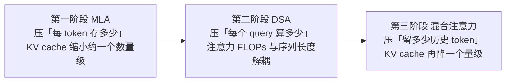

# 注意力机制演进：MLA、DSA 与混合注意力

> 中文简称：注意力机制演进：MLA、DSA 与混合注意力

> **一句话理解**: 长上下文推理的注意力负担由「每 token 存多少 × 留多少历史 × 算多少 token」三个量决定，MLA、DSA、混合注意力三代技术恰好各压一个——MLA 降「存的单价」，DSA 降「算的范围」，混合注意力降「存的总量」。

---

## 0. 主线：三代技术各压一个量

LLM 推理里注意力相关的开销可以拆成三个乘数：

**总负担 ≈ 每个 token 的 KV 存储量 × 需要保留的历史 token 数 × 每个 query 实际参与计算的 token 数**

| 阶段 | 技术 | 压哪个量 | 一句话 |
|------|------|----------|--------|
| 第一代 | **MLA**（DeepSeek-V2 起） | 每 token 存多少（存的单价） | 把 KV 压成低秩 latent「摘要卡」 |
| 第二代 | **DSA**（DeepSeek-V3.2-Exp 起） | 每个 query 算多少（算的范围） | indexer 挑 top-k，只算重点 |
| 第三代 | **混合注意力**（Qwen3-Next、Kimi Linear 等） | 留多少历史 token（存的总量） | 多数层用固定状态/滑窗，少存历史 |

三者不是三次推翻重来，而是三次「在上一代成果上继续砍」，层层叠加、可组合。

图解：箭头表示「叠加」而非「替代」——DSA 建立在 MLA 的 latent 表示之上，混合注意力里的全局层也可以继续用 MLA（如 Kimi Linear 就是 KDA + MLA）。

面试一句话口径：**「MLA 降存的单价、DSA 降算的范围、混合注意力降存的总量。」**

> 本文是口径版；实现细节、容量估算与引擎运维坑见深入版：[[10_部署推理/02_推理引擎/35_MLA_DSA_混合注意力_深入|MLA、DSA 与混合注意力：原理深入与引擎落地]]。

---

## 1. 关系澄清：MLA 与 DSA 是「配套」，不是「竞争」

1. **维度正交**：MLA 管「KV 怎么存」（表示层），DSA 管「算哪些 token」（计算层），解决的是两个不同瓶颈。
2. **叠加架构**：DeepSeek-V3.2 的完整架构 = MLA + DSA——KV cache 依旧以 MLA latent 形式存储，DSA 只是在其上叠加 indexer 打分和 top-k 门控。
3. **DSA 依赖 MLA**：DSA 不是 MHA/GQA 上的通用插件，它构建在 MLA 的 latent 表示之上；额外代价仅是缓存 indexer 的一小份 k cache。
4. **演进源头**：DSA 的前身是 NSA（Native Sparse Attention）论文，DSA 是其可训练、硬件对齐的生产落地版本。

一句话：**DSA 不是 MLA 的替代，而是构建在 MLA 之上的稀疏化扩展。**

---

## 2. 第一阶段 MLA——解决「存的贵」

1. **是什么**：Multi-head Latent Attention，DeepSeek-V2 提出，V3/R1 沿用。把每个 token 的 KV 联合压缩成一个低秩 latent 向量，注意力计算时从 latent 还原 K/V；RoPE 位置信息无法被压缩还原，单独用一小段「解耦维度」保留。
2. **效果**：KV cache 相比 MHA 缩小约一个数量级（V2 论文口径约 93%），直接缓解长上下文、大并发下的显存占用与访存带宽瓶颈。
3. **类比**：完整笔记 → 摘要卡片。每个 token 不再保存整页原文（K、V 两组完整向量），只存一张压缩摘要卡（latent 向量），用的时候从卡片还原细节。
4. **限制**：压的只是「每 token 的单价」——历史 token 还是一个不落全存、注意力还是对全部历史算一遍，上下文一长，计算量和总存储照样涨。

延伸：[[概念/Inference/kv-cache-mla|MLA 与 KV Cache 压缩]] · [[概念/Inference/flashmla|FlashMLA]] · [[概念/LLM/kv-cache|KV Cache]]

---

## 3. 第二阶段 DSA——解决「算得多」

1. **是什么**：DeepSeek Sparse Attention，DeepSeek-V3.2-Exp 引入。在 MLA 之上加一个轻量的 **lightning indexer**（打分器），为每一对「当前 query × 历史 token」算一个相关性分，每步只选 **top-k**（V3.2 设定约 2048 个）token 参与注意力计算，其余 token 跳过。
2. **效果**：注意力 FLOPs 与序列长度解耦、只与 top-k 成正比；官方口径整体推理成本约降一半。
3. **类比**：开卷考试不用重读全书——图书管理员（indexer）先扫一遍书脊标签，标出最相关的 top-k 页，你只翻这几页。索引本身很薄（小向量），翻页（注意力计算）才是大头。
4. **关键性质：省算不省存**——历史 latent 还是全量保存，显存占用基本没降，省的是计算量；甚至还要额外多存一份 indexer 的小 k cache。

延伸：[[概念/LLM/nsa-sparse-attention|NSA 稀疏注意力]] · [[概念/LLM/deepseek-series|DeepSeek 系列]]

---

## 4. 第三阶段 混合注意力——解决「存的总量」

1. **思路**：既然大部分历史 token 对当前输出的影响本来就很小，干脆**少存**——把模型多数层换成线性注意力（用一个固定大小的「状态」代替全部历史）或滑窗层（只留最近一段），只保留少数层做全注意力兜底全局依赖。
2. **效果**：KV cache 和长上下文成本再降一个量级；线性层的历史信息被压进固定大小的状态，显存不再随上下文线性增长。
3. **代表**：
   - **Qwen3-Next**：3:1 混合——每 4 层里 3 层 Gated DeltaNet（线性注意力的门控变体）+ 1 层门控全注意力。
   - **Kimi Linear**：KDA（Kimi Delta Attention）+ MLA，同样约 3:1——全局层继续吃 MLA 的低 KV 红利。
   - **MiniMax-01**：lightning attention（线性注意力变体）与 softmax 注意力混合。
4. **类比**：记账——最近的账留原文（滑窗/全注意力层），久远的账只记「累计余额」（线性注意力的固定状态），查总账不用翻每一笔流水。
5. **代价**：极长程依赖靠少数全局层兜底，理论上有精度风险；各家靠「多数局部 + 少数全局」的层配比来平衡。

---

## 5. 推理引擎视角（运维重点）

1. **DSA 支持以 MLA 后端为前提**：vLLM 和 SGLang 跑 DeepSeek V3.2 都是「MLA attention backend + indexer + top-k 选择」的组合，SGLang 的 NSA/DSA backend 就是在 MLA backend 上叠 indexer 实现的。面试关键句：**「vLLM/SGLang 的 DSA 支持都以 MLA 后端为前提。」**
2. **kernel 层**：DeepSeek 官方开源 FlashMLA（MLA 高效解码 kernel），并跟进发布了 DSA 稀疏 kernel；引擎实际走 FlashMLA 还是 FlashAttention 路径取决于引擎版本与硬件。
3. **容量规划影响**：DSA 不显著降显存（历史 KV 照存，还多一份 indexer cache），降的是算力与时延——显存容量仍按 KV cache 公式估算，收益体现在长上下文场景的吞吐与 TTFT/TPOT。
4. **混合架构模型的版本要求**：线性注意力层需要引擎专门适配（vLLM/SGLang 均已跟进 Qwen3-Next 类混合模型），部署前先确认引擎版本的支持矩阵。

延伸：[[10_部署推理/02_推理引擎/29_vLLM_深入分析|vLLM 深入分析]] · [[10_部署推理/02_推理引擎/23_SGLang_深入分析|SGLang 深入分析]] · [[10_部署推理/02_推理引擎/32_vLLM_SGLang_原理_零基础|vLLM 与 SGLang 原理：从零讲起]]

---

## 6. 三代对比速查

| 维度 | MLA | DSA | 混合注意力 |
|------|-----|-----|-----------|
| 解决什么 | KV cache 太大（存） | 注意力计算量太大（算） | 历史 KV 总量太大（总量） |
| 压哪个量 | 每 token 存储量 | 参与计算的 token 数 | 需保留的历史 token 数 |
| 代表 | DeepSeek-V2/V3/R1 | DeepSeek-V3.2-Exp | Qwen3-Next、Kimi Linear、MiniMax-01 |
| 类比 | 笔记记成摘要卡 | 图书管理员挑 top-k 页 | 旧账记总账、新账留原文 |
| 显存收益 | 约降一个数量级 | 几乎不降（还多 indexer cache） | 再降一个量级 |
| 计算收益 | 不直接降 | FLOPs 只与 top-k 成正比，约降一半 | 线性层近似常数开销 |
| 引擎前提 | MLA backend | MLA backend + indexer + top-k | 引擎需适配线性注意力层 |

---

## 7. 面试速答卡

**30 秒版本（三句话）**：

1. MLA 把每个 token 的 KV 压成低秩 latent，KV cache 缩小约一个数量级，解决「存的贵」。
2. DSA 在 MLA 之上加 lightning indexer 选 top-k token，注意力 FLOPs 与序列长度解耦，解决「算得多」——省算不省存。
3. 混合注意力更进一步，多数层换线性注意力/滑窗、只留少数全局层，直接减少要保存的历史 token 量，解决「存的总量」。

**常见追问预案**：

- 问「DSA 和 MLA 什么关系？」→ 配套扩展而非替代：MLA 管 KV 表示压缩，DSA 管稀疏计算，V3.2 = MLA + DSA 叠加。
- 问「DSA 省显存吗？」→ 不省——历史 KV 照存还多一份 indexer cache，省的是计算和时延，容量规划别指望它。
- 问「混合注意力为什么敢少存？」→ 大部分历史 token 对当前输出贡献很小，少数全局层兜底长程依赖，线性层用固定状态近似全部历史。

---

*Last updated: 2026-10-22*
