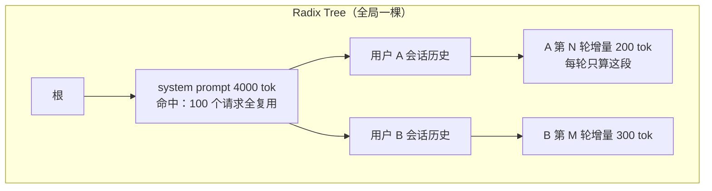

# 前缀缓存与 RadixAttention：从比喻到生产

> 中文简称：前缀缓存与 RadixAttention

> **一句话理解**: 相同前缀的 KV Cache 算出来必然一模一样（因果注意力决定的），所以「一样的开头只算一次」——RadixAttention 就是用一棵基数树把这个「只算一次」做到极致。

---

## 0. 主线：先记住一句话

前缀缓存是推理侧**性价比最高**的免费优化之一：不改模型、不改硬件，命中率 60%–85% 的业务里单次调用成本可降 5–12 倍。理解它只需要一个推导：

> **前缀相同 → KV Cache 逐位相同 → 算一次、大家复制。**

RadixAttention（SGLang 的招牌，论文 arXiv 2312.07104）回答的是后续两个工程问题：**怎么知道两个请求前缀相同**（radix tree 匹配），**缓存满了牺牲谁**（叶子 LRU 驱逐）。

---

## 1. 原理：为什么前缀可以共享

Transformer 的**因果注意力**决定：每个 token 的 K、V 向量只由「它自己 + 它前面的所有 token（含位置）」计算得到，与后面的内容无关。推论：

1. 只要两个请求的**前 N 个 token 完全一致**，这 N 个 token 的 KV Cache 必然**逐位相同**——不是「差不多」，是比特级一致，可以安全复用。
2. 复用只发生在 **prefill 阶段**：命中的前缀不再重算，decode（逐字生成）阶段速度不受影响。
3. 收益体现为 **TTFT 下降**（省掉大部分 prefill）+ **算力释放**（省下的算力去服务更多请求，吞吐上升）。

### 前缀从哪来？（五大来源）

| 来源 | 典型样子 | 共享范围 |
|------|----------|----------|
| System prompt | 所有用户共用同一套几 k token 的模板 | 全服务级共享 |
| Few-shot 示例 | 提示词里固定的示例段落 | 同一应用共享 |
| RAG 文档 | 同一篇长文档被塞进多个不同问题 | 同文档的请求共享 |
| 多轮对话 | 每轮重发全部历史，只有末尾一句是新的 | 同会话逐轮共享 |
| Agent 循环 | 同一个大 prompt 循环调用几十次 | 同任务内共享 |

多轮对话和 Agent 是收益最大的场景：**历史滚雪球，每轮真正要算的只有最新那一小段**。

延伸：[[概念/LLM/kv-cache|KV Cache]] · [[概念/Inference/prefix-caching|Prefix Caching]] · [[概念/Inference/ttft|TTFT]]

---

## 2. 比喻：助教的笔记本

你和客服机器人聊了 10 轮，每轮发给模型的是「全部聊天记录 + 新消息」。

- **没有前缀缓存**：第 10 轮来了，模型要把前 9 轮历史从头重新「读一遍、消化一遍」——越靠前的历史被重复计算的次数越多。
- **有前缀缓存**：把模型想成一个**记笔记的助教**。前 9 轮它早就读过、笔记写在了本子上（KV Cache）。第 10 轮来了，翻开笔记本接着用，只认真读新加的那句话。

算一笔账（第 10 轮，历史 8000 token，新消息 200 token）：

| | 无前缀缓存 | 有前缀缓存 |
|---|---|---|
| 每轮 prefill 计算量 | 8200 token | 约 200 token |
| 相对节省 | — | **约 97.6%** |
| TTFT | 随历史变长越来越差 | 基本恒定 |

再看全服务级：100 个请求共享同一段 4000 token 的 system prompt，无缓存就是 40 万 token 的重复 prefill——这就是「命中率 60%–85% 时成本降 5–12 倍」的来源。

---

## 3. 为什么要用「树」来管理

前缀不是只「完全重合」，还会**中途分叉**。像文件系统的目录树：`/usr/local/bin` 和 `/usr/local/share` 共享 `/usr/local`，文件系统不会把它存两遍。

```
（根）
 └─ system prompt（公共树干，只算 1 次）
     ├─ 用户 A 的对话历史
     │   ├─ "帮我总结一下"      ← A 第 1 轮，在此分叉
     │   └─ "翻译成英文"        ← A 第 2 轮，长在上一轮之下
     └─ 用户 B 的对话历史
         └─ "帮我改这段代码"    ← B 第 1 轮，另一条分支
```

新请求从根往下走：**能匹配到哪一层，就复用到哪一层，只算最后分叉出去的一小段**。这带来三个朴素哈希表做不到的能力：

1. **任意中间节点都可复用**——两个请求哪怕只在「树干中段」重叠，重叠部分照样共享；
2. **多轮对话天然成树**——第 N 轮的完整 prompt 恰好是第 N−1 轮 prompt 的延长线，自动长在祖先节点下；
3. **淘汰不伤树干**——显存吃紧时从**叶子**往上按 LRU 驱逐，热门的公共树干（那个几千 token 的 system prompt）留在树上继续服务所有人。



图解：树干只算一次、逐轮只算增量；驱逐从叶子（A1、B1）开始，树干（SP）最后被动。

延伸：[[概念/LLM/radix-attention|RadixAttention 概念卡]] · [[概念/LLM/paged-attention|PagedAttention]]

---

## 4. RadixAttention 运行时机制（面试深度区）

SGLang 里这块缓存叫 **RadixCache**（默认开启，无需配置），围绕一棵 radix tree（压缩前缀树：一条边存一段 token 序列，公共部分不重复存储）做四个动作：

1. **匹配（match_prefix）**：请求到达，token 序列从根走树，返回「最长匹配前缀 + 对应 KV 块」。未命中的尾部进入正常 prefill。
2. **插入**：请求结束后，把这条 prompt + 已生成部分的 KV 挂回树上，供后续请求复用（注意：**连已生成的回答也进了树**——它正是下一轮对话的前缀，这是多轮场景的核心）。
3. **引用计数**：正在运行（及等待中）的请求锁住自己路径上的所有节点，防止被驱逐——不会出现「算到一半底座被抽走」。
4. **驱逐**：显存不够时，从**叶子**开始按 LRU 淘汰；树干因被多条路径引用，天然比叶子活得久。

与底层显存的关系：KV 实体放在**分页式 token 池**里（与 vLLM 的 PagedAttention 同思想），radix tree 只维护「token 前缀 → 池中物理块」的映射——**PagedAttention 解决「一块 KV 怎么存」，前缀缓存解决「哪些 KV 可以共享」，正交互补**。

---

## 5. SGLang vs vLLM：同一件事的两个实现

| | SGLang（RadixAttention） | vLLM（APC，Automatic Prefix Caching） |
|---|---|---|
| 数据结构 | 全局一棵 radix tree | 块级**哈希链**（每块哈希含前块哈希，形成链式索引） |
| 匹配方式 | 逐 token 走树，任意深度命中 | 逐块哈希比对，需对齐到完整 block |
| 开启方式 | 默认开启 | v0 需 `--enable-prefix-caching`；V1（v0.8+）起默认开启 |
| 多轮/分支场景 | 树结构天然表达 fork（并行采样、tree search 各分支共享祖先） | 哈希链只索引「从头开始的完整块序列」，中间分叉表达不如树直接 |
| 业界口径 | 多轮对话、Agent 等动态场景快 10%–20% | 生态最大，通用部署 |

两点口径澄清（避免面试说错）：

- **vLLM 并非不能共享部分前缀**——哈希链也能匹配到任意深度；真实差异在**粒度**（块对齐 vs 逐 token）与**分支表达**（链 vs 树），以及淘汰策略的实现优雅度。
- 两者**殊途同归**：vLLM 后来也在向 trie 类结构演化；面试时说「思路同源、实现路径不同」最稳。

### 两个生产级加分项

1. **Cache-aware 路由**：多实例部署时，SGLang 的 router 按「最长前缀匹配 + 负载水位」选实例——同一会话的请求被粘到已持有其 KV 的实例上，命中率从「单机视角」提升到「集群视角」。
2. **HiCache（层级缓存）**：显存放不下的前缀 KV 溢出到主机内存/本地盘，命中冷前缀时从下层搬回——把「缓存容量」从几十 GB 扩到 TB 级，超长 system prompt 场景收益明显。

延伸：[[概念/Inference/sglang|SGLang]] · [[概念/LLM/vllm|vLLM]]

---

## 6. 生产视角：什么时候灵、什么时候失效

**灵**（命中率高的特征）：system prompt 统一且稳定、模板在提示词最前面、多轮会话连续打到同一实例。

**失效**（典型五连坑，详见故障手册）：

1. **前缀各异**——每个请求开头都不同（随机 ID、时间戳放最前），命中率趋近 0，缓存还白白占显存；
2. **一字之差全失效**——改了 system prompt 里一个标点，整棵子树作废；模板要改就全量切；
3. **被挤掉**——并发洪峰把池子打满，冷前缀按 LRU 被驱逐，命中率随流量波动；
4. **重启即失**——KV Cache 在显存里，实例重启/扩容后缓存从零开始预热；
5. **中间共享不算**——共享段不在开头时，因左侧上下文不同，KV 不同，无法复用。

**观测口径**：SGLang 日志的 `#cached-token` / 总 prefill token 即命中率；vLLM 暴露 prefix cache hits/queries 指标。运维上把「前缀命中率」当作和 TTFT、KV 利用率同级的日常巡检指标。

延伸：[[10_部署推理/02_推理引擎/FTA/推理/FTA_vLLM_SGLang_Prefix_Caching_失效|FTA：Prefix Caching 失效排查]]

---

## 7. 面试快问快答

1. **为什么相同前缀的 KV 一定相同？** 因果注意力：token 的 KV 只依赖它之前的 token 和自身位置，与后面内容无关；前缀相同 ⇒ 逐位相同，复用无损。
2. **为什么必须从第 0 个 token 开始共享？** KV 依赖全部左侧上下文与绝对位置；中段相同但左边不同 ⇒ KV 不同。所以是「前缀」缓存，不是「任意子串」缓存。
3. **RadixAttention 比朴素哈希表好在哪？** 树按分叉点组织，任意中间节点可复用、可单独驱逐；叶子 LRU 保住热门树干；引用计数保护运行中请求。
4. **vLLM 的对应机制？** APC：块级哈希链匹配（每块哈希含前块哈希）；v0 需手动开启，V1 起默认开启。
5. **命中前缀缓存，哪个指标改善？** TTFT 大幅下降（省 prefill）；decode 速度不变；省下的算力推高吞吐。
6. **和 PagedAttention 什么关系？** 正交互补：PagedAttention 管「KV 怎么存」（物理分页），前缀缓存管「哪些 KV 可共享」（逻辑复用）；SGLang 的 token 池同样是分页式。
7. **缓存满了怎么办？** 从叶子按 LRU 驱逐；运行中请求路径有引用计数保护；SGLang 还可用 HiCache 溢出到主机内存。
8. **多实例部署怎么进一步提高命中率？** cache-aware 路由：按最长前缀匹配 + 负载选实例，让同会话粘住同一实例。
9. **什么场景收益最大 / 最小？** 最大：多轮对话、Agent 循环、统一 system prompt、RAG 同文档多问；最小：前缀各异的短请求（还倒贴内存和匹配开销）。
10. **一句话总结口径**：「因果注意力决定了相同前缀的 KV 必然相同，前缀缓存就是把它变成共享只读；SGLang 用 radix tree 做到逐 token 匹配与按叶驱逐，vLLM 用块哈希链殊途同归。」

---

## 8. 术语速查表

| 术语 | 大白话 |
|---|---|
| 前缀（prefix） | 输入序列开头那段公共部分，共享必须从第 0 个 token 算起 |
| 前缀缓存 | 公共开头的 KV Cache 只算一次，大家复用 |
| RadixAttention / RadixCache | SGLang 用基数树组织全局前缀缓存的实现（默认开启） |
| radix tree（基数树） | 压缩前缀树：一条边存一段 token，公共前缀不重复存储 |
| match_prefix | 请求到达时走树找最长命中前缀的动作 |
| 引用计数 | 运行中请求锁住自己路径上的节点，防止被驱逐 |
| 叶子 LRU | 缓存淘汰策略：从最久未用的叶子开始赶，树干留到最后 |
| APC | vLLM 的 Automatic Prefix Caching，块级哈希链实现 |
| cache-aware 路由 | 按「最长前缀匹配 + 负载」把请求发给命中率最高的实例 |
| HiCache | SGLang 层级缓存：显存不够时把前缀 KV 溢出到主机内存/本地盘 |

---

## 相关页面

- [[10_部署推理/02_推理引擎/32_vLLM_SGLang_原理_零基础|32 vLLM 与 SGLang 原理：从零讲起]] — 本篇的零基础前置，第七步就是本文的预告片
- [[10_部署推理/02_推理引擎/33_注意力机制演进_MLA_DSA_混合注意力|33 注意力机制演进：MLA、DSA 与混合注意力]] — 姊妹篇：从「存」的维度压缩 KV Cache
- [[10_部署推理/02_推理引擎/30_vLLM_Paged注意力_架构|30 vLLM + PagedAttention 架构图]] — 「KV 怎么存」那一半的图解
- [[10_部署推理/02_推理引擎/23_SGLang_深入分析|23 SGLang 深入分析]] — SGLang 生产级全景
- [[10_部署推理/02_推理引擎/FTA/推理/FTA_vLLM_SGLang_Prefix_Caching_失效|FTA：Prefix Caching 失效]] — 命中率掉了的排查手册
- [[概念/LLM/radix-attention|RadixAttention 概念卡]] · [[概念/Inference/prefix-caching|Prefix Caching 概念卡]] · [[概念/LLM/kv-cache|KV Cache 概念卡]]

---

*Last updated: 2026-10-22*
