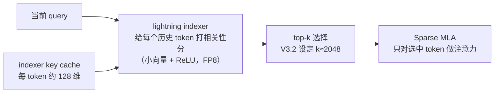

# MLA、DSA 与混合注意力：原理深入与引擎落地

> 中文简称：MLA、DSA 与混合注意力：原理深入与引擎落地

> **一句话理解**: 33 号页给了「三代各压一个量」的面试口径，本文往下挖一层——MLA 怎么压（latent + 矩阵吸收）、DSA 怎么选（lightning indexer + top-k）、混合注意力用什么代替全注意力（线性状态/滑窗），以及这些东西落到 vLLM/SGLang 里长什么样、运维要盯什么。

---

## 0. 本文与 33 号页的关系

主线口径（必背）见 [[10_部署推理/02_推理引擎/33_注意力机制演进_MLA_DSA_混合注意力|注意力机制演进：MLA、DSA 与混合注意力]]：**MLA 降「存的单价」、DSA 降「算的范围」、混合注意力降「存的总量」**。本文按同样的顺序展开实现细节，每节末尾给「面试一句话」，可独立背。

---

## 1. MLA 深入：latent 压缩与矩阵吸收

### 1.1 缓存里到底存了什么

1. 每个 token 不存每个头各自的 K、V，而是存**一份全头共享的低秩 latent** `c_KV`（512 维）+ **一小段 RoPE 专用键** `k_R`（64 维），合计约 **576 维/层**。
2. 查询侧同样先投影到 latent；推理时通过**矩阵吸收**（把上投影矩阵 W_UK 并进 W_UQ，或在 kernel 里隐式还原）直接从 latent 算注意力分数，**全程不物化每个头的完整 K**。
3. RoPE 是位置相关的旋转、无法塞进可吸收的静态矩阵，所以单独留 64 维「解耦」处理——这就是 V2 论文说的 decoupled RoPE。

> **类比**: 别人交作业交整本原文（K、V），MLA 只交一份「压缩摘要 + 一页页码批注（RoPE 键）」，要核对细节时按摘要还原——还原公式是固定的线性变换，可以提前「折」进查询侧的账本里。

### 1.2 各方案每 token KV 容量对比（以 DeepSeek-V3 配置估算）

配置口径：61 层、128 头 × 128 维、MLA latent 512 + 64。单位：每 token、全层合计。

| 方案 | 每 token 维度 | FP16 容量 | 备注 |
|------|--------------|-----------|------|
| MHA（128 KV 头） | 约 200 万维 | 约 4 MB | 质量基线，容量不可接受 |
| GQA-8 | 约 12.5 万维 | 约 250 KB | 主流折中，质量有损 |
| MQA（1 KV 头） | 约 1.56 万维 | 约 31 KB | 容量最小，质量损失明显 |
| **MLA** | 约 3.5 万维 | **约 70 KB**（FP8 约 34 KB） | 接近 MQA 的容量、不缩水的质量 |

要点：**MLA 的解码形态像 MQA**——所有头读同一份小 latent，所以 FlashMLA 这类 kernel 才能高效；质量上靠学出来的 latent 恢复接近 MHA 的表达，避开了 GQA 的精度折扣。V2 论文口径 KV cache 相比 MHA 减少约 93%。

### 1.3 两条计算路径：吸收 vs 非吸收

1. **decode 用吸收路径**：显存带宽是瓶颈，直接读 576 维 latent 最省——这是 FlashMLA 优化的形态。
2. **prefill 可用非吸收路径**：prefill 是计算密集，吸收会引入额外 FLOPs；先还原出显式 K/V 再走常规批量注意力反而更快。
3. 这就是 vLLM/SGLang 里 MLA backend 有多条 kernel 路径（FlashMLA、FlashAttention、Triton 等）的原因——本质是这两条路线的不同实现与取舍。

> **面试一句话**: 「MLA 解码快是因为矩阵吸收让注意力只读一份 576 维的共享 latent，形态像 MQA；prefill 计算密集时反而会走非吸收路径，vLLM/SGLang 的多条 MLA kernel 就对应这两种路线。」

延伸：[[概念/Inference/kv-cache-mla|MLA 与 KV Cache 压缩]] · [[概念/Inference/flashmla|FlashMLA]] · [[概念/LLM/grouped-query-attention|GQA]]

---

## 2. DSA 深入：lightning indexer 与 top-k 稀疏

### 2.1 计算流水线

图解：主注意力（Sparse MLA）之外只多两样东西——一份很薄的 indexer key cache（每 token 约 128 维，FP8 存储）和一次 top-k 选择；打分不进主注意力，只决定「算谁」。

### 2.2 四个关键机制

1. **打分便宜**：indexer 用小维度向量（每 token 约 128 维 key，FP8），对每个「query × 历史 token」算加权 ReLU 分——相比主注意力的 latent 读放大，开销是零头。
2. **top-k = 2048**：从整段历史挑 2048 个 token 参与 Sparse MLA。推论：**上下文不超过 2048 时 DSA 没有收益**（等于全算），还白付 indexer 开销——DSA 是长上下文技术。
3. **训练时即稀疏**：V3.2 是在 V3.1-Base 上**继续预训练**让模型适应 top-k 稀疏工作的；NSA 论文的核心贡献就是「可训练、硬件对齐」的稀疏方案。**不能把稠密 checkpoint 直接套 DSA 推理**——它是模型架构，不是推理补丁。
4. **省算不省存**：主 KV（MLA latent）照存，还多一份 indexer cache；降的是注意力 FLOPs 与解码时延。官方口径整体推理成本约降一半（V3.2 API 降价的依据）。

### 2.3 vLLM 的 IndexCache：给 indexer 也做前缀缓存

1. DSA 场景下同一前缀的 top-k 选择结果在多层间高度重叠，vLLM 的 **IndexCache** 跨层缓存并复用 indexer 的 top-k 索引——相当于「给 indexer 做 prefix caching」。
2. 效果：命中前缀的请求不再重算 indexer 打分，prefix caching 与 DSA 可以叠加吃收益。
3. 除 DeepSeek V3.2 外，社区 roadmap 显示 GLM-5 等新一代模型也采用 DSA 类架构——这已经不是单家模型的特例，而是长上下文架构方向。

> **面试一句话**: 「DSA = indexer 打分 + top-k 选择 + 稀疏注意力三件套；它是训练时就内建的稀疏（V3.2 靠继续预训练适配），推理侧省算不省存，vLLM 用 IndexCache 把 indexer 的选择结果也做了前缀复用。」

延伸：[[概念/LLM/nsa-sparse-attention|NSA 稀疏注意力]] · [[概念/LLM/deepseek-series|DeepSeek 系列]]

---

## 3. 混合注意力深入：三条技术路线

### 3.1 谱系与代表

| 路线 | 机制 | 代表模型 | 配比（局部 : 全局） |
|------|------|----------|--------------------|
| 线性注意力 / DeltaNet 系 | 固定大小状态递推（形似 RNN，测试时学习式更新） | Qwen3-Next（Gated DeltaNet）、Kimi Linear（KDA + MLA） | 3 : 1 |
| 滑窗系 | 多数层只看最近窗口，少数层全局 | Gemma 2/3 | 约 5 : 1 |
| SSM / Mamba 混系 | 状态空间模型层与注意力层交替 | Jamba、Zamba | 注意力约 1 : 7 |
| 线性注意力（自研变体） | lightning attention 线性化 | MiniMax-01 | 约 7 : 1 |

### 3.2 为什么「多数局部 + 少数全局」成立

1. 经验结论：大多数层只需要局部感受野，真正承载长程检索能力的是少数层——把全局配额集中给这几层即可。
2. 线性层把全部历史压进**固定大小状态**：显存不随上下文涨，代价是「精确回溯某个早期 token」的能力弱（状态是有损压缩）——所以必须留全局层兜底。
3. 收益（官方口径，仅作量级参考）：Qwen3-Next 在 32K 以上上下文吞吐约 10 倍于同级稠密模型；Kimi Linear KV cache 最大降 63%、长序列解码吞吐最高约 6 倍。

### 3.3 面试要点

1. 三条路线殊途同归：**把「保留全部历史 KV」改成「有损压缩历史」**，差异只在压缩器是学出来的状态（DeltaNet/SSM）还是硬窗口（滑窗）。
2. 可与前两代叠加：Kimi Linear 的全局层继续用 MLA（吃 latent 红利）；概念上全局层也可以再配 DSA 类稀疏。
3. 代价：线性层对精确检索弱，需要全局层兜底；引擎必须适配线性注意力 kernel，部署前确认版本支持矩阵。

> **面试一句话**: 「混合注意力把『存全部历史』换成『有损压缩历史』——线性层用固定状态近似、滑窗层只留局部，少数全局层兜底长程依赖，KV cache 再降一个量级。」

---

## 4. 引擎落地与运维检查清单

### 4.1 vLLM 侧

1. DeepSeek V3.2 为 **day-0 支持**（2025-09-29）：lightning indexer cache 与 KV cache 分开管理，prefill / decode 各有稀疏路径。
2. **IndexCache** 跨层复用 top-k 索引、命中前缀免重算 indexer——确认该特性在所用版本已启用。
3. 容量估算照旧按 KV cache 公式（见 4.3），DSA 不改变显存大头。

### 4.2 SGLang 侧

1. 同为 day-0（NSA backend，2025-09-29）；V3.2 会**自动选择 `dsa` backend**。
2. kernel 选择参数经历从 `--nsa-prefill-backend` / `--nsa-decode-backend` 到 `--dsa-prefill-backend` / `--dsa-decode-backend` 的演进，可选值含 `flashmla_sparse`、`fa3`、`tile` 等——**以所用版本文档为准**。
3. 投机解码与 NSA backend 的兼容性在持续完善（官方 roadmap 跟踪项），开启 MTP 前先核对 release notes。

### 4.3 容量估算（V3.2 口径，可直接背）

以 DeepSeek-V3 配置（61 层、latent 512 + 64、FP8 KV）估算：

- 每 token KV ≈ (576 + 128) 维 × 61 层 × 1 B ≈ **约 42 KB/token**（其中 indexer 约 8 KB）
- 32K 上下文单请求 ≈ 42 KB × 32768 ≈ **约 1.3 GB**
- 对比：同配置 MHA FP16 约 4 MB/token，32K 单请求约 **125 GB**——差约百倍，这就是「存的单价」被 MLA 压掉的部分

### 4.4 运维坑清单

1. **别指望 DSA 省显存**：容量规划仍按 KV cache 公式，DSA 降的是算力与时延；短上下文（≤2048）场景收益为零。
2. **kernel 与硬件匹配**：`flashmla_sparse` 等 kernel 主要面向 Hopper（SM90）优化，旧卡上可能直接报错或崩溃——上线前按 GPU 型号做冒烟测试。
3. **前缀缓存一致性**：indexer 引入了自己的缓存层（vLLM IndexCache、SGLang 对应机制），升级引擎版本时注意 release notes 中相关行为变化。
4. **混合架构模型**（Qwen3-Next 类）：线性注意力层需要引擎专门适配，TP/EP 并行配置按模型卡推荐，不要套用稠密模型经验。
5. **监控面**：DSA 下注意力不再是主要时延来源，排障重心转向 indexer、top-k gather 和 MoE 路由——FTA 里「解码延迟高」的归因树要相应调整。

延伸：[[10_部署推理/02_推理引擎/29_vLLM_深入分析|vLLM 深入分析]] · [[10_部署推理/02_推理引擎/23_SGLang_深入分析|SGLang 深入分析]] · [[10_部署推理/02_推理引擎/FTA/README|FTA 故障树索引]]

---

## 5. 面试深挖追问（进阶）

| 追问 | 一句话答案 |
|------|-----------|
| 为什么 MLA 解码形态像 MQA？ | 矩阵吸收后所有头从同一份 576 维 latent 读，读宽与头数解耦。 |
| 为什么不能给稠密模型直接套 DSA？ | DSA 是训练内建的稀疏架构（V3.2 靠继续预训练适配），推理时后加会掉点。 |
| DSA 与推理时事后稀疏（Quest/H2O 类）的区别？ | DSA 有专用 indexer 且模型训练时就适应 top-k；事后稀疏是推理近似，误差不可控。 |
| top-k 怎么权衡？ | k 越大召回越充分、成本越高；2048 是官方选的质量/成本平衡点，上下文短于 k 时无收益。 |
| MLA 为什么 prefill 走非吸收？ | prefill 计算密集，吸收引入额外 FLOPs；显式 K/V 的批量注意力对算力更友好。 |
| 三代能叠加吗？ | 能——Kimi Linear = KDA + MLA，概念上全局层还可配 DSA；层层叠加是演进主线。 |
| IndexCache 解决什么？ | 给 indexer 的 top-k 选择做跨层复用与前缀缓存，避免命中前缀时重复打分。 |

---

## 6. 参考资料（外部）

- [DeepSeek-V3.2-Exp in vLLM: Fine-Grained Sparse Attention](https://vllm.ai/blog/2025-09-29-deepseek-v3-2)（vLLM 官方博客，2025-09-29）
- [IndexCache — vLLM 文档](https://docs.vllm.ai/en/latest/features/index_cache)
- [SGLang Day-0 支持 DeepSeek-V3.2（NSA backend）](https://www.lmsys.org/blog/2025-09-29-deepseek-V32)（LMSYS，2025-09-29）
- [SGLang Attention Backend 文档](https://sgl-project.github.io/advanced_features/attention_backend.html)
- [DeepSeek-V3.2-Exp on vLLM, Day 0](https://developers.redhat.com/articles/2025-10/03/deepseek-v32-exp-vllm-day-0-sparse-attention-long-context-inference)（Red Hat Developers）
- [DeepSeek-V3.2-Exp 模型卡](https://huggingface.co/deepseek-ai/DeepSeek-V3.2-Exp)（Hugging Face）
- [SGLang DeepSeek V3.2 优化 roadmap（含 GLM-5）](https://github.com/sgl-project/sglang/issues/15025)

---

*Last updated: 2026-10-22*
