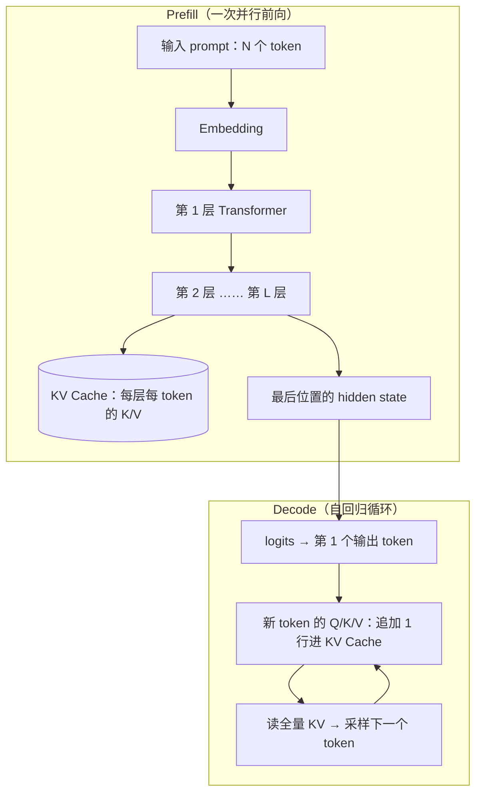

# Prefill 与 KV Cache：填充机制深度解析

> 中文简称：Prefill 与 KV Cache 填充机制

> **一句话理解**: Prefill 用「整段输入 prompt」做一次并行前向计算，把每个 token 在每一层的 Key、Value 向量「填」进 KV Cache——填的是整个推理过程都要反复读取的「中间态笔记」，填完才吐出第一个字。

---

## 0. 主线：三个直问直答

先把核心问题钉死，后面全部展开都挂在这三问上：

1. **Prefill 用什么填？** —— 用整段输入 prompt（token 序列），对模型跑一次（长 prompt 时分块跑多次）前向计算。
2. **填的是什么？** —— KV Cache：每个输入 token 在**每一层** attention 里的 Key、Value 两组向量。
3. **为什么要先填？** —— 自回归生成每一步都要「看全部历史」；先一次算好历史的 K/V，之后每步只算新 token 的增量，不用反复重算。

延伸：[[概念/Inference/prefill-decode|Prefill 与 Decode 概念卡]] · [[概念/LLM/kv-cache|KV Cache 概念卡]]。

---

## 1. 精确回答：Prefill 填的到底是什么

### 1.1 从 attention 的依赖说起

Transformer 每一层 attention 里，每个 token 都有三组投影：Query、Key、Value。生成第 t+1 个 token 时，attention 需要「全部历史 token 的 K/V」来打分。关键观察：

- 历史 token 的 K/V **只由历史本身决定**，不随生成推进而变化；
- 所以算一次、存起来，全程复用——这份存储就是 KV Cache。

### 1.2 KV Cache 的精确结构

对每一层，KV Cache 形状大致是：

```text
[num_layers] × 2(K/V) × [seq_len] × [num_kv_heads] × [head_dim]
```

- `num_layers`：几十到上百层，每层各存一份；
- `num_kv_heads`：MHA 等于总头数，GQA 是 8～16，MQA 是 1（见第 10 节）；
- Prefill 阶段一次写入 `seq_len = prompt 长度` 这么多行；Decode 阶段每步只追加 1 行。

### 1.3 Prefill 的副产品：第一个 token

Prefill 的前向除了写 KV Cache，还会输出**最后一个位置**的 hidden state → logits → 采样出第一个输出 token。所以：

> **Prefill 完成 ≈ 首 token 就绪。** TTFT（首 token 延迟）的主体就是 prefill（加上排队时间），见第 6 节。

### 1.4 两个必须分清的性质

- **KV Cache 不是 vLLM 的发明**，是 Transformer 自回归推理的固有机制，所有引擎都有；vLLM 解决的是它的「存放」问题（[[概念/LLM/paged-attention|PagedAttention]]）。
- **KV Cache 不改变输出结果**——不缓存、每步重算，结果一样，只是慢数百倍。它是性能组件而非正确性组件（极端场景下甚至有「重算换显存」的玩法，但常规负载不可接受）。

类比：考试先通读整道题、把要点记在草稿纸（prefill + KV Cache）；之后每写一个字只需看草稿纸（decode），不用重读题目。

---

## 2. 算得出来：KV Cache 显存公式与实例

面试高频题「KV Cache 多大」必须能现场算：

```text
每 token KV 大小 = 2(K/V) × num_layers × num_kv_heads × head_dim × 每元素字节数
总大小 = 每 token 大小 × seq_len × batch
```

以 Llama-3-70B（FP16/BF16）为例：80 层 × 2 × 8 个 KV 头 × 128 维 × 2 B ≈ **320 KB/token**：

| 上下文长度 | 单请求 KV Cache（Llama-3-70B） |
|------------|-------------------------------|
| 8K | ≈ 2.6 GB |
| 32K | ≈ 10.5 GB |
| 128K | ≈ 42 GB |

对比 MLA（DeepSeek-V3，61 层，latent 512 + 64）：每 token 约 **70 KB**，128K 约 9 GB；若按 MHA 等效（128 头 × 128 维）则约 4 MB/token，压缩约 57 倍。口径细节见 [[10_部署推理/02_推理引擎/35_MLA_DSA_混合注意力_深入|35 号 MLA 深入]]。

**为什么这个公式重要**：模型权重是固定开销，KV Cache 才是随「人数 × 轮次 × 上下文」线性膨胀的部分——它决定同一张卡能塞下多少并发（batch 上限）。推理优化的两大主线由此分岔：

- 管「放」：PagedAttention 分页管理、prefix cache 复用；
- 管「省」：GQA/MLA 架构压缩、KV 量化、稀疏注意力（第 10 节）。

延伸：[[概念/LLM/kv-cache-compression|KV Cache 压缩]] · [[概念/Inference/kv-cache-mla|MLA 的 KV Cache]]。

---

## 3. 为什么必须先 Prefill：重算灾难

假设没有 KV Cache，decode 每生成一个 token 都要把「prompt + 已生成部分」全部重新过一遍 K/V 投影和 attention：

- 1000 token 输入、生成 500 token：第 t 步要重算约 `1000 + t` 个 token，总计约 **62.5 万 token·次投影**；
- 有 KV Cache 时：prefill 1000 + decode 500 = **1500 token·次投影**。

冗余约 **400 倍**，而且 attention 打分本身也从「增量」退化成「每步从零」。这就是「为什么要先填」的定量答案：**一次填满，全程增量**。

> 推论：多轮对话、Agent 工具回填、每次追加上下文都会触发**新一轮 prefill**——这正是 prefix caching 存在的理由（第 8 节）。

---

## 4. Prefill 为什么快、Decode 为什么慢：Roofline 一把抓

### 4.1 一个指标：算术强度

```text
算术强度 AI = 计算量 FLOPs / 访存量 Bytes
```

硬件有一个分水岭（ridge point）：H100 BF16 约 **300 FLOP/Byte**（989 TFLOPS ÷ 3.35 TB/s），A100 约 **150**。AI 高于它 → compute-bound（算力是瓶颈），低于 → memory-bound（带宽是瓶颈）。

### 4.2 两相各自落在哪边

- **Prefill（一次并行算 4096 个 token）**：计算量 ≈ `2 × 70B 参数 × 4096`，而权重只读一次，AI ≈ **4096**，远超 ridge → **compute-bound**，GPU 算力被喂饱。
- **Decode（batch=1，一次算 1 个 token）**：计算量 ≈ `2 × 70B`，但要搬全部 140 GB 权重 + 全部 KV，AI ≈ **1**，远低于 ridge → **memory-bound**，GPU「忙在搬内存」，算力大量闲置。

> batch 是 decode 的救兵：AI 近似随 batch 线性放大，batch 数百时 decode 也会逼近 compute-bound——这就是大 batch 提吞吐、但 ITL 变差的根源。

### 4.3 对比总表

| 维度 | Prefill | Decode |
|------|---------|--------|
| 一次处理 | 整段 prompt（N 个 token 并行） | 1 个新 token（batch 内 B 个并行） |
| 计算形态 | 大 GEMM（矩阵 × 矩阵） | GEMV 为主（矩阵 × 向量） |
| 算术强度 | 数千 FLOP/Byte | ≈ 1 FLOP/Byte（batch=1） |
| 瓶颈 | Compute-bound | Memory-bound（权重 + KV 读取） |
| 典型 kernel | FlashAttention（分块，防 N² 矩阵爆显存） | FlashDecoding、PagedAttention（按页读 KV） |
| 决定指标 | TTFT | TPOT / ITL / 吞吐 |
| 优化抓手 | 算力与 kernel、chunked prefill、prefix cache | 带宽、batch、KV 压缩、投机解码 |

一句话推论：**加速 prefill 靠算力与 kernel，加速 decode 靠带宽与减 KV**。这直接解释了第 9 节 PD 为什么要分开部署。

延伸：[[概念/Inference/flash-attn|FlashAttention]] · [[概念/Inference/continuous-batching|Continuous Batching]]。

---

## 5. 一张图：Prefill → KV Cache → Decode 循环



图意：prefill 一次把 N 个 token 的 K/V 写满缓存并顺手吐出首 token；decode 每轮只算新 token 的 Q/K/V「追加一行」，再读全量缓存出下一个字——**写入是批量的，追加是逐字的**，这就是两个阶段一切差异的来源。

---

## 6. 指标归因：TTFT 与 TPOT 各归谁管

| 指标 | 含义 | 主要由谁决定 |
|------|------|--------------|
| TTFT | 请求发出到首 token 出现 | 排队时间 + **prefill 时长**（prefix cache 命中可大幅缩短） |
| TPOT / ITL | 平均每 token 间隔 | **decode 步长**（带宽、batch、KV 读取量） |
| 吞吐 | 系统 token/s | prefill 与 decode 混合调度效率（prefill tokens/s 与 decode tokens/s 通常分开统计） |

工程含义：压 TTFT 就去优化 prefill 路径（更快的 kernel、prefix cache、更高 prefill 优先级）；保流畅就去优化 decode（KV 压缩、投机解码、控 batch）。两者在混部时会互相抢资源——这是接下来三节所有「工程问题」的总根源。

延伸：[[概念/Inference/ttft|TTFT 概念卡]]。

---

## 7. 工程优化一：Chunked Prefill——把一次填切成多次填

**问题**：一个 32K prompt 的 prefill 要独占 GPU 秒级时间，同卡的 decode 请求全部停摆，用户看到 ITL 尖刺（打字「卡一下」）。不切的话，长 prefill 前后还容易留出 GPU 空泡。

**机制**：把长 prompt 按 chunk（如 8192 token）切块，逐块前向、逐块填 KV；同时把等待中的 decode token「搭车」进每个 chunk 的 batch 里混合调度。这个「stall-free batching」思路来自 Sarathi-Serve（OSDI'24）。

**配置**：

- vLLM：V1 引擎默认开启（`--max-num-batched-tokens` 典型 8192）；V0 需 `--enable-chunked-prefill`。
- SGLang：`--chunked-prefill-size` 默认约 8192，设 `-1` 关闭。

**取舍**：

| chunk 大小 | 单请求 TTFT | 在途请求 ITL | 总吞吐 |
|------------|-------------|--------------|--------|
| 大 / 关闭 chunked | 单请求最快 | 长 prompt 垄断，尖刺明显 | 混批差 |
| 小 | 单请求变慢 | 最平滑 | 混批好，kernel 效率略降 |
| 典型 8192 | 折中 | 平稳 | 引擎默认甜点 |

延伸：[[概念/Inference/chunked-prefill-plain|Chunked Prefill 概念卡]]。

---

## 8. 工程优化二：Prefix Caching——相同前缀不重填

**原理一行**：因果注意力决定了「前缀相同 → KV Cache 逐位相同」→ 算一次、大家复用。

- **vLLM**：Automatic Prefix Caching，按 block 对 token 序列做哈希链匹配 + LRU 淘汰，V1 默认开启。
- **SGLang**：RadixAttention，用基数树管理所有请求的 KV 前缀，最长前缀匹配 + LRU 淘汰，默认开启。
- **命中条件**：同模型同 tokenizer 下，token 级前缀完全一致（system prompt、few-shot 头、多轮对话历史都是典型可复用前缀）。
- **与 prefill 的关系**：命中部分直接复用已填好的 KV，prefill 从断点继续——第二轮对话只填增量。

> 深入推导、树结构机制、生产失效场景与 10 道快问快答，见专题 [[10_部署推理/02_推理引擎/34_前缀缓存与_RadixAttention|34 号：前缀缓存与 RadixAttention]]。

---

## 9. 工程优化三：PD 分离——把「填」和「用」拆到两拨卡

**问题**：由第 4 节的结论，prefill 和 decode 资源画像互补——一个 compute-bound、突发、批得越大越好；一个 memory-bound、长驻、对 ITL 极敏感。混部时互相干扰：prefill 抢算力 → decode 尖刺；保 decode → prefill 吞吐上不去。

**方案**：prefill 实例和 decode 实例分开部署、独立扩缩，中间传输的**正是 prefill 填好的 KV Cache**（RDMA 等高速链路）——「笔记在 A 机记好，快递到 B 机继续写」。代表系统：DistServe（OSDI'24 Best Paper）、Mooncake（Kimi，FAST'25）、Splitwise（ISCA'24）；SGLang 与 vLLM 均有 PD 分离部署形态。

> 配比怎么算、传输与调度细节、面试问答，见 [[21_面试岗位/19_LLM平台工程师/06_PD分离_面试复习|PD 分离面试复习]] 与 [[15_智能体/20_Agentic_Infra/03_推理服务化与_PD_分离部署|推理服务化与 PD 分离部署]]；概念层见 [[概念/Inference/prefill-decode-disaggregation|PD 分离概念卡]]。

---

## 10. 压缩「笔记本」：KV Cache 压缩路线

KV Cache 既然是 decode 的带宽负担和显存大头，「省着写」就是一整条优化谱系：

| 路线 | 代表 | 压的是什么 | 典型量级 |
|------|------|-----------|----------|
| 架构级 | MQA → GQA | KV 头数 | GQA 常压到总头数的 1/8 |
| 架构级 | MLA | K/V 联合压成低秩 latent | V3 规模约 70 KB/token（vs MHA 等效约 1/57） |
| 数值级 | FP8 / INT8 KV 量化 | 精度位宽 | 1/2 ～ 1/4 显存与带宽 |
| 选择级 | DSA / NSA 稀疏注意力、H2O 淘汰 | 读写哪些 KV | 注意力计算与读取再降一个量级 |

> 谱系全景与口径见 [[10_部署推理/02_推理引擎/33_注意力机制演进_MLA_DSA_混合注意力|33 号：注意力机制演进]] 与 [[10_部署推理/02_推理引擎/35_MLA_DSA_混合注意力_深入|35 号深入版]]；概念层见 [[概念/LLM/grouped-query-attention|GQA]] · [[概念/LLM/multi-head-latent-attention|MLA]]。

---

## 11. 与投机解码的握手

投机解码（speculative decoding）让小 draft 模型先猜 k 个 token，target 模型**一次前向并行验证**——这次「并行验证」本质上就是一次 prefill 式计算：k 个候选位置并行打分，接受的前缀 KV 留用、被拒的丢弃重来。

- 它改变的是 decode 阶段「每步算几个 token」的形态，**不取消 prefill**，draft 与 target 两套 KV Cache 都要管理；
- 新一代方法如 EAGLE-3 用浅层 draft 头代替独立小模型，验证仍是并行打分。

延伸：[[概念/LLM/speculative-decoding|投机解码]] · [[概念/Inference/eagle-3|EAGLE-3]]。

---

## 12. 误区清单（面试排雷）

1. **「Prefill 是把模型加载进显存」**——那是权重加载/预热；prefill 是对 prompt 的前向计算。
2. **「Prefill 填的是 embedding」**——embedding 只是入口；真正填的是每层 attention 的 K/V 向量。
3. **「KV Cache 是正确性组件」**——不缓存只重算，结果一样、慢数百倍；它是性能组件。
4. **「Prefill 只发生在第一轮」**——多轮对话、工具回填、Agent 每步追加上下文都会触发新一轮 prefill（除非 prefix cache 全命中）。
5. **「Decode 慢是因为 GPU 闲」**——GPU 很忙，忙在搬权重和 KV；是带宽瓶颈，不是算力闲置。
6. **「Batch 越大 decode 越快」**——吞吐上升、ITL 变差；batch 数百时 decode 逼近 compute-bound。
7. **「TTFT 只由模型大小决定」**——排队、chunked prefill 策略、prefix cache 命中率都可能主导 TTFT。
8. **「投机解码取消了 prefill」**——verify 恰恰是一次 prefill 式的并行前向。

---

## 13. 面试快问快答（12 题）

**Q1：Prefill 到底填什么？**
A：每个输入 token 在每一层 attention 的 K、V 两组向量，写入 KV Cache；副产品是最后位置的 logits → 首 token。

**Q2：为什么 decode 是 memory-bound？**
A：每步要把全部权重（70B FP16 约 140 GB）和 KV 从显存搬一遍，却只产出 1 个 token，算术强度约 1 FLOP/Byte，远低于 H100 约 300 的 ridge point。

**Q3：为什么 prefill 是 compute-bound？**
A：N 个 token 并行使权重「读一次、算 N 份」，算术强度达数千 FLOP/Byte，瓶颈在算力而非带宽。

**Q4：1000 字 prompt 的 TTFT 主要花在哪？**
A：prefill 前向（加上排队）；若 system prompt 等前缀被 prefix cache 命中，可跳过大部分 prefill，TTFT 大幅下降。

**Q5：Chunked prefill 牺牲了什么、换来了什么？**
A：牺牲单请求 prefill 略慢（切块有固定开销），换来在途请求 ITL 平稳、prefill 与 decode 混批后的整体吞吐。

**Q6：多轮对话第二轮还要 prefill 吗？**
A：要——但 prefix cache 命中时只对增量部分 prefill，历史部分复用已填好的 KV。

**Q7：Prefix cache 命中的充分条件？**
A：同模型同 tokenizer 下 token 级前缀完全一致；改一个字的 system prompt 即失效。

**Q8：PD 分离在机器间传输的是什么？**
A：prefill 填好的 KV Cache（RDMA 等高速链路搬运）——这是分离可行的前提，也是「分离的工程成本」所在。

**Q9：一句话写出 KV Cache 大小公式？**
A：`2 × 层数 × KV 头数 × head_dim × 序列长度 × 每元素字节数 × batch`；70B GQA FP16 约 320 KB/token。

**Q10：70B FP16 模型 decode 单请求每步要搬多少数据？**
A：约 140 GB 权重 + 全量 KV——所以 decode 的命门是显存带宽，这也是 GQA/MLA/KV 量化省的根本。

**Q11：MLA 为什么能把 KV 压这么小？**
A：不逐头存 K/V，把两者联合投影到低秩 latent（V3 为 512 维 + 64 维 RoPE 位），每 token 约 70 KB，等效约 1/57 于 MHA 口径。

**Q12：投机解码和 prefill 什么关系？**
A：verify 是一次 prefill 式并行前向（k 个候选位置一起打分）；接受则省掉多轮 decode，拒绝则 draft 白算——收益期望取决于接受率。

---

## 14. 相关页面

**同章原理系列**

- [[10_部署推理/02_推理引擎/32_vLLM_SGLang_原理_零基础|32 号：vLLM 与 SGLang 原理：从零讲起]]——KV Cache → PagedAttention → batching 的零基础铺垫
- [[10_部署推理/02_推理引擎/34_前缀缓存与_RadixAttention|34 号：前缀缓存与 RadixAttention]]——「一样的开头只算一次」的专题深入
- [[10_部署推理/02_推理引擎/33_注意力机制演进_MLA_DSA_混合注意力|33 号]] / [[10_部署推理/02_推理引擎/35_MLA_DSA_混合注意力_深入|35 号]]——KV 压缩的架构演进
- [[10_部署推理/02_推理引擎/30_vLLM_Paged注意力_架构|30 号：vLLM + PagedAttention 架构图]]——KV Cache 的「存放」问题

**面试线**

- [[21_面试岗位/19_LLM平台工程师/07_vLLM_SGLang_运维_面试问答|vLLM/SGLang 运维面试问答（53 题 + 40 快问快答）]]
- [[21_面试岗位/19_LLM平台工程师/06_PD分离_面试复习|PD 分离面试复习]]

**概念层**

- [[概念/Inference/prefill-decode|Prefill 与 Decode]] · [[概念/Inference/prefill-plain|Prefill 通俗版]] · [[概念/Inference/chunked-prefill-plain|Chunked Prefill]] · [[概念/Inference/ttft|TTFT]]
- [[概念/LLM/kv-cache|KV Cache]] · [[概念/LLM/kv-cache-plain|KV Cache 通俗版]] · [[概念/LLM/paged-attention|PagedAttention]] · [[概念/LLM/radix-attention|RadixAttention]]
- [[概念/Inference/prefix-caching|Prefix Caching]] · [[概念/Inference/prefill-decode-disaggregation|PD 分离]] · [[概念/Inference/continuous-batching|Continuous Batching]] · [[概念/LLM/speculative-decoding|投机解码]]
- [[概念/LLM/vllm|vLLM]] · [[概念/Inference/sglang|SGLang]] · [[概念/Inference/flash-attn|FlashAttention]] · [[概念/Inference/eagle-3|EAGLE-3]]

---

*Last updated: 2026-10-22*
