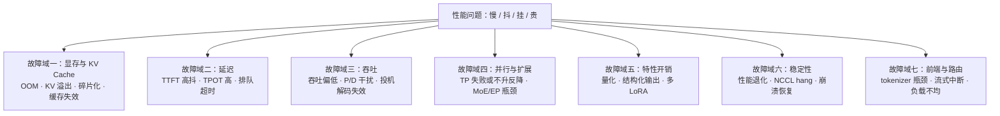
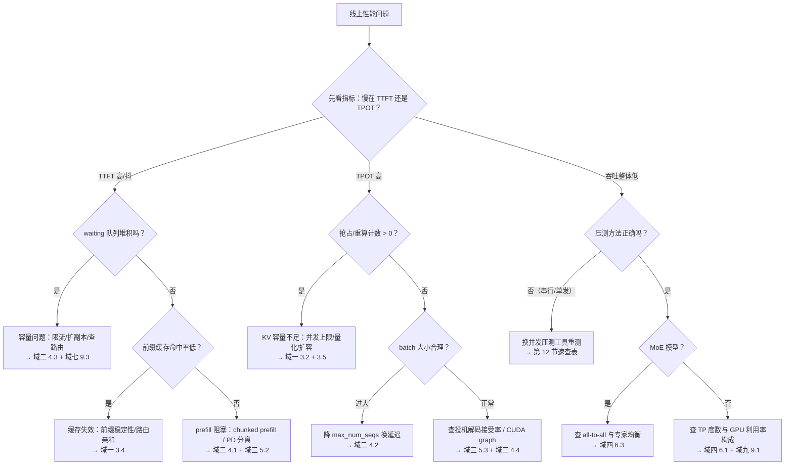

> [!warning] 生产安全提示 · Production Safety
> 本文档含可执行命令/操作步骤。执行前请核对风险等级（🟢低/🔶中/🔴高），高危命令必须 dry-run 并确认回滚方案。完整策略见 [生产安全策略](../../治理/Production_Safety_Policy.md)。
<!-- op-safety-banner v1 -->

# vLLM 与 SGLang 部署性能问题专题：故障地图与调优总纲

> 中文简称：vLLM SGLang 性能问题专题 ｜ English: vLLM & SGLang Performance Troubleshooting Atlas

> **一句话理解**: 部署 vLLM/SGLang 后遇到的性能问题，九成落在七个故障域里——显存与 KV Cache、延迟、吞吐、并行扩展、特性开销、稳定性、前端路由；排查的正确姿势是先用指标定位到域，再进域内查根因和参数，而不是凭感觉乱调。

---

## 0. 本文定位：和系列文档怎么分工

本目录的 vLLM/SGLang 内容分两个视角，别搞混：

| 视角 | 文档 | 回答的问题 |
|------|------|-----------|
| **原理视角**（它为什么快） | [[10_部署推理/02_推理引擎/32_vLLM_SGLang_原理_零基础.md|32 原理零基础]]、[[10_部署推理/02_推理引擎/34_前缀缓存与_RadixAttention.md|34 前缀缓存]]、[[10_部署推理/02_推理引擎/36_Prefill_KV_Cache_填充机制_深度解析.md|36 Prefill 与 KV Cache]] | PagedAttention、RadixAttention、chunked prefill 的机制是什么 |
| **问题视角**（它为什么慢） | **本文（37）** + [[10_部署推理/02_推理引擎/FTA/README.md|FTA 故障树系列]] | 线上慢了/挂了/OOM 了，怎么定位、调哪个参数 |

本文是问题视角的**总纲**：给出全景地图（第 1 节）、指标体检单（第 2 节）、七大故障域的根因与参数对照（第 3–9 节）、高阶专题（第 10 节）、决策树（第 11 节）、参数速查表（第 12 节）、快问快答（第 13 节）。每个具体故障的完整故障树在 FTA 系列里，本文负责把你**送到正确的 FTA**。

---

## 1. 性能问题全景图



这张图是全文的骨架：七个域覆盖了 vLLM/SGLang 部署中几乎全部性能问题。**域之间会连锁**——比如显存不足（域一）触发抢占，表现为 TTFT 抖动（域二）和吞吐下降（域三）。排查时先抓住"最上游的域"。

---

## 2. 第 0 步：先看指标——性能体检单

不看指标就调参数是排障大忌。先采一组基线，再对着下面的表定位：

```bash
# vLLM（V1 默认开启 /metrics Prometheus 端点）
curl -s http://127.0.0.1:8000/metrics | grep -E "time_to_first_token|time_per_output_token|num_requests_waiting|num_requests_running"
# 🟢 LOW-RISK — 只读查询本机监控指标 [回滚：无需]

# SGLang（需启动时加 --enable-metrics）
curl -s http://127.0.0.1:30000/metrics | grep -E "time_to_first_token|gen_throughput|num_queue_reqs|token_usage"
# 🟢 LOW-RISK — 只读查询本机监控指标 [回滚：无需]

nvidia-smi --query-gpu=utilization.gpu,memory.used,memory.total --format=csv
# 🟢 LOW-RISK — 只读查看 GPU 利用率与显存 [回滚：无需]
```

> 指标名随版本会变（如缓存占用指标 V0 叫 `gpu_cache_usage_perc`、V1 改为 KV cache 使用率类指标），以 `/metrics` 实际输出为准。

### 2.1 核心指标体检单

| 指标 | 含义 | 经验阈值（交互场景） | 异常时优先查 |
|------|------|---------------------|-------------|
| **TTFT**（Time To First Token） | 首 token 延迟 = 排队 + prefill | P99 < 2 s | 域一（缓存命中）、域二（排队/prefill） |
| **TPOT**（Time Per Output Token） | 解码阶段平均每 token 时间 | < 100 ms | 域二（batch 过大）、域四（并行） |
| **ITL**（Inter-Token Latency） | 流式输出相邻 token 间隔 | < 50 ms，且无尖刺 | 域二（抖动=抢占/干扰） |
| **端到端延迟** | TTFT + (输出长度−1) × TPOT | 按业务 SLO | 上两项分解 |
| **吞吐**（output tok/s） | 每秒产出 token 总量 | 越高越好，看与基线偏差 | 域三（batch 未满）、域七（路由） |
| **Goodput** | 满足 SLO 的有效吞吐 | 吞吐 × SLO 达标率最大化 | 域二+域三权衡 |
| **排队长度**（num_waiting / num_queue_reqs） | waiting 队列请求数 | 交互场景应 ≈ 0 | 域二（容量不足）、域七（负载不均） |
| **KV cache 使用率**（token_usage / cache usage） | KV 池占用比例 | 稳态 < 90% | 域一（溢出/抢占前兆） |
| **Cache 命中率**（cache_hit_rate / cached tokens） | 前缀缓存命中比例 | RAG/多轮 > 30% 才有意义 | 域一（缓存失效） |
| **抢占/重算次数**（preemption / retraction） | KV 不够时踢掉进行中请求 | 应 ≈ 0，持续 > 0 即容量不足 | 域一 |
| **GPU 利用率** | SM 占用率 | 仅做参考，**不能单独当性能结论** | 见下方案例 |

### 2.2 必须建立的两个公式直觉

**分解公式**：`E2E 延迟 ≈ TTFT + (n_out − 1) × TPOT`。用户抱怨"慢"时，先问清楚是"等首字慢"（TTFT 问题）还是"吐字慢"（TPOT 问题），两者的根因和调参方向完全不同。

**KV 容量公式**（估算显存够不够）：

```text
每 token KV 字节 = 2 (K+V) × num_layers × num_kv_heads × head_dim × dtype_bytes

算例 1：Llama-3.1-8B（32 层，GQA 8 KV 头，head_dim 128，FP16）
  = 2 × 32 × 8 × 128 × 2 B = 128 KB/token
  4K 上下文的一个请求 ≈ 0.5 GB；KV 池 10 GB 只够 ~20 路并发 4K 请求

算例 2：DeepSeek-V3（61 层，MLA 压缩到 576 维/层，FP16/BF16）
  ≈ 576 × 61 × 2 B ≈ 70 KB/token —— MLA 让长上下文 KV 压力降一个量级
```

常见错误：用"模型大小 × 并发数"拍脑袋估显存，完全漏掉 KV 随上下文长度**线性**增长这一项。参数详见 [[10_部署推理/02_推理引擎/36_Prefill_KV_Cache_填充机制_深度解析.md|36 号的显存公式与 Roofline 一节]]。

---

## 3. 故障域一：显存与 KV Cache（最高频）

> 显存问题占推理线上故障的一半以上，且**级联效应最强**：KV 不足 → 抢占 → TTFT 抖动 + 吞吐下降，表面看是延迟问题，根子在域一。

### 3.1 启动 OOM

- **症状**：`CUDA out of memory` 出现在进程拉起阶段，或模型加载完成后 init KV 池时挂掉。
- **根因**：权重 + 激活 + KV 池预留之和超过显存；`gpu_memory_utilization`（vLLM）/ `mem-fraction-static`（SGLang）给太高；长 `max_model_len` 把 KV 池需求放大。
- **处置**：降显存占比 → 减 `max_model_len` → 上量化 → 加 TP。完整故障树见 [[10_部署推理/02_推理引擎/FTA/推理/FTA_vLLM_SGLang_推理_OOM.md|FTA 推理 OOM]]。

### 3.2 运行时 KV 不足：抢占与重算

- **症状**：`/metrics` 里 preemption（vLLM）/ retraction（SGLang）计数持续增长；ITL 出现周期性尖刺；日志出现"抢占/收回请求"。
- **根因**：并发高峰 KV 池打满，引擎踢掉部分请求释放 KV——vLLM V0 可选 swap（换出到 CPU）/ recompute（丢弃重算），V1 默认 recompute；SGLang 把这叫 retraction，用 `--schedule-conservativeness` 控制准入激进程度。
- **处置**：recompute 和 swap 的取舍是"重算算力 vs 换入换出的 PCIe 带宽"，短请求多选 recompute；治本是**限流到容量以内**（`max_num_seqs` / `max_running_requests`）而不是硬扛。

### 3.3 显存碎片化

- **症状**：KV 池显示还有余量，但新请求进不来或频繁触发回收。
- **根因**：逻辑连续 vs 物理分页的差距——vLLM 用 PagedAttention 把 KV 切成固定大小的 block，把外部碎片压到很低；SGLang 用 paged 措施 + Radix 树管理，页大小（`--page-size`）过大时内部碎片上升。
- **处置**：确认分页开启（现代版本默认）、页大小用默认值；变长场景避免超大 `max_model_len` 独占式预留。详见 [[10_部署推理/02_推理引擎/FTA/推理/FTA_vLLM_SGLang_显存碎片化.md|FTA 显存碎片化]] 与 [[10_部署推理/02_推理引擎/30_vLLM_Paged注意力_架构.md|PagedAttention 架构图]]。

### 3.4 前缀缓存失效（命中率低）

- **症状**：`cache_hit_rate`（SGLang）/ cached token 统计（vLLM）接近 0；多轮对话、RAG 场景 prefill 耗时不降。
- **根因**：缓存开关没开（vLLM V0 需 `--enable-prefix-caching`，V1 默认开；SGLang RadixAttention 默认开）；prompt 前缀不稳定（system prompt 里塞了时间戳/随机 ID，命中必然失败）；多实例间路由无亲和，同一用户的请求打到不同副本；缓存被 LRU 驱逐过快。
- **处置**：把动态内容挪到 prompt **末尾**；路由加前缀亲和（见第 9.3 节）；调大 KV 池占比。完整故障树见 [[10_部署推理/02_推理引擎/FTA/推理/FTA_vLLM_SGLang_Prefix_Caching_失效.md|FTA Prefix Caching 失效]]，机制原理见 [[10_部署推理/02_推理引擎/34_前缀缓存与_RadixAttention.md|34 前缀缓存与 RadixAttention]]。

### 3.5 容量规划错误（最容易被忽略的"根因的根因"）

- **症状**：压测通过的配置上线后翻车；并发一过峰值就抢占。
- **根因**：容量估算漏了 KV 项。正确的估算链是：**显存总量 × 占比 − 权重 − 激活/图缓冲 = KV 池 → 池大小 ÷ 每 token KV 字节 ÷ 平均上下文长度 = 理论并发上限**，再打 7–8 折做水位。
- **处置**：把第 2.2 节公式写进容量评审 checklist；长上下文模型优先考虑 MLA 架构或 KV 量化（`--kv-cache-dtype fp8`，vLLM）。

---

## 4. 故障域二：延迟问题

### 4.1 TTFT 高且抖动

- **症状**：首 token 忽快忽慢；长 prompt 请求越多越明显；P99 远超 P50。
- **根因**：长 prefill 独占批次（chunked prefill 没开或块太大）；排队积压；前缀未命中重复计算；fcfs 调度下短请求被饿。
- **处置**：vLLM V1 默认开 chunked prefill（V0 加 `--enable-chunked-prefill --max-num-batched-tokens 4096`）；SGLang 调 `--chunked-prefill-size`（1024–4096）或 `--enable-mixed-chunk` 让 prefill 与 decode 混批；调度换 `--scheduling-policy priority`（vLLM）/ `--schedule-policy srtf`（SGLang）。完整故障树见 [[10_部署推理/02_推理引擎/FTA/推理/FTA_vLLM_SGLang_TTFT_抖动.md|FTA TTFT 抖动]]。

### 4.2 解码延迟高（TPOT/ITL 大）

- **症状**：首字快、吐字慢；流式输出"一卡一卡"。
- **根因**：running batch 太大（每步 attention 要扫全部请求的 KV）；CPU 调度跟不上 GPU（vLLM V1 / SGLang 的 overlap scheduler 就是为藏这个开销）；投机解码配置不当反而添乱；输出端流式间隔（SGLang `--stream-interval`）设太大。
- **处置**：降 `max_num_seqs` / `max_running_requests` 换单请求延迟；确认 CUDA graph 开启（关闭 eager 模式）；TPOT 尖刺与抢占计数对齐着看（多半还是域一）。

### 4.3 排队超时

- **症状**：客户端 408/超时；waiting 队列持续增长。
- **根因**：到达率超过服务容量（Little's law：队列长度 = 到达率 × 停留时间）；`max_num_seqs` 上限卡死新请求；多实例负载不均，个别副本排队爆表。
- **处置**：扩副本是最诚实的答案；应用侧设合理的排队预算并快速失败；路由层摘除落后副本。完整故障树见 [[10_部署推理/02_推理引擎/FTA/推理/FTA_vLLM_SGLang_排队超时.md|FTA 排队超时]]。

### 4.4 首请求延迟（冷启动）

- **症状**：服务健康检查通过，但第一个请求要等几十秒到几分钟。
- **根因**：CUDA graph 捕获、`torch.compile` 编译、权重懒加载都发生在首批请求；`--enforce-eager`（vLLM）/ `--disable-cuda-graph`（SGLang）能跳过图捕获但牺牲稳态性能。
- **处置**：就绪探针换成"真实推理探针"（打一条小 prompt 再放流量）；保留 graph 但加启动预热。

---

## 5. 故障域三：吞吐问题

### 5.1 吞吐量异常偏低

- **症状**：同样硬件，吞吐只有预期的一半甚至更低。
- **根因**：continuous batching 没生效（客户端串行发请求是头号嫌疑——单条 curl 测出的"吞吐"毫无意义）；`max_num_batched_tokens` 配小；量化没开导致 decode 全程 memory-bound； kernel/引擎版本老旧。
- **处置**：先确认**压测方法正确**（并发持续打满一个 benchmark 窗口），再调引擎。压测工具：`vllm bench serve` 与 `python -m sglang.bench_serving`（见第 12 节速查表）。完整故障树见 [[10_部署推理/02_推理引擎/FTA/推理/FTA_vLLM_SGLang_吞吐量异常.md|FTA 吞吐量异常]]，方法论见 [[10_部署推理/02_推理引擎/15_LLM推理_基准测试_指南.md|15 基准测试指南]]。

### 5.2 Prefill 与 decode 互相干扰

- **症状**：混合负载下 decode 吞吐塌方，或长 prompt 一到全体卡顿。
- **根因**：prefill 是 compute-bound、decode 是 memory-bound，混在一个 batch 里互相拖累；长 prefill 一次跑完会阻塞同批所有 decode 步。
- **处置**：轻则 chunked prefill / mixed chunk（4.1 节），重则 PD 分离——把 prefill 和 decode 拆到不同实例，代价是 KV 要跨机传输。什么时候划算见第 10.1 节。

### 5.3 投机解码失效（甚至负优化）

- **症状**：开了 speculative decoding 吞吐反而降。
- **根因**：draft 模型与目标模型不匹配 → 接受率低，白算；`num_speculative_tokens` 给太大 → 每次 draft 浪费多；小 batch 场景 draft 的验证开销占比高；显存被 draft 模型挤占触发域一问题。
- **处置**：vLLM 用 `--speculative-config`（JSON 形式配置 method/model/num_speculative_tokens）；SGLang 用 `--speculative-algorithm EAGLE --speculative-num-steps ... --speculative-num-draft-tokens ...`。调参目标是**接受率 × 步数**最大化，先看日志里的 draft 接受率再动。完整故障树见 [[10_部署推理/02_推理引擎/FTA/推理/FTA_vLLM_SGLang_Speculative_Decoding_异常.md|FTA Speculative Decoding 异常]]。

---

## 6. 故障域四：并行与扩展

### 6.1 TP 度数选择：启动失败与"不升反降"

- **症状**：TP=4/8 起不来；或起来了，单请求延迟没改善，吞吐甚至低于 TP=2。
- **根因**：TP 每层 attention/MLP 后都要做 all-reduce，通信量随 TP 度数增长；NVLink 机器上 TP=8 通常仍有净收益，PCIe 机器上 TP 翻倍可能全是通信开销；权重切分不均（小模型 TP=8 切不出意义）。
- **处置**：选 TP 的粗略准则是"**权重 + KV 放得下**的最小 TP 度数"；跨机优先考虑 PP/DP 而不是大 TP。完整故障树见 [[10_部署推理/02_推理引擎/FTA/推理/FTA_vLLM_SGLang_TP_启动失败.md|FTA TP 启动失败]]。

### 6.2 四种并行怎么选

| 并行 | 切什么 | 通信模式 | 什么时候用 |
|------|--------|---------|-----------|
| **TP** | 单层权重矩阵 | 每层 all-reduce（高频） | 单机多卡放权重/KV 的默认首选 |
| **PP** | 按层切深度 | 层间点对点（低频） | 跨机、模型深、NVLink 域内不够放 |
| **DP** | 复制整套实例 | 无（请求级分流） | 吞吐扩展、配合路由做亲和 |
| **EP** | MoE 专家分散到卡 | all-to-all（每 MoE 层） | MoE 模型专家数 > 单卡可容纳 |

### 6.3 MoE / EP 专题（2026 热点）

- **症状**：DeepSeek/Qwen-MoE 系模型吞吐上不去；GPU 利用率忽高忽低；换 EP 后反而变慢。
- **根因**：① **all-to-all 通信**是 EP 的命门，跨 NVLink 域后延迟放大；② **专家负载不均**——token 天然偏向热门专家，个别卡成短板；③ attention 部分若不做 DP attention，MLA/MHA 的 KV 在 EP 各副本间重复浪费显存。
- **处置**：SGLang 开 `--enable-dp-attention`（DeepSeek MLA 场景标配）+ `--ep-size`；vLLM 用 `--enable-expert-parallel` 并关注其 DP/EP 组合演进；跨机 EP 需要高带宽 RDMA 配合。这是面试高频题，展开见 [[21_面试岗位/19_LLM平台工程师/07_vLLM_SGLang_运维_面试问答.md|07 运维面试问答]]。

### 6.4 多实例扩展的正确姿势

vLLM/SGLang 单实例内部的"DP"（如 SGLang `--dp-size`）省事但有上限；生产更常见的做法是**外部多实例 + 路由层**（配合第 9.3 节的 prefix-aware 路由）。路由策略选错，前缀缓存命中率会被路由直接杀掉。

---

## 7. 故障域五：特性开销

| 特性 | 典型性能症状 | 根因与调优点 | 专题 |
|------|------------|-------------|------|
| **量化** | 精度下降；或精度 OK 但没拿到期望加速 | FP8/AWQ/GPTQ 的 kernel 支持差异；`--quantization` 与 `--kv-cache-dtype` 分开评估；小 batch 下量化 decode 收益有限 | [[10_部署推理/02_推理引擎/FTA/推理/FTA_vLLM_SGLang_量化部署_精度下降.md|FTA 量化精度]] |
| **结构化输出**（JSON mode 等） | 开了 guided decoding 后 TTFT 暴涨 | 约束编译开销（语法编译进 token mask）；backend 选择（xgrammar 快于 outlines）；vLLM V1 用 `--structured-outputs-config`，SGLang 用 `--grammar-backend` | [[10_部署推理/02_推理引擎/FTA/推理/FTA_vLLM_SGLang_Guided_Decoding_报错.md|FTA Guided Decoding]] |
| **多 LoRA** | 加载多 adapter 后吞吐下降、偶发冲突 | adapter 换入换出的调度与显存开销；`--max-loras`/`--max-lora-rank` 给太大挤占 KV 池 | [[10_部署推理/02_推理引擎/FTA/推理/FTA_vLLM_SGLang_多LoRA冲突.md|FTA 多 LoRA]] |
| **长上下文** | 长 prompt 请求成本远超线性预期 | attention 计算随长度平方涨；MLA/滑窗/混合注意力是解法 | [[10_部署推理/02_推理引擎/33_注意力机制演进_MLA_DSA_混合注意力.md|33 注意力演进]]、[[10_部署推理/02_推理引擎/35_MLA_DSA_混合注意力_深入.md|35 深入版]] |

---

## 8. 故障域六：稳定性与长时运行

### 8.1 性能随时间退化

- **症状**：上线一周后，同样压测吞吐掉了 10–20%；重启即恢复。
- **根因**：先排除**正常现象**——Radix/prefix cache 占用上涨会挤占新请求 KV 空间（看 `token_usage`，SGLang 里缓存占用高不是泄漏）；真正的退化通常来自碎片累积、句柄/连接泄漏、NCCL 通道劣化。
- **处置**：建立**周级基线压测**对比；区分"缓存占用"与"进程内存泄漏"（前者 `nvidia-smi` 稳定，后者持续上涨）；给引擎版本升级留窗口（调度器 bug 修复频繁）。

### 8.2 NCCL hang 与崩溃恢复

- **症状**：TP 组内某卡报错后全体卡死无响应；日志停在 NCCL collective。
- **根因**：单卡故障/掉卡拖死 collective 通信；NCCL 超时默认极长。
- **处置**：设置 NCCL 环境超时让进程快速失败退出，交给 K8s 拉起；副本无状态化（权重从远端加载、缓存可重建）让恢复在分钟级；这属于**可用性问题反向吞掉性能**——hang 中的实例吞吐为零且还在接流量，健康检查必须包含真实推理探针（呼应 4.4 节）。

### 8.3 崩溃后的性能陷阱

引擎重启后：CUDA graph 重新捕获、prefix/Radix 缓存清空、JIT kernel 重新编译——**重启后头几分钟的性能数据不可信**。灰度放量前先预热（打一段真实流量或复放压测）。

---

## 9. 故障域七：前端与路由

### 9.1 Tokenizer / API server 瓶颈

- **症状**：GPU 利用率不高，但请求吞吐上不去；CPU 单核打满。
- **根因**：tokenizer、API 进程、调度循环都在 CPU 上，高 QPS 或超长输入时成为单点；vLLM V1 已把 API server 与 engine core 拆成多进程（新版支持多 API server 实例），SGLang 也提供多 tokenizer 进程选项。
- **处置**：观察 CPU 分布而不是只盯 GPU；拆分前端与引擎；超大输入在应用侧预处理。相关故障见 [[10_部署推理/02_推理引擎/FTA/推理/FTA_vLLM_启动失败_架构_Tokenizer.md|FTA Tokenizer 架构]]。

### 9.2 流式响应中断

- **症状**：长回复生成到一半断流；客户端连接被中间层切断。
- **根因**：反代/网关的空闲超时小于 ITL 尖刺间隙；`stream_options` 配置缺失导致心跳缺失；抢占重算造成的长间隙触发超时（域一连锁）。
- **处置**：网关空闲超时 > 最大可接受 ITL 尖刺；开流式 keep-alive；治本还是消灭抢占。见 [[10_部署推理/02_推理引擎/FTA/推理/FTA_流式响应中断_连接异常.md|FTA 流式中断]]。

### 9.3 多实例负载不均与 prefix-aware 路由

- **症状**：总副本数够，但 P99 延迟仍高；个别副本排队爆满而其他空闲；多轮场景缓存命中率随机波动。
- **根因**：round-robin 路由对 LLM 推理是**反优化**——它把同一前缀的请求均匀打散，恰好杀掉前缀缓存的复用。
- **处置**：用前缀感知路由（SGLang router 按 Radix 前缀亲和分发；vLLM 生态用 production stack / llm-d 类路由器），会话粘性 + 缓存亲和双收益。这是 2026 年生产部署的标配组件，详见第 10.3 节。

---

## 10. 高阶专题（2026 生产热点）

### 10.1 PD 分离（Prefill/Decode Disaggregation）

- **是什么**：prefill 和 decode 拆到不同 GPU 实例，中间传输 KV Cache。SGLang 一等公民支持（`--disaggregation-mode prefill|decode`）；vLLM 走 KVConnector 体系（`--kv-transfer-config` 挂 LMCache/NIXL 等连接器）+ 上层编排。
- **解决什么**：5.2 节的 P/D 干扰；两侧独立扩缩容（prefill 吃算力、decode 吃显存带宽，硬件画像完全不同）。
- **什么时候才划算**：短请求、小规模部署**不要上**——KV 跨机传输的开销和运维复杂度会反噬收益。经验上：长 prefill 占比高（RAG 长上下文）、集群规模大、SLO 严格（TTFT 与 TPOT 分别承诺）时才值得。展开见 [[10_部署推理/02_推理引擎/36_Prefill_KV_Cache_填充机制_深度解析.md|36 号三大优化一节]] 与 [[21_面试岗位/19_LLM平台工程师/06_PD分离_面试复习.md|PD 分离面试复习]]。

### 10.2 KV Cache Offload / 分层缓存

- **是什么**：GPU KV 池装不下时，把冷 KV 降到 CPU 内存/SSD（vLLM 生态：LMCache 连接器；SGLang：HiCache，`--enable-hierarchical-cache`）。
- **解决什么**：多轮长会话、高频重复前缀场景下，"命中历史 KV"比"重新 prefill"便宜一个量级。
- **代价**：换入换出吃 PCIe/磁盘带宽；层级越深命中越慢。调优点是**命中率 × 每层带宽**，不是无脑把 ratio 拉满。

### 10.3 Prefix-aware 路由与缓存亲和

三件套配套：**路由按前缀亲和分发（10.3）→ 副本内前缀缓存复用（34 号）→ 装不下的降级到分层缓存（10.2）**。只做其中一环，效果都会打折。SGLang 的 router + RadixAttention + HiCache 是目前最完整的开源参考实现。

---

## 11. 排查决策树



用这张树的姿势：**从顶往下走，每步只用指标判断**，走到底拿到的是"域 + 节号"，再跳去对应小节或 FTA。两三个问题叠加时，先解决树上游（容量类）的问题。

---

## 12. 参数速查表：vLLM ↔ SGLang 对照

调参前先对齐"同一个旋钮两个引擎叫什么"：

| 配置目标 | vLLM | SGLang | 备注 |
|---------|------|--------|------|
| 显存池占比 | `--gpu-memory-utilization 0.9` | `--mem-fraction-static 0.88` | 留余量给激活与碎片 |
| 最大上下文 | `--max-model-len` | `--context-length` | 直接决定 KV 需求 |
| 最大并发序列 | `--max-num-seqs` | `--max-running-requests` | 延迟敏感时调小 |
| 每步 token 预算 | `--max-num-batched-tokens` | `--max-prefill-tokens` | prefill 吞吐旋钮 |
| Chunked prefill | `--enable-chunked-prefill`（V1 默认开） | `--chunked-prefill-size 2048` | 块大小 1024–4096 常用 |
| Prefill/decode 混批 | chunked prefill 即混批 | `--enable-mixed-chunk` | SGLang 特有开关 |
| 前缀缓存 | `--enable-prefix-caching`（V1 默认开） | RadixAttention 默认开 | 关闭用 `--no-enable-prefix-caching` / `--disable-radix-cache` |
| 调度策略 | `--scheduling-policy fcfs\|priority` | `--schedule-policy fcfs\|lpm\|srtf` | 交互场景可用 priority/srtf |
| 抢占行为 | V1 默认 recompute（V0 有 `--preemption-mode`） | retraction，`--schedule-conservativeness` 控准入 | 计数必须进监控 |
| 投机解码 | `--speculative-config '{"method":...}'` | `--speculative-algorithm EAGLE` 系列 | 先看接受率再调步数 |
| KV 量化 | `--kv-cache-dtype fp8` | `--kv-cache-dtype fp8_e4m3` 等 | 精度回归必做 |
| 权重量化 | `--quantization fp8\|awq\|gptq` | 同名支持 | kernel 支持看版本 |
| CUDA graph | 关闭：`--enforce-eager` | 关闭：`--disable-cuda-graph` | 生产默认开图 |
| 张量并行 | `--tensor-parallel-size` | `--tp-size` | 单机内优先 |
| 数据并行 | `--data-parallel-size` | `--dp-size` | 大规模仍推荐外部多实例 |
| MoE 专家并行 | `--enable-expert-parallel` | `--ep-size` | MoE 必配 |
| DP attention（DeepSeek） | V1 对应组合配置 | `--enable-dp-attention` | MLA 场景省 KV |
| 分层 KV 缓存 | LMCache 连接器（`--kv-transfer-config`） | `--enable-hierarchical-cache` | 见 10.2 |
| PD 分离 | KVConnector + 上层编排 | `--disaggregation-mode prefill\|decode` | 见 10.1 |
| 结构化输出 backend | `--structured-outputs-config`（旧 `--guided-decoding-backend`） | `--grammar-backend` | xgrammar 通常最快 |
| 监控指标 | `/metrics` 默认开 | 启动加 `--enable-metrics` | 见第 2 节 |
| 压测工具 | `vllm bench serve` | `python -m sglang.bench_serving` | 并发打满一个窗口再读数 |

> 参数名与默认值随版本演进（vLLM V0→V1 变化最大），以官方文档与 `--help` 实际输出为准；此表的价值是建立"旋钮对照"的心智模型。

---

## 13. 快问快答（面试向 12 题）

**Q1：TTFT 和 TPOT 分别由什么主导？**
TTFT ≈ 排队 + prefill（compute-bound）；TPOT 由 decode 步时间决定（memory-bound，扫全部 batch 的 KV）。

**Q2：`gpu_memory_utilization` 拉到 0.98 会怎样？**
KV 池变大、并发上限变高，但激活/临时缓冲被挤压，峰值 batch 下可能 OOM 崩进程；一般 0.9 左右留余量。

**Q3：抢占时 recompute 和 swap 怎么选？**
短请求/小 KV 选 recompute（重算比 PCIe 换入换出便宜）；长上下文大 KV 才考虑 swap。vLLM V1 默认 recompute。

**Q4：开了 prefix caching，为什么吞吐有时反而抖？**
缓存命中让某些请求 prefill 变极短，batch 形态剧烈变化 → 每步耗时波动；同时缓存占用挤占新请求 KV，可能触发抢占。看命中率的同时盯抢占计数。

**Q5：chunked prefill 牺牲了什么换 TTFT 平滑？**
prefill 分块后总 prefill 时间略增（分块开销 + 与 decode 交错让渡算力），极端追求 prefill 吞吐的离线批处理可关。

**Q6：TP 从 2 加到 4，什么时候几乎没有收益？**
权重和 KV 在 TP=2 下已放得下、且单机 PCIe 通信开销吃掉切分收益时；TP 的首要目的是"放得下"，其次才是加速。

**Q7：MoE 开 EP 后的主要瓶颈是什么？**
每 MoE 层的 all-to-all 通信与专家负载不均；跨 NVLink 域后通信进一步放大。

**Q8：投机解码什么情况下负优化？**
draft 接受率低（两模型分布差异大）、draft 步数过多、小 batch 下验证开销占比过高。

**Q9：Goodput 和吞吐的区别？**
Goodput = 满足全部 SLO（如 TTFT < 2 s 且 TPOT < 100 ms）的有效吞吐；只追吞吐可能把服务压到全线违反 SLO 的"假高"。

**Q10：RadixAttention 相比 PagedAttention 多做了什么？**
在分页存储之上加了 Radix 树索引，按前缀组织 KV 并跨请求共享、LRU 驱逐——把"复用"从单请求内扩展到全体请求。

**Q11：PD 分离什么时候才划算？**
长 prefill 占比高、集群规模大、TTFT/TPOT 分别有严格 SLO 时；小规模短请求场景跨机 KV 传输的代价不划算。

**Q12：线上 KV cache 使用率长期 90%+ 说明什么？**
容量贴着水位跑：一旦到达率波动就触发抢占，ITL 尖刺随之而来。要么限并发，要么扩容/上 KV 量化/分层缓存。

---

## 14. 交叉引用

**原理与机制**
- [[10_部署推理/02_推理引擎/32_vLLM_SGLang_原理_零基础.md|32 vLLM 与 SGLang 原理零基础]]
- [[10_部署推理/02_推理引擎/34_前缀缓存与_RadixAttention.md|34 前缀缓存与 RadixAttention]]
- [[10_部署推理/02_推理引擎/36_Prefill_KV_Cache_填充机制_深度解析.md|36 Prefill 与 KV Cache 填充机制]]
- [[概念/LLM/kv-cache|KV Cache 概念卡]] · [[概念/LLM/paged-attention|PagedAttention 概念卡]] · [[概念/Inference/prefix-caching|前缀缓存概念卡]]

**引擎深入与选型**
- [[10_部署推理/02_推理引擎/29_vLLM_深入分析.md|vLLM 深入分析]] · [[10_部署推理/02_推理引擎/23_SGLang_深入分析.md|SGLang 深入分析]]
- [[10_部署推理/02_推理引擎/17_LLM_推理引擎_选型_指南.md|选型指南]] · [[10_部署推理/02_推理引擎/15_LLM推理_基准测试_指南.md|基准测试指南]] · [[10_部署推理/02_推理引擎/16_LLM_推理引擎_迁移_指南.md|迁移指南]]

**故障树（FTA）性能系列**
- [[10_部署推理/02_推理引擎/FTA/README.md|FTA 总索引]]（性能相关 12 篇：OOM、KV 溢出、碎片化、缓存失效、TTFT 抖动、解码延迟、排队超时、吞吐异常、TP 启动、投机解码、量化精度、Guided Decoding）

**面试准备**
- [[21_面试岗位/19_LLM平台工程师/07_vLLM_SGLang_运维_面试问答.md|vLLM/SGLang 运维面试问答 53 题]]
- [[21_面试岗位/19_LLM平台工程师/06_PD分离_面试复习.md|PD 分离面试复习]]

*Last updated: 2026-10-22*
