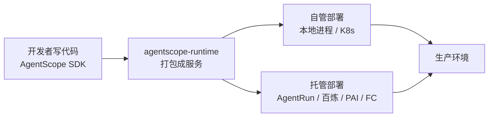
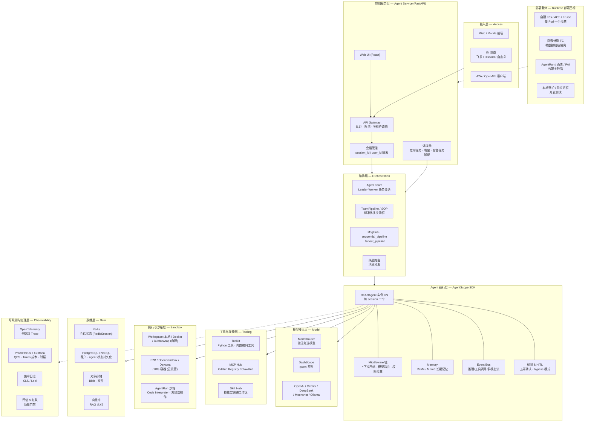
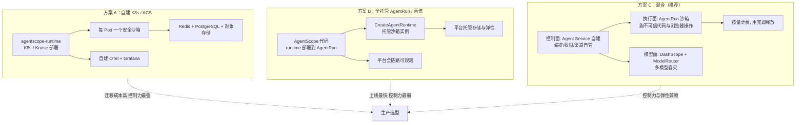

> [!warning] 生产安全提示 · Production Safety
> 本文档含可执行命令/操作步骤。执行前请核对风险等级（🟢低/🔶中/🔴高），高危命令必须 dry-run 并确认回滚方案。完整策略见 [生产安全策略](治理/Production_Safety_Policy.md)。
<!-- op-safety-banner v1 -->
# AgentScope 与 AgentRun: 生产部署架构方案 (AgentScope & AgentRun Production Architecture)

> 中文简称：AgentScope 与 AgentRun 生产部署架构

> **一句话理解**: AgentScope 负责"agent 怎么写"，阿里云 AgentRun 负责"agent 在哪跑"，本文给出把两者组合成生产级系统的完整架构图。

---

## 目录

1. [三件套关系](#1-三件套关系)
2. [AgentScope 怎么部署](#2-agentscope-怎么部署)
3. [新建一个 agent 实例](#3-新建一个-agent-实例)
4. [AgentScope vs 阿里云 Agent Runtime](#4-agentscope-vs-阿里云-agent-runtime)
5. [生产环境完整架构方案（核心）](#5-生产环境完整架构方案核心)
6. [三种生产拓扑选型](#6-三种生产拓扑选型)
7. [落地检查清单](#7-落地检查清单)

---

## 1. 三件套关系

讨论部署前先分清三个容易混淆的东西：

| 组件 | 是什么 | 类比 |
|------|--------|------|
| **AgentScope (SDK)** | 开源多智能体开发框架（Apache 2.0，Python/Java），`pip install agentscope` | 造车的图纸和零件 |
| **agentscope-runtime** | 独立的运行时项目，把 agent 应用打包成服务，支持 9 种部署方式 | 整车的装配线和测试线 |
| **阿里云 AgentRun (Agent Runtime)** | 函数计算 FC 下的一站式 Serverless Agentic AI 基础设施平台，`CreateAgentRuntime` 创建托管运行时实例 | 4S 店提供的托管车库和油卡 |

**关系是互补而非互斥**：agentscope-runtime 官方支持的 9 种部署方式里，**AgentRun 就是目标之一**（此外还有百炼、PAI、函数计算 FC、Kubernetes 等）。



一句话：**AgentScope 管逻辑，AgentRun 管算力**，runtime 是中间的搬运工。

---

## 2. AgentScope 怎么部署

按场景从轻到重分四条路径：

| 路径 | 适用场景 | 关键命令/入口 | 风险 |
|------|---------|--------------|------|
| **① 纯 SDK 进程** | 本地开发、嵌入现有服务 | `pip install agentscope`（需 Python 3.11+） | 🟢 |
| **② Agent Service** | 快速上线多租户应用 | `examples/agent_service` 后端 + `examples/web_ui` 前端 | 🟢 |
| **③ agentscope-runtime** | 生产服务化 | `pip install "agentscope-runtime[ext]"` + `app.deploy(...)` | 🔶 |
| **④ 集群/云托管** | 企业生产 | ACS 一键部署 / Kruise / AgentRun / 百炼 | 🔶 |

### 2.1 路径 ①：纯 SDK（零部署）

```bash
# 🟢 — 本地安装依赖，回滚: pip uninstall agentscope
uv pip install agentscope
```

Agent 就跑在你自己的 Python 进程里，没有服务化概念。

### 2.2 路径 ②：Agent Service（开箱即用的服务化）

官方自带一个 batteries-included 的 **agent service**：FastAPI 后端，多租户、多会话隔离、渠道接入（飞书/Discord）、RAG、MCP & Skill Hub、定时任务、SQL/NoSQL 持久化。

```bash
# 🟢 — 启动本地服务，回滚: Ctrl+C
git clone -b main https://github.com/agentscope-ai/agentscope.git
cd agentscope/examples/agent_service
python main.py          # 后端 (FastAPI)

# 另开终端启动 Web UI
cd examples/web_ui && pnpm install && pnpm dev
```

### 2.3 路径 ③：agentscope-runtime 的 9 种部署方式

| 部署类型 | 使用场景 | 扩展性 | 管理方式 | 资源隔离 |
|----------|---------|--------|---------|---------|
| **本地守护进程** | 开发与测试 | 单进程 | 手动 | 进程级 |
| **独立进程** | 生产服务 | 单节点 | 自动化 | 进程级 |
| **Kubernetes** | 企业与云端 | 单节点 | 编排 | 容器级 |
| **ModelStudio（百炼）** | 百炼应用开发平台 | 云端管理 | 平台管理 | 容器级 |
| **AgentRun** | AgentRun 平台 | 云端管理 | 平台管理 | 容器级 |
| **PAI** | 阿里云 PAI 平台 | 云端管理 | 平台管理 | 容器级 |
| **Knative** | 企业与云端 | 单节点 | 编排 | 容器级 |
| **Kruise** | 企业与云端 | 单节点 | 编排 | 容器级/微虚拟机级 |
| **函数计算 (FC)** | 阿里云 Serverless | 云端管理 | 平台管理 | 微虚拟机级 |

前置条件与本地启动示例：

```bash
# 🟢 — 安装运行时依赖，回滚: pip uninstall agentscope-runtime
pip install "agentscope-runtime[ext]>=1.0.0"

# 🟢 — 配置模型密钥（仅环境变量，不落盘）
export DASHSCOPE_API_KEY="your_qwen_api_key"
```

本地两种部署模式：`DeploymentMode.DAEMON_THREAD`（默认，守护线程内运行）和 `DETACHED_PROCESS`（独立进程，主脚本退出后服务继续）。

### 2.4 路径 ④：集群/云托管

- **ACS 一键部署**：[在 ACS 集群中使用 AgentScope](https://help.aliyun.com/zh/cs/user-guide/use-agentscope-to-quickly-build-ai-agent-in-acs-cluster) —— 每个 Pod 对应一个安全沙箱容器，Serverless 交付算力，用完即释放。
- **Kruise Agents**：[运行 AgentScope Agent 最佳实践](https://openkruise.io/zh/kruiseagents/best-practices/running-agentscope-agent)。
- **AgentScope Service（Java 版）**：Docker Compose 下载安装包部署的管控与治理平台，提供统一控制面。

---

## 3. 新建一个 agent 实例

**核心事实：agent 实例就是普通 Python 对象**，`Agent(...)` 实例化即可；服务化之后按"每会话一个实例"构造，靠 session 存储维持跨请求记忆。

### 3.1 SDK 方式（AgentScope 2.0）

```python
# 🟢 — 本地交互式对话，回滚: 退出进程
import os, asyncio
from agentscope.agent import Agent
from agentscope.console import launch_console
from agentscope.tool import Toolkit, Bash, Grep, Glob, Read, Write, Edit
from agentscope.model import DashScopeChatModel
from agentscope.credential import DashScopeCredential

async def main() -> None:
    agent = Agent(                                  # ← 新建一个 agent 实例
        name="Friday",
        system_prompt="You're a helpful assistant named Friday.",
        model=DashScopeChatModel(
            credential=DashScopeCredential(api_key=os.environ["DASHSCOPE_API_KEY"]),
            model="qwen3.6-plus",
        ),
        toolkit=Toolkit(tools=[Bash(), Grep(), Glob(), Read(), Write(), Edit()]),
    )
    await launch_console(agent)   # 终端对话，流式输出/工具确认/Ctrl+C 中断均已处理

asyncio.run(main())
```

### 3.2 服务化方式（agentscope-runtime / Agent Service）

在 `AgentApp.query` 处理函数里**按 session 构造实例**，请求结束时持久化状态：

```python
# 🟢 — 服务内每会话构造 agent，回滚: 无状态变更
@app.query(framework="agentscope")
async def query_func(self, msgs, request: AgentRequest = None, **kwargs):
    session_id, user_id = request.session_id, request.user_id

    agent = ReActAgent(                            # ← 每个 session 一个实例
        name="Friday",
        model=DashScopeChatModel("qwen-turbo", api_key=os.getenv("DASHSCOPE_API_KEY")),
        sys_prompt="You're a helpful assistant named Friday.",
        toolkit=Toolkit(execute_python_code),
        memory=InMemoryMemory(),
        formatter=DashScopeChatFormatter(),
    )
    # 从 Redis 恢复该会话的历史状态
    await app.state.session.load_session_state(
        session_id=session_id, user_id=user_id, agent=agent
    )
    try:
        async for msg, last in stream_printing_messages(
            agents=[agent], coroutine_task=agent(msgs)
        ):
            yield msg, last
    finally:
        # 退出前保存状态，下个请求可无缝续接
        await app.state.session.save_session_state(
            session_id=session_id, user_id=user_id, agent=agent
        )
```

### 3.3 三种新建方式速查

| 方式 | 怎么新建实例 | 记忆/状态存放 | 适合 |
|------|-------------|--------------|------|
| **SDK 直接实例化** | `Agent(...)` / `ReActAgent(...)` | 进程内存 | 脚本、嵌入式 |
| **Service / Runtime** | query 处理函数内按 session 构造 | RedisSession + SQL | 生产多会话应用 |
| **Builder（零代码）** | Web UI 上创建、调教、分享 | 工作区文件 | 非开发者 |

**多智能体** = 实例化多个 agent，再用 `MsgHub`（多对多广播）、`sequential_pipeline`（链式）、`fanout_pipeline`（扇出-汇聚）、`observe()`（单向注入）编排；2.0 另有 `TeamPipeline`（leader 派活给 workers）与 SOP（多步任务标准化）。

---

## 4. AgentScope vs 阿里云 Agent Runtime

阿里云的 "Agent Runtime" 指**函数计算 AgentRun** 平台的核心组件（[`CreateAgentRuntime`](https://help.aliyun.com/zh/agentrun/api-agentrun-2025-09-10-createagentruntime) 创建的托管运行时实例，提供代码执行、浏览器操作、内存管理能力）。两者是**开发框架 vs 托管基础设施**的关系：

| 维度 | AgentScope | 阿里云 AgentRun 的 Agent Runtime |
|------|-----------|--------------------------------|
| **定位** | 开源多智能体**开发框架**，你写代码 | Serverless **Agentic AI 基础设施平台**，你买资源 |
| **形态** | Python/Java 库 + 自部署服务 | 云 API 资源（有 ARN），控制台/API 创建 |
| **新建实例** | `Agent(...)` 实例化一个 Python 对象 | `CreateAgentRuntime` 创建云资源 |
| **代码执行环境** | 自选 workspace：本地 / Docker / Bubblewrap / E2B / K8s | 平台托管沙箱（FC Code 沙箱模板，会话亲和） |
| **隔离级别** | 进程级～容器级（取决于部署方式） | 微虚拟机级 |
| **运维归属** | 自己（或部署到 K8s/ACS） | 平台全托管：弹性伸缩、模型治理、全链路可观测 |
| **计费** | 自担算力成本（开源免费） | 按量计费 |
| **典型用户** | 要深度定制编排逻辑的开发者 | 要开箱即用沙箱与弹性的企业生产环境 |
| **关系** | 可作为**应用**托管到 AgentRun | 可作为 AgentScope 的**部署目标** |

> **选型口诀**：深度定制编排逻辑 → 用 AgentScope 写；只想要托管沙箱和弹性 → 直接用 AgentRun API；两者一起 → AgentScope 写完交给 runtime 托管到 AgentRun。

---

## 5. 生产环境完整架构方案（核心）

下面是**最完整的分层架构**：从接入到沙箱、从模型到可观测，涵盖自建与托管两条路线。



**读图要点**（自上而下五条主线）：

1. **请求主线**：接入层 → 网关（认证/限流/多租户）→ 会话管理 → 编排层（Team/Pipeline/MsgHub）→ Agent 运行层逐实例执行。
2. **能力主线**：每个 ReActAgent 向右伸出三条能力线 —— 模型层（ModelRouter 按任务路由到 qwen 或其他提供商）、工具层（Toolkit/MCP/Skill Hub）、沙箱层（自建 workspace 或 AgentRun 托管沙箱）。
3. **状态主线**：Redis 存热会话状态，SQL 存租户与 agent 长期状态，对象存储 + 向量库支撑 RAG。
4. **观测主线**：所有层通过 OpenTelemetry 上报 Trace、指标、日志，汇聚到评估与红队门禁。
5. **承载主线**：底部 4 类部署目标承载 L2-L4 —— 同一份 AgentScope 代码，换 `app.deploy(...)` 参数即可在自建 K8s 与 AgentRun/百炼之间迁移。

---

## 6. 三种生产拓扑选型



| 方案 | 上线速度 | 控制力 | 成本形态 | 适用 |
|------|---------|--------|---------|------|
| **A 自建 K8s/ACS** | 慢 | 最强 | 固定集群成本 | 合规要求高、已有 K8s 团队 |
| **B 全托管 AgentRun** | 最快 | 弱 | 按量 | 快速验证、无运维团队 |
| **C 混合** | 中 | 中 | 基础固定 + 沙箱按量 | **大多数企业生产场景** |

---

## 7. 落地检查清单

| 检查项 | 说明 | 状态 |
|--------|------|------|
| Python ≥ 3.11 / 依赖锁定 | `agentscope` + `agentscope-runtime[ext]` 版本钉死 | ☐ |
| 模型接入 | `DASHSCOPE_API_KEY` 走环境变量/密钥管理，配 ModelRouter 容灾 | ☐ |
| 会话状态外置 | RedisSession + SQL 持久化，agent 实例无状态重建 | ☐ |
| 沙箱隔离 | 不可信代码执行必须进 Docker/E2B/AgentRun 沙箱，禁止宿主机直跑 | ☐ |
| 权限与 HITL | 危险工具（Shell/写文件）开确认，或限定 bypass 白名单 | ☐ |
| 多租户隔离 | session_id + user_id 双键隔离，资源配额限制 | ☐ |
| 可观测 | OTel Trace 贯通网关→agent→模型调用，Token 成本打点 | ☐ |
| 弹性与降级 | 沙箱/模型侧超时、重试、熔断；高峰转后台任务队列 | ☐ |
| 评估门禁 | 上线前跑质量评估与红队用例 | ☐ |

---

## 相关资源

- [AgentScope GitHub](https://github.com/agentscope-ai/agentscope) — 官方 SDK 仓库
- [agentscope-runtime Cookbook](https://github.com/agentscope-ai/agentscope-runtime/blob/main/cookbook/zh/advanced_deployment.md) — 9 种部署方式权威文档
- [阿里云函数计算 AgentRun](https://www.aliyun.com/product/fc/agentrun) — 托管平台产品页
- [CreateAgentRuntime API](https://help.aliyun.com/zh/agentrun/api-agentrun-2025-09-10-createagentruntime) — 创建托管运行时实例
- [ACS 部署 AgentScope 指南](https://help.aliyun.com/zh/cs/user-guide/use-agentscope-to-quickly-build-ai-agent-in-acs-cluster)

## Related

- [[15_智能体/02_Agent框架/02_AgentScope_深入分析|AgentScope 深入分析]] — 框架架构与多智能体协作模式
- [[15_智能体/Agent_Production_Deployment_Runbook|Agent 生产部署 Runbook]] — 通用部署运维手册
- [[15_智能体/09_Agent平台/01_Dify_Coze_MLServe_Dive|Agent 平台对比]] — Dify / Coze / MLServe 横评
- [[15_智能体/10_企业级Agent/README|企业级 Agent]] — 企业级架构与治理
- [[15_智能体/04_Agent脚手架/01_Agent_脚手架_架构_2026|Agent Harness 架构]] — 执行脚手架与框架集成

---

*Last updated: 2026-10-14*
