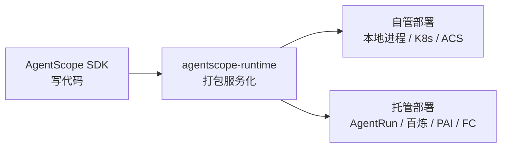

# agent-core / AgentRun / AgentScope 概念辨析与阿里开源 Agent 产品

> 中文简称：agent-core 与 AgentRun 与 AgentScope 辨析

> **一句话理解**: AgentScope 管"怎么写"，AgentRun 管"在哪跑"，agent-core 是"内核"概念（不是具体产品）——三者分属开发框架、托管基础设施、架构抽象三个层次。

---

## 1. 三者区别

| 维度 | agent-core | AgentScope | AgentRun |
|------|-----------|-----------|----------|
| **是什么** | Agent 内核的**抽象概念**（感知-推理-行动循环 + 工具 + 记忆），不是产品 | 阿里开源的**多智能体开发框架**（Apache 2.0，Python/Java） | 阿里云函数计算 FC 下的 **Serverless Agentic AI 托管平台**（商业产品） |
| **形态** | 架构概念 / 设计模式 | `pip install agentscope`，代码库 | 云 API 资源（`CreateAgentRuntime` 创建托管实例，有 ARN） |
| **新建实例** | — | `Agent(...)` 实例化一个 Python 对象 | `CreateAgentRuntime` 创建云资源 |
| **隔离级别** | — | 进程级～容器级（取决于部署方式） | 微虚拟机级（托管沙箱，会话亲和） |
| **运维归属** | — | 自己运维（可部署到 K8s/ACS/FC） | 平台全托管：弹性伸缩、模型治理、全链路可观测 |
| **计费** | — | 开源免费，自担算力 | 按量计费 |

### 1.1 agent-core 的两种含义

- **小写 / 概念义**：Agent 内核，指感知-推理-行动循环 + 工具 + 记忆的最小闭环。例如 OpenClaw 的公式：`claw agent = agent core + heartbeat + cron + IM chat + memory`。
- **产品义**：AWS **Bedrock AgentCore**（2025 年发布），与阿里云 AgentRun 是**同一生态位的竞品**——都是云厂商的托管 Agent 运行时基础设施。

### 1.2 中间层：agentscope-runtime

在框架与托管平台之间还有独立开源项目 **agentscope-runtime**：把 AgentScope 应用打包成服务，支持 9 种部署目标，**AgentRun 就是其中之一**（其余还有百炼、PAI、FC、K8s、Kruise、Knative 等）。

一句话：**AgentScope 管逻辑，AgentRun 管算力，runtime 是中间的搬运工**。

---

## 2. 阿里开源的 Agent 产品矩阵

除 AgentScope 外的阿里系开源 Agent 项目：

| 项目 | 说明 |
|------|------|
| **Qwen-Agent** | 通义千问官方 Agent 框架（github.com/QwenLM/Qwen-Agent）：指令遵循、工具调用、规划、记忆，与 Qwen 模型深度适配 |
| **agentscope-runtime** | AgentScope 配套运行时，生产服务化部署（9 种部署目标） |
| **CoPaw** | AgentScope 生态的个人 AI 助手（Apache 2.0）：多渠道（钉钉/飞书/微信）、本地优先、ReMe 记忆系统、ClawHub 技能市场 |
| **AgentScope Studio / Workstation** | AgentScope 的可视化调试与零代码编排工具 |
| **AgentScope Java** | Java 版 SDK，含 Docker Compose 部署的管控平台（AgentScope Service） |
| **OpenSandbox 相关组件** | AgentScope 生态的沙箱执行组件（代码执行/浏览器操作）；平台架构与选型见 [[15_智能体/20_Agentic_Infra/09_Sandbox_隔离技术与沙箱平台选型\|Sandbox 隔离技术与沙箱平台选型]] |

> ⚠️ 注意区分：**百炼（ModelStudio）和 AgentRun 都是阿里云的商业平台，不是开源产品**；开源的是框架层（AgentScope、Qwen-Agent）和配套生态（runtime、CoPaw）。

---

## 3. 选型口诀

- 深度定制编排逻辑 → 用 **AgentScope** 写
- 只想要托管沙箱和弹性 → 直接用 **AgentRun** API
- 两者一起 → AgentScope 写完交给 **agentscope-runtime** 托管到 AgentRun
- 用 Qwen 模型做轻量工具调用 Agent → **Qwen-Agent**

---

## 相关页面

- [[15_智能体/02_Agent框架/15_AgentScope_AgentRun_生产部署架构|AgentScope 与 AgentRun 生产部署架构]]
- [[15_智能体/02_Agent框架/02_AgentScope_深入分析|AgentScope 深入分析]]
- [[15_智能体/02_Agent框架/16_开源多智能体平台_盘点_2026|开源多智能体平台盘点 2026]]
- [[15_智能体/11_OpenClaw生态/01_CoPaw_深入分析|CoPaw 深入分析]]
- [[15_智能体/12_中国Agent生态/01_Chinese_OpenSource_Agent_项目|国内开源 AI Agent 项目]]

---

*Last updated: 2026-10-15*
