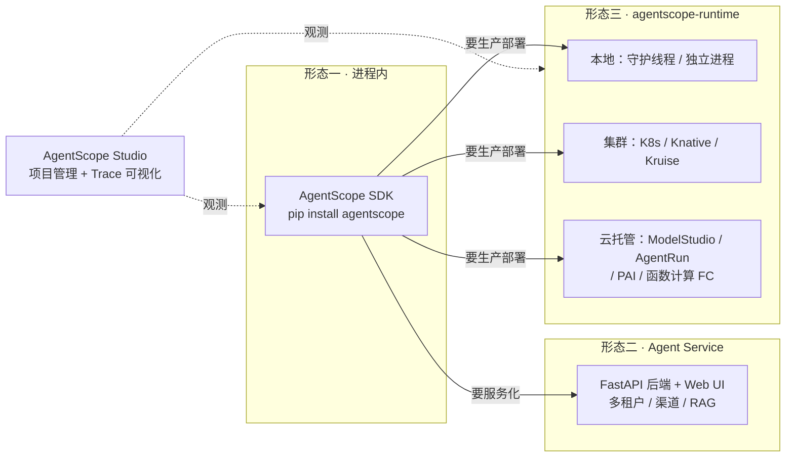
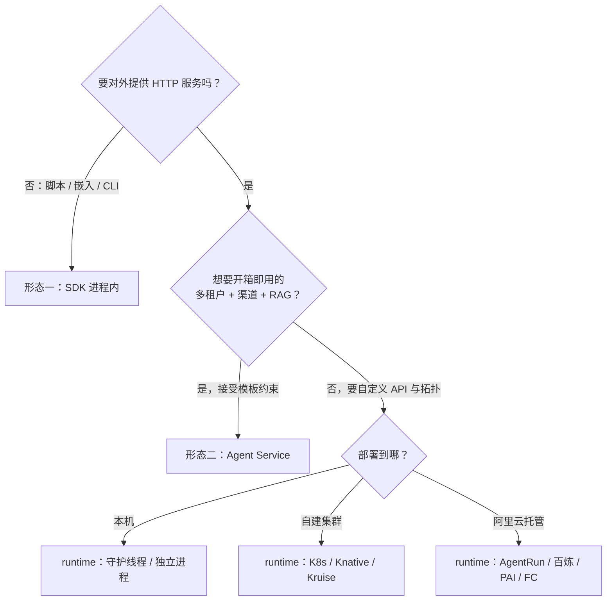

> [!warning] 生产安全提示 · Production Safety
> 本文档含可执行命令/操作步骤。执行前请核对风险等级（🟢低/🔶中/🔴高），高危命令必须 dry-run 并确认回滚方案。完整策略见 [生产安全策略](治理/Production_Safety_Policy.md)。
<!-- op-safety-banner v1 -->
# AgentScope 部署形态全景 (AgentScope Deployment Forms)

> 中文简称：AgentScope 部署形态全景

> **一句话理解**: AgentScope 的部署形态是一条从轻到重的光谱 —— 进程内 SDK、Agent Service 服务化模板、agentscope-runtime 九种部署方式、云厂商托管，同一份代码换部署器即可逐级迁移。

---

## 目录

1. [全景总览](#1-全景总览)
2. [形态一：纯 SDK 进程内（零部署）](#2-形态一纯-sdk-进程内零部署)
3. [形态二：Agent Service（开箱即用服务化）](#3-形态二agent-service开箱即用服务化)
4. [形态三：agentscope-runtime 九种部署方式](#4-形态三agentscope-runtime-九种部署方式)
5. [开发态配套：AgentScope Studio](#5-开发态配套agentscope-studio)
6. [云托管形态对比](#6-云托管形态对比)
7. [选型决策树](#7-选型决策树)
8. [形态间迁移](#8-形态间迁移)
9. [常见坑与落地检查](#9-常见坑与落地检查)

---

## 1. 全景总览

讨论部署形态前先分清三件套（详细辨析见 [[15_智能体/02_Agent框架/17_AgentCore_AgentRun_AgentScope_辨析|AgentCore / AgentRun / AgentScope 辨析]]）：

| 组件 | 是什么 | 在部署中扮演的角色 |
|------|--------|-------------------|
| **AgentScope (SDK)** | 开源多智能体开发框架（Apache 2.0，Python/Java） | 决定"agent 怎么写"，本身不约束部署 |
| **agentscope-runtime** | 独立运行时项目，把 agent 应用打包成服务 | 决定"怎么部署"，内置 9 种部署方式 |
| **阿里云 AgentRun** | 函数计算 FC 下的一站式 Serverless Agentic AI 平台 | 决定"在哪跑"，是 9 种方式中的云托管目标之一 |



图解：三个实线框是三种**生产部署形态**（按重量递增），Studio 是悬在旁边的**开发态工具**不算部署目标。形态一和形态二是"用 AgentScope 自带的东西"，形态三引入独立的 runtime 项目。

**速查表**：

| 形态 | 载体 | 隔离级别 | 适用 | 上线速度 |
|------|------|---------|------|---------|
| 一 · 纯 SDK | 自己的 Python 进程 | 进程级 | 脚本、嵌入式、本地开发 | 最快 |
| 二 · Agent Service | 官方 FastAPI 模板 + Web UI | 进程级（可容器化） | 多租户应用快速上线 | 快 |
| 三 · runtime（本地 2 种） | 守护线程 / 独立进程 | 进程级 | 开发测试、单机生产 | 快 |
| 三 · runtime（集群 3 种） | K8s / Knative / Kruise | 容器级 | 自建集群生产 | 中 |
| 三 · runtime（云托管 4 种） | ModelStudio / AgentRun / PAI / FC | 容器级～微虚拟机级 | 阿里云托管生产 | 中 |

---

## 2. 形态一：纯 SDK 进程内（零部署）

`pip install agentscope` 后 agent 就是普通 Python 对象，跑在你自己的进程里，没有服务化概念。

```python
# 🟢 — 本地交互式对话，回滚: 退出进程
import os, asyncio
from agentscope.agent import ReActAgent
from agentscope.model import DashScopeChatModel
from agentscope.tool import Toolkit, Bash, Read, Write

async def main() -> None:
    agent = ReActAgent(
        name="Friday",
        sys_prompt="You're a helpful assistant named Friday.",
        model=DashScopeChatModel(
            model="qwen-plus", api_key=os.environ["DASHSCOPE_API_KEY"]
        ),
        toolkit=Toolkit(tools=[Bash(), Read(), Write()]),
    )
    msg = None
    while True:
        user_input = input("User: ")
        msg = await agent(msg=user_input)   # 同一实例内多轮，记忆在进程内存

asyncio.run(main())
```

**边界**：

- 记忆与状态存活于进程内存，进程退出即丢失 —— 跨请求会话要靠外置存储（见第 8 节）。
- 没有并发隔离：多个用户共享一个进程 = 共享一个 agent 上下文，不做多租户。
- 适合：CLI 工具、定时脚本、嵌入现有服务的一个模块、原型验证。

**何时升级**：当"别人也要通过网络调用这个 agent"，或"会话状态不能随进程消失"时，进入形态二或三。

---

## 3. 形态二：Agent Service（开箱即用服务化）

官方在 `examples/agent_service` 自带一个 batteries-included 的服务化模板，适合"不想自己搭后端"的团队直接二开。

**能力清单**：

| 能力 | 说明 |
|------|------|
| 后端 | FastAPI，多端点（对话/流式/健康检查） |
| 多租户 | session_id + user_id 双键会话隔离 |
| 渠道接入 | 飞书、Discord、自定义 Webhook |
| RAG | 内置检索管线与知识库挂载 |
| 工具生态 | MCP Hub + Skill Hub（技能装进工作区） |
| 定时任务 | 调度器、后台任务卸载、唤醒 |
| 持久化 | SQL / NoSQL 存租户与 agent 状态 |
| 前端 | `examples/web_ui`（React） |

```bash
# 🟢 — 启动本地服务，回滚: Ctrl+C
git clone -b main https://github.com/agentscope-ai/agentscope.git
cd agentscope/examples/agent_service
python main.py            # 后端 (FastAPI)

# 另开终端启动 Web UI
cd examples/web_ui && pnpm install && pnpm dev
```

**边界**：它是"模板"不是"平台" —— 业务逻辑受限于此模板的结构；要深度定制 API 形态、路由和部署拓扑时，改用形态三的 AgentApp 自己组装。

---

## 4. 形态三：agentscope-runtime 九种部署方式

`agentscope-runtime` 是独立项目（`pip install "agentscope-runtime[ext]>=1.0.0"`），核心心智模型一句话：

> **同一份 `agent_app.py`（AgentApp + ReActAgent + 多端点），换一个 DeployManager 就是换一种部署形态** —— `await app.deploy(deployer, ...)`。

九种方式 = 本地 2 种 + 集群 3 种 + 阿里云托管 4 种。

### 4.1 总表

| # | 部署方式 | DeployManager | 目标环境 | 隔离级别 | 典型场景 |
|---|---------|---------------|---------|---------|---------|
| 1 | 本地守护进程 | `LocalDeployManager()` | 本机主进程内 | 进程级 | 开发调试 |
| 2 | 独立进程 | `LocalDeployManager(host, port)` + `DETACHED_PROCESS` | 本机后台 | 进程级 | 单机生产 |
| 3 | Kubernetes | `KubernetesDeployManager` | 自建/云 K8s | 容器级 | 企业自管生产 |
| 4 | Knative | `KnativeDeployManager` | K8s + Knative | 容器级 | 按请求弹性、缩容至 0 |
| 5 | Kruise | `KruiseDeployManager` | K8s + Kruise Agents | 容器级（实例级沙箱） | 实例隔离、暂停/恢复 |
| 6 | ModelStudio（百炼） | `ModelstudioDeployManager` | 阿里云百炼 | 容器级 | 百炼生态托管 |
| 7 | AgentRun | `AgentRunDeployManager` | 阿里云 AgentRun | 容器级 | Serverless 托管 + 平台沙箱 |
| 8 | PAI | `PAIDeployManager` | 阿里云 PAI (EAS) | 容器级 | 专属资源组、GPU 弹性 |
| 9 | 函数计算 FC | `FCDeployManager` | 阿里云函数计算 | 微虚拟机级 | Serverless 按量付费 |

通用前置：Python 3.10+；必需 `DASHSCOPE_API_KEY`；云部署另需 `DOCKER_REGISTRY`、`KUBECONFIG` 或对应云的 AK/SK。

### 4.2 本地两种模式（方式 1/2）

```python
# 🟢 — 本地部署两种模式，回滚: Ctrl+C 或调 /admin/shutdown
from agentscope_runtime.engine.deploy.local import LocalDeployManager
from agentscope_runtime.engine.deploy.local.utils import DeploymentMode

# 模式 A：守护线程（默认）—— 服务跑在主进程线程里，Ctrl+C 一起退出
await app.deploy(LocalDeployManager(), mode=DeploymentMode.DAEMON_THREAD)

# 模式 B：独立进程 —— 主脚本退出后服务继续，适合 nohup 场景
await app.deploy(
    LocalDeployManager(host="0.0.0.0", port=8080),
    mode=DeploymentMode.DETACHED_PROCESS,
)
```

独立进程模式通过 `POST /admin/shutdown` 远程关闭；生产单机部署建议配 `ServicesConfig` 把会话历史外置到 Redis：

```python
# 🔶 — 生产单机配置，回滚: 改回内存实现并重启
config = ServicesConfig(
    memory_provider="redis",
    session_history_provider="redis",
    redis_config={"host": "redis-host", "port": 6379},
)
```

### 4.3 集群三种（方式 3/4/5）

**Kubernetes**：`app.deploy` 自动构建镜像、推送仓库、生成 Deployment。关键参数：`replicas`、`image_name`、`requirements`、`base_image`、`runtime_config.resources`（requests/limits）、`push_to_registry=True`；扩容直接 `kubectl scale deployment`。

**Knative**：与 K8s 参数类似，增量价值是**按请求自动弹性 + 缩容至 0**，适合流量波峰明显的 agent 服务。前置验证 `kubectl auth can-i create ksvc`。

**Kruise**：基于 OpenKruise 的 `Sandbox CRD`（`agents.kruise.io/v1alpha1`），提供**实例级沙箱隔离**、暂停/恢复（agent 状态保留不销毁），部署后自动创建 LoadBalancer Service。前置 `kubectl get crd sandboxes.agents.kruise.io`。

### 4.4 阿里云托管四种（方式 6/7/8/9）

**ModelStudio（百炼）**： wheel 制品存 OSS，支持 STS Token 临时凭证。环境变量：`ALIBABA_CLOUD_ACCESS_KEY_ID/SECRET`、`MODELSTUDIO_WORKSPACE_ID`。

**AgentRun**：自动构建 wheel 上传 OSS 并创建端点，`agentrun_id` 可更新已有部署。必填 `AGENT_RUN_REGION_ID`、`OSS_BUCKET_NAME`；PRIVATE 网络模式必填 VPC/安全组/VSwitch；默认 `AGENT_RUN_CPU=2.0`、`AGENT_RUN_MEMORY=2048`。与 AgentRun 平台侧沙箱（代码解释器、浏览器操作）的关系见 [[15_智能体/02_Agent框架/15_AgentScope_AgentRun_生产部署架构|AgentScope 与 AgentRun 生产部署架构]]。

**PAI (EAS)**：三种资源类型 —— `public`（公共资源池）、`resource`（专属资源组）、`quota`（配额）；EAS 默认无公网，用 DashScope 需配 VPC。除 SDK 外还有 CLI：

```bash
# 🔶 — 部署到 PAI，回滚: agentscope stop <deploy-id>
agentscope deploy pai ./my_agent \
  --name my-service --workspace-id <ws-id> --env KEY=VALUE
agentscope stop <deploy-id>
```

**函数计算 FC**：Docker 自动构建 zip 存 OSS，HTTP 触发器公网访问，按量付费。必填 `FC_ACCOUNT_ID`、`OSS_BUCKET_NAME`。**会话亲和**是它的关键特性：请求头 `x-agentscope-runtime-session-id` 把同一会话路由到同一实例，弥补 Serverless 无状态实例的会话连续性问题。

```python
# 🔶 — FC 部署，回滚: 控制台删除函数
from agentscope_runtime.engine.deploy.fc import FCDeployManager
await app.deploy(
    FCDeployManager(config=FCConfig(...), oss_config=OSSConfig(...)),
    function_name="my-agent",   # 传同名即更新已有函数
)
```

---

## 5. 开发态配套：AgentScope Studio

Studio 是本地 Web 应用，**不是生产部署目标**，但贯穿所有形态使用：

- **项目管理**：管理智能体应用工程。
- **可视化追踪**：查看运行中 agent 的推理与工具调用轨迹（Trace），调试多智能体协作时的关键工具。

定位类比：Studio 之于 AgentScope ≈ LangSmith 之于 LangChain，但 Studio 是自托管的本地组件，不依赖云服务。

---

## 6. 云托管形态对比

四种阿里云托管目标 + ACS 的横向对比：

| 维度 | ModelStudio（百炼） | AgentRun | PAI (EAS) | 函数计算 FC | ACS |
|------|--------------------|----------|-----------|------------|-----|
| 定位 | 百炼应用平台托管 | Serverless Agentic AI 平台 | 机器学习平台弹性服务 | 通用 Serverless | Serverless 容器集群 |
| 沙箱能力 | 无（纯托管应用） | 平台级（代码解释器、浏览器） | 无 | 无 | Pod 即沙箱容器 |
| 弹性单位 | 实例 | 端点 | 实例/资源组 | 请求（缩容至 0） | Pod |
| 会话亲和 | 平台处理 | 端点级 | 需自配 | `x-agentscope-runtime-session-id` 头 | 需自配 |
| 计费 | 平台计费 | 按量（CPU/内存） | 实例时长 | 按量 | Pod 按量 |
| 适合 | 已在百炼生态 | 要托管沙箱 + 弹性 | 要 GPU 专属资源组 | 波动流量、低成本 | K8s 体验免运维 |

选型速记：**要平台沙箱选 AgentRun，要极致弹性选 FC，要 GPU 选 PAI，要百炼生态选 ModelStudio，要 K8s 免运维选 ACS**。

---

## 7. 选型决策树



三条判据按序问：**要不要服务化 → 要不要模板 → 部署目标是谁**。大多数团队的最终落点是"runtime + 一个云托管目标"（方式 6-9 之一），本地两种方式主要服务于开发期。

---

## 8. 形态间迁移

同一份 agent 代码在形态间迁移的两个前提：

1. **计算无状态化**：agent 实例在请求内构造、请求结束即弃，状态不留在进程内存。
2. **状态外置化**：会话历史与记忆进 Redis（`ServicesConfig`）或 SQL，任何形态都能恢复。

满足这两条后，迁移就是换一行代码：

| 从 → 到 | 改动 |
|---------|------|
| 进程内 → 本地服务 | 包一层 AgentApp，`app.deploy(LocalDeployManager())` |
| 本地 → K8s | 换 `KubernetesDeployManager` + 镜像仓库配置 |
| K8s → AgentRun/FC | 换对应 DeployManager + 云凭证，删掉自管配置 |
| 云托管 A → B | 换 DeployManager；注意会话亲和实现差异（第 6 节） |

**混合拓扑**（推荐的生产形态，详见 [[15_智能体/02_Agent框架/15_AgentScope_AgentRun_生产部署架构|AgentScope 与 AgentRun 生产部署架构]]）：控制面（编排/权限/渠道）自建在 K8s，执行面（不可信代码、浏览器操作）按量丢给 AgentRun 沙箱。

---

## 9. 常见坑与落地检查

| 坑 | 后果 | 规避 |
|----|------|------|
| 会话状态留在进程内存 | 重启/扩容丢会话 | RedisSession 外置，实例无状态重建 |
| 形态一二直接上生产多租户 | 无隔离、无弹性 | 多租户生产走形态三 + 容器级隔离 |
| FC/Knative 忽略会话亲和 | 同会话请求打散到不同实例 | 配 `x-agentscope-runtime-session-id` 头 |
| PAI EAS 不配 VPC 就调 DashScope | 网络不通 | EAS 无公网，先建 VPC 通道 |
| 不可信代码跑在宿主机 workspace | 安全事故 | 代码执行必须进 Docker/E2B/AgentRun 沙箱 |
| Kruise 未装 Sandbox CRD 就部署 | 部署直接失败 | 先 `kubectl get crd sandboxes.agents.kruise.io` 验证 |

完整的生产检查清单（可观测、权限 HITL、评估门禁等）见 [[15_智能体/02_Agent框架/15_AgentScope_AgentRun_生产部署架构|AgentScope 与 AgentRun 生产部署架构]] 第 7 节。

---

## 相关资源

- [AgentScope GitHub](https://github.com/agentscope-ai/agentscope) — 官方 SDK 仓库
- [AgentScope Runtime 部署文档](https://runtime.agentscope.io/zh/deployment.html) — 简单部署 / 高级部署官方章节
- [agentscope-runtime Cookbook: advanced_deployment](https://github.com/agentscope-ai/agentscope-runtime/blob/main/cookbook/zh/advanced_deployment.md) — 9 种部署方式权威文档
- [AgentScope Studio 教程](https://doc.agentscope.io/zh_CN/tutorial/task_studio.html) — 开发态工具
- [阿里云函数计算 AgentRun](https://www.aliyun.com/product/fc/agentrun) — 托管平台产品页

## Related

- [[15_智能体/02_Agent框架/02_AgentScope_深入分析|AgentScope 深入分析]] — 框架架构与多智能体协作（早期版本，部分 API 已过时）
- [[15_智能体/02_Agent框架/15_AgentScope_AgentRun_生产部署架构|AgentScope 与 AgentRun 生产部署架构]] — 生产架构分层与三拓扑选型
- [[15_智能体/02_Agent框架/17_AgentCore_AgentRun_AgentScope_辨析|AgentCore / AgentRun / AgentScope 辨析]] — 三件套概念辨析
- [[15_智能体/02_Agent框架/16_开源多智能体平台_盘点_2026|开源多智能体平台盘点 2026]] — 横向框架对比

---

*Last updated: 2026-10-22*
