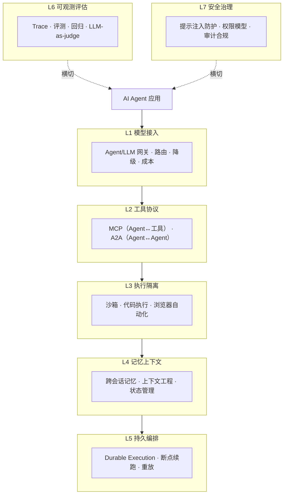
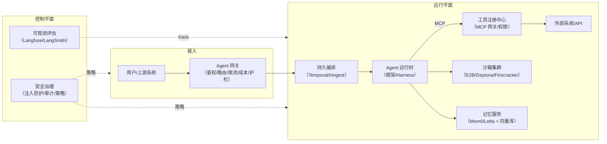

# Agentic Infra 全景 2026：智能体基础设施七层栈

> 中文简称：智能体基础设施全景 2026

> **一句话理解**: 智能体要跑在生产环境，光有模型不够——还需要「电话总机」（网关）、「工具箱协议」（MCP/A2A）、「隔离操作间」（沙箱）、「长期记忆」（记忆层）、「断点续跑的流水线」（持久编排）、「行车记录仪」（可观测）和「安保体系」（安全）这七层基础设施。

---

## 目录

1. [定义与七层全景](#1-定义与七层全景)
2. [L1 模型接入层：Agent 网关](#2-l1-模型接入层agent-网关)
3. [L2 工具协议层：MCP 与 A2A](#3-l2-工具协议层mcp-与-a2a)
4. [L3 执行隔离层：沙箱与代码执行](#4-l3-执行隔离层沙箱与代码执行)
5. [L4 记忆上下文层](#5-l4-记忆上下文层)
6. [L5 持久编排层：Durable Execution](#6-l5-持久编排层durable-execution)
7. [L6 可观测评估层](#7-l6-可观测评估层)
8. [L7 安全治理层](#8-l7-安全治理层)
9. [参考架构与部署形态](#9-参考架构与部署形态)
10. [选型决策速查](#10-选型决策速查)
11. [与本库章节的映射](#11-与本库章节的映射)
12. [参考资源](#12-参考资源)

---

## 1. 定义与七层全景

**Agentic Infra（智能体基础设施）** 是支撑 AI 智能体从 demo 走向生产的专用技术栈。它与底层 [[12_架构基建/02_架构概览/02_AI_基础设施_2026|AI 基础设施]]（GPU/训练/推理）的分野在于：AI Infra 解决「**模型怎么跑**」，Agentic Infra 解决「**智能体怎么长期、安全、可控地工作**」。



上图给出七层栈的全景：L1–L5 是**数据/控制流经的纵向栈**，L6（可观测）与 L7（安全）是**横切所有层的关注面**。

**为什么 2026 年这一层独立成型？**三个驱动力：

| 驱动力 | 表现 |
|--------|------|
| **负载形态变了** | Agentic 负载（长上下文、多轮工具调用、KV 复用）取代纯 chat 成为推理优化的第一场景，倒逼网关与推理栈改造 |
| **失败模式变了** | 业界统计约 65% 的企业 agent 故障源于**上下文漂移（context drift）**而非模型本身，记忆与编排层成为刚需 |
| **攻击面变了** | 间接提示注入成为 2026 企业 agent 的头号安全风险，OWASP 已发布专门的 Agentic AI Top 10 |

---

## 2. L1 模型接入层：Agent 网关

> **一句话理解**: Agent 网关是智能体的「电话总机」——所有模型调用从这里走，统一计费、路由、降级、限流和审计。

### 2.1 为什么需要独立网关层

| 没有 Agent 网关 | 有 Agent 网关 |
|----------------|--------------|
| 每个应用自己写 Provider SDK 适配 | 统一 OpenAI 兼容 API，模型可热切换 |
| 某家模型挂了要改代码 | 声明式 fallback 链自动切换 |
| 成本靠月末账单倒推 | 按 team/API key/token 实时核算与预算告警 |
| 工具调用没有统一策略点 | 网关侧做护栏、脱敏、限流、缓存 |

### 2.2 2026 格局

| 网关 | 形态 | 强项 | 适合 |
|------|------|------|------|
| **LiteLLM** | 开源（Python），自托管为主 | 100+ Provider 适配、代理模式成熟、社区最大 | 自托管标配起点 |
| **Portkey** | 商业（托管 + 自托管） | 护栏（guardrails）、可观测深、控制面完善 | 愿付费买企业能力 |
| **Kong AI Gateway** | 传统 API 网关扩展 | 复用 Kong 生态与插件、企业网关团队友好 | 已有 Kong 的组织 |
| **Higress / APISIX** | 开源（国内生态） | 云原生网关底座 + AI 插件，MCP 支持 | 国内/阿里系技术栈 |
| **Bifrost** | 开源（Go） | 高性能转发、轻量 | Go 技术栈 |
| **TensorZero** | 开源（Rust） | 数据飞轮导向：结构化反馈回流入实验 | 重数据闭环的团队 |
| **Helicone** | 开源 + 托管 | 轻量缓存/可观测起步 | 个人与初创 |

**2026 关键变化**：网关的对比维度从「支持多少模型」变成「**是否原生支持 MCP**」「是否有 agent 级 trace」「护栏与权限粒度」——网关正在从「LLM 代理」演化为「Agent 控制平面」。

### 2.3 最小可用配置示例（LiteLLM）

```yaml
# litellm.config.yaml — 网关路由 + 降级链 + 预算
model_list:
  - model_name: agent-primary        # 对 Agent 暴露的逻辑名
    litellm_params:
      model: anthropic/claude-opus-5-5   # 2026-09 发布的 5.5 家族
      api_key: os.environ/ANTHROPIC_KEY
  - model_name: agent-primary
    litellm_params:
      model: deepseek/deepseek-v4-flash  # 降级档：MIT 开源、成本优
      api_key: os.environ/DEEPSEEK_KEY

router_settings:
  fallbacks: [{"agent-primary": ["agent-primary"]}]  # 同名多配置即降级链
  num_retries: 2
  timeout: 30

general_settings:
  master_key: os.environ/GATEWAY_KEY   # 所有 Agent 统一鉴权入口
```

上面配置实现了智能体接入的三个基本盘：**逻辑模型名解耦**（换模型不改代码）、**降级链**（旗舰挂了自动切开源档）、**统一鉴权**。

选型深读：[[12_架构基建/11_AI网关/README|12_架构基建 AI 网关]] 与 [[概念/LLM/ai-gateway-2|AI 网关概念]]。

---

## 3. L2 工具协议层：MCP 与 A2A

> **一句话理解**: 协议层规定「智能体怎么接工具、怎么找同伴」——MCP 管工具连接，A2A 管智能体互联。

2026 年中，协议栈收敛为两层（详见 [[15_智能体/16_Agent协议/02_AG-UI_ACP_协议_2025|协议深入分析]]）：

| 协议 | 连接对象 | 2026 状态 |
|------|---------|-----------|
| **MCP** | Agent ↔ 工具/数据源 | 事实标准，主流框架与企业工具原生兼容；WebMCP 等浏览器侧扩展兴起 |
| **A2A** | Agent ↔ Agent | 2026-06 吸收 ACP 规范，Agent Card 服务发现成为多智能体互联基础 |

**基础设施视角的三个要点**：

1. **MCP 网关化**：企业不会让每个 agent 直连任意 MCP server——网关侧做**工具注册、鉴权、审计、限流**，MCP server 的「目录/治理」成为 L1 网关的新职能；
2. **工具即攻击面**：每一个 MCP 工具都是间接提示注入的入口，L7 安全层必须与工具注册联动（见第 8 章）；
3. **A2A 的服务发现**：Agent Card 让智能体像微服务一样被注册与发现，多智能体平台的「服务网格」正在成型。

---

## 4. L3 执行隔离层：沙箱与代码执行

> **一句话理解**: 沙箱是智能体的「隔离操作间」——agent 生成的代码、命令、浏览器操作都在一次性或可复用的安全环境里执行，跑崩了、被注入了，都烧不到宿主系统。

### 4.1 为什么沙箱是刚需

代码执行型智能体（coding agent、computer-use agent、数据分析 agent）的输出是**不可信代码**：

- 直接在宿主机执行 = 提示注入可以变成任意命令执行；
- 容器共享内核仍有逃逸面，microVM（Firecracker 级）成为高隔离首选；
- agent 需要**有状态地反复操作**同一环境（装依赖、改文件、跑测试），纯无状态函数计算不匹配。

### 4.2 2026 格局

| 平台 | 定位 | 关键特性 | 适合 |
|------|------|---------|------|
| **E2B** | The AI Agent Cloud | 每个Agent一个隔离机：跑代码/浏览/工具，可 pause/fork；支持跑在自有 AWS/GCP/Azure | 聚焦代码执行的快速集成 |
| **Daytona** | 有状态工作区 | ~90ms 环境创建、有状态（agent 可离开后回到同一环境）、企业级安全 | 以「整个仓库/应用」为工作单元 |
| **Modal** | 通用算力平台 | 无服务器容器 + GPU、按秒计费，代码执行是能力之一 | 计算密集型（含 GPU 推理/执行） |
| **Cloudflare Sandbox SDK** | 边缘沙箱 | Workers/V8 隔离、全球分布、冷启动极低 | 轻量、边缘、无 OS 级需求 |
| **CodeSandbox SDK** | 仓库级沙箱 | 整仓库虚拟化、快照 | 前端/全栈 agent 预览与测试 |

**选型主轴是无状态 vs 有状态**：

- **无状态快执行**（跑一段 Python 拿结果）：E2B / CF Sandbox SDK 更快；
- **有状态工作区**（agent 长期驻留开发一个项目）：Daytona / CodeSandbox 更合适——环境可以保存、恢复、fork。

### 4.3 自建 vs 托管

| 维度 | 托管（E2B/Daytona） | 自建（K8s + Firecracker/Kata） |
|------|--------------------|------------------------------|
| 上手速度 | 小时级 | 周级起步 |
| 数据合规 | 需评估（E2B 已支持自有云部署） | 完全可控 |
| 成本曲线 | 按用量，规模化后变贵 | 固定投入，规模化后占优 |
| 隔离强度 | 平台负责（microVM 为主） | 自行保障（参见 [[概念/K8s/cri|容器运行时]] 与 gVisor/Kata 选型） |

浏览器自动化（browser agent）是执行隔离的姊妹场景，见 [[概念/Agent/browser-agent|浏览器智能体]]。

---

## 5. L4 记忆上下文层

> **一句话理解**: 记忆层解决「智能体的长期记忆」——跨会话记住用户偏好与任务状态，并把「该记什么、该忘什么、该带什么进上下文」变成工程问题。

### 5.1 问题：context drift 是头号故障源

业界 2026 年的共识数据：**约 65% 的企业 agent 故障可追溯到上下文漂移**——不是模型不行，而是「上下文里该有的没有了、不该有的还在」。上下文工程（context engineering）由此从技巧上升为基础设施职责：

| 记忆类型 | 内容 | 典型实现 |
|---------|------|---------|
| 工作记忆 | 当前对话窗口 | 模型上下文本身 |
| 情景记忆 | 会话历史、过往交互摘要 | 向量检索 + 摘要压缩 |
| 语义记忆 | 用户偏好、事实知识 | 向量库 / 知识图谱 |
| 程序记忆 | 技能与操作模式 | Skill 化沉淀（参见 [[15_智能体/05_Agent技能/README|Agent 技能]]） |

### 5.2 2026 格局

| 系统 | 架构取向 | 强项 | 适合 |
|------|---------|------|------|
| **Mem0** | 检索式记忆 API（抽取-存储-召回） | 生产级多租户、可预测的外部治理记忆操作 | 应用内嵌记忆层 |
| **Letta**（原 MemGPT） | Agent-native 运行时，记忆内建于 agent 生命周期 | 记忆与 agent 运行时一体、自编辑记忆 | 以 agent 为一等公民的平台 |
| **Zep** | 时间知识图谱 | 时序推理、事实演化追踪 | 需要时间线推理的助理 |
| **Feather DB / MemPalace 等** | 轻量/隐私优先 | 本地化、零成本起步 | 隐私敏感与个人场景 |

**决策要点**：Mem0 路线把记忆做成**外部受管服务**（应用显式调用 add/search）；Letta 路线把记忆做成**运行时内在能力**（框架自动管理）。前者易与现有系统集成，后者更「agent 原生」但引入运行时绑定。

深入展开见 [[15_智能体/06_记忆基础设施/README|记忆基础设施子域]] 与 [[概念/Agent/agent-memory-systems|Agent 记忆系统]]。

---

## 6. L5 持久编排层：Durable Execution

> **一句话理解**: 持久编排解决「智能体任务跑到一半断电/超时/被限流」的问题——把多步任务写成可重放的工作流，任何一步失败都能从断点恢复，而不是从头再来。

### 6.1 为什么 Agent 需要工作流引擎

智能体任务的特点：**长时（分钟到天）、多步（几十次工具调用）、外部依赖多（模型 API/沙箱/数据源）**。任何一环抖动都会让「裸写的 agent 循环」前功尽弃。Durable execution 引擎提供：

- **状态持久化**：每步结果落盘，进程重启后恢复；
- **确定性重放**：相同输入重放得到相同执行轨迹，排障与合规审计友好；
- **超时/重试/补偿**：声明式策略，替代手写重试泥潭。

### 6.2 2026 格局

| 引擎 | 形态 | 强项 | 适合 |
|------|------|------|------|
| **Temporal** | 自托管/云，最成熟 | 多日 agentic 工作流、重放历史跨服务重启存活、生态最大 | 企业级长流程 |
| **Inngest** | 托管优先，函数式 | 无需自建 worker/队列，事件驱动，DX 好 | 事件驱动的产品团队 |
| **Restate** | 轻量 durable execution | 日志即状态，嵌入简单 | 中小型 agent 服务 |
| **AWS Step Functions** | 云托管 | 与 AWS 服务原生集成 | 全栈 AWS 团队 |
| **Cloudflare Workflows** | 边缘托管 | 与 Workers/Durable Objects 集成 | 边缘/CF 技术栈 |
| **Upstash Workflow / Trigger.dev** | 轻量托管 | 起步快 | 初创与中小项目 |

### 6.3 模式示例（伪代码）

```python
# 用 Temporal 风格把 agent 循环变成 durable workflow
@workflow.defn
class ResearchAgentWorkflow(workflow.Workflow):
    @workflow.run
    async def run(self, topic: str) -> Report:
        plan = await workflow.execute_activity(
            plan_activity, topic, retry_policy=max_attempts(3))
        findings = []
        for sub in plan.subtopics:                     # 每个子题独立可恢复
            f = await workflow.execute_activity(
                research_activity, sub,
                retry_policy=max_attempts(5),
                start_to_close_timeout=timedelta(minutes=10))
            findings.append(f)
        # 若在第 7 个子题时进程崩溃，重启后从第 7 个继续，前 6 个结果不丢
        return await workflow.execute_activity(draft_activity, findings)
```

上面代码的关键价值在注释那行：**子任务粒度的断点续跑**。这就是裸 `while` 循环做不到、而 durable engine 用事件溯源免费给你的能力。

---

## 7. L6 可观测评估层

> **一句话理解**: 可观测层是智能体的「行车记录仪 + 年检」——trace 记录每一步做了什么，评测判断做得好不好，回归门禁保证改动不会变差。

### 7.1 Agent Trace 的特殊性

传统 APM 监控请求/延迟/错误；Agent 可观测以 **trace 为一等公民**，一棵 trace 树包含：LLM 调用（prompt/completion/token/成本）、工具调用（入参/结果/耗时）、子 agent 边界、检索（RAG span）、记忆读写。2026 年主流平台均已支持嵌套 span 与 OpenTelemetry 兼容导出。

### 7.2 2026 格局

| 平台 | 形态 | 强项 | 适合 |
|------|------|------|------|
| **Langfuse** | 开源（可自托管）+ 云 | UI 内定义 LLM-as-judge 自动跑在流入 trace 上、代码/人工评分混合 | 自主可控优先的团队 |
| **LangSmith** | 商业 | LangChain/LangGraph 深度集成 | LangChain 系用户 |
| **Braintrust** | 商业 | 评测与实验（prompt playground、离线 eval）见长 | 重 eval 驱动开发 |
| **Arize / Phoenix** | 商业 / 开源 | 与传统 ML 可观测打通 | ML 平台团队 |
| **Opik（Comet）** | 开源 + 商业 | eval + trace 一体，免费额度友好 | 中小团队 |
| **MLflow** | 开源 | 传统实验追踪扩展出的 LLM/agent 支持 | 已有 MLflow 底座 |

### 7.3 实践要点

| 实践 | 说明 |
|------|------|
| **统一 trace 规范** | 以 OTLP 或平台 SDK 埋点，横跨 L1 网关与 L3 沙箱，一个请求一条完整树 |
| **在线评测** | 抽样生产 trace 跑 LLM-as-judge，把「质量」变成可告警的指标 |
| **离线回归** | agent 任务集（golden tasks）进 CI，模型/提示词升级前后对比 |
| **成本归因** | trace 上的 token 计量与 L1 网关账单对账，按 feature/team 分摊 |

深入见 [[15_智能体/07_Agent评估/README|Agent 评估子域]] 与 [[11_模型运维/08_可观测性/02_AI_可观测性_指南_2026|AI 可观测性指南]]。

---

## 8. L7 安全治理层

> **一句话理解**: 安全是智能体的「安保体系」——假设模型会被骗（提示注入）、工具会被滥用（越权）、数据会被泄露，用多层控制把爆炸半径压到最小。

### 8.1 攻击面（2026）

| 攻击类 | 说明 | OWASP 定位 |
|--------|------|-----------|
| **间接提示注入** | 恶意指令藏在 agent 读取的网页/文档/邮件里，劫持其行为 | 2026 企业 agent 头号风险；LLM Top 10 首位相关 |
| **工具劫持** | 污染工具描述或 MCP server 响应，诱导 agent 调用高危工具 | Agentic Top 10 新增类 |
| **数据外泄** | agent 把敏感上下文带进外部模型/工具调用 | 隐私与合规交叉 |
| **过度自主** | 权限过大的 agent 被注入后执行破坏性操作 | 需人类审批门 |

### 8.2 六层控制模型

2026 年企业防护的主流框架是纵深防御的**六层控制**：

| 层 | 控制 | 基础设施落点 |
|----|------|-------------|
| 1. 身份 | Agent/工具/用户各自有身份（非共享 API key） | L1 网关统一鉴权 |
| 2. 最小权限 | 工具调用按角色收敛，写操作白名单 | MCP 网关的工具授权 |
| 3. 运行时强制 | 沙箱隔离 + 出网管控 + 资源限额 | L3 沙箱（microVM） |
| 4. 行为监控 | trace 上的异常检测（注入特征/异常工具链） | L6 可观测联动 |
| 5. 审计 | 全量工具调用留痕可重放 | L5 持久编排的事件日志 |
| 6. 治理合规 | 模型/数据/工具清单、策略即代码 | 平台控制面 |

**核心设计公理：提示注入无法被「彻底防住」，只能被「限损」**——把 agent 能接触的权限、能执行的环境、能外发的通道都当假设已被攻陷来设计。

深入见 [[17_伦理安全/README|伦理安全]] 章节与 [[12_架构基建/10_安全/README|架构安全]]。

---

## 9. 参考架构与部署形态

### 9.1 企业级 Agentic 平台参考架构



上图：**运行平面**承载 agent 的实际执行（数据流），**控制平面**（trace + 策略）横切治理。网关是唯一入口，沙箱是唯一代码执行点，工具注册是唯一出网通道——三个「唯一」限定了爆炸半径。

### 9.2 三种部署形态

| 形态 | 栈组合 | 月成本量级（2026） | 说明 |
|------|--------|------------------|------|
| **初创/个人** | 托管全上：Portkey/LiteLLM 云 + E2B + Langfuse 云 + Inngest | 数十至数百美元 | 零运维，按用量 |
| **中型团队** | 混合：自托管 LiteLLM + Daytona/E2B 自有云 + Langfuse 自托管 + Temporal 云 | 数百至数千美元 | 控成本与数据，保留托管编排 |
| **企业/合规** | 全自建：Kong/Higress 网关 + K8s 上的 Firecracker 沙箱 + Mem0 自托管 + Temporal 自建 + 自建可观测 | 固定投入为主 | 数据不出域，配套 SRE 团队 |

---

## 10. 选型决策速查

| 问题 | 推荐路径 |
|------|---------|
| 只想统一多家模型 API + 算钱 | LiteLLM 自托管起步 |
| 需要护栏/审批/企业控制面 | Portkey 或 Kong AI Gateway |
| Agent 要跑用户提交的代码 | 无状态执行选 E2B；整仓库工作区选 Daytona；GPU 计算选 Modal |
| 跨会话记住用户 | 应用内嵌选 Mem0；agent 原生运行时选 Letta；时序推理选 Zep |
| 任务跑几分钟到几天、要断点续跑 | Temporal（企业）/ Inngest（事件驱动产品）/ Restate（轻量） |
| 要看 agent 每一步并自动评质量 | 自托管选 Langfuse；LangChain 系选 LangSmith；eval 重选 Braintrust |
| 面向互联网的浏览/文档型 agent | L3 沙箱 + L7 注入防护为强制项，工具白名单收窄 |

---

## 11. 与本库章节的映射

| 本文章节 | 深入章节 |
|---------|---------|
| L1 网关 | [[12_架构基建/11_AI网关/README|12_AI网关]] |
| L2 协议 | [[15_智能体/16_Agent协议/README|16_Agent协议]]、[[概念/Agent/agent-protocols|协议概念]] |
| L3 沙箱 | [[概念/Agent/browser-agent|浏览器智能体]]、[[概念/K8s/cri|容器运行时]] |
| L4 记忆 | [[15_智能体/06_记忆基础设施/README|06_记忆基础设施]] |
| L5 编排 | [[15_智能体/03_Agent工作流/README|03_Agent工作流]] |
| L6 可观测 | [[15_智能体/07_Agent评估/README|07_Agent评估]]、[[11_模型运维/08_可观测性/README|可观测性]] |
| L7 安全 | [[17_伦理安全/README|17_伦理安全]]、[[12_架构基建/10_安全/README|架构安全]] |
| 底层 AI Infra | [[12_架构基建/02_架构概览/02_AI_基础设施_2026|AI 基础设施 2026]] |

---

## 12. 参考资源

- [E2B — The Enterprise AI Agent Cloud](https://e2b.dev/)
- [Daytona — Secure Infrastructure for AI-Generated Code](https://www.daytona.io/)
- [Daytona vs E2B（Northflank, 2026-06）](https://northflank.com/blog/daytona-vs-e2b-ai-code-execution-sandboxes)
- [AI agent sandbox platforms 对比（LogRocket, 2026-08）](https://blog.logrocket.com/comparing-ai-agent-sandbox-platforms-e2b-modal-daytona-and-more/)
- [LLM Gateway Comparison 2026（Flotorch）](https://www.flotorch.ai/blogs/llm-gateway-comparison-2026)
- [7 Open-Source LiteLLM Alternatives（API7）](https://api7.ai/litellm-alternative)
- [AI Memory Systems in 2026（Feather）](https://getfeather.store/theory/ai-memory-systems-comparison-2026)
- [Mem0 vs Letta in Production（Medium）](https://medium.com/data-science-collective/mem0-vs-letta-choosing-the-right-ai-agent-memory-layer-4458712d22a6)
- [Durable Workflow Engines in 2026（Upstash）](https://upstash.com/blog/durable-workflow-engines-compared-every-major-option-in-2026)
- [Temporal vs Inngest vs Restate（Spheron, 2026-06）](https://www.spheron.network/blog/ai-agent-workflow-orchestration-temporal-inngest-restate-gpu-cloud/)
- [Top LLM Observability Platforms 2026（MarkTechPost, 2026-08）](https://www.marktechpost.com/2026/08/09/top-llm-observability-and-evaluation-platforms-in-2026-langfuse-langsmith-braintrust-arize-and-more-compared/)
- [Langfuse — Agent Evals & Observability](https://langfuse.com/)
- [AI Agent Security: 2026 Enterprise Guide（NeuralTrust）](https://neuraltrust.ai/blog/ai-agent-security-enterprises-complete-guide)
- [Prompt Injection: 2026 Enterprise Defense Playbook（AccuroAI）](https://accuroai.co/blog/prompt-injection-attacks-definitive-enterprise-guide-2026)

---

*Last updated: 2026-10-14*
