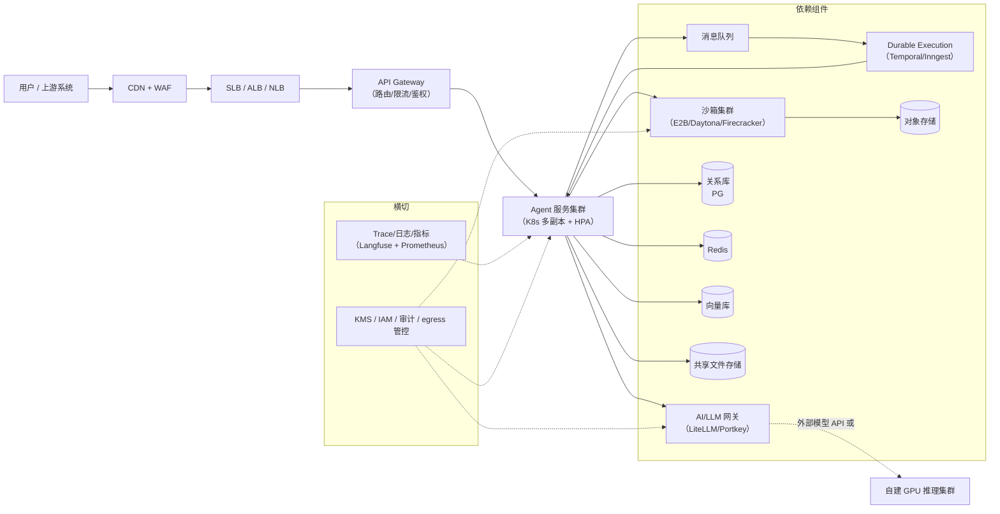
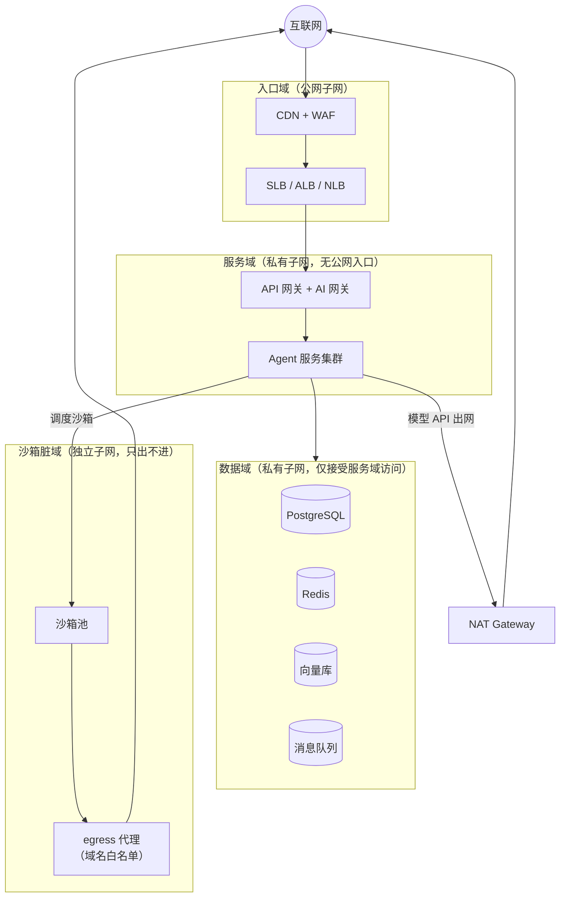

# Agent 生产环境组件清单：从 SLB 到沙箱的云资源全景

> 中文简称：Agent 生产环境组件清单

> **一句话理解**: 把一个 agent 从 demo 搬上生产，要在云上开齐「大门（SLB/WAF）、总机（AI 网关）、车间（服务集群）、隔离操作间（沙箱）、仓库（各种存储）、流水线（MQ/Temporal）、监控室（Trace/日志）、保险柜（KMS）」这一整套组件——本文按请求生命周期逐层列清，并把每个组件展开成「为什么需要 + 关键设计 + 典型选型 + 落地要点」。

---

## 目录

1. [组件全景图与本文读法](#1-组件全景图与本文读法)
2. [入口与流量层](#2-入口与流量层)
3. [计算与执行层](#3-计算与执行层)
4. [存储层](#4-存储层)
5. [异步与编排层](#5-异步与编排层)
6. [可观测与安全层（横切）](#6-可观测与安全层横切)
7. [网络底座](#7-网络底座)
8. [部署组合：最小可用 vs 完整版](#8-部署组合最小可用-vs-完整版)
9. [云厂商资源映射速查](#9-云厂商资源映射速查)
10. [选型口诀展开](#10-选型口诀展开)
11. [相关文档](#11-相关文档)

---

## 1. 组件全景图与本文读法

### 1.1 全景图



上图给出一次 agent 请求流经的组件：流量从 CDN/WAF/SLB 进来，经 API 网关到无状态 agent 服务；agent 通过 AI 网关调模型、进沙箱跑代码、读写各类存储；长任务交给 MQ + Durable Execution；Trace 与安全组件横切所有环节。

### 1.2 本文读法

- **与 [[15_智能体/20_Agentic_Infra/01_Agentic_Infra_全景_2026|Agentic Infra 全景]] 的分工**：01 讲七层栈的「技术与厂商格局」（谁强谁弱、怎么演进）；本文讲「落到云上要开哪些资源」（每个组件的原理、设计要点、选型对比、落地坑位）。两文互为补充。
- **每个组件统一五问**：一句话理解 → 是什么/为什么需要 → 关键设计 → 典型选型 → 落地要点与坑。
- **读的顺序建议**：按请求生命周期从上往下（入口 → 计算 → 存储 → 异步 → 横切 → 网络），与真实排障顺序一致。

---

## 2. 入口与流量层

先建立一个贯穿本层的分工表——三个「网关」经常被混为一谈：

| 组件 | 管什么 | 回答的问题 |
|------|--------|-----------|
| **SLB（四层/七层负载均衡）** | 连接与包：流量分发、TLS 终结、健康检查 | 这个请求该到哪台机器？ |
| **API 网关** | API 语义：路由、鉴权、限流、计量 | 这个调用是谁发的、允不允许？ |
| **AI/LLM 网关** | 模型语义：模型路由、降级、token 限流、成本核算 | 这次调用该用哪个模型、花多少钱？ |

---

### 2.1 SLB / ALB / NLB（负载均衡）

> **一句话理解**: 负载均衡是站点的「大门」——所有外部流量从这里进来，被分发到健康的后端副本上。

**是什么：四层与七层的分野**

- **四层 LB（L4，如 NLB、LVS、云 SLB 四层实例）**：工作在传输层，只看 IP 和端口转发 TCP/UDP 连接，不解析 HTTP。转发效率高、支持超长连接，对 SSE、WebSocket、gRPC 这类长连接天然友好（连接建立后它不再管内容）。
- **七层 LB（L7，如 ALB、Nginx、Envoy）**：工作在应用层，解析 HTTP 报文，可以按 path、host、header 做路由规则，也能做 TLS 终结后看到明文内容。

**为什么 agent 场景两者常成对出现**

agent 流量的主体是 **SSE 流式响应和长连接**（一次请求可能流式输出几分钟）。七层代理的默认空闲超时（如 ALB 默认 60 秒无数据即断开）会掐断「模型还在思考、尚无字节返回」的等待期。典型组合是：**NLB 在最前**（四层透传、连接稳定、固定 IP），**ALB 在后**（按 path 把 `/api/*` 路由到 agent 服务、`/admin/*` 路由到控制台），各取所长。

**关键概念**

| 概念 | 说明 | agent 场景注意点 |
|------|------|-----------------|
| **TLS 终结** | 在 LB 卸载 TLS 证书，后端走内网明文或重新加密 | 证书集中管理、轮换只改一处；合规严格时选重加密（re-encrypt） |
| **健康检查** | LB 主动探测 `/healthz`，失败摘除副本 | 探针要区分「进程活着」（liveness）与「依赖就绪」（readiness），避免依赖抖动引发全站摘除 |
| **连接排水** | 缩容/发布时停止接新请求、等存量请求跑完 | SSE 长连接排水慢，排水超时要按最长流式时长设置 |

**典型选型**

| 选型 | 特点 | 适合 |
|------|------|------|
| 云 SLB（阿里 SLB / AWS ALB + NLB） | 托管、多可用区、按量计费 | 绝大多数团队的首选 |
| **Nginx**（自建） | 七层规则灵活、生态成熟 | 已有运维体系、需要深度定制 |
| **LVS**（自建） | 四层、内核态、极高吞吐 | 大流量四层入口 |
| **Envoy**（自建/K8s Ingress 底座） | 云原生、可编程（xDS）、可观测好 | K8s 体系的 Ingress Gateway |

**落地要点与坑**

- SSE 流式：关闭代理缓冲（Nginx `proxy_buffering off` 或响应头 `X-Accel-Buffering: no`），调大空闲超时；
- 客户端断连要能传导到 agent 服务（`request.is_disconnected()`），否则模型还在烧 token 给已离开的用户；
- 发布走滚动 + 连接排水，避免「一刀切」杀掉进行中的流式请求。

---

### 2.2 WAF 与 CDN

> **一句话理解**: WAF 是大门上的「安检仪」，挡住攻击流量；CDN 是「前置仓」，把静态资源送到离用户最近的边缘。

**WAF（Web Application Firewall）**

- **挡什么**：OWASP Top 10 常规攻击（SQL 注入、XSS）、**CC 攻击**（应用层 DDoS，高频刷接口）、bot 滥用与撞库；
- **为什么 agent 必备**：agent 对外暴露 Web UI 和**回调接口（webhook）**——回调接口通常「不带用户态、直接执行业务」，是重放攻击的靶子；模型 API 端点也面临刷量薅 token 的风险；
- **agent 场景特殊性**：prompt 请求体大、内容千奇百怪，通用 WAF 规则**误杀率高**——需要对模型端点配置例外规则或专用频控策略，而不是套通用规则一刀切。

**CDN（内容分发网络）**

- 缓存 Web UI、文档等静态资源到边缘节点，回源量骤降；
- **注意**：API 路径必须绕过缓存（`Cache-Control: no-store`），SSE 流式响应绝不能被 CDN 缓冲——否则流式变成「卡半天一次性吐出」。

**典型选型**：云 WAF + CDN（阿里云 CDN + WAF、AWS CloudFront + WAF）、**Cloudflare**（WAF/CDN/bot 管理一体，SaaS 团队常用）。

**落地要点与坑**：请求体大小限制（长 prompt 可能超过 CDN/WAF 默认 body 上限，需要调大）；WebSocket/SSE 的边缘支持策略要显式配置；把 WAF 日志接入可观测层，攻击模式反哺频控规则。

---

### 2.3 AI/LLM Gateway（模型网关）

> **一句话理解**: 模型网关是所有模型调用的「唯一总机」——它不管流量包，只管模型语义：谁在调、调哪个模型、挂了切谁、花了多少钱。

**为什么需要：五个职能逐条看**

| 职能 | 没有网关的后果 | 网关提供什么 |
|------|---------------|-------------|
| **统一鉴权** | 各家 provider 的 API key 散落在各应用 | 应用只拿网关 virtual key，按 team/agent 发放与吊销；真 key 只在网关 |
| **路由与降级** | 某家模型故障就要改代码发版 | 逻辑模型名 → 物理模型映射；fallback 链（旗舰 → 开源档）自动切换 |
| **限流** | 只有 QPS 维度，与 provider 配额（TPM/RPM）错位 | 按 token 维度限流，per-key/per-model/per-team 分层 |
| **成本核算** | 月末账单倒推，无法归因 | 每次调用记账（token × 单价），按 feature/team 分摊，预算硬熔断 |
| **横切能力** | 每个应用自己实现脱敏/缓存/埋点 | PII 脱敏、语义缓存、护栏注入、trace 埋点在网关一处生效 |

**关键设计：与 SLB 的本质区别**——SLB 看到「一个 HTTP 请求」，AI 网关看到「一次模型调用」：它理解 OpenAI 协议体、知道 `model` 字段、会数 `usage.tokens`、能识别 429 与 5xx 该分别怎么重试。所以 SLB 不能替代它，反之它也不做流量分发。

**典型选型**（深度对比见 [[15_智能体/20_Agentic_Infra/01_Agentic_Infra_全景_2026|全景 2026]] 第 2 章与 [[12_架构基建/11_AI网关/README|AI 网关章节]]）：

| 选型 | 一句话定位 |
|------|-----------|
| **LiteLLM** | 开源自托管标配：100+ provider 适配、OpenAI 兼容代理、virtual key/预算/降级开箱即用 |
| **Portkey** | 商业托管：护栏（guardrails）与控制面完善 |
| **Kong AI Gateway** | 已有 Kong 生态组织的自然延伸，插件体系复用 |
| **Higress** | 阿里开源云原生网关 + AI 插件，国内栈友好 |

**落地要点与坑**

- 以 **OpenAI 兼容协议**作为统一面，agent 框架侧只写一次接入代码；
- 网关自身要高可用部署——它是模型链路上的单点，挂了全站模型调用全挂；
- **语义缓存**对 agent 多步调用省钱明显，但「同 prompt 不同意图」的误命中风险高，建议只对确定性场景（embedding、固定查询模板）开启；
- 网关里的 provider key 是最高危资产，必须进密钥管理（见 6.3），永不落明文配置。

---

## 3. 计算与执行层

### 3.1 Agent 服务集群

> **一句话理解**: 车间本体——跑 agent 运行时（循环、prompt 组装、工具编排）的无状态服务，多副本弹性伸缩。

**关键设计一：无状态是铁律**

会话状态、任务进度全部外置到 Redis/PG（见第 4 章），服务进程本身不留任何「只有它知道」的数据。收益是三件免费的事：水平扩缩容（任何副本可服务任何请求）、滚动发布（杀掉旧副本不丢会话）、故障漂移（副本挂了请求换一台重放）。凡是「这个会话粘在这台机器上」的设计，都会在扩缩容和发布时变成事故。

**关键设计二：HPA 的指标选择**

- agent 负载大部分时间**在等模型 IO**（一次 LLM 调用几十秒），CPU 占用反而低——用 CPU 做 HPA 指标会严重滞后；
- 更好的指标：**并发请求数、队列深度、每副本活跃会话数**（KEDA 可直接以 MQ 队列长度驱动扩缩）；
- 缩容保护：SSE 长连接使连接排水慢，缩容窗口要放长，且配合 3.1 的连接排水机制。

**典型选型**

| 选型 | 说明 |
|------|------|
| **K8s Deployment** | 标配：多副本 + HPA + 滚动发布；配 PDB（Pod Disruption Budget）保证发布期容量 |
| 云容器实例（ECS/Fargate/ASK 等） | 免运维 K8s，适合小团队起步 |
| 虚机 + systemd | 极简场景可用，但弹性与发布体验差 |

**落地要点与坑**

- 每副本**并发上限**（信号量/工作池）必须显式设置——一次流量尖峰打爆的不是 CPU 而是「同时挂着的几百个未完成 LLM 调用」；
- readiness 探针要含关键依赖（Redis/PG 可达），liveness 探针要轻（只查进程自身），避免依赖抖动触发重启风暴；
- 资源 request/limit 按压测数据定，agent 服务偏 IO 型，内存（上下文缓存）通常先到顶。

深入部署操作见 [[15_智能体/Agent_Production_Deployment_Runbook|智能体生产部署手册]]。

---

### 3.2 沙箱集群

> **一句话理解**: 隔离操作间——agent 生成的代码、命令、浏览器操作都在一次性或可复用的隔离环境里执行；跑崩了、被注入了，都烧不到宿主系统。

**为什么是安全边界，不是可选项**

- 模型输出 = **不可信输入**。间接提示注入可以诱导 agent 生成恶意代码，直接在宿主机执行等于把 shell 交给攻击者；
- 多租户共享算力时，租户 A 的 agent 与租户 B 的数据之间必须有横向隔离；
- 沙箱把爆炸半径限制在「一个用完即弃的 microVM」里——这是 L7 安全层「运行时强制」的物理基础（六层控制模型见 [[15_智能体/20_Agentic_Infra/01_Agentic_Infra_全景_2026|全景 2026]] 第 8 章）。

**关键设计一：隔离强度谱系**

| 技术 | 隔离原理 | 启动速度 | 隔离强度 | 适用 |
|------|---------|---------|---------|------|
| **Docker 容器** | 共享内核，namespace/cgroup | ~秒级 | 弱（内核逃逸面存在） | 跑自己人的代码，**不适合不可信代码** |
| **gVisor** | 用户态内核拦截 syscall | 快 | 中 | 需要高兼容性的轻量隔离 |
| **Kata Containers** | 每 Pod 一个轻量 VM | 秒级 | 强（内核隔离） | K8s 上的多租户隔离 |
| **Firecracker microVM** | 极简 VM（AWS Lambda/Fargate 同款） | ~125 ms，快照恢复更快 | 强 + 开销极小（MB 级内存开销） | agent 沙箱首选的隔离原语 |

**关键设计二：生命周期与冷启动**

- **池化预热（warm pool）**：预先起一批热沙箱待命，请求来了直接认领——冷启动从秒级降到毫秒级；
- **快照/模板**：用 Firecracker snapshot 或预装好环境的模板盘，把「装依赖」的时间从每次执行中砍掉；
- **生命周期策略**：一次性（跑完销毁，安全最大化）vs 会话级（同一任务复用环境 + TTL 回收，省启动开销）——coding agent 需要会话级（装一次依赖反复用），数据分析 agent 常常一次性即可。

**关键设计三：资源与产物**

- 资源配额（CPU/内存/进程数/磁盘/运行时长）必须全部设限——防死循环、fork 炸弹和磁盘写满；
- 产物（生成的文件、报表）**落对象存储**，沙箱本身可弃——环境无状态化后，沙箱层故障就只是「重跑一次」；
- 网络隔离单独对待：沙箱出网走唯一白名单通道（见 6.5）。

**典型选型**

| 选型 | 定位 | 适合 |
|------|------|------|
| **E2B** | agent 专用沙箱云（Firecracker），SDK 好，支持 pause/fork 与自有云部署 | 快速集成，无状态快执行 |
| **Daytona** | 有状态工作区（~90 ms 创建），环境可保存/恢复/fork | 以「整个仓库」为工作单元的 coding agent |
| **自建 Firecracker/Kata on K8s** | 完全可控，规模化后成本占优 | 合规要求高、量大摊薄固定投入 |
| **OpenSandbox** | 阿里开源沙箱平台（Apache 2.0）：K8s/Firecracker 后端，Lifecycle + Execution 双 API、五语言 SDK 与 MCP、凭据代理注入、批量创建 | 自托管可控 + 评测/RL 批量环境 |

无状态快执行 vs 有状态工作区的选型分野、自建 vs 托管的成本曲线，见 [[15_智能体/20_Agentic_Infra/01_Agentic_Infra_全景_2026|全景 2026]] 第 4 章；容器运行时原理见 [[概念/K8s/cri|容器运行时 CRI]]；沙箱平台层 vs 隔离技术层的两层拆分与 OpenSandbox 深度解析，见 [[15_智能体/20_Agentic_Infra/09_Sandbox_隔离技术与沙箱平台选型|Sandbox 隔离技术与沙箱平台选型]]。

**落地要点与坑**：镜像/模板要有更新流水线（安全补丁不进模板 = 全部沙箱带洞运行）；上线前做逃逸测试（已知 CVE 复现 + syscall 审计）；沙箱自身也要有指标（分配延迟、执行成功率、资源水位），它是「无人值守跑别人代码」的地方，最需要被监控。

---

### 3.3 GPU 推理集群（自托管模型时）

> **一句话理解**: 自建「发电厂」——用 vLLM/SGLang 把开源模型服务化，替代或补充外部模型 API；纯调 API 的团队可以整节跳过。

**什么时候需要自托管**

| 判断条件 | 说明 |
|---------|------|
| 数据不出域 | 合规要求 prompt/数据不流向第三方 API |
| 成本拐点 | token 用量大到租用 API 费用超过自建 GPU 摊销 |
| 定制模型 | 微调后的私有模型只有自己部署 |
| 供应链可控 | 模型版本、行为完全锁定 |

**两个推理引擎的关键设计**

| 引擎 | 核心技术 | 一句话 |
|------|---------|--------|
| **vLLM** | PagedAttention（KV cache 按页管理）+ continuous batching | 事实标准：显存利用率大幅提升 → 同卡吞吐数倍；自带 OpenAI 兼容 server |
| **SGLang** | RadixAttention（前缀树复用 KV cache） | 多轮对话/共享 system prompt 的命中率场景快；结构化输出性能好 |

**PD 分离（Prefill/Decode 分离部署）**

- **Prefill**（处理整个输入 prompt）：算力密集，可大批并行，对延迟敏感；
- **Decode**（逐 token 生成）：显存带宽密集（每生成一个 token 都要读全部 KV cache）；
- 两阶段资源画像完全不同 → **分池部署、各自扩缩**，中间传输 KV cache。agent 场景 prompt 长（系统提示 + 工具结果反复拼接）、decode 步数多，PD 分离收益比纯 chat 更大；
- 代价：架构复杂度与 KV 传输开销——中小规模先用单机混合部署，撑不住再拆。

**调度层**

| 组件 | 作用 |
|------|------|
| **LWS（LeaderWorkerSet）** | 多机推理的 leader-worker 拓扑管理：一组 GPU 节点作为一个整体扩缩、整体失败重启（vLLM 多机部署官方推荐） |
| **HAMi** | GPU 虚拟化与配额：把整卡切成小份给多个服务共享，或按卡分配独占 |
| Kueue / Volcano | 队列与批调度：推理服务与离线任务混部时的优先级管理 |

**落地要点与坑**

- 权重放对象存储 + 共享文件缓存（见 4.3），避免每个 GPU 节点重复拉几百 GB；
- 自建模型在 AI 网关注册为一个 provider——对 agent 服务透明，降级链可以横跨「自建 + 外部 API」；
- 监控核心指标：TTFT（首 token 延迟）、吞吐（token/s）、GPU 利用率、KV cache 命中率；
- 显存是硬约束：留足 KV cache 空间，别把显存全给权重。

本节两个核心概念（vLLM/SGLang 服务化、PD 分离部署）的逐层展开——服务化四层演进、引擎实操参数、Agent 场景收益分析、面试快答——见 [[15_智能体/20_Agentic_Infra/03_推理服务化与_PD_分离部署|03 推理服务化与 PD 分离部署]]。

推理基础设施全景见 [[12_架构基建/02_架构概览/02_AI_基础设施_2026|AI 基础设施 2026]]。

---

## 4. 存储层

### 4.0 先分清三种存储

| 维度 | 对象存储 | 块存储 | 共享文件存储 |
|------|---------|--------|-------------|
| 接口 | HTTP API（GET/PUT） | 挂载为磁盘（块设备） | 文件系统（NFS/POSIX） |
| 寻址 | 按 key，扁平命名空间 | 按块，随机读写 | 按路径，目录树 |
| 共享 | 天然多客户端 | 通常单机挂载 | 多机共享 |
| 单价 | 最低 | 最高 | 中 |
| 典型用途 | 权重、产物、归档 | 数据库盘、系统盘 | 共享配置、缓存 |

**选型口诀：能对象就对象，要挂载给块，多机共享上文件。**

---

### 4.1 对象存储（S3 / OSS）

> **一句话理解**: 最便宜的大容量仓库——一次写入、多次读取的海量数据都放这里。

**四类用途**

1. **模型权重**：几十到几百 GB，写一次读多次，推理集群启动时拉取；
2. **任务产物**：agent 生成的文件、报表、导出数据——沙箱用完即弃，产物必须外落；
3. **日志归档**：trace/审计事件的冷数据归档，合规留痕；
4. **知识库原始文档**：RAG 切片入库前的原件，溯源时能回到原文。

**关键设计**

- **生命周期分层**：标准 → 低频 → 归档，自动迁移省存储费（日志 90 天后转归档很常见）；
- **版本化**：防误删与勒索加密，重要 bucket 必开；
- **事件通知**：对象上传触发下游 pipeline（知识库文档上传 → 触发切片入库）；
- **预签名 URL**：临时授权直传直下，大文件不经应用服务器中转。

**落地要点与坑**：bucket 权限默认私有，公开读要显式且谨慎；跨区复制做灾备的成本要算清；大量小文件（切片）考虑打包或专用存储，对象存储按请求计费时小文件很贵。

---

### 4.2 块存储（EBS / 云盘）

> **一句话理解**: 挂给单台机器的「硬盘」——数据库和有状态服务的底座，也是沙箱的根盘。

**三类用途**

1. **数据库盘**：PG/Redis 持久化的落点，对随机 IOPS 敏感——性能档位（通用/高 IOPS/吞吐优化）按数据库规格选；
2. **有状态服务**：自建 MQ、向量库的数据盘；
3. **沙箱根盘/快照**：预装环境的模板盘 + Firecracker 快照，块存储的快照能力（增量、秒级）直接支撑 3.2 的沙箱模板体系。

**落地要点与坑**：块存储通常**单机挂载**——需要共享就上文件存储或对象存储，别硬凑；IOPS 配额是隐形瓶颈，数据库压测要在目标盘型上做；快照策略 = 备份策略的一部分，要定期做恢复演练。

---

### 4.3 共享文件存储（EFS / JuiceFS / NFS）

> **一句话理解**: 多台机器的「公共硬盘」——同一份知识库文件、同一份模型权重，全集群只存一份。

**为什么需要**

- agent 服务多副本共享知识库文件与 prompt 模板——配置改一处全集群生效；
- **模型加载缓存**：100 GB 权重 × 10 个 GPU 节点，不该从对象存储拉 10 遍——共享挂载 + 节点本地页缓存，一次拉取全网受益。

**典型选型对比**

| 选型 | 原理 | 强项 | 弱项 |
|------|------|------|------|
| **NFS**（自建） | 传统网络文件系统 | 简单、零学习成本 | 单点、无弹性，运维自负 |
| **EFS / 云 NAS** | 托管 NFS | 弹性容量、多可用区 | 单价较高，海量小文件性能一般 |
| **JuiceFS** | 元数据引擎 + 对象存储底座的分布式 FS | POSIX 兼容、缓存友好、存储成本=对象存储价 | 多一跳元数据（本身要配 Redis/PG） |

AI 场景（权重/训练数据/知识库共享）实践中 JuiceFS 渐成主流——因为底座就是已经在用的对象存储，成本曲线友好。

**落地要点与坑**：元数据性能是共性弱项——百万级小文件的目录遍历会慢，知识库切片这类海量小对象更适合走向量库/对象存储而非文件系统；挂载方式选 `async` + 缓存参数调优；JuiceFS 的元数据引擎要高可用（它挂了全挂载点挂）。

---

### 4.4 向量数据库

> **一句话理解**: 「按语义相近」检索的数据库——把文本变成 embedding 向量，用近似最近邻（ANN）索引找语义邻居；RAG 检索与记忆召回的底座。

**关键概念**

- **Embedding**：文本 → 高维向量，语义相近则向量距离近；
- **ANN 索引**：HNSW（图索引，查询快、内存大）与 IVF（倒排文件，省内存、精度略低）两大路线，参数（如 `ef_search`）在精度与延迟间调权衡；
- **混合查询**：真实需求几乎都是「向量相似 + 标量过滤」（`tenant_id = X AND 状态 = 生效` 的前提下找相似），过滤能力是选型核心维度；
- **重排（rerank）**：ANN 召回是近似，取 top-k 后过一遍 reranker（交叉编码器）补精度——向量库只解决「快」，rerank 解决「准」。

**典型选型对比**

| 选型 | 定位 | 适合 |
|------|------|------|
| **pgvector** | PG 插件：复用现有 PG | MVP 与千万级向量以内——少运维一个组件，事务与元数据同库 |
| **Qdrant** | Rust 单机/集群，标量过滤强 | 千万~亿级，过滤+向量混合查询重的场景 |
| **Milvus** | 分布式，存算分离 | 亿级以上、多副本高可用的大规模生产 |

**落地要点与坑**：规模判断——**别一上来就独立向量库集群**，pgvector 撑到千万级很常见，等规模或过滤需求真实出现再迁移；索引参数上线前用真实查询分布调优；embedding 模型换版 = 全量重灌，管线要设计成可重跑。深入见 [[14_RAG系统/03_向量数据库/README|向量数据库章节]]。

---

### 4.5 关系型数据库（RDS PostgreSQL）

> **一句话理解**: 平台的「事实源」——任务、会话、用户、审计等所有不能丢的元数据都落这里，其他存储都可以从它重建。

**存什么**

| 数据 | 特点 |
|------|------|
| 任务表 | 任务状态机、重试计数、依赖关系 |
| 会话/消息表 | 追加密集、增长快、需要按时间分区 |
| 用户与权限 | RBAC 的身份与角色数据 |
| 审计事件 | 合规留痕，写多读少、不可变 |
| 计量账单 | token 用量聚合，与网关日志对账 |

**为什么是 PG**

- **JSONB**：消息体、工具调用参数这类半结构化数据不用为每次 schema 变更做迁移；
- **pgvector 一库两用**：MVP 期向量检索直接插件化，少一个组件（见 4.4）；
- 事务与外键：任务状态机的一致性靠它兜底。

**关键设计**

- **连接池（PgBouncer）**：K8s 副本数 × 每副本连接数很容易打爆 PG 的 `max_connections`——连接池是必配项，不是优化项；
- **表分区**：消息/审计表按月分区 + 归档策略，否则一年后查询与膨胀把库拖垮；
- **PITR 备份**：WAL 归档支持恢复到任意时间点，配合定期恢复演练；
- **只读副本**：报表与评估查询走副本，不干扰主库写入。

**落地要点与坑**：PG 是整个系统里最难「重放重建」的存储——备份策略与演练频率要匹配它的地位；大字段（完整对话历史）考虑外置对象存储、库内存引用；`autovacuum` 参数在写密集表上要专门调。

---

### 4.6 Redis（云 Redis / Dragonfly）

> **一句话理解**: 内存里的「便签墙」——快但易失，放热状态、计数器和缓存；它不是事实源。

**四个用途逐个看**

1. **会话状态**：多轮对话的进行时状态（当前步骤、中间结果、锁）——带 TTL 自动过期，进程重启可丢，丢了大不了会话重来；
2. **限流计数**：令牌桶/滑动窗口（`INCR` + `EXPIRE` 或 Lua 原子脚本），per-user/per-model/per-key 多维计数——这是 AI 网关限流的实现底座；
3. **缓存**：embedding 结果、工具响应、热点配置——读多写少的数据用「旁路缓存」模式，注意穿透与雪崩防护；
4. **轻量队列**：Streams + 消费者组可撑起简单异步——但重任务（需要重试语义、延迟投递、死信）直接上专业 MQ，别在 Redis 里造 MQ。

**典型选型**：云 Redis（托管、主从/集群版）；**Dragonfly**（多线程兼容 Redis 协议，大内存下吞吐更高，自托管替代项）。

**落地要点与坑**

- **Redis 不是唯一事实源**：持久化（RDB/AOF）都有丢失窗口，凡是「丢了会出事」的状态以 PG 为准，Redis 只做加速与协调；
- **大 key**：会话历史无限追加会撑爆单 key——按轮次分 key 或定期落库截断；
- 限流脚本的原子性用 Lua 保证，否则并发下计数不准；
- 内存淘汰策略（`allkeys-lru` vs `volatile-*`）按用途分实例，缓存与会话混部时互相互杀是常见事故。

---

## 5. 异步与编排层

### 5.1 消息队列

> **一句话理解**: 任务交接的「传送带」——提交与执行解耦，流量尖峰被队列削平，事件被广播给多个订阅者。

**为什么需要**

- **解耦**：用户提交分析任务后立刻拿到响应，执行在后台异步推进；
- **削峰**：任务量突增 10 倍时，队列先吃住，执行端按自己的节奏消费——不雪崩；
- **事件驱动**：工具完成、任务状态变更等事件广播出去，巡检 agent、通知系统各自订阅。

**典型选型对比**

| 选型 | 模型 | 强项 | agent 场景 |
|------|------|------|-----------|
| **Kafka** | 分布式提交日志 | 高吞吐、可回放、多消费者组 | 事件总线：审计流、行为流水、多下游订阅 |
| **RabbitMQ** | AMQP 队列 | 灵活路由、低延迟、任务确认语义 | 任务队列：分发执行、死信重试 |
| **SQS** | 全托管队列 | 零运维、自动伸缩 | AWS 内最简任务队列 |
| **RocketMQ** | 分布式队列 | 事务消息、延时消息 | 国内云栈、需要事务一致性的任务 |

经验法则：**「任务」用 RabbitMQ/SQS/RocketMQ，「事件流」用 Kafka**——任务队列追求「每条必达且只处理一次」，事件流追求「高吞吐且可回放」。

**落地要点与坑**：至少一次投递是常态 → **消费端幂等**必做（任务 ID 去重）；死信队列（DLQ）配告警，失败任务要有去处而不是无限重试；队列积压深度接监控（KEDA 也可直接用它驱动扩容）；消息体放引用（对象存储 key）而不是大 payload。

---

### 5.2 Durable Execution

> **一句话理解**: 「断了能续、错了能重、历史能回放」的执行引擎——把多步长任务写成可重放的工作流，进程崩溃后从断点继续，而不是从头再来。

**为什么 agent 裸 `while` 循环做不到**

agent 任务的特点是**长时（分钟到天）、多步（几十次工具调用）、外部依赖多（模型 API/沙箱/人工审批）**。裸循环的三个死穴：

1. **进程重启 = 状态全丢**——跑到第 30 步崩了，只能从第 1 步重来（重复烧 token）；
2. **手写 checkpoint 不可靠**——存哪、何时存、恢复时怎么校验，每个环节都是新 bug 源；
3. **没有重试/超时/审计语义**——每个任务自己实现一套，最后谁也说不清某个任务到底执行过哪些步骤。

**关键设计：事件溯源 + 确定性重放**

引擎把工作流的每一步（活动调用、结果、信号）作为**事件历史**持久化；进程恢复时**重放历史**重建内存状态，已完成的步骤直接取历史结果、只有未完成的真正执行。这免费带来：断点续跑、声明式重试策略、天级定时器（不占进程）、完整执行审计（历史即日志）。

**核心能力四件套（agent 场景映射）**

| 能力 | agent 场景 |
|------|-----------|
| 断点续跑 | 深度研究跑到第 7 个子题崩溃，恢复后从第 7 题继续 |
| 重试策略 | LLM 调用超时自动退避重试，策略声明式配置 |
| 长定时器 | 「3 天后跟进」的任务挂起等待，不占任何计算资源 |
| 信号（signal） | human-in-the-loop：工作流暂停等人审批，批准后继续 |

**典型选型**（深度对比见 [[15_智能体/20_Agentic_Infra/01_Agentic_Infra_全景_2026|全景 2026]] 第 6 章）：

| 引擎 | 形态 | 适合 |
|------|------|------|
| **Temporal** | 最成熟，自托管/云 | 企业级长流程、强审计要求 |
| **Inngest** | 托管优先、函数式 | 事件驱动产品团队、免运维起步 |
| **Restate** | 轻量、日志即状态 | 中小型 agent 服务、低延迟要求 |

**落地要点与坑**：工作流代码必须**确定性**（不用当前时间/随机数直接写逻辑，用引擎提供的 API）；活动（activity）粒度要细——粒度越细，断点恢复越省；trace ID 与工作流 ID 关联（可观测层联动，见 6.1）；别把高频简单调用也塞进工作流，引擎有自己的开销。

工作流模式深入见 [[15_智能体/03_Agent工作流/README|Agent 工作流章节]]。

---

### 5.3 定时调度

> **一句话理解**: 给系统装「闹钟」——周期性触发任务，巡检 agent 的启动器。

**典型选型**

| 选型 | 适合 |
|------|------|
| **cron** | 单机简单任务 |
| **K8s CronJob** | 容器化周期任务，与部署体系一致 |
| **云 EventBridge / Scheduler** | 托管定时 + 事件路由，跨服务触发（AWS EventBridge Scheduler、阿里云 EventBridge/SchedulerX） |

**agent 场景**：知识库健康巡检（孤儿页扫描、断链检查——本库的周巡检就是此类）、周期性数据管道、定时报告生成、记忆整理（夜间批量摘要压缩）。

**落地要点与坑**：任务必须**幂等**（调度系统可能重复触发）；错过触发（misfire）策略要明确（跳过还是补跑）；大量任务分时错峰，避免整点齐发打爆下游；定时触发的长任务同样应跑在 Durable Execution 里（5.2），闹钟只负责「叫醒」。

---

## 6. 可观测与安全层（横切）

### 6.1 Trace 平台

> **一句话理解**: agent 的「行车记录仪」——每一步（LLM 调用/工具/检索）记在一棵 trace 树上，出事能回放，质量能评估。

**Agent trace 树的结构**

```
Session（会话）
└── Run（一次任务执行）
    ├── LLM call: prompt/completion/tokens/成本/模型
    ├── Tool call: 工具名/入参/结果/耗时
    ├── Retrieval span: 查询/召回条数/来源文档
    └── Sub-agent 边界: 子任务的独立子树
```

传统 APM 监控「请求-延迟-错误」，agent 可观测以 **trace 为一等公民**：一次任务几十步、跨多个系统（网关/沙箱/工具），没有树状 trace 就无法回答「这次幻觉是哪个环节引入的」。

**典型选型**

| 平台 | 一句话定位 |
|------|-----------|
| **Langfuse** | 开源可自托管 + 云：trace、LLM-as-judge 在线评测、数据集管理一体 |
| **LangSmith** | LangChain/LangGraph 深度集成的商业托管 |

规范层面优先选 **OpenTelemetry 兼容**（OpenInference/OpenLLMetry 语义约定）——trace 不被单一平台锁定，网关、服务、沙箱的埋点汇成一棵树。

**落地要点与坑**：trace 与 L1 网关的账单对账（token 计量双源核对）；采样策略——全量采集成本高，常用「错误 trace 全采 + 正常抽样」；生产 trace 抽样跑 LLM-as-judge，把「质量」变成可告警指标（在线评测方法论见 [[15_智能体/07_Agent评估/README|Agent 评估章节]] 与 [[11_模型运维/08_可观测性/02_AI_可观测性_指南_2026|AI 可观测性指南]]）。

---

### 6.2 日志 + 指标

> **一句话理解**: 标配三件套的 agent 特化版——日志查细节、指标看趋势、Grafana 拼成作战面板。

**日志**

- **Loki**：标签索引、不索引全文——轻量、与 Grafana 原生一体，成本友好；
- **ELK**：全文检索强、查询表达力强——重、贵，适合需要复杂日志分析的团队；
- agent 场景注意：LLM 的 prompt/completion 可能含敏感数据，日志脱敏要在采集端完成；结构化日志（JSON）+ trace ID 串联，别打纯文本。

**指标（Prometheus + Grafana）**

基础设施指标（CPU/内存/队列深度）之外，**agent 特有指标**才是排障主力：

| 指标 | 回答的问题 |
|------|-----------|
| token 用量与成本（按 model/team/feature） | 钱花在哪、有没有异常尖峰 |
| 工具调用成功率与延迟 | 哪个工具在拖后腿 |
| 沙箱分配延迟与执行成功率 | 隔离层健康度 |
| 模型降级/熔断触发次数 | 降级链是否在被频繁使用 |
| 任务队列深度与任务时长分布 | 编排层是否积压 |
| LLM 网关 429/5xx 率 | provider 侧压力 |

**落地要点**：指标要有按 team/agent 的维度切分，否则「全站平均延迟」毫无排障价值；Grafana 面板按「请求生命周期」组织（入口 → 网关 → 服务 → 沙箱/模型 → 存储），与本文结构一致。

---

### 6.3 密钥管理（KMS / Vault）

> **一句话理解**: 系统的「保险柜」——模型 API key、工具凭证、数据库密码永不落明文，用的时候动态取、有审计地取。

**两个层次的选型**

| 类型 | 定位 | 典型用法 |
|------|------|---------|
| **云 KMS** | 托管加密密钥服务 | **信封加密**：数据密钥加密数据，主密钥加密数据密钥；用于加密落盘数据与配置 |
| **Vault** | 密钥与凭证管理平台 | **动态凭证**：按需签发、自动过期（租约）的数据库账号/API token；PKI 证书签发 |

**为什么模型 API key 是最高危资产**：泄露 = 直接烧钱（按你的额度调 API）+ 数据外泄通道。它必须：只存在于 KMS/Vault；运行时注入（K8s 的 CSI Secrets Store、IRSA/Workload Identity）；永不进镜像、git 仓库、明文配置文件、日志。

**落地要点与坑**：定期轮换——网关（2.3）是唯一持 key 的组件，轮换只动网关一处；审计每一次密钥读取（谁、何时、取了哪个）；本地开发环境用短期凭证 + 代理，不发放长期 key；事故预案：key 泄露后的吊销与轮换流程要先写好再出事。

---

### 6.4 IAM/RBAC + 审计

> **一句话理解**: 让每个 agent 都「有名有分、权限受限、行为留痕」——agent 是新的「非人类身份」，共享 key 是治理灾难的开始。

**关键设计**

- **身份**：每个 agent、每个工具集成、每个服务有自己的身份（独立账号/证书/key），不共享——出事能定位到「哪个 agent」，吊销不误伤；
- **最小权限**：工具凭证按 agent 的任务裁剪（只读 agent 不发写凭证；写操作走白名单 + 审批门）——与 MCP 工具授权联动（见 [[15_智能体/16_Agent协议/README|Agent 协议章节]]）；
- **审计**：全量工具调用留痕（谁/何时/什么工具/什么参数/什么结果），且**可重放**——与 trace（6.1）和 Durable Execution 的事件历史（5.2）三线对齐，任一视角都能还原完整执行过程。

**落地要点与坑**：审计日志不可变（append-only + 对象存储归档）；人工审批节点（写操作、外发操作）是过度自主风险的最后闸门；定期权限复审——agent 的权限像员工权限一样会膨胀。

---

### 6.5 出网管控（egress 管控）

> **一句话理解**: 掐断「数据外泄的最后一步」——沙箱的出网流量只能走唯一白名单通道，注入攻击抢到控制权也送不出数据。

**为什么是限损提示注入的关键一环**

提示注入无法被「彻底防住」，只能被「限损」（设计公理见 [[15_智能体/20_Agentic_Infra/01_Agentic_Infra_全景_2026|全景 2026]] 第 8 章）。注入的最终目的一定是**外发**：把窃取的上下文 POST 到攻击者服务器，或调用外部恶意服务。只要出网通道被白名单锁死，注入的收益就趋近于零——这是纵深防御的最后一层，也是性价比最高的一层。

**关键设计**

- **默认拒绝**：沙箱域无直接外网路由，唯一通道是 egress 代理；
- **域名白名单**：代理只放行业务必需域名（如只需搜索能力的沙箱只放行搜索 API）；
- **固定出口 IP**：NAT Gateway 统一出口，便于对方审计与自身追踪；
- **全量 egress 日志**：每一次外联的域名/路径/流量大小留痕，异常外联直接告警；
- **DNS 过滤**：防止用 IP 直连或 DNS 隧道绕过域名白名单。

**落地要点与坑**：分级管控——只读检索沙箱与需要外呼工具的沙箱用不同白名单档位；白名单变更走审批流程（它是安全边界，不是配置项）；定期用「注入演练」验证外泄路径确实被掐断。

安全治理全景见 [[17_伦理安全/README|伦理安全章节]] 与 [[12_架构基建/10_安全/README|架构安全章节]]。

---

## 7. 网络底座

> **一句话理解**: 上面所有组件的「地基」——用 VPC 分域把信任级别不同的组件隔开，用安全组把开放面压到最小。



**四个域的规则**

| 域 | 放什么 | 网络规则 |
|----|--------|---------|
| **入口域** | CDN/WAF/LB | 公网子网，只开 443 |
| **服务域** | API/AI 网关、agent 服务集群 | 私有子网，只接受来自 LB 的流量；出网走 NAT 调模型 API |
| **数据域** | PG/Redis/向量库/MQ | 私有子网，**只接受服务域**的安全组引用，任何公网访问一律拒绝 |
| **沙箱脏域** | 沙箱池 + egress 代理 | 独立子网（更严格时独立 VPC）：**无到数据域的路由、只出不进**，唯一出口是白名单代理 |

「脏网络」的命名就是设计意图：假设这个域里的任何机器随时会被攻陷，所以它在网络拓扑上就摸不到数据域——这是 6.5 出网管控的物理前提。

**其余要点**

- **安全组最小开放面**：引用式规则（服务域安全组作为数据域的来源），不写具体 IP 列表；
- **内网 LB**：agent 服务 ↔ 自建推理集群/工具服务之间的流量走内网 LB，不走公网；
- K8s 侧的网络策略（NetworkPolicy）与多租户隔离细节，见 [[12_架构基建/04_Kubernetes核心/README|Kubernetes 核心章节]] 与 [[12_架构基建/02_架构概览/09_Multi_Tenant_架构|多租户架构]]。

---

## 8. 部署组合：最小可用 vs 完整版

前七章列了十几个组件，但没有人第一天就全开齐。合理的路径是：**从全托管 MVP 起步，按信号逐组件切向自托管**。本章给出两档参考组合的总览、每一档的逐项拆解、切换的触发信号与推荐推进顺序。

> **本章是速览版**。把两档拆成「单机 Demo → 全托管 MVP → 混合态 → 生产完整版」四阶段演进模型、成本交叉点判定公式与逐组件迁移 playbook（基线/双跑/切流/退役）的完整展开，见 [[15_智能体/20_Agentic_Infra/05_部署组合与迁移路径|Agent 部署组合与迁移路径]]。

### 8.1 两档组合总览：租运维，还是买控制权

| 规模 | 组合 | 说明 |
|------|------|------|
| **MVP（全托管）** | SLB + agent 服务（2 副本）+ E2B/Daytona 托管沙箱 + LiteLLM 云 + Langfuse 云 + Inngest + 托管 PG/Redis | 零运维起步，按用量付费，天级上线 |
| **生产完整版** | 上述全部自托管化 + K8s 沙箱池（Firecracker）+ Kafka + Temporal + 向量库 + WAF/KMS/审计 + 多可用区部署 | 数据不出域、规模化成本占优，需要 SRE 团队 |

两档的本质区别不是「规模大小」，而是**运维责任归谁**：托管服务把这一层的高可用、备份、升级、补丁外包给云厂商/SaaS，按用量付费；自托管把责任收归自己，换来数据、成本、定制三项控制权。逐维度对比：

| 维度 | MVP（全托管） | 生产完整版（自托管为主） |
|------|--------------|------------------------|
| 运维责任 | 云厂商/SaaS 承担，团队只管业务代码 | 自己承担：值班、容量规划、补丁流水线（需要 SRE） |
| 上线速度 | 天级（注册账号 + 换 base_url 就能跑） | 月级（搭集群、定规范、过安全评审） |
| 成本曲线 | 按用量线性计费，量大后单价显著高于自建 | 固定资源 + 人力成本，量大后摊薄占优 |
| 数据边界 | prompt / trace / 执行代码流经第三方 | 全链路不出自己的 VPC |
| 可定制性 | 功能墙只能等厂商 | 任意改（自己维护补丁也是代价） |
| 适合 | 0→1 验证期、无专职 SRE 的团队 | 有付费企业客户、合规要求、规模化成本诉求 |

**所以两档不是小公司与大公司的分界，而是「哪一层的责任你愿意外包」的答案集合**——真实的生产系统几乎都是混合态（见 8.5）。

### 8.2 MVP 档逐项拆解

MVP 组合的目标只有一个：**用最少运维人力，让七层栈的每一层都「有人管」**。逐项看托管形态买到什么、暂时忍受什么：

| 组件 | MVP 形态 | 买到什么 | 暂时忍受什么 | 完整版对应 |
|------|---------|---------|-------------|-----------|
| **入口** | 云 SLB：NLB（四层）+ ALB（七层）各一 | 多可用区、健康检查、TLS 终结全托管 | WAF 先用云基础规则甚至暂缓 | + WAF/CDN 定制（2.2） |
| **agent 服务** | 2 副本（云容器实例或最小 K8s） | 最小冗余：滚动发布 + 单副本故障不中断 | 无精细 HPA，流量尖峰靠手动扩容 | K8s + HPA/KEDA 弹性（3.1） |
| **沙箱** | E2B / Daytona 托管云 | Firecracker 级隔离 + SDK，零自建 | 代码与数据出域，按量计费单价高 | E2B 自有云 / 自建 Firecracker 池（3.2） |
| **模型接入** | LiteLLM 云（或初期直连模型 API） | 统一 endpoint、多 provider 降级、token 计量 | 调用日志（含 prompt）留在第三方 | 自托管 LiteLLM/Portkey（2.3） |
| **Trace** | Langfuse 云 | 一棵树看全任务，开箱即用 | 完整 prompt 与用户数据在第三方 | 自托管 Langfuse + OTel（6.1） |
| **编排** | Inngest 托管 | 重试、定时、事件驱动全免运维 | 复杂工作流语义弱、执行审计浅 | Temporal 集群（5.2） |
| **关系/缓存** | 托管 PG（pgvector 一库两用）+ 托管 Redis | 备份、主备、监控全是云的事 | 规格与参数受限；向量规模约千万级以内 | 自建集群 + 独立向量库（4.4–4.6） |

两件从第一天就该做、且到完整版也不用返工的事：

- **对象存储（S3/OSS）当天开通**——它本身就是托管服务，两档无差别；沙箱产物、trace 归档、模型权重分发全都依赖它；
- **Trace 从第一天就埋**（哪怕先用云版）——agent 排障强依赖 trace 树，事后补埋点等于盲飞重放（6.1）。

### 8.3 完整版增量逐项拆解

完整版不是推倒重来，而是**八个定向增量**。每一项回答三个问题：买到什么、付出什么、什么信号出现才值得上：

| 增量 | 买到什么 | 付出什么 | 该上的信号 |
|------|---------|---------|-----------|
| **自托管 AI 网关** | prompt 不出第三方；成本看板；自定义降级链 | 运维一个无状态服务（自托管里改动最小的一项） | 企业客户问「数据流向」；模型账单要按租户分摊 |
| **自托管 Trace** | trace 数据不出域；保留策略自定 | 存储成本自担（trace 量大，需配对象存储冷存） | 客户安全评审；trace 含敏感业务数据 |
| **K8s 沙箱池** | 沙箱与数据不出域；规模化后单次执行成本远低于按秒计费 | Firecracker/Kata 运维、模板流水线、逃逸测试全部自扛（3.2） | 沙箱月账单上万；合规要求代码执行在域内留痕 |
| **Kafka** | 高吞吐事件总线：可回放、多下游订阅（5.1） | MQ 里自建运维最重的一档 | 事件量每秒千级以上，或多个下游消费同一事件流 |
| **Temporal** | 断点续跑、天级定时器、human-in-the-loop、完整执行审计（5.2） | 集群 + Worker 池运维；工作流代码守确定性约束 | 任务跑分钟/天级，崩了从头重跑烧不起 token；审批要留痕 |
| **独立向量库** | 亿级向量、高召回 QPS、丰富检索参数（4.4） | 多一个有状态集群的运维 | pgvector 撑不住规模或查询 QPS |
| **WAF/KMS/审计** | 公网防护、信封加密、操作留痕（6.3/6.4） | 规则维护 + 审计埋点的开发量 | 面向公网 C 端；企业客户安全问卷；受监管行业 |
| **多可用区** | 单机房故障不中断，真正的 SLA 承诺 | 跨区流量费；有状态组件跨区同步的延迟与复杂度（第 7 章） | 签了 SLA 合同；真实发生过单区故障 |

注意最后两行的性质不同：**WAF/KMS/审计是合规驱动的必选项**（有付费客户就迟早要上），**多可用区是事故驱动的可选项**（没签 SLA、没出过单区事故，可以最后做）。

### 8.4 从 MVP 到完整版的推进顺序

按「改动小、收益大」排序：

1. **自托管 AI 网关（LiteLLM）**——改动最小（换 base_url），立刻拿到成本可见性与降级链；
2. **自托管 Trace（Langfuse）**——数据敏感度最高的组件先收回；
3. **沙箱切自有云**——E2B 自有云部署或自建 Firecracker 池，合规痛点优先解决；
4. **Inngest → Temporal**——当任务复杂度与审计要求上来后再换，前期 Inngest 的免运维价值更大；
5. **托管 PG/Redis → 自建集群 + 多可用区**——最后做，收益是成本与定制，代价是运维负担。

顺序背后的逻辑：前三步迁的都是**无状态或 SaaS 化组件**（网关、Trace、沙箱调度面）——改配置就能切，随时可回退；后两步动的是**有状态组件**（工作流事件历史、数据库）——迁移要停机窗口和数据校验，切错回退代价高，所以放最后、在业务低峰做。

### 8.5 现实是混合态

两档组合是光谱的两端，大多数团队长期停在中段。一个典型的「生产半年后」形态：

- **已收回自托管**：AI 网关、Langfuse、沙箱池——合规三件套先收；
- **仍用托管**：PG/Redis、对象存储、CDN/WAF——云的规模优势明显、自建无收益的部分；
- **两可**：Temporal 用 Temporal Cloud 而非自建集群；MQ 用托管 Kafka（如 MSK）而非自建——编排与队列是否自建，取决于 SRE 人力而非合规。

**选型口诀**：入口看 SLB/WAF，模型走网关，代码进沙箱，状态落库（PG/Redis/向量），长活用 Temporal，全程留 trace，密钥进 KMS。

口诀描述的是**组件职责**，与托管/自托管无关——无论哪一档组合，这些角色都得有人扮演，区别只在「谁来运维」（逐句展开见第 10 章）。

---

## 9. 云厂商资源映射速查

| 逻辑组件 | AWS | 阿里云 |
|---------|-----|--------|
| 四层/七层负载 | NLB / ALB | SLB（四层/七层） |
| WAF/CDN | CloudFront + WAF | CDN + WAF |
| 容器编排 | EKS | ACK |
| 沙箱 | 自建 Firecracker / E2B 自有云部署 | 同左 / ACK 安全沙箱容器 |
| 对象存储 | S3 | OSS |
| 块/文件存储 | EBS / EFS | 云盘 / NAS、JuiceFS |
| 向量检索 | Aurora pgvector / 自建 Milvus、Qdrant | 自建 Milvus、Qdrant / AnalyticDB 向量检索 |
| 关系库/缓存 | RDS / ElastiCache | RDS / 云 Redis |
| 消息队列 | SQS / MSK（Kafka） | RocketMQ / 云 Kafka |
| 编排/定时 | Step Functions / EventBridge Scheduler | EventBridge / SchedulerX |
| 密钥 | KMS + Secrets Manager | KMS + 凭证管家 |
| 可观测 | Prometheus/Grafana + Langfuse 自托管 | 同左（ARMS 可选） |

> 表格是「逻辑组件 → 云产品」的翻译器：架构设计按逻辑组件做，上哪家云再查表映射——避免被单一厂商的产品命名绑架架构。

---

## 10. 选型口诀展开

| 口诀 | 背后的组件 | 本文位置 |
|------|-----------|---------|
| 入口看 SLB/WAF | 四层/七层负载均衡、WAF/CDN、TLS、健康检查 | 2.1 / 2.2 |
| 模型走网关 | AI/LLM Gateway：鉴权、路由降级、token 限流、成本核算 | 2.3 |
| 代码进沙箱 | Firecracker/Kata 隔离、池化预热、快照模板、资源配额 | 3.2 |
| 状态落库 | PG（事实源）、Redis（热态）、向量库（语义检索）、对象存储（大容量） | 4 |
| 长活用 Temporal | Durable Execution：断点续跑、重试、长定时器、human-in-the-loop | 5.2 |
| 全程留 trace | Langfuse/OTel：一棵树看全任务、trace 与账单对账 | 6.1 |
| 密钥进 KMS | 信封加密、动态凭证、运行时注入、轮换审计 | 6.3 |

口诀的完整版还差两句：**「沙箱不出网（白名单代理）」**（6.5）与**「无状态才能扩」**（3.1）——前者是安全底线，后者是弹性前提。

---

## 11. 相关文档

- [[15_智能体/20_Agentic_Infra/01_Agentic_Infra_全景_2026|Agentic Infra 全景 2026]] — 七层栈深度长文（本文的资源清单视角补充）
- [[15_智能体/20_Agentic_Infra/03_推理服务化与_PD_分离部署|推理服务化与 PD 分离部署]] — GPU 推理集群（3.3）的深读展开
- [[15_智能体/20_Agentic_Infra/05_部署组合与迁移路径|Agent 部署组合与迁移路径]] — 本文第 8 章的时间维度展开：四阶段演进 + 迁移 playbook
- [[12_架构基建/02_架构概览/02_AI_基础设施_2026|AI 基础设施 2026]] — 底层 GPU/推理基础设施
- [[15_智能体/Agent_Production_Deployment_Runbook|智能体生产部署手册]] — 部署操作视角
- [[概念/Agent/agentic-infra|Agentic Infra 概念页]] — 七层栈概念速览
- [[概念/Agent/agent-production-deployment|Agent 生产部署概念]] — 部署视角概念页
- [[概念/Inference/ai-gateway-2|AI 网关概念]] — L1 层概念展开

---

*Last updated: 2026-10-22*
