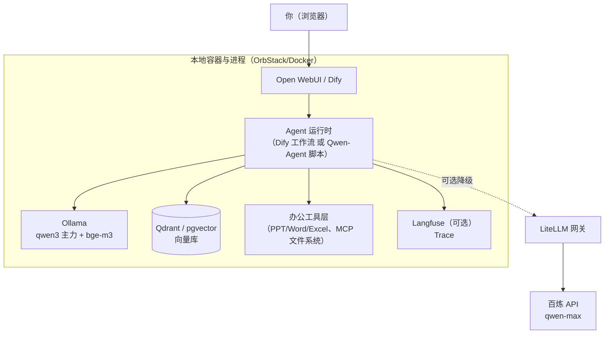

# 本地千问办公 Agent 实战：M4 24GB 上的七层清单落地

> 中文简称：本地千问办公 Agent 实战

> **一句话理解**: 「千问办公」是阿里的闭源云产品，没法本地部署——但用 Qwen 开源模型 + Ollama + Dify，一台 M4 24GB 的 Mac 就能搭出能力覆盖八成的本地平替：聊天、文档问答、PPT/Word/Excel 生成、定时任务，数据全程不出机器。

---

## 目录

1. [定位：为什么「本地部署千问办公」实际是自建](#1-定位为什么本地部署千问办公实际是自建)
2. [硬件底盘：M4 24 GB 能装下什么](#2-硬件底盘m4-24gb-能装下什么)
3. [总体架构](#3-总体架构)
4. [七层基础设施：生产版 → 本地版映射](#4-七层基础设施生产版--本地版映射)
5. [产品形态：路 A 现成平台 vs 路 B 自建](#5-产品形态路-a-现成平台-vs-路-b-自建)
6. [分阶段实施路线](#6-分阶段实施路线)
7. [混合架构：本地为主 + 云端降级](#7-混合架构本地为主--云端降级)
8. [性能预期与升级路径](#8-性能预期与升级路径)
9. [常见坑速查](#9-常见坑速查)
10. [安全清单（本地版）](#10-安全清单本地版)
11. [相关文档](#11-相关文档)

---

## 1. 定位：为什么「本地部署千问办公」实际是自建

**千问办公（QwenWork）**是阿里 2026-08 公测的企业级 Agent 办公平台（整合 QoderWork/MuleRun/悟空三款产品，桌面端 Agent + 云端 Agent + 企业协同三位一体，一句话生成 PPT/网站/文档）。它是**闭源云产品**——「本地部署千问办公」在字面上不成立，实际可选的路只有三条：

| 路线 | 做法 | 适合 |
|------|------|------|
| 直接用云产品 | 订阅/公测使用 qianwen.com | 不在乎数据上云、想立刻用 |
| **本地自建平替（本文）** | Qwen 开源模型 + 开源 agent 平台 + 办公工具层 | 隐私优先、想要贴身定制数字员工 |
| 混合 | 本地管隐私日常任务，重任务降级到云端 API | 两者兼得（见第 7 章） |

**本文的定位**：[[15_智能体/20_Agentic_Infra/01_Agentic_Infra_全景_2026|Agentic Infra 全景]] 讲七层栈的技术格局，[[15_智能体/20_Agentic_Infra/02_生产环境组件清单|生产环境组件清单]] 讲企业规模的云资源——本文是同一套七层心智模型在**个人/本地规模**的落地实践。七层框架完全复用，只是每层的组件换成本地形态。

**动手前先校准预期**：本地版的能力上限由三件事决定——内存（决定模型档位）、上下文容量（决定能读多长的文档）、工具层（决定能替你做什么）。第 2 章先把「内存的账」算清，这是所有选型的地基。

---

## 2. 硬件底盘：M4 24 GB 能装下什么

### 2.1 统一内存的账：权重 + KV cache + 系统

Apple Silicon 的统一内存由 CPU 和 GPU 共享，一台 24 GB 的机器大致这样分配：

```
24 GB 总内存
├── macOS 系统 + 常驻应用 ≈ 5-6 GB
├── Metal 给 GPU 的默认上限 ≈ 17-18 GB（约 75%）
└── 模型可用预算 ≈ 12-13 GB（保守）/ 15-16 GB（关掉大应用）
```

进阶技巧：`sudo sysctl iogpu.wired_limit_mb=20480` 可以把 GPU 上限调到 20 GB（重启失效），跑 19 GB 的 30B 模型时有用——但留太少给系统会整体卡顿，建议临时用。

### 2.2 模型矩阵

| 模型（Ollama 名） | 体积（Q4） | 剩给上下文的空间 | 体感定位 |
|---|---|---|---|
| `qwen3:30b-a3b`（MoE，激活 3B） | ~19 GB | 紧张（见 2.3） | 质量主力：知识量 30B 级、速度 3B 级，但内存贴上限 |
| `qwen3:14b` | ~9 GB | 宽裕 | **日常主力**：质量足够办公、可开 32K 上下文 |
| `qwen3:8b` | ~5 GB | 非常宽裕 | 轻任务/长上下文场景 |
| `qwen3-coder:30b` | ~19 GB | 紧张 | 代码/文件批处理任务切换用 |
| `bge-m3`（embedding） | ~1 GB | — | 中文 RAG 检索，常驻无压力 |

**选型建议**：内存预算只有一份，**主力模型选一个，别都拉**。稳妥组合是 `qwen3:14b` 做日常 + `bge-m3` 做检索；`30b-a3b` 想用就当「高质量档」临时加载（用完自动卸载）。

### 2.3 KV cache 容量账：长文档为什么必须 RAG 切片

MoE 模型的推理速度不慢，真正的瓶颈是 **KV cache（上下文缓存的显存占用）**。以 `qwen3:30b-a3b`（48 层 / 4 个 KV 头）为例：8K 上下文一条序列的 KV cache 约 0.8 GB（FP16）——19 GB 权重装进去后，剩给 KV 的只有几 GB，**放不下几条长序列**。

所以结论是硬性的：**长文档必须 RAG 切片检索，不能整篇直喂**——这不是「慢」的问题，是「放不下」的问题。想要大上下文直读长文档，用 `qwen3:14b`（权重 9 GB，省出的空间够开 32K 上下文）。

### 2.4 推理引擎：Mac 上选 Ollama 或 LM Studio

| 引擎 | 后端 | 适合 |
|------|------|------|
| **Ollama** | llama.cpp（Metal 加速） | 首选：一条命令、自带 OpenAI 兼容 API、生态对接最顺 |
| **LM Studio** | llama.cpp / **MLX** | 图形界面党；MLX 后端部分模型更快 |
| llama.cpp | 自编译 | 要深度调参 |
| vLLM / SGLang | CUDA 生态 | **Mac 上不适用**——这是生产级组件（[[15_智能体/20_Agentic_Infra/02_生产环境组件清单|02 清单]] 3.3 节）在个人规模下的第一个「不需要」 |

---

## 3. 总体架构



流量路径只有两条：日常任务全在本地闭环（浏览器 → agent 运行时 → Ollama/工具/向量库）；重任务或本地模型失败时经 LiteLLM 降级到云端。除 Ollama 外其余组件都跑在 Docker 里——这台机器唯一缺的基础设施软件就是 Docker（推荐 OrbStack，比 Docker Desktop 轻）。

---

## 4. 七层基础设施：生产版 → 本地版映射

[[15_智能体/20_Agentic_Infra/02_生产环境组件清单|02 清单]]的每一层在本地版的对应物：

| 层 | 生产版（02 清单） | 本地版 | 要点 |
|----|------------------|--------|------|
| 模型接入（L1） | LiteLLM + 多云 API | Ollama 的 OpenAI 端点（`:11434`） | 只有一家模型时网关可省；加云端降级时再上 LiteLLM（第 7 章） |
| 服务集群 | K8s 多副本 + HPA | 单机进程/容器 | 本地没有弹性问题，整层消失 |
| 执行沙箱（L3） | Firecracker microVM 池 | Docker 容器 | gVisor/Firecracker 均不支持 macOS——个人使用降级为「代码进容器跑」；会跑爬虫/生成的代码再启用 |
| 存储（L4） | S3/Milvus/RDS 集群 | Qdrant 或 pgvector 单容器 + 本地目录 | 向量库 + 原始文档目录；模型权重由 Ollama 自管 |
| 编排（L5） | Temporal + Kafka | Dify 内置异步队列 / n8n 工作流 | 单机长任务少；定时巡检用 cron 或 n8n 定时器即可 |
| 可观测（L6） | Langfuse + Prometheus | Langfuse 单机 compose（可选） | 想调优 agent 质量时再开，非必需 |
| 安全（L7） | KMS/审计/egress 白名单 | 数据不出域（天然优势）+ **文件访问圈定** | 本地版唯一要认真做的：agent 只能动指定工作目录（第 10 章） |

**什么时候该从本地版升级到生产版**？出现任一信号就去 [[15_智能体/20_Agentic_Infra/02_生产环境组件清单|02 清单]] 对号入座：多人共用（并发 > 2-3 人）、需要对外提供服务、需要审计合规、需要 7×24 可用。届时组件逐层替换：Ollama → vLLM 推理集群、单机 Docker → K8s、本地向量库 → 独立集群，agent 应用层（Dify/自建代码）基本不用动。

---

## 5. 产品形态：路 A 现成平台 vs 路 B 自建

### 5.1 路 A：现成开源平台

| 平台 | 定位 | 上手成本 | 适合 |
|------|------|---------|------|
| **Dify** | 可视化 agent + 工作流 + RAG + 工具插件 | 中（docker compose） | **主推**——最接近「办公 agent 平台」形态 |
| **Open WebUI** | 聊天壳 + 文档问答 + 代码执行 | 低（单容器） | 快速起步、当自建方案的前端 |
| **FastGPT** | 知识库问答向 | 中 | 知识密集型问答为主的需求 |
| **n8n** | 工作流自动化（邮件/日历/文档流水线） | 中 | 定时任务与第三方应用联动 |

### 5.2 路 B：自建（框架 + 工具层）

核心工作量**不在模型、在工具层**——这正是千问办公的护城河所在：

- **框架**：Qwen-Agent（官方框架，自带文档解析/浏览器工具，与千问生态同源）或 LangGraph（图状态机，控制流更精细）；协议层对接 MCP（见 [[15_智能体/16_Agent协议/README|Agent 协议]]）；
- **办公工具**：`python-docx`（Word）、`openpyxl`（Excel）、`python-pptx`（PPT）、`pdfplumber`（PDF 解析）；
- **MCP 工具**：filesystem server（只挂工作目录）、浏览器自动化（Playwright MCP）；
- **前端**：Open WebUI 当壳，或 Streamlit/Chainlit 自绘。

### 5.3 决策建议

**先路 A 后路 B**：用 Dify 一周内跑通全闭环，体验真实瓶颈（通常是「想要的自定义工具平台没有」或「记忆不够贴身」），再针对性转路 B——两条路的模型层、存储层完全复用，迁移成本只剩应用层。

---

## 6. 分阶段实施路线

### 第 0 周：模型层跑通（约一个晚上）

```bash
# 1. 基础设施
brew install orbstack            # Docker 运行时（装完启动一次）
brew install ollama
brew services start ollama       # 常驻 :11434

# 2. 拉模型（磁盘剩 54 GB 够放，主力只拉一个）
ollama pull qwen3:14b
ollama pull bge-m3
ollama run qwen3:14b             # 命令行先聊两句验证

# 3. 聊天壳（Open WebUI 单容器）
docker run -d -p 3000:8080 \
  --add-host=host.docker.internal:host-gateway \
  -e OLLAMA_BASE_URL=http://host.docker.internal:11434 \
  -v open-webui:/app/backend/data \
  --name open-webui --restart always \
  ghcr.io/open-webui/open-webui:main
```

**验收标准**：浏览器打开 `localhost:3000`，中文对话流畅、流式输出正常。

### 第 1 周：RAG 知识库（Dify）

```bash
git clone https://github.com/langgenius/dify.git
cd dify/docker && cp .env.example .env
docker compose up -d             # 默认 :80
```

在 Dify 界面「设置 → 模型供应商 → Ollama」接入：模型地址填 `http://host.docker.internal:11434`（**容器里访问宿主机不能写 localhost**——最常见的第一个坑）。LLM 选 `qwen3:14b`，Embedding 选 `bge-m3`，然后建知识库、传文档、做问答应用。

**验收标准**：上传一份 PDF/Word，能就内容准确问答且引用出处。

**这一周的关键调优**：agent 每轮会把全量历史拼进 prompt，所以要保持 **system 提示词和对话前缀稳定**——别在 system 里塞时间戳等变化内容，Ollama 才能复用 prompt 前缀缓存，省掉每轮重复 prefill（多轮对话速度差距明显）。

### 第 2 周：办公工具层

- 建立专属工作目录（如 `~/QwenOffice/`），文件类工具**只挂载这个目录**；
- Dify 装文档生成插件，或自写 Python 工具（`python-pptx`/`openpyxl`/`python-docx`）；
- 需要自动跑代码时启用代码执行节点，确认它跑在容器里而非宿主机。

**验收标准**：「根据这份会议纪要生成一页 PPT 大纲」能产出真实 `.pptx` 文件落在工作目录。

### 第 3 周起：可观测 + 混合架构

- Langfuse 单机 compose 起一份，Dify 的应用监控接上，看每步 trace 与 token 消耗；
- 按 7 章配置 LiteLLM，重任务出云。

**验收标准**：一个长文档分析任务自动降级到 `qwen-max` 并在 Langfuse 看到完整调用树。

---

## 7. 混合架构：本地为主 + 云端降级

24 GB 本地模型处理「日常写作、知识库问答、格式转换」足够；遇到**长文档分析、复杂多步推理、MoE 质量不够的重要输出**，让它自动降级到云端大模型。LiteLLM 做统一出口：

```yaml
# litellm.config.yaml — 本地为主，云端兜底
model_list:
  - model_name: qwen-office            # 应用统一用这个逻辑名
    litellm_params:
      model: ollama_chat/qwen3:14b
      api_base: http://localhost:11434
  - model_name: qwen-max-cloud         # 云端降级档
    litellm_params:
      model: openai/qwen-max
      api_base: https://dashscope.aliyuncs.com/compatible-mode/v1
      api_key: os.environ/DASHSCOPE_API_KEY

router_settings:
  fallbacks: [{"qwen-office": ["qwen-max-cloud"]}]   # 本地失败自动切云
  num_retries: 1
  timeout: 120
```

这个形态就是 [[15_智能体/20_Agentic_Infra/02_生产环境组件清单|02 清单]] 2.3 节「AI/LLM 网关」职能（统一鉴权/路由/降级/成本核算）的个人版缩放——云端走 DashScope 的 OpenAI 兼容端点，百炼用户也可以直接用 `bl` CLI 管理模型与配额。

**降级策略建议**：不是等失败才降级——按任务类型路由更稳（文档问答/闲聊走本地；长上下文/关键交付物走云端），网关侧用逻辑模型名区分即可。

---

## 8. 性能预期与升级路径

### 8.1 体感速度预估（M4，120 GB/s 内存带宽）

| 配置 | 预估生成速度 | 体感 |
|------|------------|------|
| `qwen3:14b` Q4（全在 GPU） | ~15-25 token/s | 流畅，接近打字速度 |
| `qwen3:30b-a3b` Q4（部分换页） | 波动大，~10-30 token/s | 可用但建议关大应用 |
| 同模型 + 32K 上下文 | 明显下降 | KV 占内存导致换页，回到 2.3 的容量账 |

### 8.2 硬件升级三档

| 档位 | 配置 | 解锁能力 |
|------|------|---------|
| 现在 | M4 24 GB | 14B 日常 + 30B-A3B 高质量档（本文方案） |
| 中档 | Mac Studio 64-128 GB | Qwen3 235B-A22B 的量化版可用；本地长上下文不再紧张 |
| 生产档 | Linux + RTX 4090/5090 + vLLM | 进入 [[15_智能体/20_Agentic_Infra/03_推理服务化与_PD_分离部署|推理服务化与 PD 分离部署]] 的生产推理玩法（PD 分离、continuous batching），可服务多人 |

---

## 9. 常见坑速查

1. **上下文被悄悄截断**：Ollama 默认上下文小（约 4K），agent 场景必须调大——启动时 `OLLAMA_CONTEXT_LENGTH=16384 ollama serve`，或调用时传 `options: {"num_ctx": 16384}`。注意上下文翻倍 = KV cache 翻倍（2.3 的账）；
2. **内存溢出卡死系统**：`30b-a3b` + 大上下文 + 开着浏览器/IDE，三者叠加会触发 swap 风暴——30B 档上下文别超 16K，或改用 14B；
3. **模型闲置被卸载**：Ollama 默认 5 分钟不活动就卸载权重，下次调用冷启动卡几十秒——`OLLAMA_KEEP_ALIVE=2h` 解决；
4. **容器访问不到 Ollama**：Docker 容器里写 `localhost:11434` 连的是容器自己——要用 `host.docker.internal`；
5. **长文档整篇直喂**：爆 KV cache（2.3），一律走 RAG 切片；确需通读长文用 14B + 32K；
6. **多轮对话越聊越慢**：system 提示词里塞了时间戳/随机内容，前缀缓存每轮失效——保持 system 稳定，动态信息放消息尾部；
7. **磁盘悄悄满了**：模型一个 19 GB，试玩多个模型后用 `ollama list` 查看、`ollama rm` 清理；
8. **MoE 质量取舍**：`30b-a3b` 速度好但密集推理弱于同级 dense 模型——重要交付物（对外文档、复杂分析）切云端 `qwen-max`。

---

## 10. 安全清单（本地版）

本地部署的数据不出域是天然优势，但 agent 有文件和执行能力，本地版的安全底线是**圈住它的手脚**：

- [ ] 专属工作目录（`~/QwenOffice/`），文件工具只挂载这个目录，绝不给整盘访问；
- [ ] 代码执行必须在容器内，禁止宿主机直接跑生成的命令；
- [ ] 不给 agent 邮件发送、系统配置修改等「出格」能力；确需要，加人工确认门；
- [ ] 混合架构下明确哪些目录/文件**禁止**进入云端调用（隐私红线，写进网关策略）；
- [ ] 定期备份向量库与数据库 volume（`docker run --rm -v qdrant_data:/data -v $PWD:/backup alpine tar czf /backup/qdrant-$(date +%F).tgz /data`）。

---

## 11. 相关文档

- [[15_智能体/20_Agentic_Infra/01_Agentic_Infra_全景_2026|Agentic Infra 全景 2026]] — 七层栈技术与厂商格局（本文的框架来源）
- [[15_智能体/20_Agentic_Infra/02_生产环境组件清单|生产环境组件清单]] — 企业规模的云资源对照（每层的「生产版」）
- [[15_智能体/20_Agentic_Infra/03_推理服务化与_PD_分离部署|推理服务化与 PD 分离部署]] — GPU 推理层深读（升级到生产档时读）
- [[10_部署推理/03_推理优化/28_办公Agent_PD分离_链路推演|办公 Agent × PD 分离链路推演]] — 云端同类产品的推理链路拆解，其 §8 有与本机配置逐项对照的数字账
- [[15_智能体/16_Agent协议/README|Agent 协议]] — 路 B 自建时的 MCP 工具对接
- [[12_架构基建/02_架构概览/02_AI_基础设施_2026|AI 基础设施 2026]] — 生产级推理引擎与 GPU 调度（升级到生产档时读）
- [[15_智能体/Agent_Production_Deployment_Runbook|智能体生产部署手册]] — 上生产的操作视角
- [[概念/Agent/agentic-infra|Agentic Infra 概念页]] — 七层栈概念速览

---

*Last updated: 2026-10-22*
