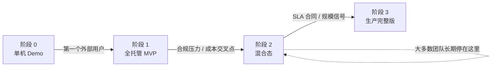
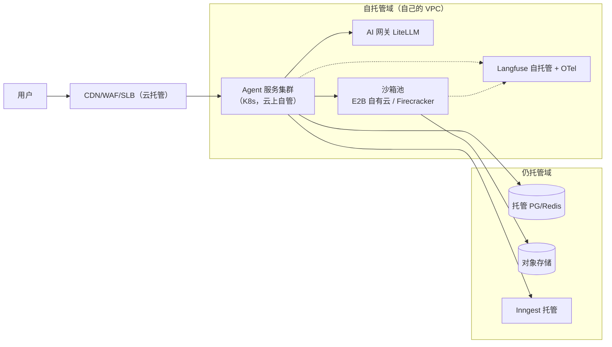

# Agent 部署组合与迁移路径：从全托管 MVP 到生产完整版

> 中文简称：Agent 部署组合与迁移路径

> **一句话理解**: 「上生产」不是一次到位，而是四次搬家——单机 Demo → 全托管 MVP → 混合态 → 生产完整版；本文给出每一站的参考组合、团队配置、成本量级与「该搬下一站」的毕业信号，并附每个组件「托管 → 自托管」的迁移 playbook（怎么切、怎么验、怎么退）。

---

## 目录

1. [为什么单讲「迁移路径」](#1-为什么单讲迁移路径)
2. [四阶段演进模型](#2-四阶段演进模型)
3. [成本模型：自建与托管的交叉点](#3-成本模型自建与托管的交叉点)
4. [迁移 Playbook：每个组件怎么搬](#4-迁移-playbook每个组件怎么搬)
5. [信号 → 动作速查表](#5-信号--动作速查表)
6. [反模式清单](#6-反模式清单)
7. [选型口诀与本篇定位](#7-选型口诀与本篇定位)
8. [相关文档](#8-相关文档)

---

## 1. 为什么单讲「迁移路径」

三篇文档的分工：[[15_智能体/20_Agentic_Infra/01_Agentic_Infra_全景_2026|Agentic Infra 全景 2026]] 讲七层栈的**技术与厂商格局**；[[15_智能体/20_Agentic_Infra/02_生产环境组件清单|Agent 生产环境组件清单]] 讲**要开哪些云资源**（空间维度，每个组件是什么、选什么）；本文讲**时间维度**——先开什么、后换什么、每一站怎么搬。

组件选型错了可以换，**演进节奏错了会直接死掉**。三种典型的死法：

| 死法 | 典型过程 | 根因 |
|------|---------|------|
| **起步即全家桶** | 3 人团队第一天就自托管 K8s + Kafka + Temporal，业务还没验证先背上一身运维 | 把终态当起点 |
| **永远 MVP** | 已经有付费企业客户，prompt 和 trace 还全在第三方 SaaS 上，安全问卷过不了丢单 | 把起点当终态 |
| **大爆炸迁移** | 一个周末把网关、Trace、沙箱、数据库全部切换，出问题无从定位、无路可退 | 把演进当重写 |

本文的目标就是给出一条**按信号驱动的演进路线**，让团队在每个阶段都知道：现在该干什么、什么信号出现才搬家、搬家时怎么保证不摔。

---

## 2. 四阶段演进模型

| 阶段 | 组合 | 团队配置 | 服务规模 | 月成本量级（示意） | 毕业条件 |
|------|------|---------|---------|------------------|---------|
| **0 单机 Demo** | docker-compose 全家桶 + 模型 API 直连 | 1–2 人，无 SRE | 内部试用 | 千元以内（几乎全是模型 API 账单） | 第一个外部用户 |
| **1 全托管 MVP** | SLB + agent 服务 2 副本 + 托管沙箱 + LiteLLM 云 + Langfuse 云 + Inngest + 托管 PG/Redis | 2–5 人，无专职 SRE | 千级用户 | 数千元（云资源 + 各 SaaS 订阅） | 合规压力或成本信号 |
| **2 混合态** | 阶段 1 + 合规三件套自托管（AI 网关 / Trace / 沙箱池） | 5–10 人，0.5–1 名 SRE | 万级用户，有企业客户 | 数万元（结构开始向固定成本倾斜） | 签 SLA 或规模信号 |
| **3 生产完整版** | 阶段 2 + Kafka + Temporal + 独立向量库 + 多可用区 + 自建数据集群 | 10 人以上，1–2 名专职 SRE 值班 | 十万级以上 | 数万到数十万（固定成本为主，边际递减） | —— |

两点先说清楚：**阶段可以跳，信号不能跳**——团队如果生而有之 SRE 兵力，从阶段 1 直奔阶段 2 是合理的；但没有合规压力就自建沙箱池，就是把钱从业务上挪走。**成本列是量级示意不是报价**——它描述的是成本「结构」从纯变动成本向固定成本迁移的规律，具体数字随厂商和区域变化。

### 2.1 阶段 0：单机 Demo

| 组件 | 形态 |
|------|------|
| agent 服务 | 单机 docker-compose，单副本 |
| 存储 | 容器内 PG + Redis（数据随容器生死） |
| 沙箱 | E2B / Daytona SDK 直连云沙箱（这一项 Demo 期就该用真沙箱，本机裸跑模型生成的代码是阶段 0 最大的事故源） |
| Trace | Langfuse 云免费档 |
| 编排 | 进程内 `while` 循环 |

**何时够用**：验证 prompt 与工作流设计、内部试用、给老板演示。

**毕业条件（出现任何一条就离开）**：第一个外部用户；第一次对外承诺可用性；意识到「重启这台机器等于全服事故」。

### 2.2 阶段 1：全托管 MVP

进入动作就是一张**按顺序执行的开通清单**——顺序本身有讲究，前序是后序的依赖：

| 顺序 | 开通什么 | 为什么在这个位置 |
|------|---------|----------------|
| 1 | 对象存储（S3/OSS） | 零依赖，且后续沙箱产物、trace 归档、备份全都落到它 |
| 2 | 托管 PG（+pgvector）+ 托管 Redis | 数据层先立，agent 服务一上线就要连 |
| 3 | 云 SLB（NLB + ALB）+ 域名 + TLS 证书 | 入口先通，后端可以慢慢换 |
| 4 | agent 服务 2 副本（云容器实例或最小 K8s） | 2 副本起步：滚动发布和单副本故障不中断的最小冗余 |
| 5 | LiteLLM 云（或先直连模型 API） | 统一模型入口，后面换模型/加降级只改这里 |
| 6 | Langfuse 云 + trace 埋点 | 上线第一天就要能排障 |
| 7 | E2B / Daytona 托管沙箱 | 代码执行能力按需接入 |
| 8 | Inngest | 异步与定时任务多了再接，同步链路稳定后不急 |

**首周必做 vs 可以欠的债**：

| 首周必做 | 可以欠的债（阶段 2/3 再还） |
|---------|--------------------------|
| trace 全链路埋点（6.1 的树结构） | 精细 HPA/KEDA 弹性 |
| 每副本并发上限显式设置（3.1） | WAF 定制规则 |
| PG 自动备份开启 + **恢复演练一次** | 多可用区 |
| 基本告警（5xx 率、队列积压、账单异动） | 审计与 KMS 信封加密 |
| 密钥不进代码（环境变量起步即可） | 出网白名单代理 |

**毕业条件**：出现企业客户意向（对方发了安全问卷）；或月账单里 SaaS 订阅总和超过云资源本身；或某个托管服务撞到限额/限流影响业务。

### 2.3 阶段 2：混合态（最常见的长期形态）

进入动作是**收回合规三件套**：自托管 AI 网关 → 自托管 Trace → 沙箱切自有云。为什么是这三件、且是这个顺序？用「数据敏感度 × 迁移成本」矩阵看：

| 组件 | 数据敏感度 | 迁移成本 | 结论 |
|------|-----------|---------|------|
| **AI 网关** | 高（全部 prompt 流经） | **极低**（换 base_url） | 第一收 |
| **Trace** | 最高（prompt + 完整执行记录 + 用户数据） | 低（双写切流） | 第二收 |
| **沙箱** | 高（用户代码与数据在第三方执行） | 中（SDK 可保留，池要建） | 第三收 |
| 托管 PG/Redis | 高 | **高**（在线迁移有停机窗口） | 不急，放阶段 3 |
| 对象存储 / CDN | 中 | 高且无收益 | **不收**，永远托管 |

阶段 2 的拓扑长这样（实线框 = 自托管、虚线框 = 仍托管）：

**毕业条件**：签下第一份 SLA 合同；或事件量级进入「每秒千级」；或公司层面决定数据全面不出域（那就要连数据层一起收，进阶段 3）。

### 2.4 阶段 3：生产完整版

进入动作是 02 §8.3 的八个定向增量里剩下的五件：Kafka、Temporal、独立向量库、自建数据集群 + 多可用区。进入前先过一遍检查清单：

- [ ] 用第 3 章的公式算过账：进阶段 3 的组件都过了成本交叉点，或由合规/SLA 硬性驱动；
- [ ] 有 1–2 名专职 SRE（不是「后端顺手兼着」），值班轮换表成立；
- [ ] 有状态组件（PG/Redis/Kafka/Temporal）的备份与恢复演练各做过一次；
- [ ] 多可用区改造方案过评审（跨区流量费与同步延迟有人认账）。

四条里有一条不满足，就停在阶段 2——**混合态不是妥协，而是大多数业务的最优解**。

---

## 3. 成本模型：自建与托管的交叉点

「什么时候该自建」不该靠感觉，靠一个简单的不等式：

- **托管月成本 ≈ 单价 × 用量**——线性增长，无固定门槛，用量为零时成本为零；
- **自建月成本 ≈ 固定资源成本 + 人力摊销**——固定门槛高，但边际趋零。人力摊销按投入的 SRE 比例折算（通常 0.25–0.5 个 SRE/组件）；
- **交叉点**：当「用量 × 托管单价」持续大于「固定资源 + 人力摊销」，且该组件的运维**不再挤占业务研发人力**时，自建开始划算。

两个条件缺一不可——只看钱不算账是常见错误：有些组件用量到了交叉点，但团队没有人手运维，自建等于用便宜的资源换昂贵的工程时间。

**逐组件的定性结论**（成本量为 2026 年示意，非报价）：

| 组件 | 托管成本特征 | 自建门槛 | 交叉点位置 | 建议 |
|------|------------|---------|-----------|------|
| **对象存储 / CDN** | 单价极低，云规模优势碾压 | 无意义 | 不存在 | **从不自建** |
| **托管 PG/Redis** | 溢价约 2–3 倍，但含备份/主备/监控/告警 | 高（要 DBA 级值守） | 很靠后 | 中小规模**永远托管** |
| **LLM 网关** | 云版收订阅/席位费；LiteLLM 开源自托管免费 | **极低**（无状态单服务） | **起点即交叉点** | **最早自建**（02 §8.4 第 1 步） |
| **Trace** | 按事件量计费，存储费随用量线性涨 | 中（应用 + PG/ClickHouse + 对象存储冷存） | 中等；数据敏感会把它提前 | 阶段 2 自建 |
| **沙箱** | 按秒/会话计费，重负载下单价敏感 | 高（Firecracker 池 + 模板流水线 + 逃逸测试） | 靠后；合规会把交叉点大幅拉前 | 量大或合规即自建 |
| **编排（Temporal）** | Temporal Cloud 按动作计费 | 高（集群 + Worker 池 + 升级纪律） | 靠后 | 多数团队长期用云版 |
| **消息队列** | 托管 Kafka 溢价中等 | 高（Kafka 是 MQ 里运维最重的） | 靠后 | 事件流规模到前用托管/RabbitMQ/RocketMQ |

结论归三层，写进决策备忘录里够用了：

1. **从不自建**：对象存储、CDN、（中小规模的）托管数据库——云的规模优势没有讨论余地；
2. **起点即自建**：LLM 网关——开源自托管免费、无状态、收益（成本看板 + 数据不出域）立等可取；
3. **按交叉点决策**：沙箱、Trace、编排、消息队列——用量和合规信号到了再动。

---

## 4. 迁移 Playbook：每个组件怎么搬

### 4.0 通用五步与三条铁律

| 步骤 | 做什么 | 要点 |
|------|--------|------|
| 1 **基线** | 迁移前 1–2 周，从 Trace 提取该组件的延迟 / 成功率 / 成本基线 | 没有基线就无法证明「迁了没变坏」 |
| 2 **双跑** | 新旧两套同时在线，新系统先接影子流量或最低风险流量 | 双跑期数据要能按来源区分 |
| 3 **切流** | 按百分比或按租户灰度，切流开关集中管理 | 一个配置项能全量回切，开关要演练过 |
| 4 **验证** | 对比双跑期指标；有状态数据做一致性抽样 | 验证不通过就回切，不带病全量 |
| 5 **退役** | 旧系统保留只读/待命 ≥7 天，确认无回流后退订 | 防止「只买不删」（见 4.6） |

**三条铁律**：一次只迁一个组件；有状态迁移先做数据校验再切写；每一步都有回退开关。违反任何一条，就是在攒一次大爆炸迁移。

### 4.1 LLM 网关（LiteLLM 云 → 自托管）

全链路里最轻的一次搬家（无状态、无数据迁移）：

1. 部署自托管 LiteLLM（K8s Deployment + 托管 PG 存配置即可）；
2. 迁移配置：模型映射、上游 API key、预算与限流规则——全部是配置文件，可用 Git 管理；
3. agent 服务把 base_url 从云版切到自托管，按副本灰度；
4. 验证：双跑期对账（token 计数、请求成功率、P95 延迟），模型行为应逐字节一致（上游是同一家）；
5. 退役云版订阅。

**停机**：0。**回退**：改回 base_url，分钟级。

### 4.2 Trace（Langfuse 云 → 自托管）

1. 自托管 Langfuse 起好（PG + 对象存储挂冷存，保留策略自定）；
2. 历史数据：用导出 API 把云端历史拉回自托管实例（量大可只迁近 30 天，更早的归档对象存储）；
3. **双写期**（1–2 周）：应用同时向新旧两个 endpoint 发 trace，顺带验证自托管实例的写入吞吐；
4. 切流：读侧（排障、评估）先切到自托管，确认查询体验无损后，写侧停掉云 endpoint；
5. 退役云订阅，云端数据按合同要求删除。

**停机**：0。**回退**：切回云 endpoint（双写期内无损失；双写期结束后回退会丢自托管期间的写入，所以结束双写要谨慎）。

### 4.3 沙箱（E2B/Daytona 托管云 → 自有沙箱）

全链路里**最重**的一次搬家，先过前置条件清单再动：

- [ ] 模板/镜像流水线建成（安全补丁能进模板，02 §3.2 的坑）；
- [ ] 逃逸测试通过（已知 CVE 复现 + syscall 审计）；
- [ ] 池化监控就位（分配延迟、执行成功率、资源水位）；
- [ ] 出网白名单代理就位（02 §6.5，脏域网络隔离）；
- [ ] SDK 兼容确认：优先选「E2B 自有云部署」保留原 SDK，应用层几乎零改动；纯自建 Firecracker 池则要写适配层。

切流按风险灰度：只读工具（代码解释器）先切 → 写文件任务 → 最后是有状态会话型工作流（Daytona 类）。

**停机**：0（按请求路由）。**回退**：路由切回云沙箱——这也是「保留双栈到验证期结束」价值最大的组件。

### 4.4 编排（Inngest → Temporal）

全链路里**唯一没有直接迁移路径**的组件：Inngest 是事件驱动函数模型，Temporal 是工作流代码 + 事件溯源模型，语义不同，没有自动转换。策略是**双栈排空**（strangler pattern）：

1. 新任务类型全部定义在 Temporal，Inngest 不再加新工作流；
2. 存量 Inngest workflow 自然跑完消亡；给存量设最长生命周期 deadline，超时的转人工处理而不是无限等待；
3. 任务查询接口做一层聚合，过渡期同时查两个系统（前端无感）；
4. **禁止**把同一个工作流的前半段留在 Inngest、后半段搬去 Temporal——跨引擎续跑等于没有断点续跑；
5. 存量清零后退役 Inngest 订阅。

**停机**：0。**回退**：让新任务暂时切回 Inngest（Temporal 侧的工作流标记废弃）——回退窗口在 Inngest 退役前都有效，所以退役一步不着急。

### 4.5 数据库（托管 PG → 自建集群）

唯一有**真正停机窗口**的迁移，也是最需要演练的：

1. 自建集群搭好（主备 + 备份 + 恢复演练过一次），发布页/连接串先准备好；
2. **逻辑复制**（logical replication）从托管库追平，观察复制延迟收敛；
3. 数据校验：行数对账 + 关键表抽样比对 + 序列（自增 ID）位置校准；
4. 低峰切写：停写窗口分钟级——应用切连接串，确认写入落在自建集群；
5. 旧托管库转只读保留 ≥7 天。

**停机**：分钟级（第 4 步切写瞬间）。**回退**：切回连接串指向托管库；注意切写后自建侧的新增量需要反向复制才能无损回退，所以回退决策要在保留期内尽早做。

**Redis 单独说**：主从同步或双写切换；切换后注意**缓存预热**——冷缓存瞬间全 miss 会把流量打穿到 PG，等于把一次缓存迁移变成一次数据库事故。

### 4.6 退役清单（防「只买不删」）

每次迁移完成后按表打勾，缺一项就留着一份幽灵账单或一个安全隐患：

| 项 | 内容 |
|----|------|
| 资源退订 | 云上按量资源（沙箱、网关、Trace 的计算与存储）最容易被遗忘 |
| DNS/TTL | 切换前提前调低 TTL；旧域名保留跳转期后下线 |
| 密钥轮换 | 旧云上的 API key / 访问凭证作废，防止残留凭据成为攻击面 |
| 账单核对 | 连续两个账期确认旧资源费用归零 |
| 数据处置 | 云端的 prompt / trace / 用户数据按合同条款删除并留证 |

---

## 5. 信号 → 动作速查表

日常运行时盯着这些信号，出现即行动，不出现不折腾：

| 观察到的信号 | 判定 | 动作 |
|-------------|------|------|
| 第一个外部用户 / 对外承诺可用性 | 该离开阶段 0 | 按 2.2 清单开通全托管 MVP |
| 企业客户发安全问卷 / 问「数据流向」 | 合规信号 | 按序收合规三件套：网关 → Trace → 沙箱（2.3） |
| 模型账单需要按租户/团队分摊 | 成本可见性信号 | 自托管网关（若还在云版） |
| Trace 月费随用量陡增 | 交叉点信号 | 自托管 Trace + 对象存储冷存（4.2） |
| 沙箱月账单上万 / 合规要求代码执行留痕 | 交叉点或合规信号 | E2B 自有云部署或自建池（4.3） |
| 长任务崩溃重跑烧 token 被投诉 | 可靠性信号 | Inngest → Temporal 双栈排空（4.4） |
| 事件流多下游订阅、每秒千级 | 架构信号 | 上 Kafka（仍可用托管 Kafka） |
| pgvector 召回 QPS / 规模撑不住 | 规模信号 | 独立向量库（02 §4.4） |
| 签下 SLA / 真实发生过单区故障 | 高可用信号 | 多可用区改造 |
| 迁移完成两个账期后旧云账单未归零 | 只买不删 | 走 4.6 退役清单 |

---

## 6. 反模式清单

| 反模式 | 典型表现 | 代价 | 纠正 |
|--------|---------|------|------|
| **起步即全家桶** | 3 人团队自托管 K8s + Kafka + Temporal 起步 | 业务未验证，钱和人力先烧光 | 从阶段 1 起步（2.2） |
| **永远 MVP** | 已有付费企业客户，prompt/trace 仍在第三方 SaaS | 安全问卷过不了，丢单 | 按 2.3 收合规三件套 |
| **大爆炸迁移** | 一个周末切全部组件 | 回归无从定位，回退无门 | 一次一个组件（4.0 三条铁律） |
| **只买不删** | 切到自托管后云资源忘退订 | 双份账单 + 残留凭据攻击面 | 4.6 退役清单 |
| **无基线硬迁** | 没有 trace 对比就切流 | 迁移回归发现不了，用户先发现 | 4.0 第 1 步基线先行 |
| **简历驱动架构** | 为「练手 K8s/Kafka」把业务搬上自建 | 运维成本 > 收益 | 用第 3 章交叉点公式说话 |

---

## 7. 选型口诀与本篇定位

02 §8 的选型口诀在这里依然成立：**入口看 SLB/WAF，模型走网关，代码进沙箱，状态落库（PG/Redis/向量），长活用 Temporal，全程留 trace，密钥进 KMS**（逐句展开见 02 §10）。

本文补的是它的**节奏版**：口诀定职责，阶段定节奏——**先托管起步，按信号搬家，一次搬一间，搬完要退租**。

---

## 8. 相关文档

- [[15_智能体/20_Agentic_Infra/02_生产环境组件清单|Agent 生产环境组件清单]] — 组件视角：每个组件是什么、选什么（本文的阶段组合逐项对应它的章节）
- [[15_智能体/20_Agentic_Infra/01_Agentic_Infra_全景_2026|Agentic Infra 全景 2026]] — 七层栈技术与厂商格局
- [[15_智能体/20_Agentic_Infra/03_推理服务化与_PD_分离部署|推理服务化与 PD 分离部署]] — 阶段 3 自建 GPU 推理层的深读
- [[15_智能体/20_Agentic_Infra/04_本地千问办公Agent实战|本地千问办公 Agent 实战]] — 阶段 0 的个人规模实践（本地硬件版演进路径）
- [[15_智能体/Agent_Production_Deployment_Runbook|智能体生产部署手册]] — 单个服务的部署操作视角
- [[12_架构基建/04_Kubernetes核心/README|Kubernetes 核心章节]] — 阶段 2/3 的容器平台底座
- [[概念/Agent/agentic-infra|Agentic Infra 概念页]] — 七层栈概念速览
- [[概念/Agent/agent-production-deployment|Agent 生产部署概念]] — 部署视角概念页

---

*Last updated: 2026-10-22*
