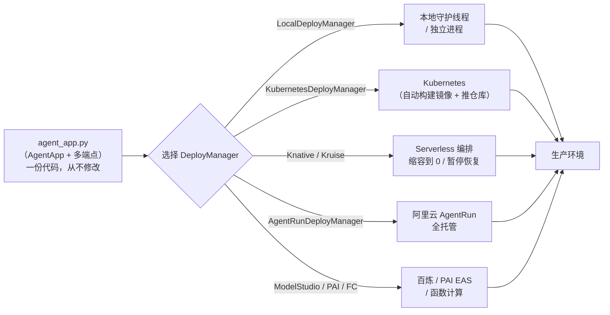

> [!warning] 生产安全提示 · Production Safety
> 本文档含可执行命令/操作步骤。执行前请核对风险等级（🟢低/🔶中/🔴高），高危命令必须 dry-run 并确认回滚方案。完整策略见 [生产安全策略](治理/Production_Safety_Policy.md)。
<!-- op-safety-banner v1 -->

# AgentScope Runtime 生产部署实战：一份代码 × 九个部署目标

> 中文简称：AgentScope Runtime 生产部署实战

> **一句话理解**: agentscope-runtime 是那个「搬运工」——把你写好的 AgentApp 打包成服务，换一个 DeployManager 参数就能从本地进程搬到 K8s、Knative、函数计算或阿里云 AgentRun，本文把九条搬运路线逐条拆到可落地。

---

## 目录

1. [本文定位：三件套分工](#1-本文定位三件套分工)
2. [部署心智模型：一份代码 × 九个目标](#2-部署心智模型一份代码--九个目标)
3. [部署前准备](#3-部署前准备)
4. [路线 A：进程级部署（最轻的生产形态）](#4-路线-a进程级部署最轻的生产形态)
5. [路线 B：Kubernetes 生产部署](#5-路线-bkubernetes-生产部署)
6. [路线 C：Serverless 三种形态](#6-路线-cserverless-三种形态)
7. [路线 D：云托管（AgentRun / 百炼 / PAI）](#7-路线-d云托管agentrun--百炼--pai)
8. [状态与持久化：ServicesConfig + Redis](#8-状态与持久化servicesconfig--redis)
9. [可观测：内置 Tracer 与生产化路数](#9-可观测内置-tracer-与生产化路数)
10. [拓扑选型对比](#10-拓扑选型对比)
11. [常见坑](#11-常见坑)
12. [落地检查清单](#12-落地检查清单)
13. [相关资源](#13-相关资源)

---

## 1. 本文定位：三件套分工

| 组件 | 角色 | 本文覆盖 |
|------|------|---------|
| **AgentScope (SDK)** | agent 怎么写（`pip install agentscope`） | 不覆盖，见 [[15_智能体/02_Agent框架/02_AgentScope_深入分析\|AgentScope 深入分析]] |
| **agentscope-runtime** | agent 应用在哪跑：打包 + 部署 + 基础服务 | **本文主体** |
| **阿里云 AgentRun** | 托管算力平台（runtime 的部署目标之一） | 本文第 7 节只讲「怎么部署上去」 |

三件套的关系、AgentScope 侧的架构与完整分层拓扑，见 [[15_智能体/02_Agent框架/15_AgentScope_AgentRun_生产部署架构|AgentScope 与 AgentRun 生产部署架构]]；本文专注 **runtime 本身的部署实战**——每条路线的命令、参数、背后的动作和生产加固。

---

## 2. 部署心智模型：一份代码 × 九个目标

agentscope-runtime 的核心设计是**部署代码与业务代码彻底分离**：业务只有一份 `agent_app.py`（AgentApp 定义），部署时只需换不同的 `DeployManager` 传给 `app.deploy(...)`。



九种部署目标全景（按管理方与隔离级别排列）：

| 部署目标 | 适用场景 | 管理方式 | 资源隔离 |
|----------|---------|---------|---------|
| 本地守护进程 | 开发测试 | 手动 | 进程级（线程） |
| 独立进程 | 轻量生产 | 手动/systemd | 进程级 |
| Kubernetes | 企业自管生产 | 编排 | 容器级 |
| Knative | Serverless、弹性伸缩 | 编排 | 容器级 |
| Kruise | 实例级隔离、暂停恢复 | 编排 | 容器/微虚拟机级 |
| ModelStudio（百炼） | 百炼平台内开发 | 平台托管 | 容器级 |
| AgentRun | 托管 Agent 基础设施 | 平台托管 | 容器级 |
| PAI（EAS） | 阿里云 PAI 平台 | 平台托管 | 容器级 |
| 函数计算（FC） | Serverless 按量付费 | 平台托管 | 微虚拟机级 |

**两条主线记法**：自管路线（本地进程 → K8s → Knative/Kruise）控制力递强；托管路线（百炼/AgentRun/PAI/FC）运维负担递减。同一份代码可以在两线之间随时搬家，这就是 runtime 的价值。

---

## 3. 部署前准备

### 3.1 安装与环境

```bash
# 🟢 — 安装 runtime（ext 扩展含各云部署器依赖），回滚: pip uninstall agentscope-runtime
pip install "agentscope-runtime[ext]>=1.0.0"
```

- Python ≥ 3.10（AgentScope SDK 侧建议 3.11+）。
- 生产环境必须**钉死版本**：`requirements` 里写明 `agentscope-runtime==x.y.z`，镜像构建才可复现。
- 网络受限环境构建 Docker 镜像时，配置自定义 PyPI 镜像源加速。

### 3.2 密钥管理

```bash
# 🟢 — 模型密钥只走环境变量，不落盘、不进代码，回滚: unset DASHSCOPE_API_KEY
export DASHSCOPE_API_KEY="your_qwen_api_key"
```

云上部署改用 **STS 临时凭证**，避免长期 AccessKey 落进部署配置。

### 3.3 AgentApp 骨架与健康探针

AgentApp 是部署的主要入口形态：把智能体、工具、上下文串联成应用，暴露 HTTP/gRPC 端点。生产要求**必须实现健康探针端点**，K8s/Knative 的 readiness/liveness 都靠它：

```python
# 🟢 — AgentApp 骨架：query 端点 + health 端点，回滚: 无状态变更
from agentscope_runtime.engine import AgentApp

app = AgentApp()

@app.query(framework="agentscope")
async def query_func(self, msgs, request=None, **kwargs):
    # 每 session 构造 agent 实例，请求结束持久化状态（见第 8 节）
    ...

@app.route("/health")
async def health():
    return {"status": "ok"}
```

官方建议的迁移路径：**先本地用 AgentApp 验证业务逻辑，再按规模迁移到高级部署**。基础部署与高级部署的分界：

| 维度 | 基础部署（本地验证） | 高级部署（生产化） |
|------|-------------------|-------------------|
| 拓扑 | 单进程 | Docker/K8s 多服务 |
| 冗余 | 无 | 多副本 / 多区域 / 多模型 |
| 发布 | 直接运行 | 灰度、扩缩容 |
| 观测 | 基本日志 | 集中日志 + Tracing + 告警 |

---

## 4. 路线 A：进程级部署（最轻的生产形态）

### 4.1 两种本地模式

`LocalDeployManager` 支持两种模式：

| 模式 | 行为 | 适用 |
|------|------|------|
| `DAEMON_THREAD`（默认） | 守护线程内运行，主进程阻塞直至服务停止 | 开发调试 |
| `DETACHED_PROCESS` | 独立进程运行，主脚本退出后服务继续 | 轻量生产 |

```python
# 🟢 — 独立进程模式部署，回滚: 杀掉对应进程
from agentscope_runtime.engine.deployers.utils.deployment_modes import DeploymentMode

await app.deploy(LocalDeployManager(host="0.0.0.0", port=8080),
                 mode=DeploymentMode.DETACHED_PROCESS)
```

### 4.2 systemd 托管（单机生产的最低配底线）

独立进程要成为"生产"，至少要有进程守护 + 开机自启 + 日志收集，systemd 是最便宜的实现：

```ini
# 🟢 — /etc/systemd/system/agent-app.service 示例，回滚: systemctl disable --now agent-app
[Unit]
Description=AgentScope Runtime Agent App
After=network.target redis.service

[Service]
Type=simple
User=appuser
Environment=DASHSCOPE_API_KEY=（由 KMS/凭据文件注入，勿明文写这里）
ExecStart=/opt/agentapp/.venv/bin/python run_server.py
Restart=always
RestartSec=5

[Install]
WantedBy=multi-user.target
```

**边界要清楚**：进程级部署没有自愈编排、没有多副本、没有滚动升级，单机单点。只适合内部工具、灰度验证；一旦面向外部用户，升到路线 B 或 D。

---

## 5. 路线 B：Kubernetes 生产部署

自管生产的标准答案。`KubernetesDeployManager` 把「构建镜像 → 推送仓库 → 创建 Deployment」三件事全部自动化：

```python
# 🔶 — 生产 K8s 部署：会构建镜像并推送到 registry，回滚: kubectl delete deployment agent_app -n agentscope-runtime
from agentscope_runtime.engine.deployers.kubernetes_deploy import (
    KubernetesDeployManager, K8sConfig, RegistryConfig,
)

deployer = KubernetesDeployManager(
    kube_config=K8sConfig(k8s_namespace="agentscope-runtime", kubeconfig_path=None),
    registry_config=RegistryConfig(registry_url="your-registry-url",
                                   namespace="agentscope-runtime"),
    use_deployment=True,          # Deployment（而非裸 Pod），才有副本自愈
)

result = await app.deploy(
    deployer,
    port="8080",
    replicas=2,                                   # 生产至少 2 副本
    image_name="agent_app",
    image_tag="v1.0",
    requirements=["agentscope==<钉死>", "agentscope-runtime==<钉死>",
                  "fastapi", "uvicorn"],
    base_image="python:3.10-slim-bookworm",
    runtime_config={
        "resources": {
            "requests": {"cpu": "200m", "memory": "512Mi"},
            "limits":   {"cpu": "1000m", "memory": "2Gi"},
        },
    },
    platform="linux/amd64",
    push_to_registry=True,
)
```

### 5.1 关键参数逐项拆解

| 参数 | 作用 | 生产建议 |
|------|------|---------|
| `use_deployment=True` | 用 Deployment 而非裸 Pod | 必开，否则无自愈/滚动升级 |
| `replicas` | 副本数 | ≥2；配合 HPA 弹性 |
| `requirements` | 构建镜像时 pip 安装清单 | 全部钉版本，锁 `base_image` digest |
| `base_image` | 镜像底座 | slim 系减小攻击面；内网用私有镜像源 |
| `runtime_config.resources` | 容器资源 requests/limits | 压测后定；agent 常驻内存大，limits 过低会 OOMKilled |
| `platform` | 目标架构 | 与集群节点架构一致（`linux/amd64` 或 `arm64`） |
| `push_to_registry` | 构建后推仓库 | 生产必开；registry 要配好凭证 |

### 5.2 deploy 之后的增量加固

runtime 帮你到「能跑」，生产还要自己补四件事：

1. **健康探针**：readiness/liveness 指向 3.3 节的 `/health` 端点，摘除不健康副本。
2. **HPA 弹性**：按 CPU + 并发连接数扩缩；agent 请求长连接多，单看 CPU 会滞后，建议叠加自定义指标（如活跃 session 数）。
3. **密钥注入**：`DASHSCOPE_API_KEY` 等走 Secret + `envFrom`，禁止打进镜像。
4. **滚动策略**：`maxUnavailable=0` + `maxSurge=1`，配合 8 节的状态外置，升级不掉会话。

### 5.3 验证部署

```bash
# 🟢 — 只读检查副本与探针状态，回滚: 无
kubectl get pods -n agentscope-runtime -w
# 🟢 — 只读看服务日志确认启动无报错，回滚: 无
kubectl logs -n agentscope-runtime deploy/agent_app --tail=100
```

---

## 6. 路线 C：Serverless 三种形态

| 形态 | 核心卖点 | 关键机制 | 适合 |
|------|---------|---------|------|
| **Knative** | 缩容到 0，按需拉起 | 流量驱动的自动扩缩 | 波谷明显的内部工具/低频应用 |
| **Kruise** | 实例级隔离 + 暂停恢复 | 容器/微虚拟机级隔离，agent 可暂停再恢复 | 长生命周期 agent 会话 |
| **函数计算 FC** | 按量付费，免运维 | 微虚拟机级隔离 + 会话亲和 | 流量尖峰大、无运维团队 |

**FC 的会话亲和是重点**：多请求间要续接同一会话时，客户端必须带上请求头 `x-agentscope-runtime-session-id`，平台据此把同一会话路由到同一执行环境——丢了这个头，会话状态就会"漂移"到别的实例上找不到。

Serverless 路线的通用注意事项：

- 冷启动延迟：模型客户端初始化、依赖导入都发生在拉起时，对延迟敏感的入口要做预热或保底实例。
- 状态依旧要外置（第 8 节）：Serverless 不改变「实例随时被回收」的现实，Redis 该配还得配。
- 长任务别硬塞：超出执行时长上限的任务，改走异步队列（见 [[15_智能体/20_Agentic_Infra/02_生产环境组件清单|生产环境组件清单]] 的异步编排层）。

---

## 7. 路线 D：云托管（AgentRun / 百炼 / PAI）

### 7.1 AgentRun：托管 Agent 基础设施

`AgentRunDeployManager` 把构建制品存 OSS、运行实例交给 AgentRun 平台：

```python
# 🔶 — 云托管部署：创建云资源并按量计费，回滚: 平台侧删除对应 agentrun 实例
import os
from agentscope_runtime.engine.deployers.agentrun_deploy import (
    AgentRunDeployManager, OSSConfig, AgentRunConfig,
)

deployer = AgentRunDeployManager(
    oss_config=OSSConfig(
        access_key_id=os.environ["OSS_ACCESS_KEY_ID"],
        access_key_secret=os.environ["OSS_ACCESS_KEY_SECRET"],
        region="cn-hangzhou",
        bucket_name="your-bucket",          # 存构建制品
    ),
    agentrun_config=AgentRunConfig(
        access_key_id=os.environ["AGENTRUN_ACCESS_KEY_ID"],
        access_key_secret=os.environ["AGENTRUN_ACCESS_KEY_SECRET"],
        region_id="cn-hangzhou",
    ),
)

result = await app.deploy(
    deployer,
    deploy_name="agent-app-example",
    requirements=["agentscope", "fastapi", "uvicorn"],
    environment={"DASHSCOPE_API_KEY": os.environ.get("DASHSCOPE_API_KEY")},
)
```

**更新已有部署**不用重建，传回 `agentrun_id` 即可原地升级：

```python
# 🔶 — 原地更新已有 AgentRun 部署，回滚: 用上一版 agentrun_id 重新 deploy
result = await app.deploy(deployer, agentrun_id="existing-id")
```

各云目标的通用规律：**都要 OSS（存构建制品）+ 对应 AccessKey 环境变量**；生产用 STS 临时凭证替代长期 AK。

### 7.2 ModelStudio / PAI / FC 一句话选型

| 目标 | 一句话定位 |
|------|-----------|
| ModelStudio（百炼） | 已在百炼平台做应用开发，直接平台内托管，和模型/知识库最近 |
| PAI（EAS） | 需要和 PAI 训练/推理管线共用一套阿里云 ML 基建 |
| FC | 纯 Serverless：按量付费 + 微虚拟机隔离，`x-agentscope-runtime-session-id` 做会话亲和 |

---

## 8. 状态与持久化：ServicesConfig + Redis

**核心原则：agent 实例无状态，状态全部外置。** 不论哪条路线，多副本/弹性/升级的前提都是「任意实例挂了，会话在别处能无缝续上」。runtime 用 `ServicesConfig` 挂接基础服务：

```python
# 🔶 — 生产状态外置：memory 与 session history 都走 Redis，回滚: 改回内存实现并重启
from agentscope_runtime.engine.services.redis import ServicesConfig

production_services = ServicesConfig(
    memory_provider="redis",
    session_history_provider="redis",
    redis_config={"host": "redis.production.local", "port": 6379, "db": 0},
)
```

要点：

1. **两个 provider 都要外置**：`memory_provider`（agent 工作记忆）和 `session_history_provider`（会话历史）是两条数据，都留在进程内的话，副本一漂移用户就"失忆"。
2. **Redis 侧要配持久化与淘汰策略**：AOF 持久化防重启丢状态；`maxmemory-policy` 不能选 `allkeys-lru` 把活跃会话随机挤掉，会话键要有 TTL 兜底。
3. **长期记忆分层**：Redis 放热会话，跨会话的长期记忆交给 L4 层（Mem0 等），见 [[15_智能体/20_Agentic_Infra/01_Agentic_Infra_全景_2026|Agentic Infra 全景]] 的 L4 记忆上下文层。
4. **每 session 构造实例**：query 处理函数内按 `session_id` 新建 agent，请求结束保存状态——这是 runtime 多租户下「新建实例」的标准姿势（代码示例见 [[15_智能体/02_Agent框架/15_AgentScope_AgentRun_生产部署架构|生产部署架构]] 第 3.2 节）。

---

## 9. 可观测：内置 Tracer 与生产化路数

### 9.1 内置 Tracer 现状

runtime 自带轻量追踪模块：`Tracer` + `TraceType` 枚举覆盖 `LLM` / `TOOL` / `AGENT_STEP` / `SEARCH` / `IMAGE_GENERATION` / `RAG` / `INTENTION` / `PLUGIN_CENTER` 八类事件，两种用法：

```python
# 🟢 — 装饰器打点：自动记录异步函数执行，回滚: 移除装饰器
from agentscope_runtime.engine.tracing import Tracer, TraceType

@trace(TraceType.AGENT_STEP)
async def my_step(...): ...

# 🟢 — 上下文管理器打点：手动控制起止 + 自定义日志，回滚: 无状态变更
tracer = Tracer(handlers=[LocalLogHandler(enable_console=True)])
with tracer.event(event_type=TraceType.LLM, payload={"model": "qwen-plus"}) as event:
    tracer.log("calling llm", prompt_tokens=1024)
    event.on_log("llm returned", payload={...})
```

**生产现状要认清**：目前内置的只有 `LocalLogHandler`（本地日志），Langfuse 等后端在官方路线图上。所以生产观测要么等官方 handler，要么走第二条路。

### 9.2 生产化路数：自定义 handler + 网关侧兜底

1. **自定义 `TracerHandler`**：实现 handler 把事件转发到集中式后端（Langfuse / OTel Collector），八类 TraceType 天然对应 Langfuse 的 trace 结构。
2. **网关侧兜底**：L1 模型网关（LiteLLM 等）记录每次模型调用的 token/成本/时延，即使 agent 侧打点缺失也有账可查——成本打点放网关是更稳的位置。
3. **三个必打点位**：会话入口（session_id 关联全链路）、每次 LLM 调用（token 成本）、每次工具/沙箱调用（失败率与延迟）。这对应七层栈的 L6 层选型（Langfuse/LangSmith），见 [[15_智能体/20_Agentic_Infra/02_生产环境组件清单|生产环境组件清单]] 第 6 节。

---

## 10. 拓扑选型对比

| 路线 | 上线速度 | 控制力 | 成本形态 | 适用 |
|------|---------|--------|---------|------|
| **A 进程级** | 最快 | 弱（单点） | 单机固定 | 内部工具、灰度验证 |
| **B 自建 K8s** | 慢 | 最强 | 集群固定成本 | 有 K8s 团队、合规要求高 |
| **C Serverless**（Knative/FC） | 快 | 中 | 按量、可缩到 0 | 波谷明显、尖峰流量 |
| **D 全托管**（AgentRun/百炼/PAI） | 最快 | 弱 | 按量 | 快速上线、无运维团队 |

**选型口诀**：内部工具进程级起步；有平台团队上 K8s；流量波动大上 Serverless；不想养运维直接托管。路线之间可渐进迁移——同一份 `agent_app.py`，从 A 搬到 B/D 只改 deploy 代码，这正是把部署交给 runtime 的理由。

---

## 11. 常见坑

| 坑 | 症状 | 根因与解法 |
|----|------|-----------|
| **会话"失忆"** | 多副本后用户上下文丢失 | 状态还在进程内。`ServicesConfig` 两个 provider 都外置到 Redis |
| **FC 会话漂移** | Serverless 下同一用户上下文对不上 | 客户端没带 `x-agentscope-runtime-session-id` 请求头 |
| **OOMKilled** | Pod 反复重启，`OOMKilled` 退出码 | agent 常驻内存 + token 峰值低估。压测定 limits，调大 memory |
| **镜像构建不可复现** | 昨天能构建今天失败 | `requirements`/`base_image` 没钉版本；全量锁定 + 内网 PyPI 镜像源 |
| **密钥泄漏** | AK 出现在镜像层或部署清单里 | `environment=` 传了明文。改 Secret 注入 / STS 临时凭证 |
| **不可信代码跑在主进程** | agent 执行的代码能读到生产密钥 | 沙箱隔离缺失。代码执行必须进 Docker/E2B/AgentRun 沙箱 |
| **观测只有本地日志** | 出事只能上机器翻日志 | 内置 Tracer 仅 `LocalLogHandler`。自定义 handler 接集中后端 + 网关侧成本打点 |
| **升级掉会话** | 滚动更新时进行中会话中断 | 状态未外置 + 没配 `maxUnavailable=0`。先做 8 节，再调滚动策略 |

---

## 12. 落地检查清单

| 检查项 | 标准 | 状态 |
|--------|------|------|
| 版本锁定 | `agentscope-runtime` 与依赖全部钉版本，`base_image` 固定 | ☐ |
| 健康探针 | `/health` 端点就绪，readiness/liveness 已配 | ☐ |
| 状态外置 | memory + session history 双 provider 走 Redis，Redis 有持久化 | ☐ |
| 副本与弹性 | ≥2 副本，HPA/缩容策略按流量形态选好 | ☐ |
| 密钥管理 | 全部走环境变量/Secret/STS，镜像与代码零密钥 | ☐ |
| 会话亲和 | Serverless 路线已带 session-id 请求头 | ☐ |
| 沙箱隔离 | 不可信代码执行全部进沙箱，禁止宿主机/主进程直跑 | ☐ |
| 可观测 | 自定义 Tracer handler 或网关打点，token 成本可查 | ☐ |
| 发布策略 | 滚动更新 `maxUnavailable=0`，升级不掉会话（演练过） | ☐ |
| 回滚预案 | K8s 回滚到上一 ReplicaSet / AgentRun 上一 `agentrun_id` 演练过 | ☐ |

---

## 13. 相关资源

- [agentscope-runtime GitHub](https://github.com/agentscope-ai/agentscope-runtime) — 官方仓库
- [Cookbook：部署](https://github.com/agentscope-ai/agentscope-runtime/blob/main/cookbook/zh/deployment.md) — 基础部署五阶段
- [Cookbook：高级部署](https://github.com/agentscope-ai/agentscope-runtime/blob/main/cookbook/zh/advanced_deployment.md) — 九种部署目标权威文档
- [Cookbook：Tracing](https://github.com/agentscope-ai/agentscope-runtime/blob/main/cookbook/zh/tracing.md) — 内置追踪模块
- [阿里云函数计算 AgentRun](https://www.aliyun.com/product/fc/agentrun) — 托管平台产品页

## Related

- [[15_智能体/02_Agent框架/15_AgentScope_AgentRun_生产部署架构|AgentScope 与 AgentRun 生产部署架构]] — 三件套关系与完整分层架构图
- [[15_智能体/02_Agent框架/02_AgentScope_深入分析|AgentScope 深入分析]] — SDK 侧框架架构
- [[15_智能体/20_Agentic_Infra/01_Agentic_Infra_全景_2026|Agentic Infra 全景 2026]] — 七层基础设施栈全景
- [[15_智能体/20_Agentic_Infra/02_生产环境组件清单|生产环境组件清单]] — 云资源组件选型与厂商映射
- [[概念/Agent/agent-production-deployment|Agent 生产部署概念]] — 部署视角的概念页

---

*Last updated: 2026-10-22*
