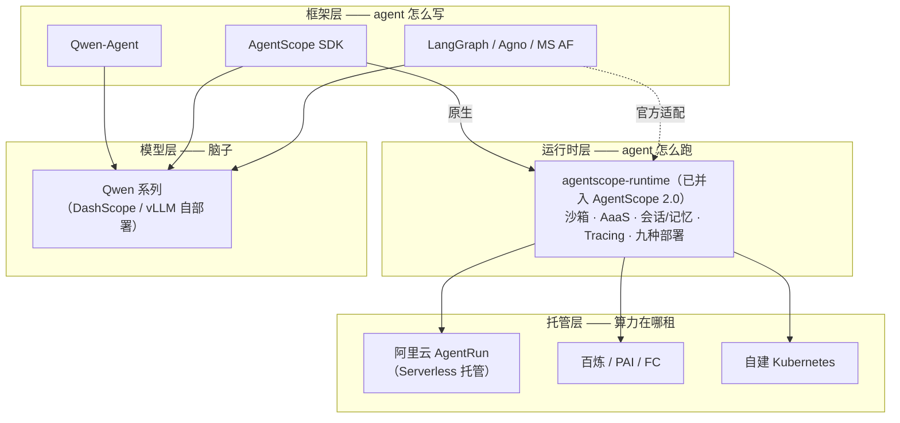

> [!warning] 生产安全提示 · Production Safety
> 本文档含可执行命令/操作步骤。执行前请核对风险等级（🟢低/🔶中/🔴高），高危命令必须 dry-run 并确认回滚方案。完整策略见 [生产安全策略](治理/Production_Safety_Policy.md)。
<!-- op-safety-banner v1 -->

# Qwen-Agent vs agentscope-runtime：框架层与运行时层对比

> 中文简称：Qwen-Agent 与 agentscope-runtime 对比

> **一句话理解**: Qwen-Agent 回答「agent 怎么写」，agentscope-runtime 回答「agent 在哪跑、怎么安全地跑」——一个在框架层一个在运行时层，组合起来才是一条完整链路，拿它们互相比「谁更强」本身就是个伪问题。

---

## 目录

1. [为什么这俩老被放在一起比](#1-为什么这俩老被放在一起比)
2. [30 秒结论](#2-30-秒结论)
3. [Qwen-Agent 拆解：框架层选手](#3-qwen-agent-拆解框架层选手)
4. [agentscope-runtime 拆解：运行时层选手](#4-agentscope-runtime-拆解运行时层选手)
5. [分层视角：两项目各在哪一层](#5-分层视角两项目各在哪一层)
6. [逐维度对比表](#6-逐维度对比表)
7. [组合模式：三种典型架构](#7-组合模式三种典型架构)
8. [选型决策指南](#8-选型决策指南)
9. [面试快问快答 10 题](#9-面试快问快答-10-题)
10. [相关资源](#10-相关资源)

---

## 1. 为什么这俩老被放在一起比

混淆的根源有三个：

1. **同一家公司**：都出自阿里系。Qwen-Agent 属 Qwen 团队（GitHub org：`QwenLM`），agentscope-runtime 属 AgentScope 团队（GitHub org：`agentscope-ai`）。
2. **名字里都有 agent**：一个叫 "Qwen-Agent"，一个叫 "agentscope-runtime"，看起来像同一赛道的两个竞品。
3. **搜索结果混在一起**：两边都在 2025-2026 年高活跃期被大量文章介绍，且常出现在同一份「国产 Agent 框架盘点」里。

但把两者放进 agent 技术栈的分层图里看，它们**根本不在同一层**——这正是本文要建立的核心心智模型。

---

## 2. 30 秒结论

| 维度 | Qwen-Agent | agentscope-runtime |
|------|-----------|-------------------|
| **层级** | 框架层：agent 怎么写 | 运行时层：agent 怎么跑 |
| **产物** | 一个 agent 程序（Python 库 + 示例应用） | 一个服务化、沙箱化、可观测的部署单元 |
| **比喻** | 整车的图纸和组装手册 | 装配线 + 测试线 + 车管所 |
| **关系** | **互补，非竞品**——理论上可以串联，但没有官方适配 | |

一句话：**用 Qwen-Agent（或任何框架）写好 agent 之后，生产化路上缺的那段——服务化、沙箱隔离、会话/记忆持久化、可观测——恰好是 agentscope-runtime 补的位置**。

---

## 3. Qwen-Agent 拆解：框架层选手

### 3.1 定位

[QwenLM/Qwen-Agent](https://github.com/QwenLM/Qwen-Agent) 是 Qwen 团队官方的 **agent 开发框架与应用集合**：基于 Qwen 模型（Qwen2/Qwen2.5/Qwen3 系列）的指令遵循、工具调用与规划能力构建，**也是 Qwen Chat 网页版背后 agent 能力的底层框架**。Python 实现，`pip install qwen-agent` 即装即用。

### 3.2 核心抽象

| 抽象 | 说明 |
|------|------|
| `LLM` / `get_chat_model()` | 模型接入工厂，支持 DashScope API 与 OpenAI 兼容 API（自部署 vLLM 的 Qwen 也走这条路）双通道 |
| `Agent` 基类 + 内置实现 | `FnCallAgent`（函数调用）、`ReActChat`（ReAct 兜底，模型不支持 FC 时也能跑）、`Router` 等可组合 |
| `BaseTool` + `register_tool` | 工具注册装饰器，写个类就能变成 agent 可调用的工具 |
| MCP 配置 | 通过 config dict 接入任意 MCP server，工具生态对齐 MCP 标准 |

### 3.3 内置能力与应用

- **函数调用 / ReAct**：优先走模型原生 FC，能力不足时自动降级 ReAct 循环。
- **文档解析 + RAG**：PDF/Word/PPT/Excel 解析成知识库，内置检索问答 agent。
- **Code Interpreter**：LLM 生成代码在本地/Docker 沙箱里执行并回传结果。
- **BrowserQwen**：浏览器助手，Chrome 扩展捕获页面 + Gradio GUI 交互——这是它最出圈的示例应用。
- **Gradio GUI**：`app.py` 一条命令起本地对话界面，原型验证极快。

### 3.4 边界（它不管什么）

Qwen-Agent 的生产化故事基本为零：**没有服务化部署模型、没有多租户会话持久化、没有分布式沙箱隔离、没有 tracing/网关**。Gradio demo 一把梭很爽，要上生产就得自己拼 FastAPI + K8s + 沙箱方案——这个「自己拼」的空档正是运行时层项目存在的原因。

---

## 4. agentscope-runtime 拆解：运行时层选手

### 4.1 定位与五大能力

[agentscope-ai/agentscope-runtime](https://github.com/agentscope-ai/agentscope-runtime) 官方公式化定义为五件事的合集：

| 能力 | 内容 |
|------|------|
| **工具沙箱隔离** | 不可信代码/工具在隔离环境中执行 |
| **AaaS（Agent 即服务）** | 把 agent 打包成标准 API 服务 |
| **可扩展部署** | 本地进程 / Docker / K8s / 托管云 |
| **全栈可观测** | 日志、执行链路追踪（Tracing） |
| **框架兼容** | 不锁死 AgentScope，协议层开放 |

### 4.2 沙箱矩阵

代码执行、浏览器控制、文件系统管理三类基础沙箱，扩展类型还有 GUI、移动端、云端沙箱，以及面向 RL 训练场景的训练沙箱；大部分支持 VNC 可视化，工具侧兼容 MCP。九种部署目标（K8s/Knative/FC/AgentRun/百炼/PAI 等）的逐条实战见 [[15_智能体/20_Agentic_Infra/07_AgentScope_Runtime_生产部署实战\|AgentScope Runtime 生产部署实战]]。

### 4.3 框架兼容面

- **AgentScope**：原生完全兼容，`ReActAgent` 一行 `app.deploy()` 上线。
- **其他框架**：LangGraph、Agno、Microsoft Agent Framework 均有官方集成指南。
- **协议层**：OpenAI SDK 兼容 + Google A2A 协议 + MCP，A2A Registry 提供服务注册与发现。

### 4.4 Engine 内置服务

会话历史（session history）、长期记忆（long-term memory）、agent 状态管理三大服务内置于 Engine，V1.0 起采用「白盒化适配器」模式——可以把这些能力嵌入自己的应用生命周期，而不是被黑盒托管。

### 4.5 ⚠️ 2026 年重要状态：已归档并入 AgentScope 2.0

2026 年 6 月官方发布归档公告（[Issue #519](https://github.com/agentscope-ai/agentscope-runtime/issues/519)）：**agentscope-runtime 仓库已归档，核心能力（Agent Service/runtime）已原生合并进 [AgentScope 2.0](https://github.com/agentscope-ai/agentscope) 主库**，官方建议所有用户迁移到 AgentScope 2.0 获取后续更新。

这意味着：

- **概念不过时**：「框架层 + 运行时层」的分层、沙箱/部署/可观测的能力清单，全部延续到 AgentScope 2.0，学习模型依然成立。
- **项目名会变**：新项目不再单独装 `agentscope-runtime`，直接用 AgentScope 2.0 一体化 SDK（写 + 跑一家人）。
- **存量部署仍可运行**：本文与 [[15_智能体/20_Agentic_Infra/07_AgentScope_Runtime_生产部署实战\|07 号实战文]] 的部署心智模型在 2.0 中延续，迁移时概念一一对应。

---

## 5. 分层视角：两项目各在哪一层

把 agent 技术栈拆成四层，两个项目各就各位：



框架层负责把模型变成 agent 逻辑；运行时层把 agent 逻辑变成安全可运维的服务；托管层出租算力。**Qwen-Agent 整个生态位都在框架层，agentscope-runtime 整个生态位都在运行时层**——纵向完全错开。

---

## 6. 逐维度对比表

| 维度 | Qwen-Agent | agentscope-runtime |
|------|-----------|-------------------|
| GitHub org | `QwenLM`（Qwen 团队） | `agentscope-ai`（AgentScope 团队） |
| 语言 | Python | Python（另有 Java 版实现） |
| 本质 | agent 开发框架 + 应用集合 | agent 运行时基础设施 |
| 模型绑定 | 深度绑定 Qwen 系（也兼容 OpenAI 兼容 API） | 基本无关模型，只管运行时 |
| 工具体系 | `register_tool` + MCP | 沙箱内工具执行 + MCP |
| 代码执行 | Code Interpreter（本地/Docker） | 分布式沙箱（代码/浏览器/文件/GUI/移动端） |
| 会话与记忆 | 无（进程内自带） | Engine 内置 session/memory/state 服务 |
| 服务化部署 | 无，需自拼 FastAPI/K8s | 核心能力：AaaS + 九种部署目标 |
| 可观测 | 无 | 内置 Tracer/日志/链路追踪 |
| 协议开放度 | OpenAI 兼容 API | OpenAI SDK + A2A + MCP + Registry |
| 典型用户 | 想复刻 Qwen Chat 能力的开发者 | 把 agent 推上生产的平台/后端工程师 |
| 生命周期阶段 | 原型到轻量应用 | 测试到生产（2026-06 起并入 AgentScope 2.0） |
| 对应本文档 | —— | 部署实战见 [[15_智能体/20_Agentic_Infra/07_AgentScope_Runtime_生产部署实战\|07 号文]] |

注意表中「沙箱」一行的差别：Qwen-Agent 的 Code Interpreter 沙箱是**为功能服务的本地隔离**（怕弄脏主机），runtime 的沙箱是**为生产安全服务的多租户隔离**（怕 agent 之间、agent 和宿主互相伤害）——同名能力，威胁模型完全不同。

---

## 7. 组合模式：三种典型架构

### Pattern A：Qwen-Agent 单栈（原型 / 个人工具）

```
Qwen 模型（DashScope 或 vLLM 自部署）
  └─ Qwen-Agent（FC/MCP/RAG/Code Interpreter + Gradio）
      └─ 自拼部署（FastAPI + systemd / 单机 Docker）
```

适合个人助手、内部工具、Qwen Chat 风格 demo。 生产化短板自己扛，本仓库 [[15_智能体/20_Agentic_Infra/04_本地千问办公Agent实战\|本地千问办公 Agent 实战]] 走的就是这条线的本地变体。

### Pattern B：AgentScope + 运行时一体化（推荐的生产链路）

```
Qwen 模型（任意 OpenAI 兼容入口）
  └─ AgentScope SDK 写 agent（2.0 起含 runtime 能力）
      └─ deploy 到 K8s / Serverless / AgentRun
```

框架和运行时同一团队、无缝衔接，2026 年中起收敛为 AgentScope 2.0 一体化 SDK。这是「写 + 跑」都省心的默认选择。

### Pattern C：Qwen-Agent + agentscope-runtime 串联（不推荐）

理论上可以按 Agent API 协议把 Qwen-Agent 的 agent 包一层交给 runtime 部署，但 **runtime 官方适配清单里没有 Qwen-Agent**（只有 AgentScope/LangGraph/Agno/MS AF），等于自己维护一层胶水，收益远不如直接换 Pattern B。除非有强绑定 Qwen-Agent 内置能力（如 BrowserQwen）的硬约束，否则不建议。

> 关键原则：**Qwen 是模型不是框架**——「用 Qwen」不等于「必须用 Qwen-Agent」。模型层、框架层、运行时层分别独立选型，才是这套栈的正确打开方式。

---

## 8. 选型决策指南

| 场景 | 推荐 | 理由 |
|------|------|------|
| 快速做 Qwen 模型工具调用 demo / 复刻 Qwen Chat | Qwen-Agent | 官方同款能力，Gradio 起步最快 |
| 文档问答 RAG + Code Interpreter 原型 | Qwen-Agent | 文档解析与内置 RAG 开箱即用 |
| 多 agent 协作 + 要上生产服务化 | AgentScope（2.0） | 框架 + runtime 一体，部署目标全 |
| 不可信代码 / 浏览器自动化需要强隔离 | AgentScope 2.0（原 runtime 沙箱） | 沙箱矩阵完整，VNC 可视化 |
| 已有 LangGraph/Agno agent 想服务化上 K8s | AgentScope 2.0 运行时能力 | 官方适配 + A2A 协议开放 |
| 极致 Qwen 生态一致性 + 无生产诉求 | Qwen-Agent | 同门同源，文档与 Qwen 模型同步演进 |
| 面试一句话口径 | —— | Qwen-Agent 写 agent，agentscope-runtime 跑 agent，AgentRun 租算力 |

---

## 9. 面试快问快答 10 题

**Q1：Qwen-Agent 和 agentscope-runtime 是竞争关系吗？**
不是。前者是框架层（怎么写），后者是运行时层（怎么跑），分层互补；官方适配清单里甚至没有互相接入的支持。

**Q2：agentscope-runtime 现在还能用吗？**
仓库 2026 年 6 月已归档，核心能力并入 AgentScope 2.0。存量部署可继续跑，新项目直接用 AgentScope 2.0。

**Q3：Qwen-Agent 只能配 Qwen 模型吗？**
设计上围绕 Qwen 调优（DashScope/OpenAI 双通道），任何 OpenAI 兼容模型都能接，但 prompt 模板和工具调用优化以 Qwen 为第一优先。

**Q4：Qwen-Agent 的 Code Interpreter 有沙箱吗？**
有本地/Docker 级隔离，但那是功能性的单机隔离；多租户、跨节点的生产级沙箱要靠 runtime 类方案。

**Q5：agentscope-runtime 的沙箱有哪些类型？**
代码、浏览器、文件系统三类基础沙箱，扩展有 GUI/移动端/云/训练沙箱，大部分支持 VNC 可视化，工具兼容 MCP。

**Q6：runtime 除了 AgentScope 还支持哪些框架？**
LangGraph、Agno、Microsoft Agent Framework 有官方集成指南；协议层开放 OpenAI SDK、A2A、MCP。

**Q7：runtime 的部署目标有哪些？**
本地进程、Docker、Kubernetes、Knative/FC 等 Serverless 形态，以及 AgentRun/百炼/PAI 云托管，共九种，逐条见 07 号实战文。

**Q8：Qwen Chat 和 Qwen-Agent 什么关系？**
Qwen-Agent 是 Qwen Chat 网页版 agent 能力的底层框架，官方示例即生产同款。

**Q9：阿里云 AgentRun 和 agentscope-runtime 什么区别？**
runtime 是开源运行时项目（自己部署）；AgentRun 是阿里云托管平台（函数计算 FC 体系下的 Serverless Agent 基础设施），而且是 runtime 九种部署目标之一——一个管软件层，一个管算力层。

**Q10：一句话总结这套选型？**
模型层选 Qwen，框架层按团队栈选（Qwen-Agent/AgentScope/LangGraph），运行时层用 AgentScope 2.0（原 runtime），托管层按成本选 AgentRun/K8s/FC。

---

## 10. 相关资源

**库内交叉引用**

- [[15_智能体/20_Agentic_Infra/07_AgentScope_Runtime_生产部署实战|AgentScope Runtime 生产部署实战]] —— 运行时层九种部署逐条拆解
- [[15_智能体/02_Agent框架/15_AgentScope_AgentRun_生产部署架构|AgentScope 与 AgentRun 生产部署架构]] —— 三件套完整分层拓扑
- [[15_智能体/02_Agent框架/02_AgentScope_深入分析|AgentScope 深入分析]] —— 框架层另一半主角
- [[15_智能体/20_Agentic_Infra/06_Mainstream_Selection_2026|主流选型 2026]] —— 七层栈每层的默认选型口径
- [[15_智能体/20_Agentic_Infra/05_部署组合与迁移路径|Agent 部署组合与迁移路径]] —— 从 MVP 到生产态的演进计划

**外部资料**

- [QwenLM/Qwen-Agent](https://github.com/QwenLM/Qwen-Agent) —— 官方仓库
- [agentscope-ai/agentscope-runtime](https://github.com/agentscope-ai/agentscope-runtime) —— 运行时仓库（已归档）
- [AgentScope Runtime 文档](https://runtime.agentscope.io/zh/intro.html) —— 能力全景
- [归档公告 Issue #519](https://github.com/agentscope-ai/agentscope-runtime/issues/519) —— 迁移到 AgentScope 2.0 的官方说明
- [agentscope-ai/agentscope](https://github.com/agentscope-ai/agentscope) —— 2.0 一体化主库

---

*Last updated: 2026-10-22*
