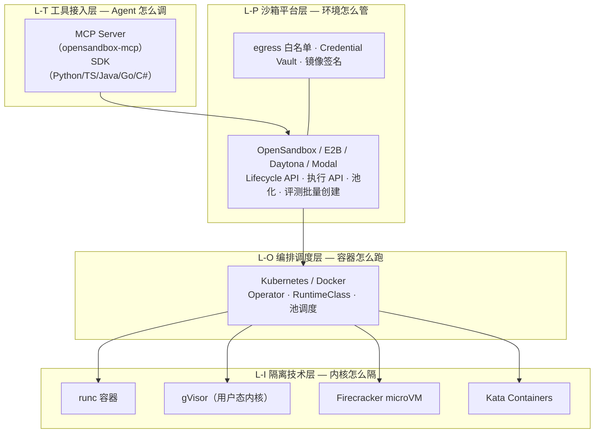
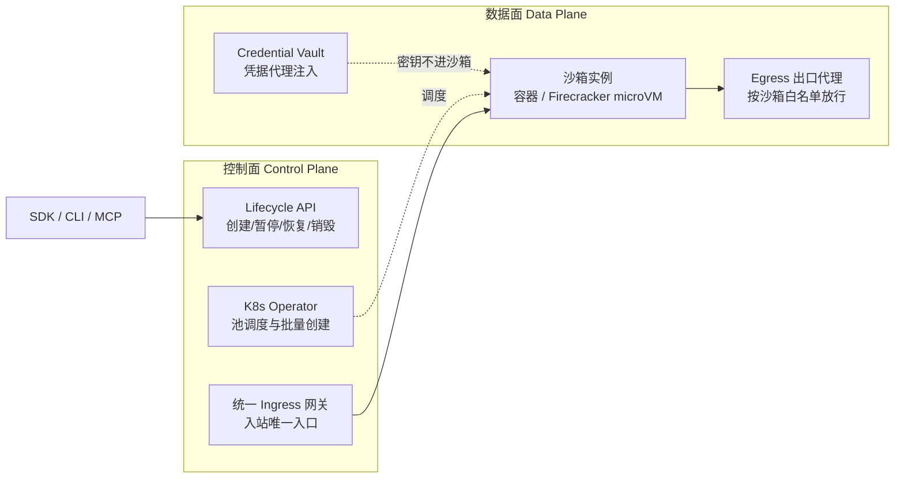
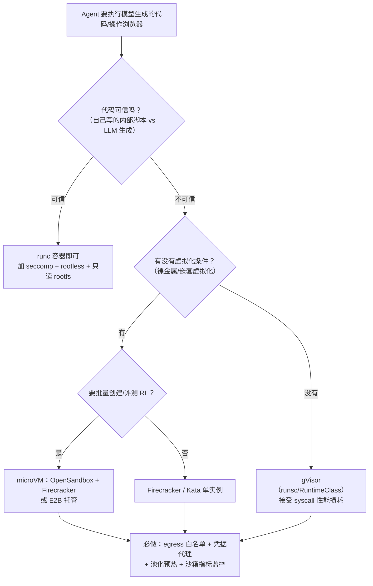

# Sandbox 隔离技术与沙箱平台选型 (Sandbox Stack & Platform Selection)

> 中文简称：Sandbox 隔离技术与沙箱平台选型

> **一句话理解**: Agent 沙箱要拆成两层看——**隔离技术**（gVisor、Firecracker 这些「发动机」）决定一个进程怎么和宿主机隔开，**沙箱平台**（OpenSandbox、E2B 这些「整车厂」）决定 Agent 怎么拿到一个管好网络、密钥、生命周期的执行环境；两者是上下层关系，OpenSandbox 底层甚至可以直接装 gVisor。

---

## 目录

1. 问题起点：OpenSandbox 和 gVisor 是什么关系
2. 沙箱四层栈心智模型
3. 隔离技术层速览（五种原语一张表）
4. OpenSandbox 深度解析
5. 平台层对比：OpenSandbox vs E2B vs Daytona vs Modal
6. 选型决策树（按威胁模型选）
7. 生产落地要点
8. 面试快问快答（平台层 10 题）

---

## 1. 问题起点：OpenSandbox 和 gVisor 是什么关系

读生产组件清单时最容易被问倒的一题：「OpenSandbox 不也是沙箱吗，和 gVisor 有啥区别？」答案是**它们不在同一层，甚至不是竞品**：

| | gVisor | OpenSandbox |
|----|----|----|
| 层次 | 容器运行时 / 隔离技术 | 沙箱服务与编排平台 |
| 解决的问题 | syscall 级内核隔离——「进程怎么和真内核隔开」 | 沙箱全生命周期——「Agent 的执行环境怎么创建、限网、给密钥、用完销毁」 |
| 形态 | OCI 运行时 `runsc`，替换 Docker/K8s 里的 runc | Lifecycle API + Execution API，配五语言 SDK、CLI、MCP Server |
| 类比 | 发动机 | 整车厂 |
| 谁在用 | Google Cloud Run / App Engine / GKE Sandbox 的底座 | Coding Agent、Code Interpreter、RL 训练环境等 Agent 负载 |

关键连接点：**OpenSandbox 生产形态跑在 Kubernetes 上，隔离后端是可插拔的**——官方一级支持 Docker（本地）、K8s 容器、Firecracker microVM；而 K8s 生态里通过 RuntimeClass 叠加 gVisor/Kata 加固是成熟做法（社区评测有提及，官方主推的还是 Firecracker 路线）。所以「OpenSandbox vs gVisor」的正确问法是「OpenSandbox 底下用不用 gVisor」。

一句话记忆：**gVisor 管「隔不隔得开」，OpenSandbox 管「Agent 用方不方便、环境管不管得住」。**

---

## 2. 沙箱四层栈心智模型

图解：Agent 请求从工具接入层（SDK/MCP）进入平台层，平台层通过编排层（K8s/Docker）在隔离技术层造出真正的隔离环境；**平台层可以换，隔离层也可以换，两层解耦**。面试里能把这四层说清楚，比背任何一个产品名都值钱。

---

## 3. 隔离技术层速览（五种原语一张表）

> 深入展开见 [[21_面试岗位/28_Agent_Runtime工程师/04_Sandbox_隔离技术|Sandbox 隔离技术专题]]（威胁模型 + 五方案逐个讲透）与 [[12_架构基建/10_安全/05_gVisor_常见问题与避坑指南|gVisor 避坑指南]]，这里只放速查表。

| 隔离原语 | 原理 | 隔离强度 | 性能开销 | 启动速度 | 适用 |
|----|----|----|----|----|----|
| **runc 容器** | namespaces + cgroups，共享宿主内核 | ★★（内核逃逸面） | 最低 | ~百 ms | 可信内部负载 |
| **gVisor** | 用户态内核 Sentry 拦截并重实现 200+ syscall，进程不碰真内核 | ★★★★（软隔离） | syscall 密集型有数倍损耗 | 与容器相当 | 多租户 SaaS、不可信代码（无虚拟化要求时） |
| **Kata Containers** | 每个 Pod 一个轻量 VM，硬件虚拟化 | ★★★★★ | 接近原生，内存开销较大 | 秒级 | 强合规、企业多租户 |
| **Firecracker** | 极简 microVM（AWS Lambda 同款），KVM 之上 | ★★★★★ | 接近原生，**MB 级内存开销** | ~125 ms | **Agent 沙箱首选**：高频创建销毁、评测/RL 批量 |
| **Wasm/WASI** | 不给完整内核，能力式安全模型 | ★★★（不同路线） | 低 | 毫秒级 | 轻量插件/边车，非完整 Linux 环境 |

选型直觉：**可信程度越低、创建销毁越频繁，越往 microVM 走；没有虚拟化硬件、又要强于 runc 的隔离，选 gVisor；要求兼容完整 Linux 行为且预算充足，选 Kata。**

---

## 4. OpenSandbox 深度解析

### 4.1 定位与生态位置

- 阿里系开源（opensandbox-group 组织，Apache 2.0，已进入 CNCF Landscape），定位 **"Secure, Fast, and Extensible Sandbox runtime for AI agents"**，2026 年上线数月即到 16k+ star；
- 官网与文档：[open-sandbox.ai](https://open-sandbox.ai)；仓库：[opensandbox-group/OpenSandbox](https://github.com/opensandbox-group/OpenSandbox)；
- 生态位置：与 AgentScope Runtime 同属阿里系 Agent 基础设施——**AgentScope Runtime 提供框架侧的 sandbox 抽象**（本地 Docker 起沙箱），**OpenSandbox 提供独立成平台的沙箱运行时**，可对接 E2B/Daytona 同类的云托管位置（三件套关系见 [[15_智能体/02_Agent框架/15_AgentScope_AgentRun_生产部署架构|AgentScope 与 AgentRun 生产部署架构]]，AgentScope 生态组件清单见 [[15_智能体/02_Agent框架/17_AgentCore_AgentRun_AgentScope_辨析|AgentCore AgentRun AgentScope 辨析]]）。

### 4.2 架构：控制面 / 数据面分离

图解：入站流量只从统一网关进，出站必须过按沙箱粒度配置的 egress 代理；密钥由 Vault 代理注入到出站请求上、**从不落地进沙箱工作负载**——这三条是「无人值守跑不可信代码」的命门设计。

### 4.3 两类 API 与接入方式

- **Lifecycle API**：创建/销毁/暂停/恢复（pause-resume 支持内存与磁盘状态保留，即 checkpoint 能力）；
- **Execution API**：命令执行、代码执行、文件传输、（浏览器/桌面类镜像的）自动化操作——协议规格开放在 `specs/`，便于自建兼容实现；
- **SDK 五语言**：Python、TypeScript/JavaScript、Java/Kotlin、Go、C#/.NET；
- **CLI**：`osb`——创建沙箱、执行命令、传文件、诊断、管出口策略；
- **MCP Server**（`opensandbox-mcp`）：Claude Code、Cursor 等 MCP 客户端可直接把 OpenSandbox 当工具用。

### 4.4 隔离后端与性能口径

| 后端 | 场景 | 口径 |
|----|----|----|
| Docker | 本地开发 | 最快上手：`uvx opensandbox-server init-config` 起服务 |
| Kubernetes | 生产默认 | Operator 管理资源池与批量创建 |
| Firecracker microVM | 强隔离生产 | 官方口径：创建 **P50 ≈ 64 ms / P99 ≈ 125 ms**（10 并发），支持 pause/resume 快照恢复 |

> 注意区分两层性能：**microVM 创建 64 ms** 是隔离实例的冷启动；**业务冷启动**还包括镜像拉取与依赖就绪——生产靠池化预热 + 快照把它压到毫秒级（见第 7 节）。K8s 后端下若需要 gVisor/Kata 级别的加固，走 RuntimeClass 挂载即可，代价是调度约束与性能折损。

### 4.5 安全机制清单

1. **出站白名单**：按沙箱粒度配置 egress 策略，防外传数据、防挖矿扫端口；
2. **Credential Vault**：Agent 要调外部 SaaS（GitHub、数据库）时，凭据由代理层注入请求，沙箱内进程看不到明文密钥；
3. **镜像供应链**：官方镜像发布 Docker Hub/GHCR/阿里云 ACR 三处，Cosign 无密钥签名 + 来源证明，可配置验签后才允许创建沙箱；
4. **入站收敛**：统一 ingress 网关，沙箱无公网直连地址。

### 4.6 镜像与场景生态

官方预置镜像覆盖 Agent 高频场景：**Code Interpreter**（代码执行/数据分析）、**浏览器自动化**（Playwright + Chrome）、**桌面环境**、**Coding Agent 宿主**（Claude Code、Codex CLI、DeerFlow 跑在沙箱里）、**评测**（Harbor：每个 trial 一个独立沙箱，天然可复现）。配合资源池与批量创建接口，对**评测与 RL 训练**这类「一次起几百个环境」的负载是显式设计目标。

---

## 5. 平台层对比：OpenSandbox vs E2B vs Daytona vs Modal

| | **OpenSandbox** | **E2B** | **Daytona** | **Modal** |
|----|----|----|----|----|
| 开源/商业 | 开源（Apache 2.0），可自托管 | 开源内核 + 商业云 | 开源 + 云服务 | 纯商业 SaaS |
| 隔离后端 | Docker / K8s / **Firecracker** | **Firecracker** microVM | Docker 容器 | **gVisor** |
| 主打场景 | Coding Agent、Code Interpreter、评测/RL 环境 | LLM 代码解释器（AI 数据分析起家） | Agent 状态化执行环境、快启动 | Serverless Python/GPU 函数 |
| SDK | 五语言 + CLI + MCP | Python/JS 为主 | Python/TS 为主 | Python 优先 |
| 生命周期特性 | pause/resume 快照、批量创建、资源池 | pause/fork、自有云部署 | 秒级快启、快照 | 按秒计费、自动伸缩 |
| 选型一句话 | **要自托管 + 协议开放 + 评测批量** | **要最快集成 + 托管省心** | **要状态化工作区** | **要 Python 函数直上云 + GPU** |

口径提醒：这张表是「平台层」对比，四家底下的隔离原语并不相同（E2B/OpenSandbox 主推 Firecracker，Modal 用 gVisor）——**比产品名更本质的是比隔离后端和生命周期 API**。

---

## 6. 选型决策树（按威胁模型选）

图解：先问威胁模型（代码可信度），再问基础设施条件（虚拟化），最后问负载形态（批量与否）——三问落地，答案自然收敛。

---

## 7. 生产落地要点

1. **池化预热（warm pool）**：预先起一批热沙箱待命，请求来了直接认领——冷启动从秒级到毫秒级；配合 Firecracker pause/resume 快照，模板盘 + 内存快照双管齐下；
2. **会话亲和与无状态化**：同一会话路由到同一沙箱，但**产物（文件/报表）一律外落对象存储**，沙箱用完即弃——环境无状态化后，沙箱层故障只是「重跑一次」（存储选型见 [[15_智能体/20_Agentic_Infra/02_生产环境组件清单|生产环境组件清单]] 第 4 节）；
3. **网络最小化**：egress 白名单按场景收敛（如 Code Interpreter 只放行 PyPI 镜像 + 目标 API 域名）；入站只走平台网关；
4. **凭据零落地**：外部服务调用走 Credential Vault 类代理，审计日志记「谁代表哪个会话用了哪个凭据」；
5. **镜像流水线**：模板镜像要有更新流水线——安全补丁不进模板 = 全部沙箱带洞运行；上线前做逃逸测试（已知容器逃逸 CVE 复现 + syscall 审计）；
6. **沙箱自身可观测**：分配延迟 P50/P99、执行成功率、资源水位、egress 拦截次数——它是「无人值守跑别人代码」的地方，最需要被监控；
7. **与 Agent 服务解耦**：agent 服务通过 API/SDK 调沙箱，不要和沙箱同机混部；沙箱集群独立扩缩容（计算执行层全景见组件清单第 3 节）。

---

## 8. 面试快问快答（平台层 10 题）

> 本文聚焦**平台层选型**题；隔离技术层的 50 题见 [[21_面试岗位/28_Agent_Runtime工程师/13_Sandbox_快问快答_50题|Sandbox 快问快答 50 题]]，两者搭配使用。

**Q1：OpenSandbox 和 gVisor 有什么区别？**
不同层。gVisor 是隔离技术（用户态内核，OCI 运行时 runsc），解决进程与宿主内核的隔离；OpenSandbox 是沙箱平台，解决执行环境的生命周期、网络与凭据管控。OpenSandbox 可跑在 K8s 上并通过 RuntimeClass 使用 gVisor 加固——上下层关系，非竞品。

**Q2：给 Agent 选沙箱平台看哪几点？**
隔离后端（runc/gVisor/microVM）、API 与 SDK 覆盖、网络与凭据控制能力、池化与冷启动、能否自托管、可观测性与镜像供应链。

**Q3：为什么 Agent 沙箱业界从容器转向 microVM？**
容器共享宿主内核，内核漏洞即逃逸面；Firecracker 把 microVM 开销压到 MB 级内存、~125 ms 启动，让「每个会话一个 VM」在经济上可行——隔离强度上到硬件虚拟化，成本接近容器。

**Q4：沙箱冷启动怎么优化？**
四招：池化预热、pause/resume 快照（内存+磁盘状态保留）、镜像分层与模板盘预烘焙、依赖预装。平台层（OpenSandbox 资源池）+ 隔离层（Firecracker snapshot）配合。

**Q5：沙箱需要出网调外部 API，怎么管？**
egress 白名单按沙箱粒度放行 + 凭据代理（Credential Vault）：密钥在代理层注入出站请求，沙箱内看不到明文，审计可追。

**Q6：OpenSandbox 和 E2B 怎么选？**
都要自托管/协议开放/评测批量 → OpenSandbox；要全托管快速集成 → E2B 云。两者底层都是 Firecracker 路线，差异在商业化形态与协议开放度。

**Q7：多租户下防「串扰」靠什么？**
沙箱粒度的网络策略 + 文件系统不共享 + 会话亲和与用完即弃 + 只读 rootfs；平台层还要有租户级配额与审计。

**Q8：评测/RL 训练场景对沙箱的特殊要求？**
批量并发创建（一次数百 trial）、环境可复现（固定模板镜像）、trial 级快照回滚、成本敏感——这正是 OpenSandbox 把批量创建和资源池做成一级特性的原因。

**Q9：gVisor 什么时候不合适？**
syscall 密集（编译、数据库）、高吞吐网络 IO、依赖冷门 syscall 的程序——性能损耗明显或不兼容；有虚拟化条件时换 Firecracker/Kata。

**Q10：沙箱镜像安全怎么做？**
最小化基础镜像 + 模板更新流水线（补丁必须进模板）+ Cosign 签名验签 + 定期逃逸测试与 CVE 复现演练。

---

## 关联阅读

- [[15_智能体/20_Agentic_Infra/02_生产环境组件清单|生产环境组件清单]] — 沙箱集群在完整云资源全景中的位置（3.2 节）
- [[15_智能体/20_Agentic_Infra/07_AgentScope_Runtime_生产部署实战|AgentScope Runtime 生产部署实战]] — 框架侧 runtime 如何服务化，沙箱是其执行层
- [[21_面试岗位/28_Agent_Runtime工程师/04_Sandbox_隔离技术|Sandbox 隔离技术专题]] — 本文第 3 节的完整展开：威胁模型 + 五方案逐个讲透
- [[21_面试岗位/28_Agent_Runtime工程师/13_Sandbox_快问快答_50题|Sandbox 快问快答 50 题]] — 隔离技术层面试题库
- [[12_架构基建/10_安全/05_gVisor_常见问题与避坑指南|gVisor 常见问题与避坑指南]] — gVisor 落地的坑位清单
- [[15_智能体/02_Agent框架/17_AgentCore_AgentRun_AgentScope_辨析|AgentCore AgentRun AgentScope 辨析]] — OpenSandbox 在 AgentScope 生态中的位置
- [[15_智能体/20_Agentic_Infra/06_Mainstream_Selection_2026|主流选型 2026]] — 各层默认项速查（L3 层默认 E2B 的口径）

---

*Last updated: 2026-10-22*
