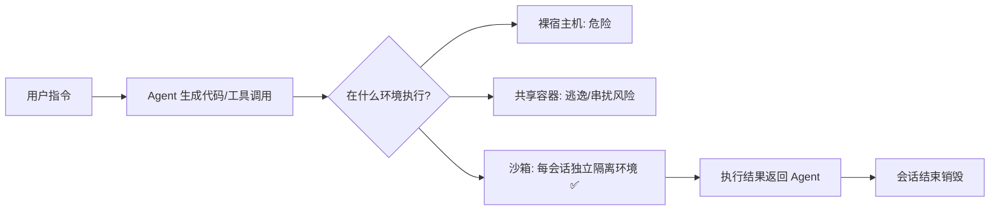

# 沙箱技术面试备考 (Sandbox Tech for Interview)

> 中文简称：沙箱技术面试备考

> **一句话理解**: 沙箱就是"给 Agent 单独关的小房间"——每个用户/任务在互相看不见的隔离环境里跑代码，这份文档帮你讲清楚它为什么必需、有哪几种做法、怎么对比选型。

---

## 1. 为什么 Agent 需要沙箱（面试开场逻辑）

图解：Agent 与传统应用最大的不同是**会执行不可信代码**——LLM 生成的代码可能删文件、占满磁盘、访问其他用户数据，所以必须把每次执行关进沙箱。

**三个核心价值**（招聘方原话口径）：

| 价值 | 说明 | 面试表述 |
|------|------|---------|
| **数据安全隔离** | 多用户/多 Agent 会话互不可见 | "客户最关心的就是用户之间的安全数据隔离" |
| **资源隔离** | CPU/内存/磁盘/网络限额，防 noisy neighbor | 每沙箱独立 cgroup + 配额 |
| **生命周期管理** | 秒级创建、快照冻结、用完销毁 | Agent 会话是短生命周期的，冷启动必须快 |

**一句话总结**：做 Agent 不管做哪个产品，不懂沙箱都满足不了客户需求——它是 Agent 的核心刚需组件。

---

## 2. 隔离技术分层（由重到轻）

| 层级 | 方案 | 隔离强度 | 启动速度 | 密度/成本 | 代表项目 |
|------|------|---------|---------|----------|---------|
| **虚拟机** | 硬件虚拟化 | 最强（独立内核） | 秒~十秒级 | 低（每 VM 一个内核） | KVM/QEMU、Cloud hypervisor |
| **microVM** | 轻量虚拟机 | 强（独立内核 + 精简） | 毫秒~百毫秒级 | 中高 | **Firecracker**（AWS Lambda 底层） |
| **内核态沙箱** | 系统调用过滤/拦截 | 中强（进程级） | 毫秒级 | 高 | **gVisor**（Google，用户态内核）、**Kata Containers**（VM+容器混合） |
| **容器** | namespace + cgroup | 弱（共享内核，可逃逸） | 毫秒级 | 最高 | Docker、containerd |
| **Wasm 沙箱** | WebAssembly 沙箱 | 中（内存安全） | 亚毫秒 | 最高 | Wasmtime、wasmCloud |

**记忆口诀**：安全和速度天然矛盾——**内核越共享越快越险，内核越独立越慢越安全**；工程本质是按业务信任等级选层。

### 关键原理（追问时要能展开）

- **容器为什么不够**：namespace/cgroup 只隔离"看见什么、用多少"，共享同一个内核——一个内核漏洞（如 runc CVE）就可能逃逸。多租户 Agent 场景容器只是**最后一道兜底，不是隔离边界**。
- **gVisor**：用 Go 实现的用户态内核（Sentry）截获系统调用，应用不直接碰宿主内核——牺牲 ~部分 syscall 兼容性和性能换隔离。
- **Firecracker**：microVM，专为 Lambda 设计，去掉声卡/显卡等设备模拟，**启动 <125ms、内存开销 ~5MB**，适合"每 Agent 会话一个 microVM"。
- **Kata Containers**：Pod 级别跑一个小 VM，兼顾 K8s 生态兼容与 VM 隔离。

---

## 3. 开源方案选型对比（面试必考）

### 3.1 对比维度框架

| 维度 | 要问的问题 |
|------|-----------|
| 隔离边界 | 进程级 / 内核级 / VM 级？能否防内核漏洞逃逸？ |
| 冷启动 | Agent 会话创建要多久？（<100ms 才能做交互式体验） |
| 密度 | 单机能跑多少并发沙箱？（直接决定成本） |
| 快照/休眠 | 能否冻结现场、恢复上下文？（长任务 Agent 刚需） |
| 文件系统 | 可写层、持久化、镜像分发速度 |
| 网络 | 每沙箱独立网络策略？出口管控？ |
| GPU 直通 | AI 负载能否用 GPU？（我方算力卖点） |
| K8s 兼容 | 能否作为 operator/runtime 接进存量集群？ |
| 生态与运维 | 社区活跃度、许可证、生产案例 |

### 3.2 录音中提到的方案（已核实）

> **核实结论（2026-10-13）**：录音中的 "Cube CloudBoss" 即腾讯云 2026 年开源的 **CubeSandbox**（GitHub: TencentCloud/CubeSandbox）；"GV 方案" 疑为 **gVisor**，面试前再向招聘方口头确认一次。

**CubeSandbox 核实档案**（面试竞品对比必背）：

| 维度 | 事实 |
|------|------|
| 背景 | 腾讯云开源，Apache-2.0，已入 CNCF Landscape（AI Native Infra） |
| 路线 | **RustVMM + KVM microVM**（硬件级隔离） |
| 性能 | **60ms 创建**硬件隔离沙箱，内存开销 **<5MB** |
| 兼容 | **对外兼容 E2B SDK**（客户迁移成本极低） |
| 部署 | 单机 → 多机集群；v0.6 起支持 K8s 部署；ARM64 全栈、Terraform 一键集群 |
| 快照 | CubeCoW 写时复制快照引擎：事件级快照、即时克隆、回滚任意历史状态 |
| 暂停恢复 | 闲置自动暂停、新请求毫秒级唤醒；v0.7 支持**跨节点**暂停恢复（S3 后端） |
| 安全 | 凭证托管——Agent 调外部 API 时 Key 不进沙箱 |
| 迭代速度 | v0.3→v0.7 仅 3 个月（2026.06–2026.08），投入很重 |

**面试话术要点**（客户"更偏开源社区方案"时怎么接）：

1. **先认可**："CubeSandbox 做得很专业，60ms、CoW 快照都是真功夫"——显得懂行而非只会贬竞品。
2. **换维度**："但客户买的不是沙箱软件，是**责任边界**：microVM 内核补丁谁打？规模翻 10 倍时容量谁扩？跨 AZ 容灾谁做？开源版这些都落在客户 SRE 身上。"
3. **讲生态位**："CubeSandbox 兼容 E2B SDK 恰恰说明**沙箱 SDK 标准化、底层资源差异化**——SDK 之上的算力、网络、存储、合规，正是弹性计算的主场。"
4. **引导 POC**："我们可以出一版对比 POC：同一负载下比启动延迟、密度、成本和运维投入。"

### 3.3 更多方案速查（补充）

| 方案 | 路线 | 典型场景 | 对我方竞争关系 |
|------|------|---------|--------------|
| **CubeSandbox（腾讯）** | RustVMM/KVM microVM | Agent 代码执行，E2B 替代 | **最直接的国内竞品，重点研究** |
| **gVisor** | 用户态内核 | GCP Cloud Run / Sandbox | 开源免费，K8s 可插 |
| **Firecracker** | microVM | AWS Lambda / Fargate 底层 | 成本低但要自己搭全栈 |
| **Kata Containers** | VM + 容器 | 安全容器 | 兼容 K8s 好 |
| **E2B** | Firecracker 云服务 | AI Code Interpreter 沙箱 | **直接对标**：Agent 沙箱 SDK 事实标准 |
| **Daytona / Modal** | 开发沙箱云服务 | 代码执行/Agent 运行时 | **直接对标** |
| **Docker + gVisor runtime** | 组合 | 轻量场景 | 最常见 DIY 方案 |

> 数据来源：CubeSandbox 官方 README 与公开报道（2026-10 检索）；面试前可再浏览其 GitHub changelog 看最新版本动态。

---

## 4. "我方沙箱优势"话术结构（引导客户需求）

面试要求：**对比业界开源方案，讲清楚我方沙箱的优势，并自然引导出客户需求**。建议四段式：

1. **场景切入**："您的 Agent 是多用户在线服务吧？那每个会话的代码执行必须互相隔离……"
2. **开源局限**：自建开源方案 = 选型拼装（runtime + 调度 + 网络 + 配额 + 可观测）+ 自己扛安全补丁与规模化运维。
3. **我方优势**（按弹性计算产品线口径准备）：
 - **开箱即用**：与阿里云算力/存储/安全/观测产品预集成，不做拼图；
 - **规模化验证**：弹性计算的调度与容量底座，大促级规模经验；
 - **安全合规**：等保/数据隔离能力，企业客户采购语言；
 - **商务绑定**：沙箱 + 算力一起卖，客户单一供应商简化采购与支持。
4. **引导提问**："你们现在 Agent 代码在哪儿跑？遇到过用户数据串扰问题吗？" —— 让客户自己说出需求。

> 注意：**具体产品功能参数面试前向招聘方/官网核实**，不要编造未发布能力。

---

## 5. 高频问答速练

| 问题 | 答题骨架 |
|------|---------|
| 沙箱到底解决什么问题？ | 三价值（数据/资源/生命周期隔离）+ Agent 执行不可信代码的本质 |
| 容器为什么不够？ | 共享内核 → 逃逸面 → 多租户必须 VM/内核态沙箱兜底 |
| gVisor vs Firecracker？ | 用户态内核 vs microVM：兼容性/启动/密度权衡 |
| 怎么选型？ | 9 维度框架（隔离/启动/密度/快照/FS/网络/GPU/K8s/生态） |
| 为什么客户要买我方的而不是开源自建？ | 拼装成本 + 安全运维责任 + 规模经验 + 商务集成 |
| 沙箱冷启动怎么优化？ | 预热池、镜像懒加载、快照恢复（CRIU 类）、内存共享 |
| GPU Agent 沙箱难点？ | 设备直通 vs 虚拟化、显存配额、调度与排队 |

---

## 6. 学习任务清单

- [x] 核实录音中 "GV 方案" 和 "Cube CloudBoss" 的准确项目名与架构（Cube CloudBoss = 腾讯云 CubeSandbox ✅；GV 疑为 gVisor，面试前口头确认）
- [ ] 通读 gVisor / Firecracker / Kata 三者架构图，各能讲 2 分钟
- [ ] 浏览 CubeSandbox GitHub changelog，记住 3 个以上特性亮点
- [ ] 整理我方沙箱官方文档的产品能力清单（向招聘方要资料）
- [ ] 用四段式话术做一次 5 分钟模拟宣讲
- [ ] 准备"客户说我们就用 Docker 跑，为什么要买沙箱"的反驳应答

---

## Related

- [容器安全概念页](../../概念/Safety/container-security.md)
- [OCI Runtime 概念页](../../概念/K8s/oci-runtime.md)

---

*Last updated: 2026-10-13*
