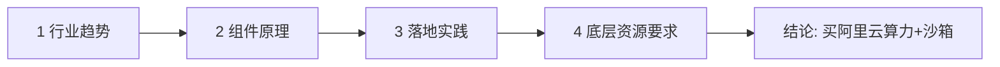

# 正式面试技术案例与内容准备 (Interview Case Prep)

> 中文简称：正式面试技术案例准备

> **一句话理解**: 按招聘方给的三道"考前作业"——技术案例讲到问题底层、Agent 按四个维度成链、沙箱能引导客户需求——把面试弹药提前备齐。

---

## 0. 招聘方布置的考前作业（对照表）

| 作业 | 录音原话要点 | 本文对应章节 |
|------|-------------|-------------|
| 技术案例 | 讲清楚遇到的问题、问题表现、解决手段，展现对底层技术的理解 | [第 1 章](#1-技术案例库按问题--表现--解决手段--底层原理) |
| Agent 内容 | 从**行业趋势、组件原理、落地实践、底层资源要求**四个维度形成逻辑链条 | [第 2 章](#2-agent-四维逻辑链) |
| 沙箱内容 | 讲清楚沙箱的作用、选型对比，引导客户产生对我方沙箱的需求 | [第 3 章](#3-沙箱引导式宣讲脚本) + [04_沙箱技术_面试备考](04_沙箱技术_面试备考.md) |
| 深度示例 | 熟悉 K8s 就要能讲"跨大版本升级为什么风险高" | [第 4 章](#4-深度示例k8s-跨大版本升级) |
| 选择本岗位 | 结合职业发展和个人兴趣，梳理清楚为什么选这个岗位 | [第 5 章](#5-为什么选择本岗位回答框架) |

---

## 1. 技术案例库（按"问题 → 表现 → 解决手段 → 底层原理"）

每个案例**必须讲满四层**：只有"我做了什么"不合格，要落到"为什么这样能行"的底层机制。

### 案例 1：运维智能体（主推，讲透 10 分钟）

| 层 | 内容（基于录音事实） |
|----|---------------------|
| **背景** | SDK/AISTack 二线工单量大，人工处理成本高 → 基于 AgentScope 建设运维智能体，目标自动解决工单 |
| **问题/挑战** | ① 代码仓库多（本地五六十个仓库），知识如何组织；② 高频问题如何保证兜底不翻车；③ 客户数据如何不串 |
| **方案** | 代码库蒸馏生成 Markdown 语料 → 进一步蒸馏为分场景技能；**hub-spoke 总分总架构**；高频问题加**分支判断树**兜底；**LM Wiki** 做知识沉淀 |
| **部署形态** | 全托管版部署在云启 LaneSmith（提单前自动问答）；疑难问题走本地（全量代码检索） |
| **数据安全** | 数据脱敏 + 客户数据隔离 |
| **效果** | 场景覆盖率 80%，直接推送无需修改 >40%，达考核要求 |
| **底层原理（追问点）** | ① 为什么蒸馏成技能而不是直接塞代码库？（上下文预算 vs 信噪比，检索命中率）② hub-spoke 为什么比单体 Agent 好？（路由降复杂度、技能隔离爆炸半径）③ 分支判断树 vs 纯 LLM 兜底的可靠性差异（确定性路径处理高频问题，LLM 只兜长尾） |

**准备动作**：画一张 hub-spoke 架构图（mermaid），能白板画出来。

### 案例 2：vLLM / SGLang / LLM 工单排查（展现推理底层）

从日常二线工单中挑 1–2 个有深度的，建议按下面骨架写：

```text
问题：__________（如：vLLM 吞吐骤降 / OOM / 首 token 延迟高）
表现：__________（监控指标如何变化、什么条件下复现）
解决手段：__________（改了什么配置/代码/资源）
底层原理：__________（KV cache 分块调度 / PagedAttention / 张量并行通信 /
          内存碎片 / 批处理排队 —— 必须落到机制，不能只说"调参好了"）
验证：__________（指标对比、回归结果）
```

**准备动作**：从工单系统挑 2 个案例，按骨架各写 200 字，控制在 3 分钟讲完一个。

### 案例 3：AISTack 轻量方案（展现产品化思维）

| 层 | 内容 |
|----|------|
| **问题** | 用户把 PPU 跑起来门槛高，生态工具散 |
| **方案** | 整合 SG + vLLM，预配置最佳实践命令，保证**缓存命中率**与**首 token 响应**，只做薄 UI |
| **底层原理（追问点）** | 前缀缓存命中对 TTFT 的影响机制；为什么"薄 UI + 厚预设"是正确产品形态（降低决策成本，呼应候选人"客户体验"观点） |

### 案例 4：个人项目（展现自驱力与产品感觉）

- **瑜伽馆数字人**：接入 IM 做私域运营 → 讲"AI 能力如何包装成客户愿意付费的业务闭环"。
- **AgentUp（开源 Agent 蒸馏）**：代码蒸馏生成技能和知识库 → **与案例 1 同源方法论的开源化**，面试中作为"我把私有实践抽象成了通用方案"的证据；准备好 GitHub 链接与 star/使用情况。

---

## 2. Agent 四维逻辑链

招聘方要求的四维度，必须**一口气连成一条链**（建议 2 分钟版本）：



| 维度 | 核心表述（初稿） |
|------|----------------|
| **1 行业趋势** | 90% Agent 项目会被废弃，真正落地的 10% 成为核心生产力；行业收敛为**办公提效**与**生产集成**两大类；判断标准是"能不能解决生产问题或办公提效预期" |
| **2 组件原理** | 一个能落地的 Agent 需要：模型推理（vLLM/SG）、Harness（工具/循环/护栏/评测）、**沙箱（执行隔离）**、存储、观测、上下文管理 |
| **3 落地实践** | 我的运维智能体：蒸馏技能 + hub-spoke + 兜底树，80% 覆盖率；AgentUp 开源化复用同一方法论 |
| **4 底层资源** | 推理要 GPU 算力与调度、沙箱要安全隔离的弹性执行环境、长任务要快照与存储 → **都落在弹性计算的能力面上** |
| **收束** | 所以客户要落地 Agent，缺的不是 Prompt，而是这套 Infra——这正是本团队"Agent Infra + 沙箱"要卖的东西 |

**练习**：不看稿讲一遍，卡壳处标记，重复到 2 分钟内讲完。

---

## 3. 沙箱引导式宣讲脚本

按 04 号文档第 4 章四段式，写成自己的话（目标：3 分钟）：

1. **场景切入**（问客户）："你们的 Agent 是多用户在线服务吗？Agent 生成的代码在哪儿执行？"
2. **痛点放大**：共享环境的风险——一个用户看到另一个用户的数据 / 一个任务把机器打挂。
3. **方案对比**：开源自建 = gVisor/Firecracker 选型 + 调度 + 网络 + 配额 + 补丁运维的拼装工程；我方 = 预集成 + 规模验证 + 合规 + 与算力打包。
4. **引导收单**："如果每会话要做到毫秒级创建和彻底隔离，值得我给您出一版 POC 方案吗？"

---

## 4. 深度示例：K8s 跨大版本升级（招聘方点名的考察样式）

招聘方用它演示"熟悉领域要讲到多深"——**照此深度准备自己的 1–2 个领域**：

| 追问层 | K8s 跨版本升级示例 |
|--------|-------------------|
| **为什么风险高** | 跨版本不支持跳版本升级（需逐 minor 升）、废弃 API 移除（如 v1.16 移除 extensions/v1beta1）、CRD/webhook 兼容性 |
| **哪些组件会不兼容** | 老版本 kubelet 与新 apiserver 的版本偏移 skew 规则、CNI/CSI 插件、Operator 和 admission webhook 用的废弃 API |
| **升级失败怎么解决** | dry-run/告警（kubectl deprecations）先扫描、备份 etcd、灰度节点池、回滚预案、workload 逐批迁移 |
| **底层原理** | apiserver 的 API 版本演进机制、aggregated API、对象序列化兼容策略 |

**迁移练习**：把同样四层用在自己最熟的领域（推荐：vLLM 版本升级/显卡驱动兼容，或 AgentScope 框架升级）。

---

## 5. "为什么选择本岗位"回答框架

招聘方明确提示：**深圳还有其他方向机会，要结合职业发展和个人兴趣梳理清楚**。三段式：

1. **地理与团队**（事实动机）：现团队在杭州、仅我一人在深圳 → 深圳本地团队让协作与融入成本最低。
2. **技术路线匹配**（职业发展）：我想走技术深钻路线而非快速晋升；本岗位是"客户场景 × Agent Infra × 产品迭代"的交点，能积累优质落地案例。
3. **兴趣与积累**（个人兴趣）：我自发做了运维智能体、AgentUp 开源、数字人项目——都是 Agent 落地实践，与"沙箱是 Agent 刚需"的判断一致，选本岗位是顺延而非转行。

---

## 6. 冲刺清单（面试前完成）

- [ ] 案例 1–4 各写成"四层"提纲，每个 3 分钟脱稿版
- [ ] hub-spoke 架构图手绘一遍
- [ ] 四维逻辑链 2 分钟脱稿 ×3 遍
- [ ] 沙箱 3 分钟宣讲脚本 + "客户只用 Docker"反驳应答
- [ ] K8s 式深度题在自己领域出 1 道并写好答案
- [ ] 核实 "GV / Cube CloudBoss" 项目名（见 04 文档）
- [ ] AgentUp GitHub 链接、demo 截图备好
- [ ] "为什么选本岗位" 三段式讲熟

---

## Related

- [沙箱技术面试备考](04_沙箱技术_面试备考.md)
- [面试指南](../18_面试指南/README.md)

---

*Last updated: 2026-10-13*
