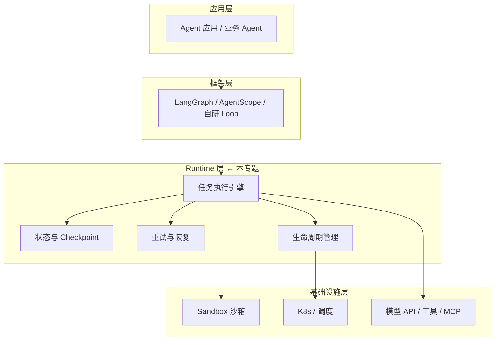

# Agent Runtime 核心机制 (Agent Runtime Core Mechanics)

> 中文简称：Agent Runtime 核心机制

> **一句话理解**: Agent Runtime 就是"Agent 的操作系统进程管理器"——模型负责决定下一步做什么，Runtime 负责让这一步哪怕进程崩了、机器挂了也能接着跑完。

---

## 1. Runtime 在 Agent 技术栈中的位置

图解：框架层回答"Agent 怎么思考"，Runtime 层回答"思考的过程怎么在生产环境可靠运转"——这正是 JD 第 1 条的落点。

---

## 2. 六大核心能力逐个拆解

### 2.1 任务执行（Agent Loop 的事件化）

- Agent 本质是一个循环：**接收输入 → 调模型 → 解析工具调用 → 执行工具 → 回填结果 → 再调模型**，直到产出最终答案；
- Runtime 要做的第一件事：把这个循环**事件化**——每一步（LLM 调用、工具调用、状态变更）都是可记录、可追溯的事件，而不是进程内存里的临时变量；
- 面试要点：事件化是后面一切能力（恢复、审计、可观测）的地基。

### 2.2 状态管理（会话状态 = 四类东西）

| 状态成分 | 内容 | 持久化位置 |
|---------|------|-----------|
| 对话历史 | 消息列表、token 计数 | 会话存储（DB/对象存储） |
| 控制流位置 | 循环执行到哪一步、在等什么 | Checkpoint / 事件日志 |
| 工具中间态 | 长任务工具的进度、外部系统游标 | 外部状态存储 |
| 环境引用 | 沙箱 ID、挂载文件、浏览器会话句柄 | 资源注册表 |

- 关键区分：**对话状态**（可序列化）与**环境状态**（活着的沙箱进程）——前者好恢复，后者要靠沙箱快照或重建（见 [[21_面试岗位/28_Agent_Runtime工程师/04_Sandbox_隔离技术|04 沙箱隔离]]）。

### 2.3 长任务运行（Durable Execution）

- Agent 任务动辄几十分钟到几小时（长代码任务、深度研究、批处理），远长于一次 HTTP 请求；
- 两条工程路线：
  1. **Durable Execution 引擎**（Temporal 式）：状态即事件日志，进程挂了在新进程上**重放**事件恢复现场；
  2. **Checkpoint + 显式恢复**：在安全点（工具调用前后、人工审批点）落快照，恢复时从最近 Checkpoint 继续；
- Agent 场景的特殊点：存在**人类在环暂停点**（human-in-the-loop），任务可能挂起几小时等审批——Runtime 必须支持"挂起不占资源、恢复时环境还在或可重建"。

### 2.4 Checkpoint（面试必考）

- **Checkpoint 里存什么**: 完整对话状态 + 控制流位置 + 待处理队列 + 环境引用清单；
- **何时打点**: 每轮工具调用完成后、暂停点前、定时心跳处；
- **两种实现**:
  - 全量快照：简单、恢复快，代价是写放大；
  - 事件溯源（Event Sourcing）：只追加事件，恢复时重放，天然带审计日志，代价是重放时间和快照策略设计；
- 业界参照：LangGraph 的 checkpointer（memory/SQLite/Postgres 后端，支持 time-travel）就是框架级 Checkpoint 的代表；Temporal 把同一思想做成了通用工作流引擎。

### 2.5 重试恢复

- **错误三分类**（先分类再谈策略）:
  - 瞬时错误：网络抖动、限流 429 → 指数退避 + 抖动重试；
  - 永久错误：参数非法、权限不足 → 快速失败，不重试；
  - 语义失败：模型跑偏、结果错误 → 不能盲重试，需要检测 + 回退到上一个 Checkpoint 换策略；
- **幂等性是重试的前提**: 工具调用带幂等键（idempotency key），避免"重试导致重复下单/重复发邮件"；
- **副作用补偿**: 不可幂等的操作用 Saga 式补偿（撤销上一步）而不是重放。

### 2.6 生命周期管理

| 状态 | 含义 | 迁移触发 |
|------|------|---------|
| created | 会话已创建，环境分配中 | 用户发起 |
| running | Agent Loop 执行中 | 资源就绪 |
| suspended | 挂起等待（审批/外部事件/抢占） | 暂停点到达 |
| recovered | 从 Checkpoint 恢复中 | 崩溃/重启后 |
| completed / failed / cancelled | 终态 | 正常结束/超限/用户取消 |

- 配套机制：超时与租约（lease）防止僵尸会话、孤儿沙箱回收、TTL 清理、优雅取消（先停 Loop 再释放沙箱）。

---

## 3. 高频面试题速练

1. **"设计一个支持断点恢复的 Agent 执行引擎，你的状态放在哪？"** —— 答：对话状态外置持久化 + 事件日志；环境状态区分可重建（重拉镜像）与需快照（沙箱 snapshot）；恢复 = 最近 Checkpoint + 事件重放到一致点。
2. **"工具调用重试怎么保证不产生重复副作用？"** —— 幂等键 + 服务端去重；不可幂等操作走补偿；重试前先判断上一次是否实际成功（查询对账）。
3. **"任务挂起等人工审批 3 小时，资源怎么办？"** —— 挂起时释放计算（沙箱快照后销毁或池化回收），仅保留 Checkpoint；恢复时按需重建环境。
4. **"为什么不用 Serverless 函数直接跑 Agent？"** —— FaaS 有状态与时长限制、执行环境不保活，与长会话/暂停恢复错配，需要 Durable Execution 层补足（详见 [[21_面试岗位/28_Agent_Runtime工程师/10_执行平台形态|10 执行平台形态]]）。
5. **"Checkpoint 太频繁影响性能，太稀疏丢失多，怎么权衡？"** —— 按安全点打点（工具边界）+ 事件日志兜底增量 + 异步落盘，恢复目标 RPO 由业务定。

---

## Related

- [[21_面试岗位/28_Agent_Runtime工程师/04_Sandbox_隔离技术|沙箱隔离技术]]（环境状态的另一半）
- [[15_智能体/03_Agent工作流/05_LangGraph_深入分析|LangGraph 深入分析]]（框架级 Checkpoint 实现参照）
- [[15_智能体/02_Agent框架/17_AgentCore_AgentRun_AgentScope_辨析|AgentCore / AgentRun / AgentScope 辨析]]（业界 Runtime 形态对照）
- [[15_智能体/15_课程笔记/02_Learn_Claude_Code_第1课_Agent_Loop|Agent Loop 课程笔记]]

---

*Last updated: 2026-10-20*
