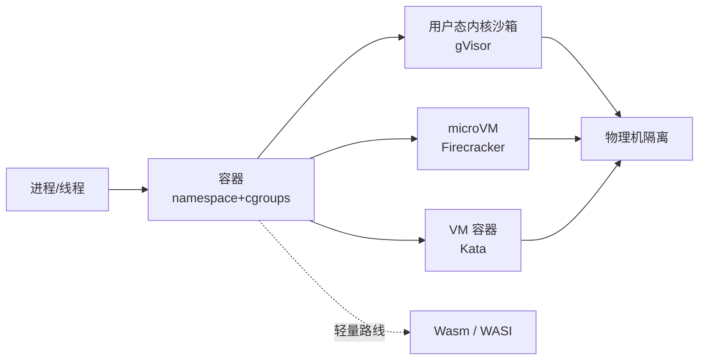

# Sandbox 沙箱隔离技术 (Agent Sandbox Isolation)

> 中文简称：Sandbox 沙箱隔离技术

> **一句话理解**: LLM 生成的代码是不可信代码，沙箱就是"给每次执行单独关的小房间"——本专题讲清楚房间有几种造法、隔离强度和启动开销怎么权衡。

---

## 1. 威胁模型：为什么 Agent 必须隔离

- Agent 会**执行模型生成的代码**、调用有副作用的工具、接触企业数据——三者叠加意味着执行环境必须假设"代码是恶意的"；
- 三条威胁线：**逃逸**（容器 breakout 打到宿主机）、**串扰**（租户 A 会话读到租户 B 数据）、**滥用**（挖矿、扫端口、外发数据）；
- 对应 JD 第 2 条的六个能力点：环境创建、镜像与依赖管理、资源限制、网络控制、文件系统隔离、运行时安全。

---

## 2. 隔离层次谱系（由轻到重）

图解：越靠右隔离越强、开销越大；Wasm 是另一条轻量路线——不隔离内核接口，而是根本不给一个完整内核。

---

## 3. 五大技术逐个讲透

### 3.1 Docker（容器基线）

- 原理：Linux **namespaces**（pid/net/mnt/uts/ipc/user 六种视图隔离）+ **cgroups**（CPU/内存/IO 限额）+ overlayfs 镜像分层；
- 短板：所有容器**共享宿主内核**，内核漏洞（提权、namespace 逃逸）就是逃逸面；默认 root 运行风险高；
- 工程加固：rootless 模式、user namespace 重映射、seccomp 默认 profile、只读 rootfs。

### 3.2 gVisor（用户态内核）

- Google 开源，核心组件 **Sentry**：用 Go 实现的用户态内核，拦截并重新实现 200+ Linux 系统调用，容器内进程**从不直接碰真内核**；
- 两种拦截平台：ptrace（通用）与 KVM（性能更好）；以 OCI runtime `runsc` 形式无缝接入 K8s/Docker；
- 代价：syscall 密集型负载有可观性能损耗、部分 syscall/驱动行为不完全兼容；
- 适用：不可信代码、多租户 SaaS（Google 自家 Cloud Run / App Engine 血统）。

### 3.3 Kata Containers（VM 级容器）

- 思路：**每个 Pod/容器组跑在一个独立轻量虚拟机里**，对外保持 OCI/K8s 接口不变；hypervisor 后端可选 QEMU、Cloud Hypervisor 甚至 Firecracker；
- 优势：硬件虚拟化隔离（独立内核），兼容性几乎无损；
- 代价：比纯容器多一份 VM 内存开销、启动略慢（秒级可优化到数百毫秒）。

### 3.4 Firecracker（microVM 极致）

- AWS 开源（2018），**Lambda 与 Fargate 的底层**：基于 KVM 的 microVM，砍掉全部非必要设备模型（只剩 virtio-net/block、串口等）；
- 关键数字（面试可引用量级）：**~125 ms 启动、每 VM ~5 MB 额外内存**，单机可跑数千 microVM；
- 快照/恢复（snapshot/restore）原生支持——这是 Agent 沙箱"挂起/恢复"的硬件级方案；
- 典型用户：AWS Lambda、Fly.io、E2B 等 AI 代码执行平台。

### 3.5 Wasm / WASI（无内核路线）

- 思路：Wasm 模块跑在用户态运行时（Wasmtime、WasmEdge）里，**默认什么系统调用都不能做**，能力由宿主显式授予（capability-based security，WASI 预授权文件/网络句柄）；
- 优势：毫秒级冷启动、极小内存、无需虚拟化硬件；
- 代价：生态尚在成熟中（多语言支持、WASI 接口覆盖）、不适合任意 Linux 程序；
- 定位：工具/插件级扩展的沙箱（Plugin 沙箱化）优先选它，任意代码执行仍首选 microVM。

---

## 4. 选型对比总表（面试默写级）

| 维度 | Docker | gVisor | Kata | Firecracker | Wasm/WASI |
|------|--------|--------|------|-------------|-----------|
| 隔离机制 | namespace+cgroups | 用户态内核拦截 | 硬件虚拟化（VM per Pod） | 硬件虚拟化（极简 microVM） | 能力授予+无内核 |
| 隔离强度 | 中（共享内核） | 强 | 强 | 强 | 中-强（受限面小） |
| 启动速度 | 秒级 | 秒级 | 数百 ms-秒级 | ~125 ms 量级 | 毫秒级 |
| 兼容性 | 完整 Linux | 大部分（syscall 有缺口） | 几乎完整 | 精简设备模型 | 受限（WASI 为主） |
| 性能开销 | 低 | syscall 密集时明显 | 中 | 低-中 | 极低 |
| 典型场景 | 通用部署 | 多租户不可信负载 | K8s 强隔离 Pod | Serverless/Agent 沙箱 | 插件/工具沙箱 |

---

## 5. 运行时安全清单（JD 第 2 条逐项落点）

| JD 关键词 | 工程手段 |
|-----------|---------|
| 镜像与依赖管理 | 最小化基础镜像、镜像签名与扫描、依赖锁定、预热镜像仓库 |
| 资源限制 | cgroups CPU/内存/pids 限额、磁盘 quota、执行时长上限 |
| 网络控制 | 默认断网、egress 白名单代理（域名+协议）、带宽限制 |
| 文件系统隔离 | 只读 rootfs + tmpfs 工作区、per-session 独立卷、跨会话不可见 |
| 运行时安全 | 非 root 运行、seccomp/AppArmor/SELinux profile、no-new-privileges、审计日志 |

---

## 6. Runtime 工程视角：沙箱是"会话级的"

面试加分点：不要只讲隔离技术，要讲**沙箱生命周期怎么被 Runtime 管理**——

1. **池化预热**：预先拉起沙箱池，请求到来直接认领（把 125 ms 启动从关键路径抹掉）；
2. **快照恢复**：用 Firecracker snapshot 或 CRIU 做会话挂起/恢复，配合 [[21_面试岗位/28_Agent_Runtime工程师/03_Agent_Runtime_核心机制|Runtime Checkpoint]]；
3. **模板分层**：基础镜像 + 语言依赖层 + 会话可写层，依赖装一次、会话秒级创建；
4. **确定性回收**：TTL + 心跳 + 租约，防止僵尸沙箱吃掉集群。

---

## 7. 高频面试题速练

1. **"gVisor 和 Kata 都能加固容器，选哪个？"** —— 按负载画像：syscall 密集/强兼容选 Kata（硬件虚拟化），短命不可信代码、要求秒级大量并发选 gVisor；两者可并存于同一 K8s 集群（不同 RuntimeClass）。
2. **"为什么 Agent 代码执行平台多选 Firecracker 而不是裸容器？"** —— 不可信代码 + 多租户要求内核级隔离；125 ms 启动和 5 MB 内存让"每会话一个 VM"在经济上可行；原生快照支持会话挂起恢复。
3. **"Wasm 能替代容器沙箱吗？"** —— 不能整体替代：任意 Linux 程序跑不了；但在插件/工具执行、边缘场景以毫秒冷启动+能力最小授权取胜。
4. **"怎么防沙箱里代码外传数据？"** —— egress 白名单代理 + DNS 过滤 + 出口流量审计，网络策略在宿主侧强制执行而非容器内自觉。

---

## Related

- [[21_面试岗位/27_技术解决方案工程师/04_沙箱技术_面试备考|沙箱技术面试备考（27 号系列，客户话术视角）]]
- [[21_面试岗位/28_Agent_Runtime工程师/14_Kata_Containers_架构深潜|Kata Containers 架构深潜（调用链/版本演进/追问）]]
- [[21_面试岗位/28_Agent_Runtime工程师/03_Agent_Runtime_核心机制|Agent Runtime 核心机制]]
- [[概念/K8s/docker|Docker 概念页]]
- [[12_架构基建/03_AI技术栈/01_AI技术栈_容器_Runtime_指南|AI 技术栈：容器与 Runtime 指南]]

---

*Last updated: 2026-10-20*
