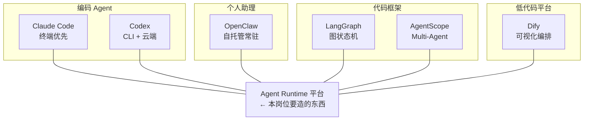

# Agent 框架与产品生态 (Agent Frameworks & Products)

> 中文简称：Agent 框架与产品生态

> **一句话理解**: JD 加分项点名的六个产品各占一个生态位——两个 Coding Agent（Claude Code/Codex）、一个个人助理（OpenClaw）、两个框架（LangGraph/AgentScope）、一个低代码平台（Dify）；面试要求是"用一句话定位 + 两个技术细节"讲清每个。

---

## 1. 生态位全景

图解：这些产品都跑在 Runtime 平台之上或本身就是 Runtime 的雏形——面试时把"我研究过它们"落到"我知道它们的执行层怎么设计"。

---

## 2. 六个产品逐个讲（一句话定位 + 两个细节）

### 2.1 Claude Code（Anthropic · 编码 Agent）

- 定位：终端优先的 Agentic Coding 工具，把 agent loop + 工具调用（读写文件、执行命令、搜索）做到生产可用；
- 细节一：扩展体系完整——**MCP 客户端、Hooks、Skills、Subagent、权限模式**，是"Agent 连接能力"的最佳参照实现；
- 细节二：上下文工程（CLAUDE.md 记忆、compact 压缩、技能渐进加载）是长任务稳定性的关键手段；
- 深入：[[15_智能体/08_Agent编程工具/03_Claude_Code_深入分析|Claude Code 深入分析]]。

### 2.2 Codex（OpenAI · 编码 Agent）

- 定位：OpenAI 的编码 Agent 家族——本地 CLI（Rust 实现、开源）+ 云端 Agent（沙箱内独立执行任务、可并行）；
- 细节：云端模式每个任务在**隔离沙箱**里跑，天然对应 JD 的安全执行环境要求；
- 深入：[[16_编程/05_开发工具/05_codex_openai_概览|Codex 概览]]。

### 2.3 OpenClaw（开源 · 个人 AI 助理）

- 定位：自托管的全天候个人 AI 助理（前身 Clawdbot/Moltbot），通过网关接入 WhatsApp/Telegram 等 IM，24/7 常驻；
- 细节一：架构上是"常驻 Gateway + 会话管理 + 工具/技能插件"，本质是单用户版 Agent Runtime；
- 细节二：2026 年初爆火同时暴露大量安全问题（暴露网关、凭证泄露、注入攻击）——**反向印证沙箱与凭证管理的必要性**，面试可主动拿它讲安全叙事；
- 深入：[[15_智能体/11_OpenClaw生态/06_OpenClaw_Internals|OpenClaw Internals]]。

### 2.4 LangGraph（LangChain · 编排框架）

- 定位：把 Agent 建模成**图状态机**（节点=步骤，边=流转，共享 State），适合需要确定控制流的复杂 Agent；
- 细节：**checkpointer 机制**（多后端持久化 + time-travel 回溯 + human-in-the-loop 中断恢复）就是框架级 Checkpoint 的代表实现；
- 深入：[[15_智能体/03_Agent工作流/05_LangGraph_深入分析|LangGraph 深入分析]]、[[概念/Agent/langgraph|概念页]]。

### 2.5 AgentScope（阿里开源 · Multi-Agent 框架）

- 定位：面向 Multi-Agent 的消息传递框架，**Actor 模型 + 显式消息传递 + 容错重试**，1.0 起补齐 Runtime 支持生产部署；
- 细节：与 LangGraph 的"图"抽象不同，AgentScope 用"消息"抽象组织协作，天然适合分布式 Multi-Agent；
- 深入：[[15_智能体/02_Agent框架/02_AgentScope_深入分析|AgentScope 深入分析]]、[[15_智能体/02_Agent框架/15_AgentScope_AgentRun_生产部署架构|AgentRun 生产部署架构]]。

### 2.6 Dify（LangGenius · 低代码平台）

- 定位：可视化 LLM 应用平台——工作流编排、RAG 管线、模型管理、Agent 策略、LLMOps 观测一站式；
- 细节：插件体系 + 多模型网关，代表"低代码平台"生态位，企业内非算法团队落地 Agent 的常见入口；
- 深入：[[15_智能体/09_Agent平台/01_Dify_Coze_MLServe_Dive|Dify/Coze 平台 Dive]]。

---

## 3. 连接能力谱系：Tool / Skill / Plugin / MCP / Computer Use

| 能力 | 本质 | 粒度 | 典型实现 |
|------|------|------|---------|
| **Tool** | 一个可调用的函数/接口 | 单个动作 | Function Calling、MCP tools |
| **Skill** | 指令+脚本+资源的**能力包**，按需渐进加载 | 一个任务域 | Claude Code Skills、[[15_智能体/05_Agent技能/README|Agent 技能专题]] |
| **Plugin** | 平台级扩展（含多个工具+UI+配置） | 平台生态 | Dify 插件、浏览器扩展 |
| **MCP** | 连接工具/数据的标准**协议** | 传输与发现层 | MCP Server 生态 |
| **Computer Use** | 直接操作 GUI（截图→定位→点击/键入） | 通用界面层 | Claude Computer Use、浏览器自动化 |

- 记忆口径：**Tool 是动词，Skill 是能力包，Plugin 是商品，MCP 是协议，Computer Use 是兜底**（没有 API 时最后的选择，也是唯一能操作任意软件的方式）。

---

## 4. 高频面试题速练

1. **"LangGraph 和 AgentScope 怎么选？"** —— 单 Agent 强控制流/需要精细 Checkpoint 选 LangGraph；分布式 Multi-Agent、消息驱动、需要容错选 AgentScope；二者都在往 Runtime 平台化走（LangGraph Platform / AgentScope Runtime）。
2. **"这些框架和你要建的 Runtime 什么关系？"** —— 框架管"单次执行的抽象"，Runtime 管"多租户下的执行、隔离、恢复、观测"；平台通常框架无关（框架跑在沙箱会话里）。
3. **"Computer Use 和 RPA 什么关系？"** —— RPA 是规则驱动的 UI 自动化前生，Computer Use 由模型驱动、泛化到未见界面，但成功率/延迟/成本更差，两者在企业自动化里互补。
4. **"OpenClaw 的安全问题给你什么启发？"** —— 常驻助理=高权限长期凭证+不可信内容入口，必须做沙箱隔离、凭证代管、操作审计——正是企业级 Runtime 的三个必修课。

---

## Related

- [[21_面试岗位/28_Agent_Runtime工程师/06_MCP_A2A_协议|MCP 与 A2A 协议]]
- [[15_智能体/20_Agentic_Infra/01_Agentic_Infra_全景_2026|Agentic Infra 全景 2026]]
- [[概念/Agent/multi-agent|Multi-Agent 概念页]]
- [[21_面试岗位/01_Agent工程师/README|Agent 工程师面试系列]]

---

*Last updated: 2026-10-20*
