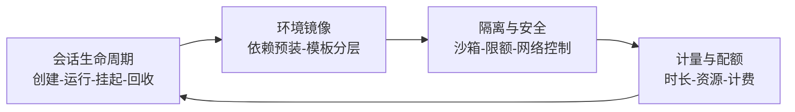

# 执行平台形态 (Execution Platform Archetypes)

> 中文简称：执行平台形态

> **一句话理解**: JD 加分项列的那串"代码执行平台、Serverless、CI/CD Runner、在线 IDE、Notebook、RPA"其实是同一个问题的七种历史答案——**如何安全地替别人跑一段代码**；面试时把旧经验翻译成 Agent Runtime 语言，就是加分项的打开方式。

---

## 1. 共性抽象（先立框架再逐个讲）

图解：所有执行平台都在解这四件事的闭环，差别只在"跑什么、跑多久、给谁跑"。

---

## 2. 七种形态逐个拆

### 2.1 代码执行平台（Code Interpreter / E2B 模式）

- 形态：API 驱动的短命沙箱会话——"给我一个 Python 环境，跑这段代码，把结果和文件还我"；
- 技术要点：容器/microVM 池化预热、会话级文件系统、超时强杀、产物（图表/文件）回传；
- 与 Agent 的关系：这是 Agent 工具调用里最典型的重执行场景，Agent Runtime 的沙箱层基本就是它的强化版。

### 2.2 Serverless / FaaS

- 形态：函数即部署单位，平台管扩缩容到零、毫秒计量计费；
- 与 Agent 的错配（面试要点）：FaaS 假设**无状态短请求**，而 Agent 会话**有状态、长周期、要暂停恢复**——所以业界方向是 Serverless 之上的 **Durable Execution**（状态外置+重放），而非直接把 Agent 塞进函数；
- 参照：[[概念/General/serverless|Serverless 概念页]]、Firecracker 正是 Serverless 底座（见 [[21_面试岗位/28_Agent_Runtime工程师/04_Sandbox_隔离技术|04 沙箱]]）。

### 2.3 CI/CD Runner

- 形态：GitHub Actions / Jenkins 的执行器——领取任务、拉起隔离环境、执行流水线、回收；
- 与 Agent 同构的三个设计：**一次性环境**（防跨任务污染）、**池化与预热**（秒级领取）、**凭证最小下发**（短时 token 注入环境变量而非仓库）；
- 迁移叙事："管过 CI Runner 就是管过'任务队列+隔离执行+日志回收'，Agent 沙箱池是同一套问题换了个客户。"

### 2.4 在线 IDE（VS Code Server / code-server）

- 形态：浏览器里的完整开发环境——远端进程 + 文件同步 + 端口转发 + 终端；
- 技术要点：会话与工作区解耦、idle 自动休眠、资源限额、多会话并发隔离；
- 与 Agent 的交集：Coding Agent（Claude Code/Codex）的环境正是"无头版在线 IDE"。

### 2.5 Notebook（Jupyter 系）

- 形态：会话式交互计算——内核（kernel）长驻、单元格增量执行、状态在内核里累积；
- 对 Runtime 的启发：**内核断连重连**（内核死了 notebook 还在）就是"执行现场与状态分离"的原型；idle 内核回收策略可直接搬到 Agent 会话管理。

### 2.6 RPA（机器人流程自动化）

- 形态：录制/编排 UI 操作脚本，无人值守（批处理）或有人值守（辅助）跑在受控终端上；
- 与 Computer Use 的接力：RPA 是"规则驱动"，Computer Use 是"模型驱动"——RPA 稳定但脆（界面一改就断），Computer Use 泛化但贵且慢，企业自动化正走向两者混用；
- 平台视角：RPA 十几年的"终端资源池、任务排队、失败截图、审计录像"资产，Agent GUI 操作平台可以全套继承。

### 2.7 自动化执行平台（泛化）

- 形态：工作流引擎（Airflow/Temporal 式）+ 调度 + 重试 + 依赖管理；
- 与 Agent 的合流：Agent 任务正在变成工作流引擎的一种新节点类型（把 Agent 当一个会失败、需重试、有输出的活动），这是 Runtime 与工作流引擎融合的趋势。

---

## 3. 形态对照速查表

| 形态 | 隔离单位 | 会话时长 | 状态 | 对 Agent Runtime 的可迁移资产 |
|------|---------|---------|------|------------------------------|
| 代码执行平台 | 沙箱容器/VM | 秒-分钟 | 弱 | 池化预热、产物回传 |
| Serverless | 函数实例 | 毫秒-分钟 | 无 | 弹性到零、计量计费 |
| CI/CD Runner | Runner 环境 | 分钟-小时 | 一次性 | 任务队列、凭证下发、日志回收 |
| 在线 IDE | 工作区容器 | 小时-天 | 有（文件+进程） | 会话休眠恢复、端口/终端管理 |
| Notebook | 内核进程 | 小时 | 有（内核内存） | 执行与状态分离、断连重连 |
| RPA | 受控终端/桌面 | 分钟-天 | 有 | 资源池、审计录像、失败重试 |
| 工作流引擎 | 任务节点 | 分钟-月 | 有（Durable） | 重试语义、DAG 依赖、补偿 |

---

## 4. 高频面试题速练

1. **"你没做过 Agent Runtime，凭什么能做？"** —— 迁移叙事：执行平台的四件套闭环（生命周期/镜像/隔离/计量）我在 X 平台做过 Y，Agent Runtime 的增量在语义层（Checkpoint+协议+评测），正是我补齐的部分。
2. **"Agent 会话和 Serverless 函数最本质的冲突？"** —— 状态与生命周期假设相反；解法是 durable execution 层把"状态"从"进程"里解耦出来。
3. **"Computer Use 会不会取代 RPA？"** —— 短期不会：确定性流程 RPA 更稳更便宜；模型驱动适合长尾与变化界面，企业落地是混编。

---

## Related

- [[21_面试岗位/28_Agent_Runtime工程师/03_Agent_Runtime_核心机制|Agent Runtime 核心机制]]
- [[21_面试岗位/28_Agent_Runtime工程师/04_Sandbox_隔离技术|Sandbox 隔离技术]]
- [[概念/General/serverless|Serverless 概念页]]
- [[15_智能体/09_Agent平台/01_Dify_Coze_MLServe_Dive|Agent 平台 Dive]]

---

*Last updated: 2026-10-20*
