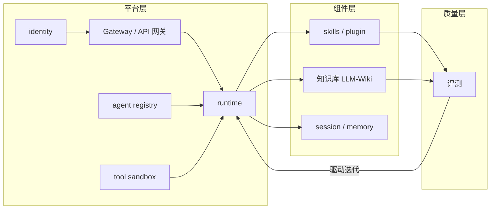

# Agent 平台岗 JD × 简历匹配分析与拓展 (JD-Resume Match Deep Dive)

> 中文简称：Agent 平台岗简历匹配与拓展

> **一句话理解**: 把平台岗 JD 的三个方向逐项拆到"简历证据 → 面试话术 → 预判追问"三层，能写的写出口径，不能写的明确不写。

---

## JD 原文还原（截图内容）

1. Agent 开发框架、平台研发经验
2. Agent 性能优化与 plugin/skills 等组件研发能力
3. Agent infra 层：Gateway、runtime、tool sandbox、agent registry、identity、评测、应用广场、session、memory、知识库、镜像管理、任务管理、API 网关、评测等

来源：脉聘渠道岗位截图（2026-10-20），与 [[21_面试岗位/28_Agent_Runtime工程师/01_Agent_Runtime_岗位JD|Runtime 岗 JD]] 属同一招聘线，两份合并即是完整岗位画像。

---

## 总体判断

**匹配度高，主线完全对得上。** 三个方向里：

- 方向一（框架/平台研发）是强项：主业即 Agent 平台 0→1，开源侧四个 AgentScope 系项目横向印证。
- 方向二（组件研发）skills/plugin 部分极强，"性能优化"需要换口径承接。
- 方向三（infra 清单）约一半组件有真实弹药可写，另一半遵守"没有就不写"原则。

**结构性风险**：简历叙事重心是"运维/工单指标"，JD 是"平台/infra 研发"。事实都具备，表述上把重心从"工单托管成功率"往"平台组件与机制"上挪。

---

## 方向一：Agent 开发框架、平台研发经验 — 强匹配，主打

### 证据

| 层 | 证据 |
|----|------|
| 主业 | ACK/AI Stack 运维智能体 0→1；作为平台架构师设计基于 AgentScope 的智能体底座接入专有云运维管控平台；主导 RAG → ReAct 架构演进 |
| 开源 | resolve-agent（生产级智能体平台，432 场景、23 项定制功能）、open-tam（AgentScope + MCP 多 Agent 排障）、open-arch（AgentScope 2.0 Copilot）、agent-up（配置全生命周期平台） |

### 面试话术要点

- **选型叙事**：为什么是 AgentScope——多 Agent 编排原生、分布式部署支持、与阿里系生态兼容；对比自研（成本）与 LangGraph/Dify（可控性、私有化交付约束）。
- **演进叙事**：RAG 智能体（检索问答，天花板低）→ ReAct 智能体（推理 + 工具调用 + 观察闭环）的触发点是工单场景里"多步诊断无法一步检索解决"；代价是延迟、评测难度、幻觉风险三项都要重做。
- **数字锚点**：432 个场景、23 项定制功能、覆盖率/托管成功率接近 SOTA、AI Stack 冷启动两周。

---

## 方向二：性能优化与 plugin/skills 组件研发 — 组件极强，性能换口径

### plugin/skills 组件（直接写，最亮部分）

| 组件 | 证据 | 面试话术锚点 |
|------|------|-------------|
| Skills 体系 | skills-database（455 条技能、27 个角色、分类幂等重建）、open-cognition-database（137 个标准化 Skill 可被大模型直接挂载）、peace-lab（24 个 Skills） | "技能组件化"：来源可溯、幂等重建、单文件离线、可直接挂载——成体系的 Skill 资产设计，市面上候选人少见 |
| MCP/plugin | mcp-database / mcp4coder（37 个 Server、200+ 工具收敛进统一基类，新增一个 Server 只需实现两个方法；内置 JWT 双认证 + 沙箱隔离） | 接入边际成本从周级降到小时级；统一基类 = 框架层抽象能力 |

### 性能优化的承接口径

简历上没有 latency/吞吐/token 成本类数据，现有指标全是效果类与效率类：

- **效果类**：工单场景覆盖率、托管成功率接近 SOTA（评测驱动迭代的结果）。
- **效率类**：klaw 排障 API 调用降约 90%、mcp4coder 接入成本周→小时。

**处理原则**：用"效果与效率优化"口径承接；除非实际做过智能体推理延迟、token 成本、并发吞吐优化（有真实数据才补），否则不硬凑"性能优化"——面试官听到这四个字会往 TTFT/吞吐/成本上追问。延伸技术储备（KV Cache、PD 分离）见 [[21_面试岗位/28_Agent_Runtime工程师/08_可观测_评测|可观测与评测]] 里的延迟/成本指标口径。

---

## 方向三：Agent infra 组件清单逐项对照

| JD 组件 | 简历证据 | 结论 | 面试话术锚点 |
|---------|---------|------|-------------|
| runtime | AgentScope 底座接入运维管控平台；resolve-agent Loop 工程 | ✅ 主打 | 智能体生命周期、路由（FTA/WIKI/skills/代码分析四路）、闭环收敛 |
| 知识库 | LLM-Wiki 知识体系（主业）；kudig 4,750 篇"人 + Agent 双读"；docsy（14 条 Linter + 健康评分，机器可解析可校验）；cmd-database（Agent 语料） | ✅✅ 最强项 | "双读设计"：文档按人和 AI 双消费端设计，可直接作 LLM-Wiki 语料挂载 |
| 评测 | open-tam"故障注册表即评测集"；open-mock 确定性 Agent 测试沙盒（215 个测试）；覆盖率/托管成功率指标体系 | ✅ 主打 | "评测即资产"：trace 可回放 + 故障注册表直接当评测集，拉开差距的设计点 |
| agent registry | agent-up 配置全生命周期（编辑→审批发布→效果追踪→一键回滚，30 个 API、232 个自动化测试）；skills-database 技能注册 | ✅ 写 | 用"注册/生命周期管理"语言表述；四分区编辑器支持分区级回滚 |
| tool sandbox | mcp4coder 沙箱隔离；open-mock 测试沙盒 | ✅ 写 | 口径是"工具接入沙箱隔离"，不是 Firecracker/VM 级隔离；VM 级储备见 [[21_面试岗位/28_Agent_Runtime工程师/04_Sandbox_隔离技术|Sandbox 隔离技术]] |
| 任务管理 | resolve-agent 告警→根因→修复的 Loop 编排；sokr 六层链路（目标→KR→专项→课题→工单→技能） | 🔶 可写 | 口径"任务编排/闭环"，不是项目管理系统 |
| 应用广场 | open-demo（959 个可运行案例、18 个技术栈、按客户场景检索） | 🔶 类比聊 | 概念最接近"案例广场"，可类比，别写成"agent 应用市场" |
| Gateway / API 网关 | mcp4coder 统一接入 + JWT 双认证 | 🔶 带一句 | 只在聊 MCP 统一接入层时带过，不单写"网关" |
| session / memory | 平台类产品大概率有会话与上下文管理，但简历未写 | 🔶 视事实 | 真做过多轮上下文/长期记忆就补半句；注意知识库 ≠ memory |
| identity | 仅 JWT 双认证 | ❌ 不写 | — |
| 镜像管理 | Docker 专著 + OSS 管控容器化是容器底子，非 agent 镜像管理 | ❌ 不写 | — |

---

## 两份 JD 合并：完整岗位画像

把本 JD 与 [[21_面试岗位/28_Agent_Runtime工程师/02_技术清单_知识地图|Runtime JD 技术清单]] 合并，岗位本质是**企业级 Agent 平台全栈**：

图解：本 JD 覆盖平台层 + 组件层 + 质量层，而 Runtime JD 深挖 runtime 内部（Checkpoint、生命周期）与执行隔离（Firecracker/Kata/gVisor/Wasm）。备考主线不变：P0 仍是 [[21_面试岗位/28_Agent_Runtime工程师/03_Agent_Runtime_核心机制|Runtime 核心机制]]、[[21_面试岗位/28_Agent_Runtime工程师/04_Sandbox_隔离技术|沙箱隔离]]、[[21_面试岗位/28_Agent_Runtime工程师/06_MCP_A2A_协议|MCP/A2A 协议]] 三个专题，本页补的是"平台组件 × 个人证据"的匹配层。

---

## 预判追问 Q&A（按简历展开逻辑）

**Q1：为什么选 AgentScope 而不是自研或 LangGraph/Dify？**
答：三条理由——多 Agent 编排与分布式能力原生；消息驱动的 actor 模型适合工单流水线；私有化专有云交付要求全栈可控。补充对比：LangGraph 图编排灵活但生态偏 Python 研究，Dify 偏低代码快速搭建、深度定制受限。

**Q2：RAG → ReAct 演进的触发点是什么？代价是什么？**
答：触发点是单轮检索解决不了多步诊断（一个工单要先定位版本、再查变更、再给处置）。代价三项：延迟上升（多轮循环）、评测复杂（单轮准确率 → 全链路成功率）、幻觉风险（工具误用）——所以评测体系和工具沙箱是配套建设的，不是独立功能。

**Q3：评测集怎么建的？托管成功率怎么定义？**
答：open-tam 的设计——"排查即语料"：每步推理、工具调用、观察都落盘为可回放 trace；故障注册表同时就是评测集（新故障进注册表 = 新评测用例）。托管成功率的口径要能说清：场景覆盖率（有多少类工单有对应智能体方案）+ 托管成功率（托管后无需人工接管的比例），以及防幻觉误操作的门禁（高危命令红线、人工确认边界）。

**Q4：mcp4coder 统一基类怎么设计的？"两个方法"是什么？**
答：把 37 个 Server 的共性（鉴权、参数校验、日志、错误码）下沉到基类，新增 Server 只实现"工具描述注册 + 执行体"两个方法。价值在边际成本：周级→小时级。这题在展示框架层抽象能力，对应 JD 的"组件研发能力"。

**Q5：Skills 怎么做到"可被大模型直接挂载"？**
答：标准化结构（元数据 + 触发条件 + 执行说明 + 红线约束）、来源可溯、分类幂等重建（同一来源重跑结果一致）、单文件可离线。open-cognition 的 137 个 Skill 就是按"Agent 消费端优先"的写法组织的。

**Q6：配置变更怎么保证不出事故？（agent-up 追问）**
答：全生命周期闭环——编辑（四分区）→ 审批发布 → 效果追踪（上线自动生成效果报告）→ 一键回滚（支持分区级）。类比"配置即代码"：变更可审计、可撤销，用户反馈经 AI 归因自动转化为变更建议。

**Q7（弱项）：高并发多租户、网关限流、身份体系怎么做？**
答：坦诚边界 + 补位——"这块在专有云运维平台场景里由平台工程团队承担，我的深度在智能体侧；但云原生底子扎实（ACK 容器技术专家组组长，etcd Operator、K8s 网络排障工具、单二进制运维平台都是自己写的），补齐成本低"。参照 [[21_面试岗位/28_Agent_Runtime工程师/09_企业级交付_安全|企业级交付与安全]] 补 IAM/审计/灰度口径。

**Q8（弱项）：沙箱用什么隔离技术？**
答：当前口径是工具接入层的沙箱隔离（MCP 层）；VM 级隔离（Firecracker/Kata/gVisor/Wasm）是知识储备项，已系统补齐——见 [[21_面试岗位/28_Agent_Runtime工程师/04_Sandbox_隔离技术|Sandbox 隔离技术]]，能讲到"gVisor 拦截 syscall、Kata 轻量 VM、Firecracker 毫秒级启动、Wasm 秒级冷启动但生态受限"的对比粒度。

**Q9：AI Stack 智能体"冷启动两周"是怎么做到的？**
答：平台资产复用——知识库（LLM-Wiki 语料直接挂载）、评测框架、技能模板都是平台级的，新产品线智能体只需填场景语料和技能；这是"平台 vs 单点智能体"差异的最好证明，回应 JD"平台研发经验"的核心考点。

**Q10：和纯做 Agent 应用的候选人比，你的差异化是什么？**
答：平台组件 + 生产运维双视角——既做过平台架构（底座、注册、评测、知识库），又有一线工单/故障场景的领域深度（FTA 故障树、应急预案），智能体不是 demo 而是承接生产工单的。三本技术专著（容器、大模型）+ 22 个开源项目作为工程能力的旁证。

---

## 简历表述改法（只改表述，不加新事实）

项目经历第一条（企业级智能运维 Agent 平台）用 JD 语言点名组件，示例：

> 主导平台架构从 RAG 向 ReAct 智能体迭代：设计智能体接入与注册机制（配置审批发布、效果追踪、一键回滚）、LLM-Wiki 知识库（人 + Agent 双读语料体系）、评测集与托管成功率指标（场景覆盖率与托管成功率接近 SOTA）、工具沙箱（MCP 统一接入层隔离）；沉淀 Skills 组件体系（455 条标准化技能、137 个可挂载 Skill），MCP 统一框架收敛 37 个 Server、200+ 工具，新增接入从周级降到小时级。

改动逻辑：每个词背后都是已有真实事实，但让筛简历的人和面试官一眼对上 JD 关键词。"性能优化"四字不出现，用"效果追踪/成功率指标/接入效率"承接。

---

## 缺口与补强

| 缺口 | 性质 | 补法 |
|------|------|------|
| session/memory 机制 | 表述缺口（平台里大概率有） | 确认事实后补半句；知识储备参考记忆基础设施专题 |
| identity / 多租户 | 真缺口 | 不写；用 [[21_面试岗位/28_Agent_Runtime工程师/09_企业级交付_安全|企业级交付与安全]] 备到"能聊"粒度 |
| VM 级沙箱 | 知识缺口（已补） | [[21_面试岗位/28_Agent_Runtime工程师/04_Sandbox_隔离技术|Sandbox 隔离技术]] 已覆盖 |
| Gateway / 限流 | 真缺口 | 不写；被追问时用云原生底子补位（Q7 口径） |
| 性能优化（latency/成本） | 口径缺口 | 用"效果与效率"口径承接；延伸储备见 [[21_面试岗位/28_Agent_Runtime工程师/08_可观测_评测|可观测与评测]] |

---

## 相关页面

- [[21_面试岗位/28_Agent_Runtime工程师/01_Agent_Runtime_岗位JD|01 岗位 JD 解读]] — 同招聘线的 Runtime JD 原文与能力域拆解
- [[21_面试岗位/28_Agent_Runtime工程师/02_技术清单_知识地图|02 技术清单知识地图]] — 全量技术清单与库内映射
- [[21_面试岗位/28_Agent_Runtime工程师/07_Agent_框架产品生态|07 Agent 框架与产品生态]] — AgentScope/LangGraph/Dify 对比，支撑 Q1
- [[21_面试岗位/28_Agent_Runtime工程师/README|系列导航]] — 本系列全部 12 篇

---

*Last updated: 2026-10-22*
