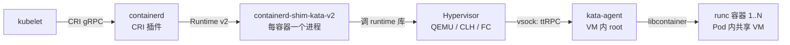

# Kata Containers 架构深潜 (Kata Containers Architecture Deep Dive)

> 中文简称：Kata Containers 架构深潜

> **一句话理解**: Kata = "容器的接口 + 虚拟机的边界"——你在 K8s 里照常写 Pod，但每个 Pod 实际住在一台独占内核的轻量虚拟机里。

---

## 1. 定位：一句话模型

- Kata Containers 是 **OCI 兼容的容器运行时**：上层接口（containerd、K8s、Docker）完全不变，下层把"起容器"换成"起一台轻量 VM，再在 VM 里起容器"；
- 起源：2017 年由 Intel **Clear Containers** 与 Hyper.sh **runV** 合并而成，现属 OpenInfra 基金会；
- 核心价值主张：**硬件虚拟化隔离**（独立 guest kernel）+ **几乎无损的 Linux 兼容性**——这正是它和 gVisor 分道的地方。

---

## 2. 完整调用链（面试默写级）



图解：shim 是"翻译官"——把 containerd 的 shim API 翻译成 agent 协议经 vsock 打进 VM；agent 是 VM 内的"施工队"，用和 runc 同源的 libcontainer 真正创建容器。

逐组件职责表：

| 组件 | 运行位置 | 职责 | 关键点 |
|------|---------|------|--------|
| containerd-shim-kata-v2 | 宿主机 | 实现 Runtime v2 shim API，管理容器生命周期（Create/Start/Exec/Signal/stdio 转发） | **每容器一个进程**，Pod 内所有 shim 共享同一 VM |
| Hypervisor（QEMU/CLH/FC） | 宿主机 | 创建并运行 microVM | 隔离边界的真正执行者 |
| kata-agent | VM 内 | 接收 ttRPC 指令，调 libcontainer 创建容器、管理 cgroup/挂载 | VM 内 root，被攻破 = VM 内防线归零 |
| kata-runtime（CLI） | 宿主机 | Docker/CRI-O 直连 runtime 二进制场景的入口；承载配置与调试命令 | K8s + containerd 路线下基本不出现 |
| guest kernel | VM 内 | 独立内核，与宿主内核解耦 | Kata 自己维护内核配置，攻击面独立 |

---

## 3. shim 之辨：runc shim vs kata shim（高频追问）

- **不是同一个 shim**：默认链路是 `containerd-shim-runc-v2`（直接在本机 fork 容器进程）；Kata 用 **`containerd-shim-kata-v2`** 替换它，二者实现的是同一套 Runtime v2 shim API，可无缝互换——这就是 RuntimeClass 能按 Pod 切换的基础；
- **shim 没有被架空**：stdio 转发、信号、exec、resize、状态查询仍由 shim 承接，它把请求翻译成 agent 协议经 vsock 送进 VM；
- **进程配比**：**每容器一个 shim 进程，每 Pod 一个 VM**——第一个容器的 shim 负责创建 VM（sandbox），后续容器的 shim 附着到同一 sandbox；
- **加分明细**：Kata 1.x 时代是 shim-v1 + kata-proxy + kata-shim 三个进程协作（串口 + JSON 消息），2.x 收敛为单一 shim-kata-v2 直连 vsock——链路短了、进程少了、延迟降了。

---

## 4. 版本演进：1.x → 2.x → 3.x

| 版本 | 时间 | 架构要点 | 面试一句话 |
|------|------|---------|-----------|
| 1.x | 2017 | shim-v1 + kata-proxy + kata-shim 三进程；virtio-serial + JSON 通信 | "链路长、进程多" |
| 2.x | 2020 | **containerd-shim-kata-v2** 实现 Runtime v2；**vsock + ttRPC** 直连；kata-agent 改 Rust 实现；去掉 proxy/shim 两个旁路进程 | "架构收敛的一代" |
| 3.x | 2023 | **runtime-rs**（Rust 重写的 runtime）；默认 hypervisor 从 QEMU 换为 **Cloud Hypervisor**；guest kernel 独立仓库管理；支持 Dragonball VMM | "Rust 化 + 默认 CLH" |

演进主线记一条：**砍宿主侧进程、缩短控制链路、换更轻的 VMM**——每次演进都在压启动延迟和内存开销。

---

## 5. kata-agent 与通信通道

- **kata-agent 职责**：VM 内唯一特权进程，收 ttRPC 请求后调 libcontainer 创建/销毁容器、管理挂载点和 cgroup；还有健康检查与 VM 内事件上报；
- **为什么用 vsock**：VM Socket 是 hypervisor 提供的**主机↔客户机直连通道，不经过网络栈**——无需给 VM 配 IP 就能通信，天然不走 tc/iptables，控制面与数据面网络解耦；
- **协议**：ttRPC（containerd 生态同款轻量 RPC，非 gRPC），2.x 起经 vsock 直连；
- **降级路径**：对不支持 vsock 的 hypervisor/老环境，可回落到 virtio-serial + 代理转发（1.x 遗产）；
- **安全视角**：agent 在 VM 内是 root，但它只能操作 VM 内部——即使被攻破，隔离边界（硬件虚拟化）仍在；真正的红线是 **hypervisor 逃逸**。

---

## 6. Hypervisor 后端选型对比

| 维度 | QEMU | Cloud Hypervisor（CLH） | Firecracker | Dragonball |
|------|------|------------------------|-------------|-----------|
| 定位 | 全功能传统 VMM | Rust 极简 VMM（Kata 3.x 默认） | AWS 极简 microVM VMM | 蚂蚁集团 VMM（机密计算场景） |
| 内存/启动开销 | 最大 | 小、启动快 | ~125 ms 量级、每 VM ~5 MB 级 | 小，面向可信执行 |
| 设备模型 | 最全（兼容性最强） | 精简 virtio | 极简（net/block/vsock/串口） | 精简 |
| 适用 | 兼容性优先、传统虚拟化特性 | 通用云原生默认 | Serverless / Agent 沙箱 | 机密计算、runtime-rs 栈 |
| 一句话 | "重但全" | "3.x 新默认" | "AWS 血统" | "国内贡献" |

补充：Firecracker 也可作为 Kata 的后端 hypervisor 使用，但业界更常见的做法是直接用 Firecracker 自建沙箱平台（如 E2B），绕过 Kata 这层容器语义。

---

## 7. Pod 级沙箱模型：资源与网络

- **Pod = 一个 sandbox = 一台 VM**：Pod 内容器共享 VM 的内核与资源，这正是 K8s 语义（共享网络/存储命名空间）的自然映射；
- **内存 sizing 与热插拔**：VM 默认内存 ~2 GiB 量级（可配），配合 **memory hotplug（virtio-mem / ACPI 热插）**按 Pod spec 动态扩容；vCPU 也支持热插——避免"小 Pod 预付大 VM"的浪费；
- **网络模型**（2.x 起三选一）：
  1. **tc mirroring**（默认）：流量经 tc 镜像到 VM 内 tap，延迟低；
  2. **macvtap**：直通虚拟网卡，性能好但灵活性差；
  3. 老式 **bridge/tap**：兼容场景；
- **镜像拉取**：支持宿主侧拉取后注入 VM（默认），也有 guest 内拉取模式（配合机密计算时镜像内容对宿主不可见）。

---

## 8. 选型定位：Kata vs gVisor vs 裸 Firecracker

| 维度 | Kata | gVisor | Firecracker 直用 |
|------|------|--------|-----------------|
| 隔离机制 | 独立 guest kernel（硬件虚拟化） | 用户态内核拦截 syscall | 独立 guest kernel（极简设备） |
| 兼容性 | 几乎完整 Linux | syscall 有缺口（/proc、FUSE、部分 mount） | 需自建设备与控制面 |
| 启动延迟 | 数百 ms（优化内核+initrd） | 秒级（容器级） | ~125 ms |
| 每会话内存开销 | ~百 MB 量级（VM 基线） | ~十几 MB（Sentry） | ~5 MB 级额外开销 |
| 侵入性 | 无（OCI/RuntimeClass 即插） | 无（runsc 即插） | 高（自建控制面） |
| Agent 沙箱契合 | 长任务、强兼容（如需要完整依赖链） | 高并发短任务 | 会话型代码执行平台主流选择 |

选型口诀：**要 K8s 语义不改平台选 Kata；要密度和启动选 gVisor；要每会话一 VM 的极致弹性直接 Firecracker 自建**。同一 K8s 集群可用 RuntimeClass 三者并存。

---

## 9. Agent 沙箱场景：怎么用、何时别用

适合用 Kata 的场景：

- 平台已经是 containerd + K8s，想**零改造**获得内核级隔离（RuntimeClass 一行切换）；
- 执行的任务**兼容性敏感**：完整 pip 依赖链、需要特定 syscall 行为、GPU 直通类负载；
- 长会话型 Agent 任务：VM 常驻、池化复用后启动成本被摊薄。

要三思的场景：

- **海量短命会话**（每次工具调用秒级创建销毁）：Kata 的 VM 基线内存和启动延迟不如 gVisor/Firecracker 经济；
- **快照恢复**：Kata 的 snapshot/restore 生态不如 Firecracker 原生成熟，"挂起-恢复"型会话管理做起来更费劲；
- **密度极限**：单节点数千会话的诉求，VM-per-Pod 的基线开销会成为瓶颈。

---

## 10. 运维与排障（实战加分）

```yaml
# K8s 侧启用 Kata：RuntimeClass + Pod annotation 一行切换
apiVersion: node.k8s.io/v1
kind: RuntimeClass
metadata:
  name: kata
handler: kata          # 对应 containerd 配置里的 runtime_type + handler
```

排障工具链：

- `kata-collect-data.sh`：一键收集 runtime/hypervisor/agent 日志与环境信息，报障先跑它；
- runtime 配置文件（`configuration.toml/clh.toml`）：开 `enable_debug` 看 shim↔agent 全链路日志；
- **debug console**：给 VM 开控制台，`kubectl exec` 进去查 guest 内状态（生产默认关）。

常见坑（面试讲 2 个即可）：

1. **嵌套虚拟化**：节点必须暴露 `/dev/kvm`（裸金属或开 nested），否则 Kata 直接起不来——云上自建最容易踩；
2. **内存基线误判**：小 Pod 也会占一份 VM 内存基线，节点容量规划要按 VM 开销重算，否则批量调度后 OOM；
3. **cgroup v2 / SELinux**：老版本宿主组件与 Kata 2.x/3.x 的兼容矩阵要核对，机密计算场景还有固件/attacher 依赖。

---

## 11. 高频面试题速练

1. **"Kata 架构里是哪个 shim？"** —— `containerd-shim-kata-v2`，Kata 实现的 Runtime v2 shim，替换默认 shim-runc-v2；每容器一个 shim 进程，Pod 共享一个 VM，shim 把 shim API 翻译成 ttRPC 经 vsock 打给 VM 内的 kata-agent。
2. **"为什么用 vsock 而不是给 VM 配 IP？"** —— 控制面不走网络栈：无需 IP、不受网络策略/防火墙影响、天然与数据面解耦，攻击面小。
3. **"kata-agent 被攻破了会怎样？"** —— 攻击者拿到 VM 内 root，但仍在 guest 里；隔离边界是 hypervisor，红线是 VM escape。纵深做法：最小化 agent 攻击面（Rust、精简接口）、guest kernel 与 agent 及时升级、机密计算补一层 TEE。
4. **"Kata 2.x 相比 1.x 改了什么？"** —— 三进程收敛为一个 shim-kata-v2；virtio-serial+JSON 换成 vsock+ttRPC 直连；agent 用 Rust 重写。主线是砍宿主侧进程、缩短控制链路。
5. **"Kata 和 Firecracker 什么关系？"** —— 竞合关系：Firecracker 可以作为 Kata 的 hypervisor 后端；但 Agent 沙箱平台（如 E2B）更多是绕开 Kata 直接用 Firecracker 自建控制面，换取 ~125 ms 启动和更低内存基线。
6. **"Pod 里第二个容器怎么进同一个 VM？"** —— 第一个容器的 shim 创建 sandbox（VM），后续容器 shim 附着到同一 sandbox id；agent 在 VM 内把新容器挂进共享的 pod 级 namespace。
7. **"Kata 的内存为什么不能像容器那样按需精确定位？"** —— VM 有基线开销（guest kernel + agent + 预留内存），3.x 用 memory/vCPU 热插拔缓解"预付浪费"，但基线仍在。
8. **"机密计算（CoCo）和 Kata 什么关系？"** —— Confidential Containers 以 Kata 为底座：guest kernel/agent 藏进 TEE（SEV-SNP/TDX），宿主（含 K8s 管理面）看不到工作负载与镜像——可信执行 × 容器编排的结合点。

---

## Related

- [[21_面试岗位/28_Agent_Runtime工程师/04_Sandbox_隔离技术|Sandbox 沙箱隔离技术（五方案总览）]]
- [[12_架构基建/10_安全/05_gVisor_常见问题与避坑指南|gVisor 常见问题与避坑指南（对照视角）]]
- [[21_面试岗位/28_Agent_Runtime工程师/03_Agent_Runtime_核心机制|Agent Runtime 核心机制]]
- [[21_面试岗位/28_Agent_Runtime工程师/05_编排调度_云原生|编排调度与云原生（RuntimeClass 落点）]]
- [[21_面试岗位/28_Agent_Runtime工程师/02_技术清单_知识地图|技术清单知识地图]]

---

*Last updated: 2026-10-22*
