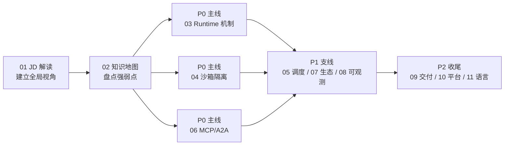

# Agent Runtime 工程师 · 面试准备系列 (Agent Runtime Engineer Interview Series)

> 中文简称：Agent Runtime 工程师面试系列

> **一句话理解**: 这是为企业级 Agent Runtime 平台研发岗定制的备考系列——把 JD 里点名的每一个产品和技术都落成一篇专题，面试时每个关键词都有话可讲。

---

## 系列导航

| # | 专题 | 对应 JD 要点 | 优先级 |
|---|------|-------------|--------|
| 01 | [[21_面试岗位/28_Agent_Runtime工程师/01_Agent_Runtime_岗位JD\|岗位 JD 解读]] | JD 原文沉淀 + 逐条能力域拆解 | P0 |
| 02 | [[21_面试岗位/28_Agent_Runtime工程师/02_技术清单_知识地图\|技术清单知识地图]] | 全量产品/技术清单 + 优先级 + 库内映射 | P0 |
| 03 | [[21_面试岗位/28_Agent_Runtime工程师/03_Agent_Runtime_核心机制\|Agent Runtime 核心机制]] | 任务执行、状态管理、Checkpoint、重试恢复、生命周期 | P0 |
| 04 | [[21_面试岗位/28_Agent_Runtime工程师/04_Sandbox_隔离技术\|Sandbox 沙箱隔离技术]] | 容器/VM/Sandbox、Firecracker/gVisor/Kata/Wasm/Docker | P0 |
| 05 | [[21_面试岗位/28_Agent_Runtime工程师/05_编排调度_云原生\|编排调度与云原生]] | K8s、弹性伸缩、多租户、配额、CPU/GPU 异构 | P1 |
| 06 | [[21_面试岗位/28_Agent_Runtime工程师/06_MCP_A2A_协议\|MCP 与 A2A 协议]] | MCP、A2A、Function Calling 对比 | P0 |
| 07 | [[21_面试岗位/28_Agent_Runtime工程师/07_Agent_框架产品生态\|Agent 框架与产品生态]] | Claude Code、Codex、OpenClaw、LangGraph、Dify、AgentScope、Tool/Skill/Computer Use | P1 |
| 08 | [[21_面试岗位/28_Agent_Runtime工程师/08_可观测_评测\|可观测与评测]] | 模型/工具调用追踪、任务轨迹、成功率/延迟/成本 | P1 |
| 09 | [[21_面试岗位/28_Agent_Runtime工程师/09_企业级交付_安全\|企业级交付与安全]] | IAM、凭证、审计、灰度、容灾、公有云/专有云 | P2 |
| 10 | [[21_面试岗位/28_Agent_Runtime工程师/10_执行平台形态\|执行平台形态]] | 代码执行平台、Serverless、CI/CD Runner、在线 IDE、Notebook、RPA | P2 |
| 11 | [[21_面试岗位/28_Agent_Runtime工程师/11_语言栈_AI工程效能\|研发语言栈与 AI 工程效能]] | Go/Python/Java/C++/Rust、AI-Native SDLC | P2 |
| 12 | [[21_面试岗位/28_Agent_Runtime工程师/12_平台岗JD_简历匹配与拓展\|平台岗 JD × 简历匹配]] | 平台岗三方向逐项匹配、面试话术、预判追问、简历改法 | P0 |
| 13 | [[21_面试岗位/28_Agent_Runtime工程师/13_Sandbox_快问快答_50题\|Sandbox 快问快答 50 题]] | 面试前冲刺：沙箱 50 题一问一答速览（八类全覆盖） | P0 |
| 14 | [[21_面试岗位/28_Agent_Runtime工程师/14_Kata_Containers_架构深潜\|Kata Containers 架构深潜]] | 调用链逐组件拆解、shim 之辨、版本演进、hypervisor 选型、高频追问 | P0 |

---

## 学习路径建议

图解：先吃透 JD 和清单，再主攻三个 P0 专题（Runtime 机制、沙箱、协议——这是本岗与普通后端岗的分水岭），最后补齐 P1/P2 支线。

---

## 复习节奏建议

- **第一周**: 01 + 02 + 03，能把"Agent Runtime 是什么、Checkpoint 怎么设计"讲 5 分钟
- **第二周**: 04 + 06，沙箱五方案对比表能默写，MCP/A2A 原语能举例
- **第三周**: 05 + 07 + 08，结合 [[15_智能体/20_Agentic_Infra/01_Agentic_Infra_全景_2026|Agentic Infra 全景]] 串成平台架构叙事
- **面试前**: 09 + 10 + 11 过一遍，准备 2 个自己主导的"问题闭环"故事

---

*Last updated: 2026-10-22*
