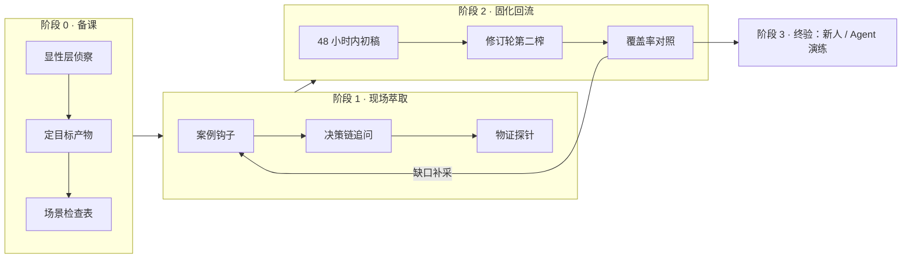

# 专家知识蒸馏（Expert Knowledge Distillation）

> 中文简称：专家知识蒸馏
>
> **一句话理解**：把客户专家"说不出来、但每次都做对"的隐性判断力，用案例访谈反向工程成 playbook / 知识库 / Agent 能直接消费的显性资产——FDE Discovery 阶段最值钱、也最没处学的一门手艺。

---

## 1. 为什么 FDE 必须掌握这门手艺

客户买的从来不是"一个大模型"，而是**领域专家经验的产品化**。甲方的运维总监、风控专家、老师傅，才是真正的"领域大模型"——他们的判断力决定了系统上线后是"能用"还是"敢用"。

- 模型和框架都能买到，专家的判断力买不到，只能**萃取**。同样一条"节点 NotReady"告警，有专家判断力的系统知道先查网络再查 kubelet，没有的系统只会照着 runbook 重启一遍；
- Discovery 阶段（见 [[22-FDE/03_交付方法论/01_Discovery发现阶段|Discovery 发现阶段]]）解决"做什么"，蒸馏解决"**客户凭什么信你做的东西**"——没有专家判断力注入的 AI 系统，甲方一线员工第一个月就会弃用；
- 这门手艺在 FDE 面试里属于"场景判断"维度的深水区（见 [[22-FDE/12_面试岗位/01_FDE面试指南|FDE 面试指南]]）。

### 1.1 与模型蒸馏的类比（这张表值一顿饭）

| 机器学习蒸馏 | 客户现场蒸馏 |
|---|---|
| Teacher 模型 | 运维总监 / 领域专家的大脑 |
| Student 模型 | playbook / RAG 知识库 / Agent / 新人 |
| Hard label（输入 → 输出对） | SOP、runbook 等显性流程 |
| Soft target（带置信度的分布） | 专家的灰区判断："这个告警八成可以睡，但要看伴生指标" |
| 蒸馏损失 | 访谈中丢掉的例外条件与置信度信息 |
| Student 容量 | FDE 自己的领域储备，决定能接住多少 |
| 评估指标 = Student 表现 | 新人 / Agent 拿着产物跑通真实任务的概率 |

**核心结论**：只抄 hard label（SOP）等于白蒸馏——专家和普通人的差别，全在 soft target 里。

---

## 2. 哲学层：五条第一性原理

### 原理一：蒸馏的是判断力，不是知识

显性知识（SOP、runbook、监控大盘配置）专家自己会写、公司 wiki 上也有；值钱的是例外、灰区、取舍——什么告警可以睡、什么"指标正常"其实要命、P0 时先保什么弃什么。规则是二值的，判断是带置信度分布的：只拿走规则，等于只学了 hard label，把 soft target 全丢了。

判别标准：一条知识如果"能 Google 到"，就不该占用宝贵的访谈时间。

### 原理二：专家不知道自己知道什么

波兰尼悖论：我们知道的多于我们能说出来的。直接问"你的运维方法论是什么"，得到的必然是官方叙事。隐性知识只完整地存在于具体案例里，所以萃取的基本单位是**事件 / 场景**，不是"知识点"——这正是学界 Critical Incident Technique 和认知任务分析（Cognitive Task Analysis, CTA）的出发点；Nonaka SECI 模型里，这一步叫外化（Externalization），是四个象限里最苦的一段，FDE 的价值就在这里。

### 原理三：蒸馏器需要容量

模型蒸馏里，student 容量不够，teacher 的分布就接不住；现场同理——你听不懂"南北向流量抖一下先看哪"，就记不下来这句金子。备课不是为了"显得懂"，是给 student 扩容：对方能用黑话跟你省力地讲话，萃取效率才高。

反面更常见：词汇量不够的 FDE，会不自觉地把专家的问题**降维成自己会问的问题**——这是最典型的静默损失。

### 原理四：信任是前提，不是礼貌

运维总监对"AI 化"天然警觉：怕被替代、怕背锅、怕经验被抽走后自己贬值。信息只往信任的方向流。要把他定位成**署名作者**而不是数据源——"你的经验会变成部门标准和资产，署你的名"，而不是"我们提取完就可以优化掉你"。开场三分钟把产物的用途、署名、边界讲清楚，后面两个小时才有的谈。

### 原理五：检验在学生侧

蒸馏质量的唯一标准是 student 的表现：新人拿着 playbook 能不能独立处理一次真实变更？Agent 灌库后答得对不对？不是你笔记记了多少、访谈录了多少小时。跑不通的地方就是你蒸馏损失所在——回去补采，而不是回去改文档措辞。

---

## 3. 方法论总览：三段流水线 + 终验



图解：蒸馏是一条带反馈环的流水线——固化阶段对照检查表发现的缺口会触发下一轮补采；终验（新人或 Agent 实跑）跑不通的地方，定位蒸馏损失后同样回到萃取阶段。

### 3.1 阶段 0 · 备课（到现场之前）

**（1）显性层侦察清单**——能自己拿到的全部先拿到，访谈时间只留给拿不到的：

```
□ 监控大盘截图 / 告警分级规则（现有的，不是理想中的）
□ 最近 3 个月的故障复盘报告（金矿：每次复盘都是一个免费案例）
□ 值班手册 / 交接记录
□ 组织架构 + 谁背什么锅（背锅图决定真实决策流）
□ 对方的 KPI / 考核口径（他今年被考核什么，就最关心什么）
□ 行业黑话表（提前学，现场确认）
```

**（2）先定目标产物**——student 架构决定萃取格式，先想清楚萃出来给谁用：

| 目标产物 | 萃取重点 | 产出形态 |
|---|---|---|
| SOP / Playbook | 动作序列 + 判断条件 + 升级路径 | 决策表 + 流程图 |
| RAG 知识库 | 案例全文 + 阈值口径 + 历史误判 | 带来源标签的案例卡 |
| Agent（自动值班 / 辅助决策） | 规则 + 置信度 + 边界（什么必须转人工） | 规则集 + prompt 素材 |
| 培训课程 / 新人带教 | 老手 vs 新手差异点 + 常见错误 | 题库 + 错题本 |
| 验收 / 交付标准 | 成功指标 + 反例（什么算不及格） | 验收清单 |

**（3）场景检查表（脚手架）**——以运维域为例，用途不是照着问，是访谈结束后对照找缺口：

```
值班与交接 · 告警分级与降噪 · 变更窗口管理 · 容量规划
故障应急（MTTR 压缩）· 复盘与整改 · 向上汇报（P0 通报怎么写）
跨部门博弈（研发背锅 / 资源抢夺）· 成本治理 · 安全合规红线
```

### 3.2 阶段 1 · 现场萃取

**访谈纪律**：

- 单场不超过 2 小时，一场只打一个主题；分多场比一次榨干好——专家会累，第 3 小时的产出质量断崖下跌；
- 别在他救火时蒸馏；最好约在值班室 / 机房旁，别约会议室——环境本身是记忆触发器；
- 录音先拿授权；逐字稿比你的总结值钱，你的笔记只记结构和追问。

**核心武器：案例钩子 + 决策链追问**。开场不问方法论，只要一个故事：

```
"讲一次你印象最深（或最后怕）的故障。"

然后沿决策链拆六问：
1. 当时最先看到的是什么？（入口信号）
2. 为什么先看这个而不是别的？（优先级）
3. 凭什么判断是 X 而不是 Y？（鉴别诊断）
4. 当时还可能是什么？你怎么排除的？（反事实）
5. 如果当时判断错了，最坏会怎样？（风险权重）
6. 一个新人到这里最可能怎么错？（可迁移点）
```

第 6 问是整条链的落点——前五问还原他的大脑，第 6 问直接产出可教的内容。

**八个萃取手法**（按使用频率排序）：

| 手法 | 话术示例 | 挖的是什么 |
|---|---|---|
| 案例钩子 | "讲一次最后怕的故障" | 完整决策链的载体 |
| 对比提问 | "老手和新手在这件事上差别在哪？" | 隐性知识的差值 |
| 追失效不追流程 | "这套 SOP 什么时候不灵？你什么时候绕过它？" | 流程的边界条件 |
| 强制排序 | "只能留 3 个告警 / 3 条铁律，留哪三个？" | 压缩后的价值观 |
| 新人接手测试 | "明天新人完全接手，你最担心什么？先教他什么？" | 关键路径 |
| 物证探针 | "打开你凌晨三点真看的那个面板" | 官方叙事之外的真实行为 |
| 极端场景压测 | "预算砍半先砍什么？流量翻十倍先崩哪？" | 取舍权重 |
| 黑话钉死 | "你们说的'抖动'具体指 P99 超过多少毫秒？" | 可入库的精确口径 |

**应对四种专家人格**：

| 人格 | 特征 | 策略 |
|---|---|---|
| 话痨型 | 滔滔不绝但发散 | 打断的艺术："这个故事我记下了，我们回到刚才那个判断点" |
| 沉默型 | 问三句答一句 | 全部换成选择题 + 物证："这两个面板你先看哪个？" |
| 防御型 | 处处留神、怕担责 | 先处理政治（署名 / 用途 / 边界），从"别人怎么搞砸"的案例问起 |
| 官方型 | 满口流程与术语 | 每个流程后补一句"实际上呢？" |

**警惕官方叙事（espoused theory vs theory-in-use）**：说的是一套、做的是另一套是常态——不是对方不诚实，而是流程文档本身就是理想化的。物证（群聊记录、真实面板、Excel 台账）永远比口头陈述可信："理论上走审批，实际上 P0 你直接打给谁？"

### 3.3 阶段 2 · 固化回流

**24–48 小时内出初稿**，回给对方修订——修订轮是第二榨：人纠正你的时候，会漏出更多真东西。"这里不对，其实要先看 X"——每一处纠正都是一次免费补采。

**四类内容分层落库**（别把黄金混进沙子里）：

| 层 | 例子 | 价值 | 处理方式 |
|---|---|---|---|
| 事实 | 集群规模、架构图、阈值现状 | 背景 | 照录，标注采集日期 |
| 规则 | "P0 必须十分钟内电话升级" | 可执行 | 转决策表 |
| 判断 | "主指标正常但伴生指标异常时，宁可误报" | 黄金 | 保留置信度与例外，尽量原文引用 |
| 案例 | "双 11"那次全网抖动 | 证据 | 整篇入库，作为知识库锚点 |

**统一产物 schema**（每个场景一张卡）：

```
场景：交换机 upstream 告警风暴
触发条件：同机柜 > 3 台设备同时丢包
判断标准：先查南北向流量曲线（例外：割接窗口内不算）
动作序列：确认影响面 → 双路切换 → 电话通知研发值班
升级路径：15 分钟未恢复 → 升级总监 + 拉厂商
常见误判：新人常先重启交换机（会造成二次断连）
置信度：高（近一年 3 次实战验证）
来源：2026-10-22 访谈 · 张总监（第 2 场）
```

最后两行（置信度 + 来源）是与普通文档拉开差距的地方——蒸馏产物必须**可溯源、可信度可评估**。

**覆盖率对照与收尾信号**：访谈结束后拿场景检查表逐项打勾，没聊到的主题排下一场；连续两场都挖不出新判断时，蒸馏可以收尾——这是边际收益递减的信号。

### 3.4 阶段 3 · 终验

- **新人演练**：产物丢给一个没参与访谈的新人，跑一次真实（或仿真）变更 / 故障，卡壳的地方就是蒸馏损失；
- **Agent 灌库测试**：把案例卡灌进 RAG / Agent，用历史故障的重演题考它，接入 [[22-FDE/03_交付方法论/04_Iteration迭代优化|Iteration 迭代优化]] 的评估闭环；
- 通过后，产物进入 [[22-FDE/03_交付方法论/06_交付证据包|交付证据包]]，成为下一个项目的销售武器。

---

## 4. 从蒸馏产物到 AI 系统

在 AI 交付项目里，蒸馏产物喂养三个下游：

**（1）RAG 知识库切片策略**。案例卡**整体入库、不切碎**——案例的价值在完整叙事里，切片会破坏反事实语境；规则 / 阈值口径单独成卡，便于精确命中。每张卡打上来源、置信度、时效三个标签。相关体系见 [[14_RAG系统/README|RAG 系统]]。

**（2）Agent 的判断规则**。高置信度规则可以做成工具调用策略或预检脚本；低置信度判断只能进 prompt 作为"参考口径"，并强制"低于阈值转人工"。专家明确说的"什么必须留给人"（通常是不可逆操作 + 政治敏感操作），要硬编码为边界，不要指望模型自己学出来。

**（3）数据飞轮的种子**。Agent 与一线的每次真实分歧（Agent 说 A、老师傅说 B）都是最高价值的补采线索——**分歧点就是蒸馏损失点**。把这个回流机制设计进交付方案（见 [[22-FDE/03_交付方法论/03_Delivery交付执行|Delivery 交付执行]]）。

---

## 5. 现场纪律与坑清单

```
□ 别在专家救火时蒸馏；单场 ≤ 2 小时，一场一个主题
□ 约值班室 / 机房旁，别约会议室
□ 录音先授权；逐字稿留存，笔记只记结构和追问
□ 别挑战专家、别秀肌肉——你的 KPI 是他说了多少，不是你说得多对
□ 但词汇量要够：让他觉得"跟你讲话不费劲"
□ 每个流程后补一句"实际上呢？"
□ 黑话当场钉死定义，不过夜
□ 开场 3 分钟讲清署名 / 用途 / 边界，化解"被 AI 优化掉"的焦虑
□ 时间永远向判断和案例倾斜——流程能 Google 到，判断不能
□ 24–48 小时内回初稿；修订轮是第二榨
□ 连续两场挖不出新判断 → 收尾
□ 终验用新人 / Agent 实跑，不用"专家觉得不错"做验收
```

**三个最常见的静默失败模式**：

1. **降维蒸馏**——FDE 只记得住自己听得懂的，把专家的问题降维成自己会问的问题。解法：拿逐字稿复盘，专挑"当时没听懂但对方强调过"的段落回补。
2. **SOP 收集癖**——两小时收了一摞流程文档，零条判断。解法：检查产物里"例外 / 除非 / 宁可 / 千万别"出现的频次，为零说明白去了。
3. **一次性压榨**——想一场聊完，结果专家疲劳 + 信任未建立，产出稀薄。解法：把蒸馏当战役打（3–5 场，每场一个主题），场与场之间用初稿修订维持信任温度。

---

## 6. 一页速查：十个万能追问

```
1.  "讲一次你印象最深的故障。"（开场钩子）
2.  "你当时为什么先看那个，而不是别的？"
3.  "什么情况下这个指标正常，你反而不放心？"
4.  "这套流程什么时候不灵过？"
5.  "老手和新手在这儿差在哪？"
6.  "只能留三条铁律，你留哪三条？"
7.  "明天新人完全接手，你最担心什么？"
8.  "理论上走审批——实际上 P0 你直接打给谁？"
9.  "预算砍半 / 流量翻倍，你先动什么？"
10. "这句话我原样记下来行吗？"（钉黑话）
```

---

## 7. 相关页面

- [[22-FDE/03_交付方法论/01_Discovery发现阶段|Discovery 发现阶段]]——蒸馏是其中"业务场景梳理"的深水区武器
- [[22-FDE/02_核心能力/04_软技能与沟通|FDE 软技能与沟通]]——访谈纪律的沟通学基础
- [[22-FDE/03_交付方法论/04_Iteration迭代优化|Iteration 迭代优化]]——分歧回流与评估闭环
- [[22-FDE/03_交付方法论/06_交付证据包|交付证据包]]——蒸馏产物的最终归宿之一
- [[14_RAG系统/README|RAG 系统]]——案例卡的下游消费者

---

*Last updated: 2026-10-22*

> **黄金法则**：专家说不出来，但讲得出来——让他讲故事，你去还原他的大脑。蒸馏质量的唯一验收标准：学生（新人或 Agent）拿着产物，能不能跑通一次真实的活。
