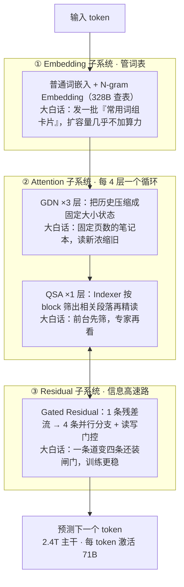
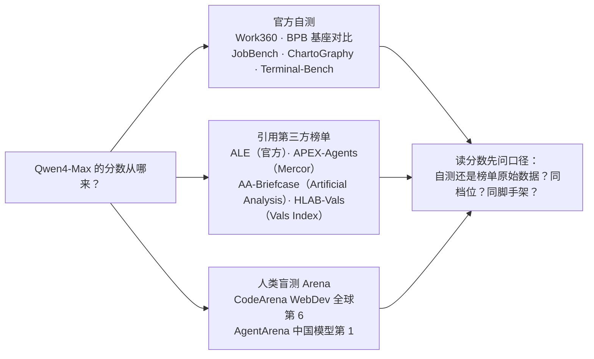
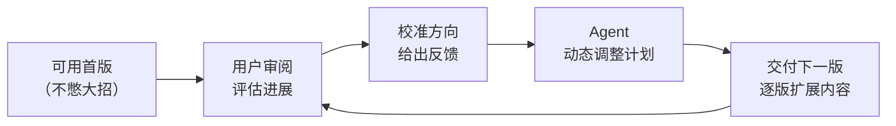

# Qwen4-Max

> 阿里 Qwen4 系列首款旗舰闭源模型：2.4T 主干参数、原生视觉、百万上下文，主打「更省 token 的 AI 同事」。

## 是什么

Qwen4-Max 是阿里巴巴于 2026-11-16 发布的新一代旗舰大模型（官方博客《Qwen4-Max：新同事，已就位》，5382 词），也是 Qwen4 系列的第一款模型。它的三个硬指标：**2.4 万亿（2.4T）主干参数、每个 token 激活 71B、原生视觉能力 + 100 万 token 上下文窗口**。定位从「聊天助手」进一步转向「全天候 AI 新同事」——强调调用专业工具、推进长周期任务、交付可用成果。

相比上一代 Qwen3.8-Max，官方给出的核心卖点不是跑分，而是**效率**：同等或更好的性能下 token 消耗最多减少约 50%，Work360 评测中单任务平均费用从 26.58 元降至 11.16 元（降 58%）。API 已在 QwenCloud 上线（输入 $1.5/M、输出 $4.5/M tokens），也可在千问办公、Qoder CN、千问 App、Qwen Studio 中使用。模型闭源，但官方预告小尺寸 Qwen4 模型将陆续开放权重（Unsloth 转发称 Qwen4-27B 将可在 16GB 内存设备上运行）。

本页按博客原文顺序，把里面提到的每个技术点用小白语言拆一遍。

### 2026-11

- **2026-11-16** · [Qwen 发布 Qwen4-Max](https://qwen.ai/blog?id=qwen4-max)
  Qwen4 系首款旗舰：2.4T 主干 / 71B 激活 / 328B N-gram Embedding，GDN+QSA、Gated Residual、N-gram Embedding 三项架构升级，预训练全程无 loss spike；单任务均价降 58%，开源 Qwen-Live-Delivery-Plugin（[官方 X](https://x.com/Alibaba_Qwen/status/2122148127520289151)、IT之家/凤凰网、快科技交叉印证）。

---

## 读前预备：先弄懂这 10 个词

| 术语 | 小白解释 |
|---|---|
| **Token** | 模型读写文字的最小单位，英文约一个词、中文约 1–2 个字。你看到的「上下文」「计费」全部按 token 算。 |
| **参数量 / 激活参数** | 参数是模型里的「旋钮」。MoE 模型总参数很大但每次只「点亮」一部分——2.4T 是全部旋钮，71B 是每个 token 实际用到的旋钮，直接决定推理成本。 |
| **MoE（混合专家）** | 把一个大模型拆成很多「专家」小网络，每个 token 只路由给最相关的几个专家处理。又大又省的主流架构。 |
| **上下文窗口** | 模型一次能记住的最大 token 量。100 万 token ≈ 一次读完约 50 万字或几十个文件。 |
| **基准测试（Benchmark）** | 给模型出的标准考题（如 Terminal-Bench 考终端操作），分数用来横向对比各家模型。 |
| **loss / loss spike** | loss 是训练时的「错误率曲线」，应平滑下降；突然的尖峰（spike）意味着训练可能报废要回退。2.4T 规模下全程无 spike 是官方强调的工程成就。 |
| **BPB（bits per byte）** | 衡量基座模型压缩文本能力的指标，越低说明对语言理解越强，适合在不跑主观考题的情况下比较模型底子。 |
| **Agent / 长程任务** | 模型不只回答问题，而是自己规划、调工具、反复执行数小时甚至数天完成一个目标（如交付一份尽调报告）。 |
| **MCP** | 模型连接外部工具的通用协议，金融案例里模型就是通过 90 个 MCP 工具取行情数据的。 |
| **思考档位（Xhigh/High）** | 同一模型可以「想得深」或「想得快」，档位越高越准也越费 token；博客里的 token 对比都按档位分开报。 |

---

## 本报告新名词速查（谁造的 + 大白话）

> 与本知识库既有语料（console + wiki）比对：以下词**全部为 2026-11-16 本报告首发**，此前 0 次出现。

### ① Qwen 自创的架构名词（详解见「博客逐段拆解」§1）

| 名词 | 大白话 |
|---|---|
| **QSA（Qwen Sparse Attention）** | 先派廉价「前台」按块筛出相关段落，再让「专家」精读——百万上下文省钱的核心 |
| **GDN（Gated DeltaNet）** | 把读过的历史浓缩进固定大小的「笔记本」，文章再长笔记也不变厚 |
| **Gated Residual（GR）** | 残差高速路从 1 条扩成 4 条还装了闸门，梯度走得稳，2.4T 训练不出事故 |
| **N-gram Embedding** | 328B 查表参数给模型发一批「常用词组卡片」，扩容量几乎不加算力 |
| **Qwen4-Max-Base** | 未做后训练的基座版，专门用来跑 BPB 对比（GLM、Kimi 参评的是后训练版，官方注明不完全公平） |

### ② Qwen 自创的机制 / 产品名词（详解见 §3、§5）

| 名词 | 大白话 |
|---|---|
| **Work360** | 官方自建的行业大考场：26 个一级 / 182 个二级 / 721 个三级领域，把「真实工作」变成可打分的题 |
| **Live Delivery + Qwen-Live-Delivery-Plugin** | 长任务不憋大招：先交能用的第一版，再逐版扩建，插件已开源 |
| **24/7 Agents** | 全天候推进长周期任务的智能体产品概念（本报告主打叙事） |
| **隐式缓存（implicit caching）** | 同样的前缀内容第二次问就打 $0.075/M 的骨折价（OpenAI 已有此说法，Qwen 文档首次引入） |
| **10 × BPB** | 内部基座评测的图表口径：压缩文本的错误率 ×10，越低越聪明 |

### ③ 首次出现的第三方新基准（分数见 §4 评测小词典）

| 基准 | 考什么 | 出处口径 |
|---|---|---|
| **Terminal-Bench 4.0** | 终端里完成真实编程任务 | 自测（token -48% 的主证据） |
| **Agents' Last Exam（ALE）v1.1** | 智能体长程任务 | 引用官方榜 |
| **ChartoGraphy** | 图表理解与生成 | 自测（注明 min_pixels=4096×32×32） |
| **JobBench** | 真实职业任务 | 自测（更新数据集与评测代码） |
| **HLAB-Vals-1.1** | 法律专业任务 | 引用 Vals Index |
| **APEX-Agents v1.1 / AA-Briefcase v1.1 / AutomationBench-AA** | 智能体与办公任务 | 引用 Mercor / Artificial Analysis |
| **Last Secure Code Bench** | 无提示重建代码的「功能+漏洞」双通过率 | 安全自测（22.0% → 31.8%） |

### ④ 借这篇报告登场的既有名词

- **MindOpt**：阿里自研求解器，模型优化自己的调度方案时协同它迭代（§6 云资源调度）。
- 制造：**节拍仿真、PLC 虚拟调试、刀路生成**；科研：**干湿实验闭环、MPA 性质预测、第一性原理计算、逆合成设计、RBFE（相对结合自由能）**；视频：**参数化白模预演**。
- 通用词（不算新）：MoE、MCP、CoT、Xhigh/High 思考档、Token Plan。

---

## 博客逐段拆解

### 1. 架构：2.4T 主干 + Attention / Residual / Embedding 三件套升级

官方把新架构概括为对稀疏 MoE 模型的三个子系统升级——这三件事共同回答一个问题：**如何在更大容量的同时更省算力、训练更稳**。

**① GDN + Qwen Sparse Attention（QSA）— 管「注意力」**

- 官方说法：每四层中，三层是 Gated DeltaNet（GDN），把历史信息压缩为固定大小的状态；另一层是 QSA，通过轻量级 Indexer 以 block 为粒度选择相关上下文，降低长序列的 Attention 计算与索引开销。
- 小白理解：标准 Transformer 注意力是「句子里每个词都和所有词算一遍关系」，序列越长越贵。QSA 相当于先派一个廉价的「前台」（Indexer）快速扫一遍，挑出真正相关的段落，再让「专家」精读；GDN 则像一本固定页数的笔记本，读到的新内容不断浓缩记进去，不随文章变长而变厚。两者交替，就是百万 token 上下文能便宜跑起来的原因。

**② Gated Residual（GR）— 管「残差流」**

- 官方说法：将 Residual Stream 扩展为四条并行分支，通过动态读写门控增强跨层信息传递，提升训练稳定性。
- 小白理解：残差连接是深层网络的「高速直通道」，让信息跳过层层加工直达后面。GR 把一条道扩成四条，还装了可开可关的「闸门」（门控），决定每层读什么、写什么——梯度流动更顺，这是 2.4T 规模训练不出事故的关键之一。

**③ N-gram Embedding — 管「词表」**

- 官方说法：根据局部上下文查表，在第二层提供局部 token 模式的表示，以较低的额外计算开销扩展模型容量。
- 小白理解：传统 Embedding 只认单个 token；N-gram 版本额外记住常见「词组搭配」（查表即得，几乎不花计算），相当于给模型免费发了一批常用短语卡片，容量变大但速度几乎不变。该部分共 328B 参数——注意它们基本不参与每 token 的激活计算。

**三件套在模型里的位置（图解）**：

一句话读图：token 进来先查词表（含 N-gram 卡片），然后在「3 层浓缩历史 + 1 层精选精读」的四层循环里反复加工，残差高速路全程保证信息不丢、梯度不断——这就是 2.4T 模型每次只激活 71B 还能又稳又便宜的原因。

### 2. 预训练：全程无 spike，基座底子更厚

- 2.4T 规模下 loss 持续下降、**全程未出现 loss spike**（官方配图）。
- 内部基座对比：Qwen4-Max-Base 在知识、代码、问答、STEM 四类评测的 BPB 全部为五个参评模型中最低，比 Qwen3.8-Max-Base 各领域低约 **5–13%**，同时每 token 激活参数**减少约 25%**——更少的激活换来更低的 BPB，即「更便宜还更聪明」。
- 参评的 GLM-5.3、Kimi-K3.1-Pro 为后训练模型，与基座对比不完全公平（官方评测说明原文注明）。

### 3. Token 效率与价格：本次发布真正的主角

| 场景 | 思考档位 | token 消耗 vs Qwen3.8-Max |
|---|---|---|
| Work360（行业综合） | Xhigh | 约 **-24%** |
| Work360 | High | 约 **-35%** |
| Terminal-Bench 4.0（终端编程） | Xhigh | 约 **-48%** |
| Terminal-Bench 4.0 | High | 约 **-49%** |

- 单任务成本：Work360 评测中平均费用 **26.58 元 → 11.16 元（-58%）**。
- API 定价（官方 X）：输入 **$1.5/M**、输出 **$4.5/M**、隐式缓存 **$0.075/M**，全面低于 Qwen3.8-Max，其中缓存命中价**降 70%**——高频复用系统提示词的 Agent 应用受益最大。
- 第三方口径（快科技引官方图表）：Terminal-Bench 4.0 同为 Xhigh 档，每次尝试平均 token 用量降约 47.5%、评测得分提升近 28%。

### 4. 评测：分数小词典

官方评测说明列明各家分数来源（榜单引用 vs 自测），读分数前先分清口径：

一句话读图：分数分三路来源，可信度和可比性各不相同——自测可复现性最弱、榜单引用最可比、盲测最接近真实偏好。

| 评测 | 是什么 | Qwen4-Max 成绩（官方口径） |
|---|---|---|
| **Work360** | 官方自建行业基准：26 个一级 / 182 个二级 / 721 个三级领域的场景分类体系 | **52.69**（Qwen3.8-Max 为 47.74） |
| **Terminal-Bench 4.0** | 终端里完成真实编程任务 | Xhigh 档得分较上代 +近 28%，token -47.5% |
| **Agents' Last Exam（ALE）** | 智能体长程任务考题 | **46.7**（较上代 +18.8） |
| **ChartoGraphy** | 图表理解与生成 | **54.2**（+12.2） |
| **JobBench** | 真实职业任务 | **67.3**（更新数据集与评测代码后自测） |
| **HLAB-Vals-1.1** | 法律专业评测（Vals Index） | **21.3**（+5.9） |
| **CodeArena WebDev** | 全球前端编程盲测（人类投票 Arena） | **全球第 6**，居 GPT6-Astra 与 Claude Fable5.1 之间，中国模型最好成绩 |

- 其余引用口径：APEX-Agents v1.1 引自 Mercor 榜；AA-Briefcase v1.1、AutomationBench-AA 引自 Artificial Analysis；CodeArena、AgentArena 引自 Arena；发布后同日 Qwen 官方还宣布 Qwen4-Max 登顶 Agent Arena 中国模型榜首。
- 提醒：除 Work360 与 BPB 基座对比为内部自测外，多数分数是官方引用第三方榜单原始数据，非统一复测。

### 5. 长程智能体：24/7 Agents 与 Live Delivery

长程 Agent 的老毛病是「蒙头干活」——跑几小时不吭声，用户既看不到进展也来不及纠偏。Qwen4-Max 的解法叫 **Live Delivery（持续交付）**：

1. 先交付一个**可用首版**，而不是憋到最后；
2. 之后持续交付更新版本，逐版扩展内容、提升质量；
3. 用户按每版成果校准方向，Agent 按反馈动态调整计划。

一句话读图：这是一条「交付 → 审阅 → 反馈 → 调整 → 再交付」的循环——把黑箱长任务变成每版都能看得见、来得及纠偏的公开进度。

官方案例：一个物理课堂科普网站需求，最终交付了 **14 个可用版本**，逐版扩充成含 3D 动画、交互实验与原理详解的完整站点。配套能力已开源为 **Qwen-Live-Delivery-Plugin**，装插件即可体验。

### 6. 行业落地案例：博客的「证据」部分

| 领域 | 模型做了什么 | 关键数字 |
|---|---|---|
| 汽车制造 | 二维布局图 → 三维产线 + 节拍仿真 + PLC 虚拟调试；零件建模与刀路核验 | 单工件加工编程人工投入 **475 分钟 → 24 分钟（约 -95%）** |
| 3D 与游戏 | Blender 全流程建模；Unity / Unreal / Godot 里独立做完可玩的 3D 游戏并实机调优 | 案例游戏《喵出法随》（UE） |
| 金融投研 | 调用 **90 个 MCP 工具**取行情/财务/利率数据，算基差、做多因子回测 | 交付 Excel 底稿 + PPT 报告，单元格可溯源、图表与底稿对齐 |
| 法律尽调 | 198 份散乱底稿归类为 14 个目录，多源交叉核验，识别对赌协议恢复条款等风险 | 交付 **86 页、6 万余字**报告，12 模块 + 14 项法律问题 |
| 危重症医疗 | 单次对话通读整份病历：定位检验、理时间线、读 1433 张影像 | 识别「双肺背侧实变」与主管医生一致；给出 4 条处置建议逐条对齐医嘱 |
| 云资源调度 | 模型自主生成调度算法，协同自研求解器 MindOpt 迭代 | 标注调用费用 **-10.42%**；GPU 整机空闲时长 +4.62%；CPU 重调度求解提速 **14.61 倍** |

视频与创作侧另有「万镜一刻」端到端视频工作流（分镜 → 白模预演 → 连续渲染剪辑）；产品侧强调与 Qoder 等团队「模型-框架-产品」协同设计。

### 7. 科学发现：从数字世界跨到物理世界

- **新型冷却液（干湿实验闭环）**：48 小时自主 Agent 运行，构建 **270 万个分子**候选空间，完成筛选 → 性质预测 → 第一性原理计算 → 逆合成设计，再调度自动化湿实验室真实合成，经 **4 轮「设计-合成-主动学习」闭环**拿到经实验验证的材料样品。
- **药物发现（阿尔茨海默病 NLRP3 靶点）**：在深势科技 PharmMaster 平台上累计调用工具 **454 次**、评估 **3239 项计算指标**、设计 **24 个候选分子**；最终分子相对起点的名义结合亲和力约 **3.6 倍**（RBFE 计算估计），专家认为值得进入湿实验验证。

### 8. 安全：内生安全写进训练

- **代码安全**：软件工程训练新增代码安全检测。Last Secure Code Bench「无安全提示代码重建」中，函数级功能与安全双通过率 **22.0% → 31.8%**；函数/文件/仓库三粒度同时生成安全代码比例 **8% → 14.7%**（接近翻倍）。
- **网络安全与 CBRN**：训练数据只保留漏洞验证、检测、修复等防御用途，剔除进攻用途；内部专家审查含完整 CoT 的长程轨迹后结论为「尚未发现模型产生大规模网络安全风险的能力」，且未过度拒答。
- 伦理声明重申：Qwen 用于合法建设性用途，高影响场景须保留人类专业判断与监督。

---

## 怎么看

1. **叙事从「跑分」切换到「单位任务成本」。** 这是本次发布最重要的信号：官方头条数字是 token -50%、单任务费用 -58%、缓存价 -70%，而不是某个榜单第一。当旗舰能力差距收窄，企业客户买单的是「完成同一个任务花多少钱」——架构三件套（QSA/GR/N-gram）本质上都在为「更少激活、更稳训练」服务，是这条商业主线的工程支撑。

2. **GDN + QSA 是混合注意力路线的落地样本。** 线性/状态空间记忆（GDN）负责「记住读过什么」，稀疏注意力（QSA）负责「需要时精准翻阅」，四比一交替——这是当前把百万 token 上下文做出经济性的主流解法之一。理解它，就理解了各家长上下文模型的成本竞争。

3. **Live Delivery 回答的是信任问题，不是技术问题。** 长程 Agent 的瓶颈正从「能不能做完」转向「用户敢不敢放手」。先交首版、逐版扩展让进展可见、方向可控；开源插件则把这套交互范式推给整个生态。与之呼应的云资源调度案例（模型优化支撑自己的算力系统）是「AI 优化 AI 基础设施」闭环的早期样板。

4. **口径要留一半清醒。** 闭源、无模型卡、无训练数据披露，多数分数为内部评测或引用第三方榜单；与前代的对比是否同脚手架同档位未完全披露。真正的检验在后面：小尺寸 Qwen4 的开源落地（27B 传闻 16GB 可跑）与第三方复测，才是「新架构」成色的试金石。

---

## 关键锚点

- **2026-11-16** · [官方博客：Qwen4-Max：新同事，已就位](https://qwen.ai/blog?id=qwen4-max)（本页一手源，含评测说明与引用口径）
- **2026-11-16** · [官方 X 发布推文](https://x.com/Alibaba_Qwen/status/2122148127520289151)（定价、Token Plan、开源预告）
- **2026-11-16** · [IT之家/凤凰网：阿里通义千问 Qwen4-Max 正式版发布](https://tech.ifeng.com/c/8y5w0vc9KsC)（token 效率对比表）
- **2026-11-16** · [AIHOT 收录：Qwen 发布 Qwen4-Max（Blog Retrieval）](https://aihot.news/items/nqcfrkilrh7nhnpd03t9q1zfh)（2.4T/71B/328B 参数口径）
- **2026-11-16** · [AIHOT：Unsloth 预告更小的 Qwen4 开源模型](https://aihot.news/items/ilw9pjl6arxr6k675xds3mpmz)（Qwen4-27B / 16GB）

## 下钻

- [证据时间线（原始线索卡）](../../证据层/开源模型与生态/Qwen.md)
- [Qwen（厂家总览叶子）](../04-开源权重生态/Qwen.md)
- [SWE-bench（编码基准怎么读）](SWE-bench.md)
- [MCP协议（工具调用怎么连）](../../证据层/智能体平台/MCP协议.md)
- [模型定价与 token 经济（节点学习页）](../12-模型定价与 token 经济/_index.md)
