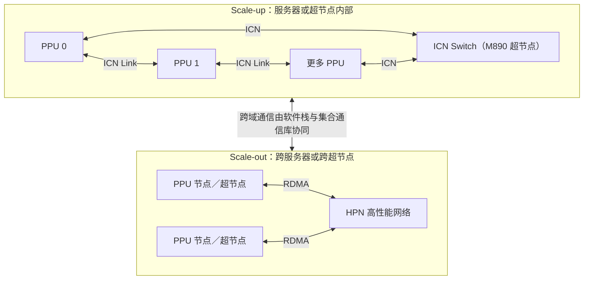

# PPU 高性能网络与 ICN 互联

> 中文简称：PPU 高性能网络与 ICN 互联

> **一句话理解**: PPU 高网就像“机内高速匝道加跨机高速公路”：ICN 负责近处多卡快速交换数据，HPN＋RDMA 负责把更多机器连成训练或推理集群。

---

## 1. 范围与信息口径

本文的“PPU 高网”包括两个不同通信域：

1. **Scale-up**：服务器内或超节点内的高带宽片间互联，核心是 **ICN（Inter-Chip-Network）**。
2. **Scale-out**：跨服务器、跨超节点的集群网络，在已公开的 PAI／ACS PPU 场景中涉及 **HPN、RDMA 网卡与集合通信库**。[S3][S4][S5]

> **资料边界**：公开资料没有完整披露 ICN 协议帧、每个端口带宽、全网物理接线、路由算法和拥塞控制细节。本文只把官方明确发布的内容写成事实；通用工程建议不冒充厂商实测结论。资料核验截至 2026-10-27。

### 来源标记

| **标记** | **来源类型** | **本文用途** |
|---|---|---|
| **S1／S2** | 平头哥官方产品页、官方新闻 | 芯片、ICN 端口、ICN Switch 与互联规模 |
| **S3／S4／S5** | 阿里云产品页、PAI／ACS 官方文档 | PPU 云实例、机内拓扑、跨机 RDMA 与配置 |
| **S6** | 阿里云灵骏官方产品页 | HPN 7.0 的通用网络架构，不作为所有 PPU 集群的同配置证明 |
| **S7** | SIGCOMM 2024 论文 | HPN 设计动机、双平面与生产评估；论文对象是 GPU 集群 |

完整链接见[第 10 节](#10-信息来源)。

---

## 2. 一张图看懂：ICN 与 HPN 各管哪一段

**图意**：ICN 与 HPN 不是同一个东西，也不能用一个“带宽数字”概括整个集群。近端通信优先利用机内／超节点互联，跨机通信还要经过 RDMA 网络和相应的软件栈。[S3][S4][S5]

---

## 3. 官方已公开的硬件能力

| **产品／组件** | **官方公开信息** | **不能由此推出的结论** | **来源** |
|---|---|---|---|
| **真武 810E** | 每颗芯片 7 个 ICN 端口，片间互联带宽 700 GB/s | 不能推算每个端口固定为 100 GB/s；官方未在该页给出逐端口口径 | [S1] |
| **真武 810E 云实例** | 高速互联可聚合整机 16 卡算力，可结合通信库使用 EP／TP／DP 等并行策略 | “16 卡”不等于任意 16 卡之间都具有相同路径和实测带宽 | [S3] |
| **真武 M890** | 片间互联带宽 800 GB/s | 不能直接与交换芯片总吞吐量比较高低 | [S2][S3] |
| **ICN Switch 1.0** | 支持 ICN 互联总线协议与 PCCL 通信库，吞吐量 25.6 Tbps | 25.6 Tbps 是交换芯片口径，不是单张 PPU 的片间带宽 | [S2] |
| **M890＋ICN Switch 1.0** | 支持 64 卡全带宽互联；官方同时发布 128 卡超节点 | **“128 卡超节点”不等于官方宣称“128 卡全带宽互联”** | [S2] |

### 两个必须分开的口径

- **卡间互联带宽**：例如 700 GB/s、800 GB/s，描述 PPU 片间互联能力。[S1][S2]
- **交换芯片吞吐量**：例如 25.6 Tbps，描述 ICN Switch 1.0；对象、统计范围与卡间带宽不同。[S2]

因此，不应把这些数字直接相加，也不应只凭峰值带宽推断 AllReduce、All-to-All 或端到端训练性能。

---

## 4. Scale-up：ICN 机内与超节点互联

### 4.1 真武 810E：16 卡 ICN-Link 拓扑

阿里云 ACCL-P 最佳实践明确说明，PAI-PPU 机型采用 **16 卡 ICN-Link 机内互联**，并针对 TP 2、TP 4、TP 8 给出不同的设备顺序；TP 1／TP 16 无需该项调整。[S4]

这说明一个实际工程事实：**逻辑设备编号顺序不必然等于最佳物理通信顺序**。官方文档建议按 TP 并行度匹配拓扑，而不是默认所有并行策略都使用同一设备排列。[S4]

> **配置纪律**：设备顺序会随镜像、驱动和 ACCL-P 版本变化。应使用当前实例对应版本的官方文档，不要把旧镜像中的 `CUDA_VISIBLE_DEVICES` 顺序复制到新环境。

### 4.2 真武 M890：64 卡全带宽与 128 卡超节点

官方口径需要拆开理解：[S2]

- **64 卡全带宽互联**：M890 搭配 ICN Switch 1.0 的明确能力描述。
- **128 卡超节点**：磐久 AL128 的系统形态，官方称可将 128 张 AI 芯片组成一台计算机。
- **公开资料未充分说明**：128 卡系统的完整交换级联拓扑、跨域带宽、收敛比，以及不同集合通信算子在 64 卡域内和跨域时的实测差异。

所以，评估 128 卡任务时，应分别测量 **64 卡域内**与**跨 64 卡域**的通信，而不是把“超节点”直接理解为所有卡之间完全同构、完全等带宽。

---

## 5. Scale-out：PPU 跨机 HPN＋RDMA

### 5.1 PPU 官方文档中的直接证据

阿里云 ACCL-P 文档指出，PAI 的 `ml.gp7vf.16.40xlarge` 和 `ml.gp7vf.16.46xlarge` 使用自研 RDMA 网卡，并给出跨机通信环境变量要求；相关变量已内置于 PAI-PPU 官方镜像，文档明确提示不要随意更改。[S4]

ACS 的 `training-xpu-pytorch 26.04` 镜像文档进一步写明：[S5]

| **单个 Pod 的 PPU 申请规模** | **官方文档中的网络接口设置** | **说明** |
|---|---|---|
| **1／2／4／8 卡** | `NCCL_SOCKET_IFNAME=eth0` | 镜像默认配置 |
| **整机 16 卡** | `NCCL_SOCKET_IFNAME=hpn0` | 文档明确注明此时可以使用 HPN 高网 |

这组配置是 **ACS 指定镜像与场景的要求**，不能原样套用到所有 PAI 实例或自建集群。PAI 与 ACS 文档中的接口名可能不同，应以实际产品、实例和镜像版本为准。[S4][S5]

### 5.2 HPN 7.0 的通用架构

灵骏官方产品页对 HPN 7.0 的描述包括：多轨＋双平面拓扑、单层千卡 Segment、两层万卡、多种 RDMA 网络配置、HPCC 流控、多路径优化、双上联冗余，以及计算网络与存储管理网络分离。[S6]

SIGCOMM 2024 的 HPN 论文解释了设计动机：大模型训练具有少量、周期性、突发的大流量，传统 ECMP 容易出现哈希极化；论文提出的两层双平面架构可连接 15K GPU，并通过双 ToR 降低单点故障影响。论文报告其生产环境中端到端训练性能提升 14.9%。[S7]

> **不要误用论文数字**：14.9% 是论文所述 HPN／GPU 生产场景的评估结果，不是真武 PPU 的保证收益，也不能直接当作某个 PPU 模型的预期加速比。[S7]

---

## 6. 通信软件栈：PCCL、ACCL-P 与 AcclEP-P

| **名称** | **公开定位** | **使用边界** | **来源** |
|---|---|---|---|
| **PCCL** | 平头哥官方在 ICN Switch 1.0 与真武 810E 资料中提及的通信库 | 公开产品资料未完整披露 API、算法与版本兼容矩阵 | [S1][S2] |
| **ACCL-P** | 阿里云 PAI-PPU 自研集合通信库最佳实践所对应的软件栈 | 拓扑顺序和跨机变量必须匹配实例及镜像版本 | [S4] |
| **AcclEP-P** | ACS 文档称为 PPU 版本的 DeepEP | 面向专家并行通信；使用要求见对应镜像文档 | [S5] |

**不要简单画等号**：现有公开资料没有充分说明 PCCL 与 ACCL-P 的全部内部关系，也没有证明不同版本中的环境变量含义完全一致。排障时先确认实际加载的库及版本，再查看对应文档。

---

## 7. 并行策略如何映射到网络

以下是通用工程分析方法，不是厂商性能承诺：

| **并行方式** | **主要通信特征** | **优先核验项** |
|---|---|---|
| **TP** | 频繁、时延和带宽敏感 | 是否落在合适的 ICN 域内，设备顺序是否匹配官方拓扑建议 |
| **EP** | All-to-All 明显，易受路径不均和慢节点影响 | 专家组放置、跨域流量、AcclEP-P 配置及负载均衡 |
| **DP** | 梯度或参数同步，常见 AllReduce／ReduceScatter | 跨机有效带宽、通信与计算重叠、慢节点 |
| **PP** | 阶段间点对点发送激活 | 阶段划分、相邻阶段是否跨机、气泡与链路时延 |

阿里云 PPU 产品页明确支持结合通信库采用 EP／TP／DP 等策略；ACCL-P 文档则特别强调了 TP 与 ICN-Link 拓扑的匹配。[S3][S4] 更完整的通用原理见[[10_部署推理/03_推理优化/18_Parallel_策略_深入分析|LLM 并行策略全景]]。

---

## 8. 性能验证与排障清单

### 8.1 先固定基线

1. 记录实例型号、PPU 数量、驱动、PPU SDK、镜像和通信库版本。
2. 分清测试范围：单机 ICN、单超节点、跨机 HPN，不能混为一个结果。
3. 固定模型、并行度、消息大小、精度和节点布局。
4. 同时保留通信算子指标与端到端指标，避免只看峰值带宽。

### 8.2 分层定位

| **现象** | **优先检查** | **依据／备注** |
|---|---|---|
| **任务建连失败** | 产品类型、接口名、网卡匹配及官方镜像变量 | PAI 与 ACS 配置不能互相照抄；官方镜像变量不要随意修改。[S4][S5] |
| **TP 性能异常** | 设备顺序是否与当前 ACCL-P 版本和 TP 并行度匹配 | 官方对 TP 2／4／8 给出不同顺序。[S4] |
| **跨机通信慢或抖动** | 是否实际经过预期 RDMA／HPN 路径，是否存在慢节点或跨域热点 | 先核对路径，再做算子与端到端对比 |
| **EP 通信异常** | AcclEP-P 版本、专家组放置、跨域 All-to-All 流量 | 使用当前镜像文档中的要求。[S5] |
| **NCCL 超时** | 是否有节点闲置、通信域不一致或真实网络故障 | 不要只通过无限增大超时掩盖问题 |

RDMA、RoCE、拥塞与通用排障原理可交叉阅读[[12_架构基建/08_网络/06_RDMA_and_RoCE_for_AI|RDMA 与 RoCE 在 AI 集群中的应用]]。

---

## 9. 已知、未知与常见误读

### 已有官方依据

- 810E 的 7 个 ICN 端口与 700 GB/s 片间互联带宽。[S1]
- M890 的 800 GB/s 片间互联带宽，以及搭配 ICN Switch 1.0 实现 64 卡全带宽互联。[S2][S3]
- PAI-PPU 的 16 卡 ICN-Link 拓扑与按 TP 调整设备顺序。[S4]
- 指定 PAI-PPU 实例使用自研 RDMA 网卡；指定 ACS 整机 16 卡场景可使用 `hpn0`。[S4][S5]

### 尚无充分公开依据

- ICN 完整协议规范、逐端口带宽与物理编码细节。
- 810E 16 卡完整物理拓扑的文本化规格及所有链路带宽。
- 128 卡超节点内任意两卡均为全带宽、等时延连接。
- PCCL、ACCL-P 各版本完整兼容矩阵与内部实现关系。
- 某模型在 PPU 高网上的通用线性加速比或固定性能提升百分比。

### 三个常见误读

1. **误读：ICN 就是 HPN。** 纠正：ICN 主要对应片间／超节点互联，HPN 对应集群高性能网络。[S3][S4][S5]
2. **误读：128 卡超节点就是 128 卡全带宽。** 纠正：官方明确表述是 64 卡全带宽互联，128 卡是超节点系统规模。[S2]
3. **误读：环境变量有一套万能值。** 纠正：PAI、ACS、镜像版本和申请卡数不同，配置可能不同。[S4][S5]

---

## 10. 信息来源

| **编号** | **来源与发布方** | **直接支持的内容** | **核验日期** |
|---|---|---|---|
| **S1** | [真武 810E 产品页](https://www.t-head.cn/product?id=7)，平头哥半导体 | 7 个 ICN 端口、700 GB/s、ICN 互联总线与 PCCL | 2026-10-27 |
| **S2** | [真武 M890 AI 芯片首次亮相，构建 Agentic 算力芯底座](https://www.t-head.cn/news/newsDetail?id=188)，平头哥半导体 | M890、ICN Switch 1.0、25.6 Tbps、PCCL、64 卡全带宽与 128 卡超节点 | 2026-10-27 |
| **S3** | [真武 PPU 云服务](https://www.aliyun.com/ppu)，阿里云 | 700／800 GB/s、810E 整机 16 卡、M890 64 卡全带宽、EP／TP／DP | 2026-10-27 |
| **S4** | [自研集合通信库（ACCL-P）使用最佳实践](https://help.aliyun.com/zh/pai/use-cases/untitled-document-1734335577668)，阿里云帮助中心 | PAI-PPU 16 卡 ICN-Link、TP 设备顺序、自研 RDMA 网卡与官方镜像变量 | 2026-10-27 |
| **S5** | [training-xpu-pytorch 26.04](https://help.aliyun.com/zh/document_detail/3033014.html)，阿里云帮助中心 | ACS 不同卡数的 `eth0`／`hpn0` 设置、AcclEP-P | 2026-10-27 |
| **S6** | [智能计算灵骏产品功能](https://www.aliyun.com/product/lingjun/features)，阿里云 | HPN 7.0、多轨双平面、RDMA、HPCC、多路径与双上联 | 2026-10-27 |
| **S7** | [Alibaba HPN: A Data Center Network for Large Language Model Training](https://ennanzhai.github.io/pub/sigcomm24-hpn.pdf)，SIGCOMM 2024 | HPN 设计动机、两层双平面、双 ToR、15K GPU 与论文评估 | 2026-10-27 |

> **来源使用原则**：芯片参数优先采用平头哥官方口径；云上配置采用对应产品和镜像版本的阿里云文档；HPN 论文数据只用于解释其原始研究场景，不外推为 PPU 实测结果。

---

## Related

- [[01_数学基础/10_AI硬件/08_T_Head_PPU_深入分析|平头哥真武 PPU 深度解析]]
- [[12_架构基建/08_网络/06_RDMA_and_RoCE_for_AI|RDMA 与 RoCE 在 AI 集群中的应用]]
- [[10_部署推理/03_推理优化/18_Parallel_策略_深入分析|LLM 并行策略全景]]

---

*Last updated: 2026-10-27*
