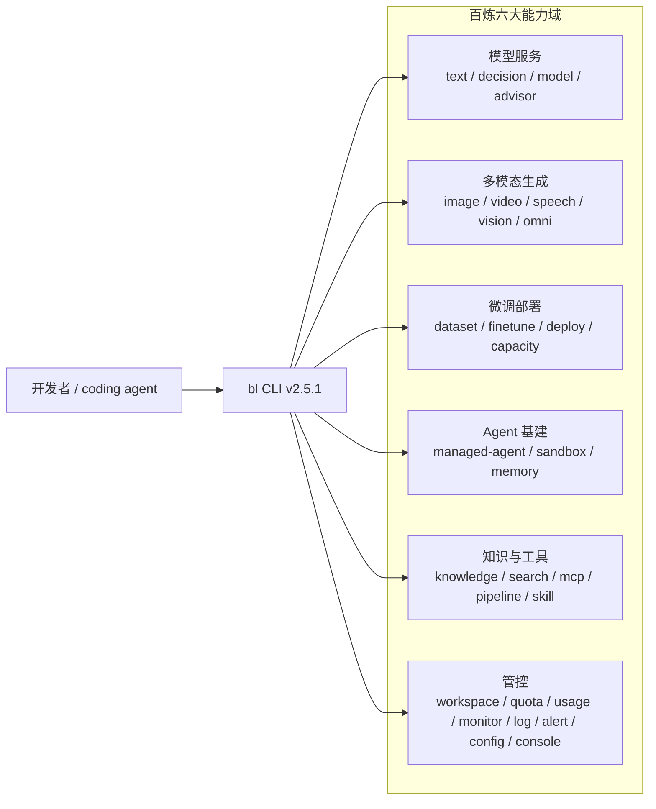

# 百炼平台全景与生态位

> 中文简称：百炼平台全景与生态位

> **一句话理解**: 百炼是阿里云把「调模型、微调部署、Agent 基建、知识工具」打包进一个控制台加一套 API 的模型商店兼工厂，本页是它的全貌地图。

基于 bl v2.5.1（2026-11）实测提炼，命令细节以 `bl <cmd> --help` 为准。

---

## 一、平台定位：Model Studio 与 DashScope 的关系

百炼（Bailian）是阿里云的 MaaS（Model as a Service）平台，正式产品名 **Model Studio**；国际站对应 **Aliyun Model Studio**。它把模型调用、微调、部署、Agent 编排与知识管理放进同一个工作空间，面向「不想自己搭推理栈」的应用团队。

**DashScope 不是另一个平台**，而是百炼的 API 服务品牌与 SDK 名：

- 接入点（base_url）形如 `<region>.maas.aliyuncs.com`，按 region 拼接；
- 鉴权环境变量是 `DASHSCOPE_API_KEY`；
- 原生 SDK 的包名也叫 `dashscope`。

一句话记法：控制台层面叫百炼（Model Studio），API 层面叫 DashScope，一个平台、两套称呼。同一个接入点体系同时支撑 `bl` 命令面与 SDK/HTTP 两条调用轨道（OpenAI 兼容与 dashscope 原生，见 04 页）。

---

## 二、兄弟平台辨析：四个入口各管一段

阿里云体系里常与百炼混淆的还有三个入口，四者是互补关系而非替代关系：

| **平台** | **定位** | **典型用法** | **与百炼的分工** |
| ------- | ------- | ------------ | ---------------- |
| **百炼（Model Studio）** | 模型与应用一站式 MaaS | 调 API、微调、部署、Agent、知识库 | 现成模型开箱即用的主入口 |
| **千问 AI 平台** | Agent Skills + CLI 生态的新 MaaS | 技能市场、bl CLI、coding agent 协作 | 承接 Agent 原生工作流，与百炼互补 |
| **PAI** | 机器学习训练推理平台 | 大规模训练、GPU 集群、自管推理栈 | 自炼模型用 PAI，调现成模型用百炼 |
| **ModelScope 魔搭** | 开源社区入口 | 找开源模型、下权重、看 Demo | 开源模型源头，可接入百炼再服务化 |

选型口诀：**现成模型走百炼，Agent 技能与 CLI 走千问 AI 平台，自炼模型走 PAI，找开源权重走魔搭。**

---

## 三、能力域地图：从 bl 命令面归纳六大域

`bl` 的命令分组本身就是百炼能力域的最佳索引：

| **能力域** | **bl 命令组** | **解决的问题** |
| --------- | ------------ | -------------- |
| **模型服务** | text / decision / model / advisor | 文本对话、决策、模型元信息、选型建议 |
| **多模态生成** | image / video / speech / vision / omni | 图像、视频、语音合成、视觉理解、全模态 |
| **微调部署** | dataset / finetune / deploy / capacity | 数据集、微调任务、部署实例、容量管理 |
| **Agent 基建** | managed-agent / sandbox / memory | 托管 Agent、代码沙箱、会话记忆 |
| **知识与工具** | knowledge / search / mcp / pipeline / skill | 知识库、联网搜索、MCP、编排、技能 |
| **管控** | workspace / quota / usage / monitor / log / alert / config / console | 工作空间、配额、用量、监控、日志、告警、配置、控制台直达 |

本系列按域逐页深潜：计费与套餐（02）、鉴权与配置（03）、SDK 双轨（04）、模型矩阵与选型（05、06）、多模态生成（07、08）、微调到部署（09–11）、应用编排与 Agent 基建（12–15、19）、知识与工具（16–18）、CLI 总览与协议护栏（20、21）。

---

## 四、接入三态：Console、API Key、订阅套餐

与百炼建立连接有三种状态，能力与约束不同：

| **接入态** | **进入方式** | **特征** |
| --------- | ----------- | -------- |
| **控制台 Console 登录** | `bl auth login --console` | 浏览器账号授权，适合交互式探索与管控操作 |
| **API Key** | `bl auth login --api-key sk-...` | 程序化调用与 CI 的标准姿势 |
| **订阅套餐** | Token Plan / Coding Plan 订阅 | 专属 endpoint 与 harness 配额，只能 API Key 登录 |

三条纪律：

- 生产与 CI 用 API Key，交互式探索与管控用 Console；
- 订阅套餐 endpoint 与普通 endpoint 不同域，且只能以 API Key 身份进入；
- 鉴权流程、profile 隔离与 Base URL 优先级见 03 页，计费口径与套餐查询见 02 页。

---

## 五、能力域图

图解：`bl` 是统一命令面入口，六大域共享同一套鉴权、同一套 workspace 隔离与同一套计费口径。「一站式 MaaS」在工具层面的直接体现，就是这一个入口覆盖六个域。

---

## 六、与 07_MaaS 概览页的分工

- 07_MaaS 平台页回答「百炼与千问 AI 平台是什么、边界在哪」，是概览视角；
- 本系列（13_百炼深度）基于 bl v2.5.1 实测，逐域深潜命令行为、计费口径与操作护栏；
- 需要架构层视角（训练平台、推理服务、企业 RAG、Agent 平台）时，转到 Alibaba_Cloud 架构方案系列对应页面。

---

## 交叉引用

- [[12_架构基建/06_云厂商/Alibaba_Cloud/产品/13_百炼深度/README|百炼深度系列目录]]
- [[12_架构基建/06_云厂商/Alibaba_Cloud/产品/13_百炼深度/02_Billing_Plans_And_Cost|计费体系与套餐]]
- [[12_架构基建/06_云厂商/Alibaba_Cloud/产品/13_百炼深度/03_Workspace_Auth_Config|工作空间鉴权与配置]]
- [[12_架构基建/06_云厂商/Alibaba_Cloud/产品/13_百炼深度/04_OpenAI_Compatibility_SDK|OpenAI 兼容与 SDK 双轨]]
- [[12_架构基建/06_云厂商/Alibaba_Cloud/产品/07_MaaS平台_百炼与千问AI平台|MaaS 平台：百炼与千问 AI 平台]]

---

*Last updated: 2026-11-06*
