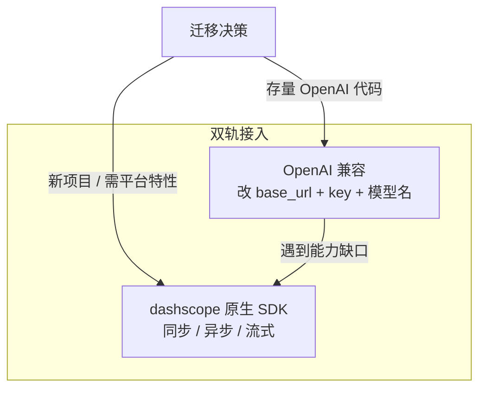

# 百炼 OpenAI 兼容与 SDK 双轨

> 中文简称：OpenAI 兼容与 SDK 双轨

> **一句话理解**: 调百炼模型有两条路——OpenAI 老代码改个地址就能跑，或换 dashscope 原生 SDK 拿全能力，本页讲两条路怎么选、示例怎么生成、怎么迁移。

基于 bl v2.5.1（2026-11）实测提炼，命令细节以 `bl <cmd> --help` 为准。

---

## 一、双轨接口：OpenAI 兼容 vs dashscope 原生

| **轨道** | **接入方式** | **能力面** | **适合谁** |
| ------- | ----------- | --------- | --------- |
| **OpenAI 兼容** | openai 客户端改 base_url + key + 模型名 | 通用对话、流式等标准能力 | 已有 OpenAI 技术栈、要低成本迁移 |
| **dashscope 原生 SDK** | 安装 dashscope 包 | 平台特有参数与功能面 | 要吃满百炼特性的新项目 |

两条轨道都支持**同步 / 异步 / 流式**三种调用模式。实践口径：先用 OpenAI 兼容跑通业务，遇到能力缺口再局部切原生 SDK，两轨可以并存。

---

## 二、bl model code：官方示例直接生成

与其手抄文档，不如让 CLI 生成目标模型的官方示例：

```bash
bl model code --sdk openai --lang python     # OpenAI 兼容示例
bl model code --sdk dashscope --lang python  # dashscope 原生示例
```

两个工程细节：

- **文本输出即纯代码片段**，没有额外说明文字，可安全重定向落盘（如 `> demo.py`）；
- `--sdk` 选轨道、`--lang` 选语言，按目标模型生成当前版本示例，天然避免文档过期。

---

## 三、默认模型与 Responses API

文本对话的默认口径：

- `bl text chat` 的默认文本模型是 **qwen3.8-max**，不传模型参数也能跑；
- `--system` 控制回复语言与角色设定（如要求始终用中文回答）。

Responses API 是更新的调用面，支持直接挂工具：

```bash
bl text chat --api responses --tool '{"type":"web_search"}'
```

三条使用纪律：

- 需 **Qwen3.7 及以上**、支持原生联网搜索的模型才能挂 web_search；
- **不硬编码 `--model`**：让默认解析逻辑选当前可用模型，写死模型名会让脚本随模型迭代失效；
- 搜索路由与 Token Plan 自带搜索的关系见 02 页与 18 页。

---

## 四、MCP 与 coding agent 生态

`bl mcp connect` 把百炼 MCP 服务注册进主流 coding agent，覆盖 Codex、Claude Code、Cursor、Qoder、Qwen Code、Gemini、OpenCode、ZCode 等：

```bash
bl mcp connect   # 将百炼 MCP 注册进 coding agent
```

意义：coding agent 不出终端就能调用百炼的搜索与知识能力（查文档、搜资料），注册一次、后续会话复用。这也是百炼作为 Agent 基建、而非单纯模型 API 的直接体现。

---

## 五、从 OpenAI 迁移实践

标准路径三步：**改 base_url → 换 API key → 模型名映射到 qwen 系**。Python（OpenAI 兼容）示例：

```python
from openai import OpenAI

client = OpenAI(
    base_url="https://<region>.maas.aliyuncs.com",  # 接入点以控制台 / bl model code 生成示例为准
    api_key="sk-***",
)

resp = client.chat.completions.create(
    model="qwen3.8-max",  # 模型名映射到 qwen 系
    messages=[
        {"role": "system", "content": "你是一个严谨的技术助手"},
        {"role": "user", "content": "一句话介绍百炼"},
    ],
)
print(resp.choices[0].message.content)
```

curl 对照（脚本与网关侧调试用）：

```bash
curl -s https://<region>.maas.aliyuncs.com/chat/completions \
  -H "Authorization: Bearer $DASHSCOPE_API_KEY" \
  -H "Content-Type: application/json" \
  -d '{
    "model": "qwen3.8-max",
    "messages": [{"role": "user", "content": "一句话介绍百炼"}]
  }'
```

迁移不是逐字兼容，两处差异留回归余量（定性）：

- **错误码语义**：报错结构、限流与参数校验的返回与 OpenAI 不完全一致，重试与告警逻辑不要照搬错误码字面值；
- **参数语义**：部分参数默认值与取值行为存在差异，迁移后先跑关键路径回归再上线。

---

## 六、选轨速查图



图解：存量代码走兼容轨成本最低；新项目或需要平台特有能力直接走原生轨；兼容轨遇到能力缺口可局部切换，两轨并存不冲突。

---

## 交叉引用

- [[12_架构基建/06_云厂商/Alibaba_Cloud/产品/13_百炼深度/01_Bailian_Platform_Overview|百炼平台全景与生态位]]
- [[12_架构基建/06_云厂商/Alibaba_Cloud/产品/13_百炼深度/05_Model_Matrix_Plaza|模型矩阵广场]]
- [[12_架构基建/06_云厂商/Alibaba_Cloud/产品/13_百炼深度/16_MCP_Marketplace_Skills|MCP 市场与技能]]
- [[12_架构基建/06_云厂商/Alibaba_Cloud/产品/13_百炼深度/18_Web_Search_Routing|联网搜索路由]]
- [[12_架构基建/06_云厂商/Alibaba_Cloud/产品/06_Qwen模型家族_2026|Qwen 模型家族 2026]]

---

*Last updated: 2026-11-06*
