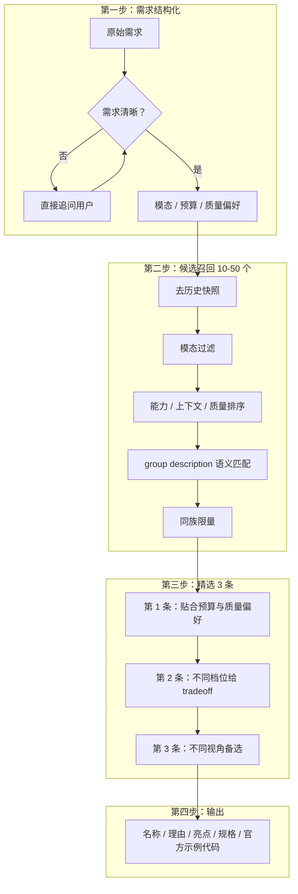

# 百炼模型选型方法论

> 中文简称：模型选型方法论

> **一句话理解**: 选型不是背模型列表，而是一套固定流程——需求结构化、召回候选、精选三条、按规格输出；画像回答「擅长什么」，硬规格回答「贵不贵、快不快」。

*基于 bl v2.5.1（2026-11）实测提炼，命令细节以 `bl <cmd> --help` 为准。*

---

## 一、选型画像 profile 字段

每个主干模型在模型广场挂一份选型画像（profile），刻画「适合谁用、怎么调」：

| **字段** | **含义** | **约束与取值** |
|----------|----------|----------------|
| oneLinePositioning | 一句话定位 | ≤50 字 |
| scenes | 适用场景标签 | 受控词表，共 31 个值 |
| notSuitableFor | 负面清单 | 明确列出不适用场景 |
| styleKeywords | 风格关键词 | ≤5 个 |
| familyTier | 族内档位 | flagship 效果首选 / balanced 默认均衡 / lightweight 成本延迟优先 |
| familyComparison | 同族对比 | 与族内其他模型的取舍关系 |
| callModes | 调用模式 | sync / async / streaming / realtime |
| pipelineRole | 流水线角色 | 在多模态流水线中承担的步骤角色 |

familyTier 三档的读法：要最好效果找 flagship，不确定就用 balanced，成本与延迟敏感选 lightweight。画像挂在模型目录的 profile 字段里，目录结构见 [[12_架构基建/06_云厂商/Alibaba_Cloud/产品/13_百炼深度/05_Model_Matrix_Plaza|模型矩阵与模型广场]]。

---

## 二、三态语义与可信度边界

画像字段统一遵循三态语义：

- **字段缺失** = 未知，不能当作「不适用」，也不能当作「没有」。
- **显式 null** = 不适用，仅 familyTier 与 familyComparison 允许取 null。
- **有值** = 已知信息，可作为推荐依据。

两个高频踩坑：

- `notSuitableFor: []`（空数组）表示「无已知限制」，可以放心推荐；字段缺失才是「未知」，两者语义不同。
- `profileCompleteness = structured-only` 表示画像未读过文档，只有从结构化字段机械推导的内容可信，oneLinePositioning 这类叙述性字段谨慎引用。

---

## 三、硬规格与画像的分工

价格、QPM、contextWindow、openSource 这四类硬规格永远以模型目录顶层结构化字段为准，不从画像文本里找。分工边界：

| **信息类型** | **来源** | **理由** |
|--------------|----------|----------|
| 价格 / QPM / contextWindow / openSource | models.jsonl 顶层结构化字段 | 机读、精确、随目录同步更新 |
| 场景适配 / 档位 / 风格 | profile 画像字段 | 定性判断，用于解释「为什么适合」 |
| 示例代码 / 入参定义 | groups/&lt;slug&gt;.json 的 samples 与 predictConfig | 与 Playground 对齐的官方口径 |

给用户报规格时引用结构化字段原值；画像只用来组织推荐理由，不作为规格来源。

---

## 四、推荐四步流程



四步各管一段：召回做「快」，精选做「准」，输出做「可执行」。

1. **需求结构化要快**：几句话内锁定模态、预算、质量偏好；不清晰直接追问用户，不要靠猜。
2. **候选召回 10-50 个**：去掉带日期后缀的历史快照，做模态过滤，按能力 / 上下文 / 质量排序，用 group description 做语义匹配，同一家族限量召回，避免单一家族霸榜。
3. **精选 3 条**：第 1 条贴合预算与质量偏好——省钱优先给性价比模型而非旗舰，要最好效果直接上旗舰；第 2 条换一个档位给出 tradeoff；第 3 条换一个视角给备选。推荐理由必须关联用户的具体需求，「功能强大、性能优秀」这类空话禁用。
4. **输出**：每条给名称、理由、亮点、规格、官方示例代码；禁止暴露召回、排序等内部流程术语。

---

## 五、命令与流水线约束

```bash
# 意图 → 候选召回 → LLM 排序，一条命令完成推荐
bl advisor recommend "低延迟中文客服问答，预算有限，偶尔需要长上下文"
```

- `bl advisor recommend` 是四步流程的自动化版：先按意图召回候选，再用 LLM 排序精选。
- 多模态 pipeline 场景的硬约束：相邻步骤的模态必须兼容（上一步的输出模态等于下一步的输入模态），不兼容的组合在召回阶段就该被过滤掉。
- 推荐结果仍不满足需求时，下一步不是换更大的模型，而是考虑微调定制，见 [[12_架构基建/06_云厂商/Alibaba_Cloud/产品/13_百炼深度/09_Finetune_Pipeline|微调流水线]]。

---

## 交叉引用

- [[12_架构基建/06_云厂商/Alibaba_Cloud/产品/13_百炼深度/05_Model_Matrix_Plaza|模型矩阵与模型广场]]
- [[12_架构基建/06_云厂商/Alibaba_Cloud/产品/13_百炼深度/09_Finetune_Pipeline|微调流水线]]
- [[12_架构基建/06_云厂商/Alibaba_Cloud/产品/13_百炼深度/20_BL_CLI_Guide|bl CLI 使用指南]]
- [[12_架构基建/06_云厂商/Alibaba_Cloud/产品/09_Token经济与商业化|Token 经济与商业化]]

---

*Last updated: 2026-11-06*
