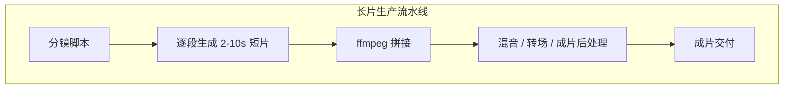

# 百炼图像与视频生成

> 中文简称：图像与视频生成

> **一句话理解**: bl 把文生图、改图、文生 / 图生视频、视频风格转换、参考生视频收敛成五条命令——图片同步落地、视频异步取回、本地文件直接传、不用先传图床。

*基于 bl v2.5.1（2026-11）实测提炼，命令细节以 `bl <cmd> --help` 为准。*

---

## 一、命令矩阵

五条命令覆盖「生成—修改—视频—风格化—参考」全链路，默认模型开箱即用：

| **命令** | **默认模型** | **关键行为** |
|----------|--------------|--------------|
| bl image generate | qwen-image-3.0 | 文生图 |
| bl image edit | — | 改图；`--image` 可重复出现，多图合成改图 |
| bl video generate | wan3.0-video | 文生视频 / 图生视频 |
| bl video edit | happyhorse-1.0-video-edit | 视频风格转换 |
| bl video ref | — | 参考生视频 + 配音 |

「—」表示该命令未规定默认模型，以 `bl <cmd> --help` 实时输出为准。除非有明确理由（特定风格、微调基座链路），生成与视频直接用 qwen-image-3.0 与 wan3.0-video 默认值即可，不必显式换模型。

画面内出现的文字，语言跟随用户 prompt：prompt 里写中文文案，成图 / 成片就出中文，不存在单独的「画面文字语言」参数。各模型的家族与能力代码归属见 [[12_架构基建/06_云厂商/Alibaba_Cloud/产品/13_百炼深度/05_Model_Matrix_Plaza|模型矩阵与模型广场]]。

---

## 二、同步与异步行为

| **维度** | **图片 / 语音** | **视频** |
|----------|-----------------|----------|
| **返回方式** | 同步返回 | 异步任务 |
| **产物落地** | 直接落地本地文件 | 任务完成后取回 |
| **取回手段** | 无需额外操作 | `--download` 或轮询任务状态 |

行为差异的实践含义：

- 图片链路没有任务概念，单条命令出单件产物，适合交互式使用。
- 视频链路提交后默认进入异步任务，加 `--download` 才会在完成后自动取回成片；批量生产时更常见的是提交多个任务再统一轮询取回。

---

## 三、本地文件直传与水印

**直传规则**（三条，记住就不用再碰图床）：

- 任何接受文件 URL 的命令都接受本地路径。
- CLI 自动把本地文件上传到 DashScope 临时存储（oss://），保留 48h。
- 绝不要求用户先自行上传图床——把本地路径直接交给 bl 即可。

**水印治理**：生成类命令默认启用水印。

```bash
# 全局关闭水印
bl config set --key watermark --value false

# 只改名为 media 的命名 Profile：仅在该 Profile 生效，不动全局默认
bl config set --key watermark --value false --config media
```

---

## 四、视频工程化：短片拼接

单次生成的视频产物约 2-10s 短片，长片不靠一条命令硬撑，靠后处理流水线：



先用 bl 按分镜批量生成短片，再用 ffmpeg 做拼接、混音与成片后处理，多段短片即可拼出更长时长的成片。

镜头控制的两条路：分镜延续性优先走图生视频（wan i2v 基座），需要钉死首尾帧的镜头用 kf2v 基座。

---

## 五、与微调联动

- 图像微调基座：wan2.7-image-pro 支持 sft-lora 微调，训练数据 zip = data.jsonl + 图像文件平铺（不分子目录）。
- 微调出的图像模型部署只支持 lora plan，容量规划别按通用部署假设。
- 视频微调基座：wan i2v（图生视频）与 kf2v（首尾帧）——要风格可控的视频产出，先微调基座再生成，完整流程见 [[12_架构基建/06_云厂商/Alibaba_Cloud/产品/13_百炼深度/09_Finetune_Pipeline|微调流水线]]。

---

## 六、代码示例

```bash
# 文生图：默认 qwen-image-3.0，画面文字语言跟随 prompt
bl image generate --prompt "水彩风格的城市街角咖啡馆，招牌写着「晴天」"

# 改图：--image 可重复，多张图合成一张
bl image edit --image person.png --image background.png --prompt "把人物放进背景，保持光照一致"

# 文生视频：异步任务，--download 在完成后自动取回成片
bl video generate --prompt "延时摄影：云海翻涌漫过雪山山脊" --download
```

---

## 交叉引用

- [[12_架构基建/06_云厂商/Alibaba_Cloud/产品/13_百炼深度/05_Model_Matrix_Plaza|模型矩阵与模型广场]]
- [[12_架构基建/06_云厂商/Alibaba_Cloud/产品/13_百炼深度/08_Speech_TTS_ASR|语音合成与识别]]
- [[12_架构基建/06_云厂商/Alibaba_Cloud/产品/13_百炼深度/09_Finetune_Pipeline|微调流水线]]
- [[12_架构基建/06_云厂商/Alibaba_Cloud/架构方案/17_架构方案_多模态内容生成|架构方案：多模态内容生成]]

---

*Last updated: 2026-11-06*
