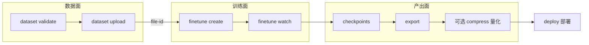

# 百炼微调全流程：从数据校验到量化部署

> 中文简称：微调全流程

> **一句话理解**: 用 bl 把准备好的数据练成自己的模型，再把模型瘦身部署上线，八步连成一条链，一步都不能跳。

---

基于 bl v2.5.1（2026-11）实测提炼，命令细节以 `bl <cmd> --help` 为准。

## 一、八步全链路总览

微调不是一条命令而是一条链路：数据先过 validate 再上传拿 file-id，训练按模态选子命令，产物经 checkpoint / export / 可选量化后交给部署。跳过校验或拿错 file-id，后面全部返工。

```bash
# 1. 校验本地数据（自动探测 schema）
bl dataset validate --file train.jsonl
# 2. 上传，拿 file-id
bl dataset upload --file train.jsonl
# 3. 发起训练（按模态选 text|audio|image）
bl finetune text create --base-model qwen3-8b \
  --training-type sft-lora --datasets <file-id> \
  --n-epochs 3 --learning-rate "3e-4"
# 4. 盯进度直到终态
bl finetune watch --job <job_id>
# 5. 列出 checkpoint
bl finetune checkpoints --job <job_id>
# 6. 导出指定 checkpoint 为可部署模型
bl finetune export --job <job_id> --checkpoint <cp_id> --model-name my-qwen
# 7. 可选：量化压缩（仅全参微调产物，见第五节）
bl compress create --template-id <tid> --suffix int4
# 8. 部署上线
bl deploy text create --model-name my-qwen ...
```



数据面产出 file-id，训练面产出 job_id 与 checkpoint，产出面把 checkpoint 变成可部署（必要时先量化）的模型名，最后交给部署面。

---

## 二、training-type 穷举与模态差异

training-type 一共五种，穷举如下，没有第六种：

| **training-type** | **含义** | **暴露位置** | **备注** |
| --- | --- | --- | --- |
| sft | 全参监督微调 | 仅 finetune text create | 效果上限与成本都最高 |
| sft-lora | LoRA 微调，默认值（服务端映射为 efficient_sft） | 仅 finetune text create | 响应里看到 efficient_sft 属正常 |
| dpo | 全参偏好对齐 | 仅 finetune text create | 数据须为 DPO schema |
| dpo-lora | LoRA 偏好对齐 | 仅 finetune text create | 与 dpo 数据格式相同 |
| cpt | 继续预训练 | 仅 finetune text create | 无 lora 变体 |

两个高频误区：

- `--training-type` 只有 `finetune text create` 暴露；音频（cosyvoice-v3-flash）与图像（wan2.7-image-pro）固定走 sft-lora，CLI 不暴露该 flag。
- 全参（sft/dpo/cpt）与 LoRA 的选择不只影响效果与成本，还决定产物能否走 compress 量化（见第五节）。

---

## 三、数据格式与数据三来源

三种模态对应三种文件形态；validate 自动探测 schema，不放心就显式指定：

| **模态** | **文件形态** | **内部结构** | **显式 --schema** |
| --- | --- | --- | --- |
| 文本 | .jsonl | ChatML / DPO / CPT 三种 schema 逐行 JSON | chatml、dpo、cpt |
| 音频 | .zip | data.jsonl + train/*.wav | tts |
| 图像 | .zip | data.jsonl + 图像文件平铺 | image |

```bash
# 自动探测
bl dataset validate --file train.jsonl
# 显式指定 schema（探测失败或想强制时）
bl dataset validate --file train.jsonl --schema dpo
```

数据的三种来源，按优先级排列：

1. **本地路径**：用户已有数据文件，validate 通过后直接 upload。
2. **已上传**：先 `bl dataset list` 查历史记录，能复用 file-id 就不重复上传。
3. **示例数据**：仅征得用户同意后生成少量示例数据跑通流程；示例数据练出的模型没有业务价值，只用于验证链路。

---

## 四、能力预检与任务管理

预检一正一反两条路：

```bash
# 正查：这个基座支持哪些训练类型
bl finetune capability --base-model qwen3-8b
# 反查：这个训练类型支持哪些模型（列表含中文名，适合给用户挑模型）
bl finetune capability --training-type sft-lora
```

- capability 查不到的组合不要硬提交。即便硬提交，create 也会做二次校验，不支持会快速失败且不耗配额，但预检能省一轮来回。
- 任务管理六件套：`list` / `get` / `watch` / `logs` / `cancel` / `delete`。
- create 响应里立刻记下两个值：`job_id`（后续所有操作都靠它），以及 `finetuned_output`——形如 `<base>-ft-<ts>-<id>` 的微调输出名。

---

## 五、checkpoint 治理与量化压缩

默认路径很短：任务 SUCCEEDED 后服务端自动导出 best checkpoint，可直接部署，无需手动 export。只有要部署非 best checkpoint 时才走手动链路：

```bash
bl finetune checkpoints --job <job_id>
bl finetune export --job <job_id> --checkpoint <cp_id> --model-name my-qwen-v2
```

量化压缩（compress）把全参微调产物压成 int4 等低精度版本，两条硬约束：仅支持全参微调模型（LoRA 产物不适用）、仅北京地域。流程三步：

```bash
bl compress templates                        # 列出可用模板
bl compress create --template-id <tid> --suffix int4
bl compress watch --follow                   # 盯到完成
```

---

## 六、超参纪律与调优次序

超参的坑集中在类型与归属：

- `--learning-rate` 必须传字符串 `"3e-4"`：裸数字会被解析成浮点再进 JSON，有精度丢失风险；字符串原样透传，行为可控。
- `--n-epochs` 按整数传，是最先值得调的旋钮。
- 音频、图像微调的超参由 CLI 自动注入，不需要也不要手传。

效果不好时的调整次序，从便宜到贵：

1. 先加数据量与数据质量（同配置重训）——绝大多数效果问题出在数据。
2. 再调 `--n-epochs` 与 `--learning-rate`（LoRA 重试成本低）。
3. 最后才考虑全参 sft。

预期管理：少于 100 条的小数据集无论怎么调参，效果上限都有限；数据规模上不去时，先讲清预期再开工。

---

## 交叉引用

- [[12_架构基建/06_云厂商/Alibaba_Cloud/产品/13_百炼深度/10_Deploy_Capacity_Management|部署与容量管理]]
- [[12_架构基建/06_云厂商/Alibaba_Cloud/产品/13_百炼深度/11_Train_To_Deploy_Playbook|训练到部署闭环实战]]
- [[12_架构基建/06_云厂商/Alibaba_Cloud/产品/13_百炼深度/08_Speech_TTS_ASR|语音 TTS 与 ASR]]
- [[12_架构基建/06_云厂商/Alibaba_Cloud/架构方案/18_架构方案_模型微调与行业定制|架构方案：模型微调与行业定制]]

---

*Last updated: 2026-11-06*
