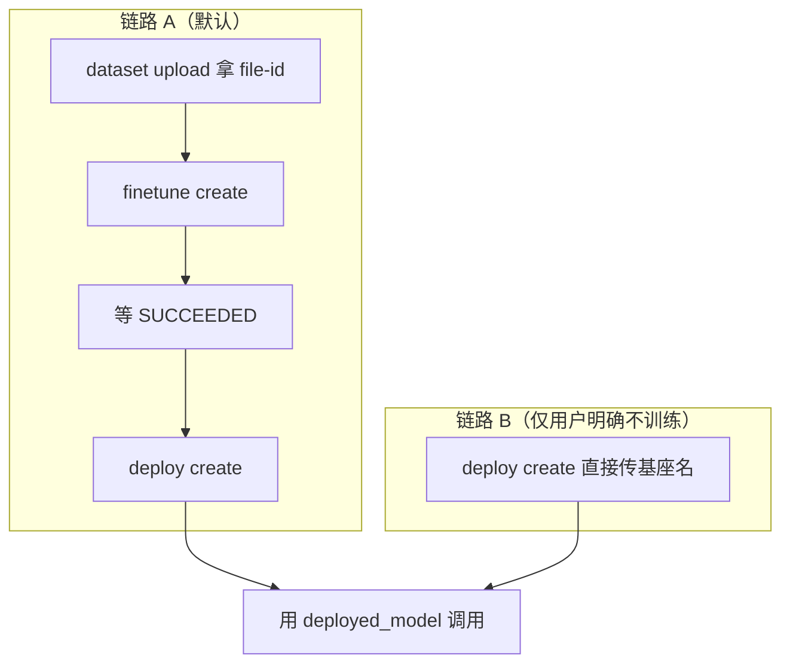

# 百炼训练到部署闭环实战

> 中文简称：训练到部署闭环实战

> **一句话理解**: 从一份训练数据到一个能调用的专属模型实例，中间该查什么、等什么、防什么，照这一页走完整个闭环。

---

基于 bl v2.5.1（2026-11）实测提炼，命令细节以 `bl <cmd> --help` 为准。

## 一、两条链路：默认 A，用户明确说不训练才走 B



链路 A 是默认：数据集 → finetune create → 等 SUCCEEDED → 部署 → 调用。链路 B 跳过训练直接部署基座，仅当用户明确说「不训练」才走，agent 不要自作主张替用户选 B。

链路 B 的价值要向用户讲清边界：它与直接调公共 API 推理没有本质区别，收益只在三点——独立实例、可调速率的计费方式、纳入自身运维体系。只为「用上某个模型」而走 B 没有意义。

---

## 二、写前三道闸：预检、计费、账号

**第一道：预检代替 dry-run。** 整个 bl 没有 `--dry-run`，预检用只读命令完成：

```bash
# 训练支持：基座与 training-type 组合是否成立
bl finetune capability --base-model qwen3-8b
# 可部署性与 plan：custom=微调产物，base=基座
bl deploy models --source custom
bl deploy models --source base
# 复用检测：已有 RUNNING 部署引用同一 finetuned_output 就直接复用
bl deploy list --status RUNNING
```

复用检测是省钱关键：如果 list 里已有引用同一 `finetuned_output` 且状态 RUNNING 的部署，直接复用它的 `deployed_model`，不要建第二个计费实例。

**第二道：计费硬闸门。** lora 按量计费是安全默认；mu / ptu 资源闲置也计费，开通前必须在终端取得真人确认。agent / CI 等非交互环境一律不能自动开通预留资源。

**第三道：账号就绪。**

```bash
bl auth status
# authenticated: false 即停，不要带着问题往下走
```

---

## 三、异步等待与 zsh 陷阱

两类异步任务的轮询节奏：

| **任务** | **轮询间隔** | **终态 / 就绪态** |
| --- | --- | --- |
| finetune | 每 30 秒 | SUCCEEDED / FAILED / CANCELED / PARTIALLY_SUCCEEDED |
| deploy | 每 15 秒 | RUNNING 即就绪（注意状态传播延迟，见部署与容量管理） |

zsh 陷阱：`status` 是 zsh 的只读内置变量，手写 `status=...` 的轮询循环会直接报 `read-only variable` 并 exit 1：

```bash
# 错误（zsh 下）：status 只读
while true; do status=$(bl finetune get --job "$JOB"); sleep 30; done

# 正确：换变量名，或干脆用 bash 跑这段脚本
while true; do ft_status=$(bl finetune get --job "$JOB"); sleep 30; done
```

---

## 四、反幻觉速查表

写命令前对一遍，这些是最容易编出来的东西：

| **易错点** | **事实** |
| --- | --- |
| --base-model / --model-name / --model | 三处不同名：微调传基座名，部署传导出模型名，推理传部署实例 id |
| 裸 finetune create | 不存在，必须带模态段：finetune text / audio / image create |
| finetune start | 不存在，create 即提交训练 |
| deploy stop | 不存在，停实例用 pause，恢复用 resume |
| --dry-run | 整个 bl 都没有，用 capability 与 deploy models 预检代替 |

---

## 五、交付物清单与模态化推理差异

一次闭环跑完，至少交付四样东西：

1. `deployed_model` 实例 id——推理的唯一入口。
2. 一条拿来就能运行、能出结果的推理命令。
3. 常用运维命令：`bl deploy get` 与 `bl deploy delete`。
4. 训练侧回查入口：`bl finetune list`。

推理命令按模态取不同子命令：

| **模态** | **推理方式** | **要点** |
| --- | --- | --- |
| 文本 | `bl text chat --model <deployed_model>` | 同步返回结果 |
| 音频 | `bl speech synthesize --voice default` | 语音合成，voice 传 default |
| 图像 | 异步 API + prompt 触发词 | prompt 中带触发词，提交任务后轮询取图 |

---

## 六、复用数据集

训练前先查再传，避免同一份数据反复上传：

```bash
bl dataset list                        # 查历史 file-id
bl dataset upload --file train.jsonl  # 确认没有才上传
# 之后 create 用 --datasets <file-id> 直接引用
```

---

## 交叉引用

- [[12_架构基建/06_云厂商/Alibaba_Cloud/产品/13_百炼深度/09_Finetune_Pipeline|微调全流程]]
- [[12_架构基建/06_云厂商/Alibaba_Cloud/产品/13_百炼深度/10_Deploy_Capacity_Management|部署与容量管理]]
- [[12_架构基建/06_云厂商/Alibaba_Cloud/产品/13_百炼深度/21_Shared_Protocol_Guardrails|共享协议与护栏]]
- [[12_架构基建/06_云厂商/Alibaba_Cloud/产品/13_百炼深度/03_Workspace_Auth_Config|工作空间与鉴权配置]]

---

*Last updated: 2026-11-06*
