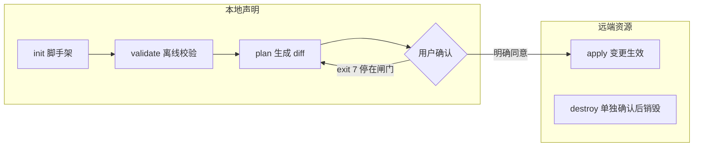

# 百炼 Managed Agent 声明式基础设施

> 中文简称：Managed Agent 声明式基础设施

> **一句话理解**: 像用 Terraform 管服务器一样，用一份 agents.yaml 文件声明式地创建、修改、销毁百炼上的托管 Agent 与全部配套资源。

> 基于 bl v2.5.1（2026-11）实测提炼，命令细节以 `bl managed-agent <cmd> --help` 为准。

---

## 一、定位与资源模型

Managed Agent 是百炼面向生产环境的托管 Agent 产品线。bl 没有把它做成一堆零散的命令式接口，而是实现成一套声明式基础设施（IaC）：项目根目录的 `agents.yaml` 是六类资源的**唯一事实源**，远端实际状态始终向这份声明对齐。

| **资源类型** | **职责** | **声明位置** |
| --- | --- | --- |
| Agent | 托管智能体本体（模型、指令、工具） | agents.yaml 顶层 agents 声明 |
| Environment | 运行环境变量与依赖集合 | environments 声明 |
| Skill | Agent 可调用的技能包 | skills 声明 |
| Vault | 凭证保管（API Key 等敏感值） | vaults 声明 |
| Deployment | 定时或事件驱动的部署实例 | deployments 声明 |
| Memory Store | Agent 的长期记忆库 | memoryStores 声明 |

一切变更都走「改声明 → plan 看 diff → 确认 → apply」，没有绕过 state 的旁路操作，这是后续所有纪律的地基。

---

## 二、生命周期六步与确认纪律

标准生命周期共六步，一步不省：

```bash
bl managed-agent init            # 1. 生成 agents.yaml 脚手架
bl managed-agent validate        # 2. 离线校验声明，不访问远端
bl managed-agent plan            # 3. 计算并输出 diff 预览
# 4. 把 diff 展示给用户，等待明确确认
bl managed-agent apply --yes     # 5. 确认后执行变更
bl managed-agent destroy --yes   # 6. 销毁，需单独确认
```

- **禁止自动加 `--yes`**：apply 与 destroy 都必须由用户看过 diff 后亲自确认，Agent 不得代签。
- **exit 7 是停信号不是 bug**：命令以 `requires_confirmation`（退出码 7）退出时，表示它在等人工确认——此时应把 diff 呈报用户，而不是重试或加参数绕过。
- destroy 是最高危动作，必须单独确认，不能与 apply 合并进同一次操作。



图解：全链路只有「用户确认」一处人工闸门；exit 7 的语义是「停在闸门等你」，属于流程内状态而非错误。

---

## 三、单资源定向 create 与 agent create 增强 flag

除全量 apply 外，还有面向单资源的定向 create 子命令：agent、environment、skill、vault credential、deployment、memory-store。它们的共同纪律是**先构造 YAML 声明，再走 scoped plan/apply，不绕过 state**：

- 同名资源不覆盖，而是**递增后缀并存**（旧 `demo-agent` 之外新建 `demo-agent-1`）。
- 定向操作只刷新目标资源及其传递依赖，**无关资源不检测 Drift**，小改动不触发全量重算。

agent create 的增强 flag 是日常最高频的一组：

| **Flag** | **作用** | **注意点** |
| --- | --- | --- |
| `--skill <id>` | 绑定远端 Skill | 默认写 `type: custom`；平台 Skill 需加 `--type official` |
| `--skill-dir <path>` | 接入本地 SKILL.md 目录或 ZIP 包 | 自动生成顶层 skills 声明，先上传再建 Agent |
| `--environment` / `--vault <key>` | 写入默认运行时绑定 | API 不收这两字段；仅当 session/deployment 未显式传值时生效 |
| `--mcp <server-code>` | 绑定市场 MCP 服务 | 取值来自 `bl mcp list`；写入 mcp_servers 与 tools.mcp |

`--mcp` 默认启用该服务全部工具；要按工具粒度开关，需修改 YAML 中对应 configs 后走全量 apply。

---

## 四、凭证安全：vault credential 与 .env

凭证纪律一句话：**变量名进 YAML，明文留在本机**。

```bash
# 正确：传环境变量名，不传明文
bl managed-agent vault credential create --secret-env MY_API_KEY
```

- agents.yaml 里只存 `${VAR}` 引用；命令输出、诊断信息、State 文件均不落明文。
- CLI 从当前目录**向上自动查找 .env** 并加载，因此 .env 放项目根即可，无需 export。
- **不要提交 .env**，也不要把真实密钥写进示例、文档或 `_examples/`。

---

## 五、目录项目与 Workbench

agents.yaml 所在目录即一个「目录项目」，配套 project 命令族：

```bash
bl managed-agent project init       # 初始化目录项目
bl managed-agent project validate   # 校验项目结构
bl managed-agent project build      # 仅本地构建
bl managed-agent project publish    # 只消费 build 产物
bl managed-agent project workbench  # 打开 Workbench
bl managed-agent playground --agent <name>  # 就地试运行某个 Agent
```

- `.openagentpack/versions/` 是版本库，CLI 与 Workbench 共用，**无需 Git**。
- Build 仅在本地执行；Publish 只消费 build 产物；Publish 成功会把**全部项目源码**版本化快照，但**不含远端 State**。
- Build 会把 vault.json 中的明文密钥移入项目根 .env、替换为环境引用——这是预期内的安全动作，不是密钥丢失。
- `_examples/` 的示例资源默认不启用也不发布，永远不要往里放真实密钥。
- `version status / list / preview / restore` 管理版本；restore 只恢复源码，**不回滚远端 State**。

---

## 六、state 管理与 Deployment as IaC

state 是本地声明与远端资源之间的账本，命令族为 `state list / show / import / rm`：

- **state import**：把既存远端资源「收养」进本地 state，从此纳入声明管理。
- **state rm 与 destroy 的区别必须向用户说清**：rm 只解除本地跟踪、**不删远端**；destroy 才真正删除远端资源。方向搞反，后果完全不同。

Deployment 与 Agent 走同一条 IaC 链路，最小可用声明是 agent 引用加一条初始事件：

```yaml
deployments:
  - name: daily-brief
    agent: demo-agent
    initial_events:
      - type: user.message   # 至少一个 user.message 或 system.message
        content: "生成今日简报"
```

- `schedule` 由服务端执行；若已有外部 cron 在跑同一任务，apply 前先 plan，防止重复触发。
- 本地文件在 apply 时上传；`mount_path` 必须位于 `/mnt` 之下，且会被归一化、不允许重复。

---

## 交叉引用

- [[12_架构基建/06_云厂商/Alibaba_Cloud/产品/13_百炼深度/README|百炼深度系列总览]]
- [[12_架构基建/06_云厂商/Alibaba_Cloud/产品/13_百炼深度/14_Session_MemoryStore|Session 交互与 Memory Store]]
- [[12_架构基建/06_云厂商/Alibaba_Cloud/产品/13_百炼深度/16_MCP_Marketplace_Skills|MCP 市场与 Skill 生态]]
- [[12_架构基建/06_云厂商/Alibaba_Cloud/产品/13_百炼深度/20_BL_CLI_Guide|bl CLI 全景指南]]
- [[12_架构基建/06_云厂商/Alibaba_Cloud/架构方案/14_架构方案_Agent智能体平台|架构方案：Agent 智能体平台]]

---

*Last updated: 2026-11-06*
