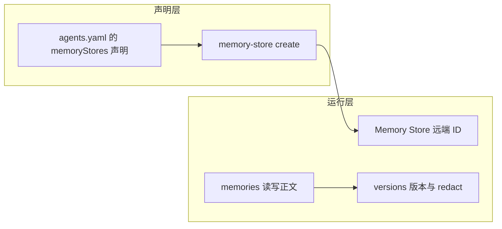

# 百炼 Session 交互与 Memory Store

> 中文简称：Session 交互与 Memory Store

> **一句话理解**: Session 是与托管 Agent 的一次对话实例，Memory Store 是 Agent 跨对话记住事情的长期抽屉，bl 为两者各提供一组命令。

> 基于 bl v2.5.1（2026-11）实测提炼，命令细节以 `bl session <cmd> --help` 与 `bl memories <cmd> --help` 为准。

---

## 一、session 命令族

| **命令** | **用途** | **要点** |
| --- | --- | --- |
| `session run` | 一步完成创建会话 + 发送消息 + 流式收答 | 交互调试首选，等价于 create + send + stream 的组合 |
| `session send` | 向既有会话发送消息 | 目标 session 必须已存在 |
| `session create / get / list / update / archive / delete` | 会话 CRUD 与归档 | delete 高危，先确认目标再执行 |
| `session event send / list / stream` | 事件级读写与订阅 | `events` 是兼容别名，行为一致 |
| `session debug / export` | 诊断与导出 | export 只导诊断元数据，不含 File 正文 |

日常高频是 `run`（一条命令跑通闭环）与 `event stream`（观察事件流）；收尾场景优先 archive，而非直接 delete。

---

## 二、子线程模型与环境变量注入

**子线程不是独立资源。** 事件（Event）带 `session_thread_id` 字段，子线程通过它暴露；但公开 API 没有独立的 Thread 资源 CRUD——不要构造 `session thread` 之类子命令，一切围绕 Event 操作。

环境变量按会话注入，仅对当次会话生效：

```bash
bl session create --environment_variables KEY1=VALUE1 --environment_variables KEY2=VALUE2
bl session run   --environment_variables TOKEN=abc --environment_variables EMPTY=
```

- `--environment_variables` 可重复传参，**后值覆盖前值**。
- 允许空值，也允许值里含 `=`（按第一个 `=` 切分键值）。
- 不改 Environment 资源本身，只影响本次会话。
- 预览输出与诊断导出都会对这类变量**脱敏**。

`session export` 导出的是诊断元数据：**不含 File 正文**、脱敏凭证——排障时可以放心分享。

---

## 三、Memory Store 声明式生命周期

Memory Store 的生命周期挂在 agents.yaml 上，而非独立 CRUD：

```bash
bl managed-agent memory-store create   # 声明并创建
bl managed-agent memory-store list     # 列出
bl managed-agent memory-store get      # 查看详情
```

- **没有直接的 update / archive / delete**：改声明走 plan/apply，删除走 destroy 链路。
- `name` 只是显示名、**不必唯一**；资源按**远端 ID** 识别，state 里记录的就是 ID；`state import` 可显式收养既存库。
- `entries` 只在**新建库**时写入初始化内容；对既有库，运行时内容保持原样。要持续把声明内容同步进库，必须显式写 `entries_mode: sync`。



图解：声明层决定库的存在与同步模式；正文层（memories/versions）直连 API 操作，两层通过远端 store ID 关联。

---

## 四、记忆正文 API：memories 与 versions

记忆条目操作直连 API、不依赖 agents.yaml，用 `--workspace-id` 与 `--store-id` 定位目标库：

```bash
bl memories create --workspace-id <wid> --store-id <sid> --content "第一条记忆"
bl memories list   --workspace-id <wid> --store-id <sid>
bl memories update --workspace-id <wid> --store-id <sid> --expected-content-sha256 <sha>
bl memories versions redact --workspace-id <wid> --store-id <sid> --dry-run
```

- `memories create / list / get / update / delete` 覆盖正文 CRUD；`--content` 与 `--content-file` **互斥**、二选一，且允许空正文。
- `update` 支持 `--expected-content-sha256` 做**并发冲突检测**：期望摘要不匹配即失败，防止静默覆盖他人写入。
- `versions list / get / redact` 管版本；**redact 是版本擦除，永久且不可撤销**——先 `--dry-run` 看清影响，确认后才加 `--yes`。

---

## 五、挂载模型与 Deployment 限制

会话挂载记忆库有两种写法：

```bash
# 简写：逗号分隔
bl session run --memory-stores notes,projects

# 显式资源：可控制访问级别
bl session run --resource '{"type":"memory_store","memory_store":"notes","access":"read_only"}'
```

- 显式 resource 会**覆盖**同名的简写挂载；**重复的显式引用会被拒绝**。
- 每个 session 至多挂 **8 个**记忆库。
- **Deployment 本期只支持 File 资源、不能挂记忆库**——即使 Agent 声明里带了记忆库，Deployment 也不会继承。

---

## 六、Webhook 与分页纪律

Webhook 是**工作空间级 API 资源**，不进 agents.yaml、也不进 State，治理方式与托管资源不同：

- 整族命令（`list / get / events` 与 `create / update / delete / enable / disable / test / reset-secret`）都按高风险对待，先 `--dry-run` 再执行。
- `test` 会**向接收端真实投递事件**，不是干跑。
- `create` 与 `reset-secret` 的响应可能含 `signing_secret`，须安全保存，用于回调验签。

分页三条纪律：

- Cursor **不透明**：只原样回传 `next_page`，不要解析、不要换算成页码。
- 客户端搜索默认**最多扫 10 页**；确需更深，用 `--page-limit` 显式扩大。
- 下载必须用 `--output-file` 落盘，**默认不覆盖**已有文件；确认要覆盖后才加 `--force`。

---

## 交叉引用

- [[12_架构基建/06_云厂商/Alibaba_Cloud/产品/13_百炼深度/13_Managed_Agent_IaC|Managed Agent 声明式基础设施]]
- [[12_架构基建/06_云厂商/Alibaba_Cloud/产品/13_百炼深度/19_Personal_Memory|个人记忆]]
- [[12_架构基建/06_云厂商/Alibaba_Cloud/产品/13_百炼深度/24_Production_Observability|生产可观测性]]
- [[12_架构基建/06_云厂商/Alibaba_Cloud/产品/13_百炼深度/20_BL_CLI_Guide|bl CLI 全景指南]]

---

*Last updated: 2026-11-06*
