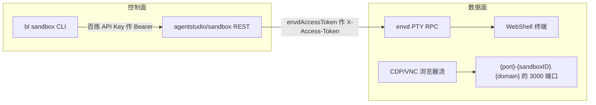

# 百炼 Sandbox 沙箱生命周期

> 中文简称：Sandbox 沙箱生命周期

> **一句话理解**: Sandbox 是给 Agent 用的一次性「隔离小电脑」，Agent 在里面安全地跑代码、开浏览器，用完即删。

> 基于 bl v2.5.1（2026-11）实测提炼，命令细节以 `bl sandbox <cmd> --help` 为准。

---

## 一、定位与端点解析

Sandbox 为 Agent 提供代码执行与浏览器运行环境。控制面是 **E2B 兼容的 REST API**：无需安装 E2B SDK，也无需 E2B API Key，鉴权直接用百炼 API Key 作 Bearer Token。

端点 origin 的解析优先级：

1. `--base-url` 参数
2. `DASHSCOPE_BASE_URL` 环境变量
3. profile 中配置的 base_url

拿到 origin（例如 `https://workspace.cn-beijing.maas.aliyuncs.com`）后，CLI 会剥掉其中的路径，再追加两类端点：

- 生命周期：`/api/v1/agentstudio/sandbox`
- 模板文件：`/api/v1/agentstudio/files`

未配置 base_url 时，工作空间 ID 按同样优先级取 `--workspace-id` > `BAILIAN_WORKSPACE_ID` > 配置值，拼出 `https://{workspace_id}.cn-beijing.maas.aliyuncs.com/...` 形式的地址。当前地域支持 **cn-beijing**，且需**事先完成 Sandbox SLR 授权**，未授权的调用会被拒绝。

这套解析规则意味着：换工作空间或换网关地址时，只需调整参数、环境变量或 profile，命令本身不变。

---

## 二、命令族一览

| **命令** | **用途** | **风险与注意** |
| --- | --- | --- |
| `sandbox official-images` | 查内置镜像预设 | 离线、免鉴权，随时可查 |
| `sandbox file upload` | 为模板上传挂载文件 | 文件与模板须在同一工作空间 |
| `sandbox list / get / create` | 实例查询与创建 | get 默认脱敏凭证 |
| `sandbox connect / pause / resume` | 连接实例与生命周期控制 | 依赖实例处于可用状态 |
| `sandbox delete` | 删除实例 | **高风险**：先展示目标，确认后执行 |
| `sandbox template list / get / create / update / build-status / delete` | 模板全生命周期管理 | create/update 轮询 build-status 等待构建 |

典型顺序：official-images 选镜像 → template create 建模板 →（可选 file upload 挂文件）→ create 起实例 → connect 使用 → delete 清理。

---

## 三、模板与镜像预设

- `--image` 传预设 ID 或中文名，两者都会**同时填 fromImage 与 imageName**；`--image-name` 只是显示名、**不是选择器**，不要用它选镜像。
- 预设是**固定的 cn-beijing 镜像 URL**，不是实时目录——以 CLI 内置列表为准，不要外推不存在的预设。
- 镜像预设清单来自 `official-images` 的离线输出，`--image` 的合法取值以该输出为准。
- `template create / update` 通过**轮询 build-status 端点**等待构建完成，而不是反复查模板详情；`--async` 只返回 templateID 与 buildID，**拿到它们不代表构建完成**。
- 修改模板后要重新等待构建；判断依据是 build-status，不是模板详情接口。
- 两个超时语义不同：`--timeout` 管 HTTP 请求与构建轮询的总时长；`--instance-timeout` 管实例自身寿命，到期实例被回收。

---

## 四、挂载文件

```bash
# 上传文件（multipart，source=sandbox_template），返回文件 id
bl sandbox file upload ...
# 返回的 id 填入模板 mntConfig[].originFileId
```

- 上传返回的 `id` 作为 `mntConfig[].originFileId` 被模板引用。
- 上传的文件与使用它的模板**必须在同一工作空间**，跨空间引用无效。
- 文件带审核状态：`status=checking`（未过审）**不可挂载**，只使用 `available` 状态的文件。

---

## 五、连接数据面

控制面 API Key 与数据面访问凭证是**两回事**。取数据面凭证：

```bash
bl sandbox get --sandbox-id <id> --show-credentials --output json
# 取 envdAccessToken，作为 X-Access-Token 请求头访问实例内服务
```



图解：控制面用百炼 API Key 管生命周期；数据面用实例级 token（envdAccessToken）访问，两条凭证链互不通用。

- **WebShell** = envdUrl + envd PTY RPC，打开即得交互终端。
- 官方浏览器模板的 CDP/VNC 地址形如 `{port}-{sandboxID}.{domain}`、走 **3000 端口**——这来自**模板契约**，不是 get 返回的字段。
- 用户要访问实例时，必须**完成连接并验证**：终端跑通命令、或浏览器页面真实渲染，才算完成；只返回 JSON 不算完成。
- CLI **没有 exec / webshell / browser 子命令**，不要发明——一切交互走上述数据面端点。
- 取凭证与访问动作应紧邻执行，避免长期持有实例 token。

---

## 六、安全边界

- 凭证默认脱敏；`--show-credentials` 只在确需访问实例的动作中使用，不要写进脚本例行输出。
- 实例 token **不进日志、不进 URL、不进提交的文件**。
- pause / resume 只是挂起与恢复实例，不改变凭证与网络边界。
- 删除类操作（实例 delete、模板 delete）属高风险：先向用户展示目标（ID、名称），确认后再执行。

---

## 交叉引用

- [[12_架构基建/06_云厂商/Alibaba_Cloud/产品/13_百炼深度/13_Managed_Agent_IaC|Managed Agent 声明式基础设施]]
- [[12_架构基建/06_云厂商/Alibaba_Cloud/产品/13_百炼深度/16_MCP_Marketplace_Skills|MCP 市场与 Skill 生态]]
- [[12_架构基建/06_云厂商/Alibaba_Cloud/产品/13_百炼深度/20_BL_CLI_Guide|bl CLI 全景指南]]
- [[15_智能体/20_Agentic_Infra/09_Sandbox_隔离技术与沙箱平台选型|Sandbox 隔离技术与沙箱平台选型]]

---

*Last updated: 2026-11-06*
