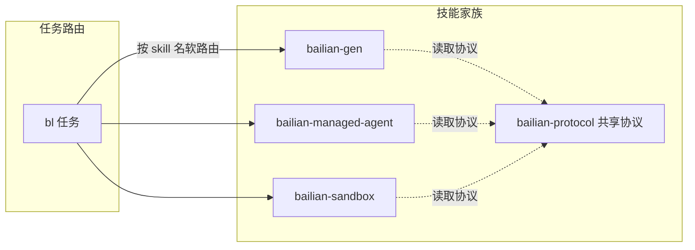

# 百炼 MCP 市场与 Skill 生态

> 中文简称：MCP 市场与 Skill 生态

> **一句话理解**: MCP 市场是百炼的「工具商店」，Agent 从这里接入搜索等能力；Skill 生态是装进本地 coding agent 的百炼操作手册包。

> 基于 bl v2.5.1（2026-11）与本机 11 个 bailian-* 技能实测提炼，命令细节以 `bl <cmd> --help` 为准。

---

## 一、MCP 市场三层用法

| **层次** | **命令** | **回答的问题** |
| --- | --- | --- |
| 发现 | `bl mcp list` | 市场上有哪些 MCP 服务 |
| 探查 | `bl mcp tools <server-code>` | 某个服务暴露哪些工具、参数长什么样 |
| 调用 | `bl mcp call` | 这个工具实际返回什么 |

```bash
bl mcp list                  # 浏览市场目录
bl mcp tools <server-code>   # 看某个服务的工具清单
bl mcp call ...              # 直接调用，验证工具行为
```

先探查再调用：确认工具名与参数形态后，再把它写进 Agent 配置，避免凭印象配置、运行时才发现拼错。

---

## 二、接入本地 coding agent 与托管 Agent

百炼 MCP 可作为**工具源**接进本地 coding agent：

```bash
bl mcp connect <server-code>     # 注册进当前客户端
bl mcp disconnect <server-code>  # 移除注册
```

支持的主流客户端包括 Codex、Claude Code、Cursor、Qoder、QwenWork、Qwen Code、Gemini、OpenCode、OpenClaw、DeepSeek Harness、ZCode、WorkBuddy 等——同一台机器上不同客户端各自注册、互不冲突。

托管 Agent 侧走声明式绑定：

```bash
bl managed-agent agent create --mcp <server-code>
```

该 flag 写入 `mcp_servers`（type: official）与 `tools.mcp`，**默认启用该服务全部工具**；要按工具粒度开关，需修改 YAML 中对应 configs 后走全量 apply。

---

## 三、Skill registry 与安装纪律

百炼 skill registry 管理本地技能包：

```bash
bl skill add --name bailian-gen   # 安装单个技能
bl skill list                     # 列出已装技能
bl skill update                   # 更新
bl skill remove                   # 移除
```

- **官方整包安装**：`bl skill init` 一次装齐共享协议与全部业务技能，是默认推荐。
- **子集安装的陷阱**：只装个别业务 skill 时，**必须显式带上 bailian-protocol**——业务 skill 通过相对路径读取共享协议，缺协议包，运行时会因协议读取失败而报错。

---

## 四、技能家族架构解析

本机的 bailian-* 家族是理解这套设计的最好样本：

| **组成** | **角色** | **说明** |
| --- | --- | --- |
| bailian-protocol | 共享协议 | 风险分级、确认纪律等公共契约 |
| gen / finetune / managed-agent / sandbox / memory / web-search / cli | 七个业务 skill | 按产品线拆分的操作手册 |
| docs-llm-wiki / model-recommend | 两个数据技能 | 由源码构建生成的参考资料 |
| references/ | 命令手册 | CLI 源码构建时自动生成，非手写 |



图解：技能间按 **skill 名**软路由、不写死跨目录路径；业务 skill 经相对路径读共享协议——这正是子集安装必须显式带 protocol 的原因。

- **references/ 自动生成**：命令手册从 CLI 源码构建产出，与 CLI 版本严格对应，手改会被覆盖。
- **反幻觉纪律**：命令细节以 reference 与 `--help` 为准，**禁止猜 flag**。
- 「共享协议 + 按名路由 + 生成式手册 + 反幻觉纪律」这套组合，本身就是 Agent 技能工程的范本。

---

## 五、WebSearch MCP 特例

- WebSearch 默认用 **DashScope key** 走 `bl search web`，需要在**市场开通**后才能使用。
- 未开通时报 **MCP_IS_INVALID 类错误**并附开通链接——看到这个错先去开通服务，而不是排查代码。
- **Token Plan key 不能授权 Bailian MCP 搜索**，只能走模型原生搜索；选型时把 key 类型与搜索路径放在一起考虑。

---

## 六、与 Agent Skills 开放标准的关系

bailian-* 技能遵循 SKILL.md 目录式技能约定：每个技能一个目录、SKILL.md 是入口、references/ 等辅助文件按需加载。这与业界 Agent Skills 开放标准同构：

- 技能可跨客户端复用，同一份 SKILL.md 能被 Codex、ZCode 等不同客户端识别。
- 自研技能套用同样的目录契约，即可获得一致的发现与加载行为。
- 库内 Agent 基建系列对技能契约与 Agent 运行时有更展开的讨论，可对照阅读。

---

## 交叉引用

- [[12_架构基建/06_云厂商/Alibaba_Cloud/产品/13_百炼深度/13_Managed_Agent_IaC|Managed Agent 声明式基础设施]]
- [[12_架构基建/06_云厂商/Alibaba_Cloud/产品/13_百炼深度/18_Web_Search_Routing|Web 搜索路由]]
- [[12_架构基建/06_云厂商/Alibaba_Cloud/产品/13_百炼深度/21_Shared_Protocol_Guardrails|共享协议与防护栏]]
- [[15_智能体/20_Agentic_Infra/08_Qwen_Agent_vs_AgentScope_Runtime|Qwen Agent 与 AgentScope Runtime 对比]]

---

*Last updated: 2026-11-06*
