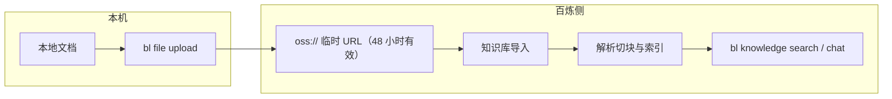

# 百炼知识库与 RAG 实战

> 中文简称：知识库与 RAG

> **一句话理解**: 把文档交给百炼托管，应用提问时平台先检索出相关片段再让模型作答，这个「先查再答」的闭环就是百炼知识库。

基于 bl v2.5.1（2026-11）实测提炼，命令细节以 `bl knowledge --help` 为准，刻意不罗列未实测的 flag。

---

## 一、产品定位：应用的数据面

百炼知识库不是孤立功能，而是**应用的数据面**：文档导入 → 平台托管解析切块 → 检索 → 供应用绑定的 RAG 问答。模型负责「说」，知识库负责「知道」，两者在应用层拼装成完整的问答体验。

三个关键定位判断：

1. **知识库属于百炼资源**：与模型、应用同属一套资源体系，纳入 workspace 管理与计量，不游离在组织模型之外。
2. **走 API key 与 workspace 体系**：CLI 访问知识库需要 API key 鉴权，并携带相应的 workspace/agent 标识才能命中正确资源；身份与配置细节见 [[12_架构基建/06_云厂商/Alibaba_Cloud/产品/13_百炼深度/03_Workspace_Auth_Config|工作区与鉴权配置]]。
3. **解析切块由平台托管**：解析、切块、索引等重活由平台承担，使用方不需要自建向量数据库与文档解析管线。

这个定位决定了适用边界：知识频繁更新、需要引用溯源的场景天然适合；想改变模型行为风格而非注入事实的场景不适合，那属于微调的领地（第五节展开）。

知识库与应用的绑定关系、在编排流程中的位置，见 [[12_架构基建/06_云厂商/Alibaba_Cloud/产品/13_百炼深度/12_App_Workflow_Orchestration|应用与工作流编排]]。

---

## 二、CLI 核心：search 与 chat

`bl knowledge` 域下两条核心命令，分工一句话讲清：**search 只查不答，chat 查完再答**。

```bash
# 纯检索：返回知识片段，不进入生成环节
bl knowledge search

# 检索增强问答：检索与生成一次完成
bl knowledge chat
```

两条命令的取舍：

- **`bl knowledge search`**：把知识库当检索引擎。适合自己拼 prompt、自己控制生成环节的场景，例如把检索片段嵌入自定义 Agent 流程，或只取引用做二次加工。
- **`bl knowledge chat`**：平台把「检索 + 生成」一次做完，直接返回带知识依据的回答，适合快速问答与验证知识库内容质量。
- 两条命令都需要 **API key 与相应的 agent/workspace 标识**；具体 flag 以 `bl knowledge --help` 输出为准——不列参数名，避免 CLI 版本迭代后以讹传讹。

选型口诀：要**控制生成过程**（换模型、改 prompt、接编排）用 search；要**最快拿到答案**用 chat。chat 是黑盒快车道，search 是可组合积木。

---

## 三、RAG 通用链路映射：平台接管了什么

RAG 的通用链路是业界共识，百炼把每一环都产品化了，逐环节对照：

| **通用 RAG 环节** | **百炼语境的实现** | **使用方剩余工作** |
| --- | --- | --- |
| 文档导入 | 知识库导入能力，可衔接 `bl file upload` 产出的 oss:// 临时 URL | 准备源文档与导入格式 |
| 解析与切块 | 平台托管，无需自建解析管线 | 无 |
| 向量化与索引 | 平台内置索引管理与更新 | 无 |
| 检索 | `bl knowledge search`；关键词/向量/混合等检索方式可定性理解，具体能力以平台文档为准 | 决定检索在流程中的位置 |
| 重排与引用 | 平台侧精排与引用标注 | 在应用层消费引用 |
| 应用挂载 | 应用绑定知识库后经 `bl knowledge chat` 问答 | 设计提问与产品交互 |

读表方法：中间一列全部由平台接管，右边一列才是使用方的真实工作量。自建 RAG 的「解析切块 + 向量库 + 检索服务」三座大山在百炼语境里整体消失，剩余精力应投在**内容质量与产品层**。

代价是可控性收窄：切块策略、向量模型选型、检索算法细节由平台决定。深度定制需求应评估自建路线，库内 [[12_架构基建/06_云厂商/Alibaba_Cloud/架构方案/13_架构方案_企业知识库RAG|企业知识库 RAG 架构方案]] 页对两条路线有完整对比。

---

## 四、与文件上传的衔接：48 小时的搬运通道

本地文档进入知识库，通常先经 `bl file upload`：

```bash
# 上传本地文件，返回 oss:// 临时 URL（48 小时有效）
bl file upload
```

- 返回的 **oss:// 临时 URL 有效期 48 小时**，可作为知识摄取链路的一步：先 upload 拿 URL，再把 URL 交给知识库导入环节。
- 48 小时意味着它是**搬运通道而非存储**——上传后尽快完成导入，不要把临时 URL 当长期引用保存。
- 两个动作别混淆：文件上传解决「文件从本机到云上」，知识导入解决「云上文件变成可检索知识」。只 upload 不导入，知识库里什么也不会多。

整条摄取链路：



图解：左框在本机完成文件上云，右框在百炼完成「临时 URL 到可检索知识」的转化；48 小时时限约束的是 URL 到导入这一段，导入完成后临时 URL 的使命即告结束。

---

## 五、知识库还是微调：按更新频率与目标判断

知识库与微调解决两类不同的问题，定性判断收敛到两条轴：**知识变化多快**、**要改变的是事实还是行为**。

| **判断维度** | **倾向知识库（RAG）** | **倾向微调** |
| --- | --- | --- |
| 知识更新频率 | 频繁更新，文档常改常新 | 知识稳定，不随时间漂移 |
| 目标形态 | 注入事实、需要引用溯源 | 固化输出风格与领域行为 |
| 典型场景 | 手册问答、制度查询、文档助手 | 客服话术风格、行业术语表达 |
| 生效方式 | 导入后即可检索到 | 完成训练后才生效 |

两者**可以叠加**：微调让模型「像这个行业的人」，知识库让模型「读过这家公司的文档」，先 RAG 后微调是常见演进路径。微调侧流程见 [[12_架构基建/06_云厂商/Alibaba_Cloud/产品/13_百炼深度/09_Finetune_Pipeline|百炼微调流水线]]，行业定制视角见 [[12_架构基建/06_云厂商/Alibaba_Cloud/架构方案/18_架构方案_模型微调与行业定制|模型微调与行业定制方案]]。

实用默认：**拿不准先上 RAG**——成本低、可溯源、文档更新立刻生效；等发现模型「知道了但说不好」，再补微调。

---

## 交叉引用

- [[12_架构基建/06_云厂商/Alibaba_Cloud/产品/13_百炼深度/README|百炼深度系列总览]]
- [[12_架构基建/06_云厂商/Alibaba_Cloud/产品/13_百炼深度/03_Workspace_Auth_Config|工作区与鉴权配置]]
- [[12_架构基建/06_云厂商/Alibaba_Cloud/产品/13_百炼深度/12_App_Workflow_Orchestration|应用与工作流编排]]
- [[12_架构基建/06_云厂商/Alibaba_Cloud/产品/13_百炼深度/09_Finetune_Pipeline|百炼微调流水线]]
- [[12_架构基建/06_云厂商/Alibaba_Cloud/架构方案/13_架构方案_企业知识库RAG|企业知识库 RAG 架构方案]]
- [[12_架构基建/06_云厂商/Alibaba_Cloud/架构方案/18_架构方案_模型微调与行业定制|模型微调与行业定制方案]]

---

*Last updated: 2026-11-06*
