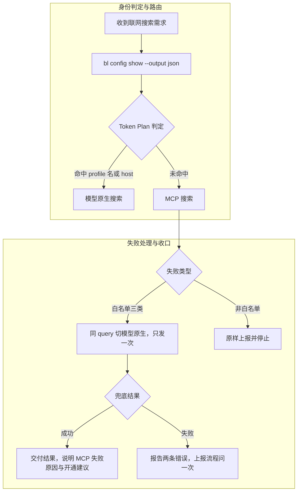

# 百炼联网搜索路由

> 中文简称：联网搜索路由

> **一句话理解**: 用户要联网查资料时先看钥匙类型——Token Plan 钥匙只能走模型原生搜索，普通钥匙走 MCP 搜索，通道坏了也只允许换一次。

基于 bl v2.5.1（2026-11）实测提炼，命令细节以对应 `bl <cmd> --help` 为准。

---

## 一、双路径总表：模型原生 vs MCP

百炼语境下的「联网搜索」有两条实现路径，命令、通道、前置条件完全不同：

| **路径** | **命令** | **底层通道** | **前置条件** |
| --- | --- | --- | --- |
| 模型原生搜索 | `bl text chat --api responses --tool '{"type":"web_search"}'` | Responses API | 需 Qwen3.7+ 原生联网模型；不硬编码 `--model`，让 CLI 用默认模型 |
| MCP 搜索 | `bl search web --query <查询词>` | Bailian WebSearch MCP | 需在市场开通该 MCP；未开通时报 `MCP_IS_INVALID`/404 类错误，并附市场开通链接 |

```bash
# 路径一：模型原生搜索（Responses API + web_search 工具）
bl text chat --api responses --tool '{"type":"web_search"}'

# 路径二：MCP 搜索
bl search web --query "<查询词>"
```

两条路径不是按口味二选一，而是**由身份决定的路由问题**：钥匙类型决定能走哪条通道，这正是本页的核心。

---

## 二、第一步永远是身份判定

任何联网搜索请求，动手前先跑：

```bash
bl config show --output json
```

Token Plan 判定规则：**活动 profile 名为 token-plan，或 base_url 主机名匹配 `token-plan.<region>.maas.aliyuncs.com`——两者满足其一即 Token Plan，其余为默认身份。**

| **判定信号** | **判定结果** | **说明** |
| --- | --- | --- |
| 活动 profile 名为 token-plan | Token Plan | 快速信号，但不充分，见下方陷阱 |
| base_url 主机名匹配 `token-plan.<region>.maas.aliyuncs.com` | Token Plan | 兜底信号，覆盖自定义 profile 名的情况 |
| 两个信号都不命中 | 默认身份 | 走 MCP 路径 |

关键陷阱：**不能只看 profile 名**。profile 名可以被用户自定义成任意字符串——叫 token-plan 的未必是 Token Plan，真 Token Plan 也可能叫别的名字。只有 base_url 的 host 检查能兜住真实身份：host 是服务端路由的产物，不随用户命名摆布。身份与配置体系的全貌见 [[12_架构基建/06_云厂商/Alibaba_Cloud/产品/13_百炼深度/03_Workspace_Auth_Config|工作区与鉴权配置]]，套餐差异背景见 [[12_架构基建/06_云厂商/Alibaba_Cloud/产品/13_百炼深度/02_Billing_Plans_And_Cost|计费与套餐]]。

---

## 三、路由决策与兜底白名单

| **身份或状态** | **路由动作** | **理由** |
| --- | --- | --- |
| Token Plan | 只走模型原生搜索 | Token Plan key 不能授权 Bailian MCP 搜索；用户点名要 MCP 也要解释原因后走原生 |
| 默认身份 | 走 MCP 搜索 | MCP 是默认身份的常规通道 |
| MCP 特定失败且命中白名单 | 兜底一次，切模型原生 | 通道基建故障，换通道才合理 |

兜底触发白名单——**仅三类**，一类都不许扩充：

1. **鉴权/权限失败**：如 Token Plan key 被误路由到 MCP。
2. **MCP 未开通**：404，且错误信息含未开通、MCP 不存在、`MCP_IS_INVALID` 类字样。
3. **传输失败**：405、Streamable-HTTP 不支持、网络超时、DNS 解析失败。

与之相对，明确**不兜底**的情形——原样上报并停止，不浪费一次 Responses 调用：

| **不兜底情形** | **处理** |
| --- | --- |
| 缺 `--query` 等 USAGE 错误 | 修正命令本身，与通道无关 |
| 限流、内容策略等业务错误 | 换通道也绕不过，原样上报 |
| 空结果但调用成功 | 结果就是空，如实报告，不是故障 |

判断口诀：兜底解决「通道坏了」，不解决「请求坏了」。请求本身有错时换通道毫无意义；通道基建故障时，切一次才合理。

---

## 四、兜底纪律：一次、透明、可上报

兜底不是重试循环，纪律三条：

1. **同 query 重发一次**：切到模型原生后用同一个 query，只发一次。
2. **兜底成功**：正常交付结果，同时告知 MCP 失败原因与市场开通建议；错误信息自带开通链接时一并给出。
3. **两条都失败**：原样报告两条错误，走错误上报流程**问一次**，绝不循环重试。

「问一次」的分量：错误上报流程只触发一次征询，用户不响应或拒绝就停在如实报告，不反复追问、不自动改参数再试。循环重试是联网搜索路由里最典型的自伤行为——每次失败调用都在消耗配额与时间。

MCP 市场与开通细节见 [[12_架构基建/06_云厂商/Alibaba_Cloud/产品/13_百炼深度/16_MCP_Marketplace_Skills|MCP 市场与技能]]，Responses API 的兼容层背景见 [[12_架构基建/06_云厂商/Alibaba_Cloud/产品/13_百炼深度/04_OpenAI_Compatibility_SDK|OpenAI 兼容与 SDK]]，统一的错误上报纪律见 [[12_架构基建/06_云厂商/Alibaba_Cloud/产品/13_百炼深度/21_Shared_Protocol_Guardrails|共用协议与护栏]]。

---

## 五、路由决策树



图解：上区先做身份判定选通道，host 检查兜住自定义 profile 名的漏判；下区只对三类通道故障做一次性兜底，所有终止节点都以如实上报收口，不存在循环重试路径。

---

## 交叉引用

- [[12_架构基建/06_云厂商/Alibaba_Cloud/产品/13_百炼深度/README|百炼深度系列总览]]
- [[12_架构基建/06_云厂商/Alibaba_Cloud/产品/13_百炼深度/02_Billing_Plans_And_Cost|计费与套餐]]
- [[12_架构基建/06_云厂商/Alibaba_Cloud/产品/13_百炼深度/03_Workspace_Auth_Config|工作区与鉴权配置]]
- [[12_架构基建/06_云厂商/Alibaba_Cloud/产品/13_百炼深度/04_OpenAI_Compatibility_SDK|OpenAI 兼容与 SDK]]
- [[12_架构基建/06_云厂商/Alibaba_Cloud/产品/13_百炼深度/16_MCP_Marketplace_Skills|MCP 市场与技能]]
- [[12_架构基建/06_云厂商/Alibaba_Cloud/产品/13_百炼深度/21_Shared_Protocol_Guardrails|共用协议与护栏]]

---

*Last updated: 2026-11-06*
