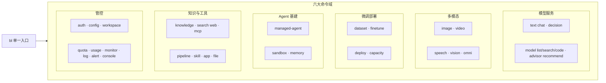

# bl CLI 总纲：百炼官方命令行全景

> 中文简称：bl CLI 总纲

> **一句话理解**: bl 是阿里云百炼的官方命令行，一条命令就能调模型、生成图片视频、微调部署、管理 Agent 基建和查用量。

基于 bl v2.5.1（2026-11）实测提炼，命令细节以 `bl <cmd> --help` 为准。

---

## 一、定位与安装

`bl` 是百炼（Aliyun Bailian / DashScope）的官方 CLI，也是整个 bailian-* 技能家族的执行底座：技能负责「选哪条命令、怎么判断风险」，`bl` 负责「真正执行」。六个命令域共用同一个入口，无需记忆多个工具名。

安装与升级围绕技能家族展开：

```bash
bl skill init      # 整包安装 bailian-* 技能家族
bl skill update    # 只升级技能文档，不动 CLI 本体
bl update          # 升级 CLI 本体，技能家族随版本对齐
```

安装后先用 `bl auth status` 确认鉴权状态，再进入具体命令域。

---

## 二、命令全景：六大域

**表：bl 命令域全景**

| **命令域** | **代表命令** | **典型用途** |
| --- | --- | --- |
| **模型服务** | `text chat`（默认 qwen3.8-max）、`decision`、`model list` / `model search` / `model code`、`advisor recommend` | 文本调用、工具决策、模型检索与选型推荐 |
| **多模态** | `image`、`video`、`speech`、`vision`、`omni` | 图像视频生成、语音合成识别、视觉理解、全模态 |
| **微调部署** | `dataset`、`finetune`、`deploy`、`capacity` | 数据集管理、微调任务、服务部署与容量管理 |
| **Agent 基建** | `managed-agent`、`sandbox`、`memory` | Agent 托管资源、沙箱生命周期、会话记忆 |
| **知识与工具** | `knowledge`、`search web`、`mcp`、`pipeline`、`skill`、`app`、`file` | 知识库、联网搜索、MCP、流水线、技能、应用与文件 |
| **管控** | `auth`、`config`、`workspace`、`quota`、`usage`、`monitor`、`log`、`alert`、`console` | 鉴权配置、工作空间、配额用量、监控日志告警、控制台跳转 |



图中 bl 单一入口向右展开为六个命令域 subgraph，与上表一一对应。日常使用先判断任务落在哪个域，再到该域查 `bl <cmd> --help`；跨域任务（如微调后部署）按流水线顺序串联。

---

## 三、全局行为约定

**表：跨命令的全局行为约定**

| **约定** | **具体行为** |
| --- | --- |
| **本地文件直传** | 凡接受文件 URL 的命令都同时接受本地路径；CLI 自动上传到 DashScope 临时存储（`oss://`，保留 48 小时），绝不要求用户先自建图床 |
| **纯文本输出** | 设置 `NO_COLOR=1` 去除颜色控制符，便于管道与脚本解析 |
| **输出格式** | `--output json` 与 `--output text` 在结构化与人类可读之间切换 |
| **回复语言** | 模型回复语言跟随用户输入；需要固定语言时用 `--system` 强制指定 |
| **不猜 flag** | 拿不准参数时不凭印象拼 flag，先查所属 skill 的 reference/ 目录或 `bl <cmd> --help` |

其中本地文件直传对体验影响最大：生成任务引用本地图、知识库导入本地文档，都不需要先把文件传到公网存储再贴 URL。

```bash
# 组合示例：纯文本环境 + JSON 结构化输出
NO_COLOR=1 bl text chat --output json
```

---

## 四、Profile 多配置体系

`bl` 支持多套 profile 隔离配置，正式与测试环境、不同账号之间互不干扰：

- 用 `--config <name>` 指定本次命令使用哪套 profile；
- 每套 profile 独立维护 base_url、API key、默认模型、水印、语言等设置；
- `bl config show` 查看当前生效配置，`bl config set` 修改配置项。

Base URL 解析优先级从高到低：

```text
--base-url（单次命令参数）
  > DASHSCOPE_BASE_URL（会话环境变量）
    > profile 内保存的 base_url
```

三级优先级意味着：临时切站点加一次 `--base-url` 即可，长期切换改环境变量或 profile，互不覆盖。

---

## 五、家族路由与鉴权速查

bailian-cli 技能是整个家族的 hub。遇到属于其它域的任务时，按技能名软 hand-off 到 gen、finetune、managed-agent、sandbox、memory、web-search 等七个域技能：

- 目标技能已安装：读取其 SKILL.md，按该技能的协议继续执行；
- 目标技能未安装：退回 `bl <cmd> --help` 自助探索，或提示用户运行 `bl skill init` 补齐家族。

鉴权速查：

```bash
bl auth status                      # 查看当前鉴权状态
bl auth login --api-key <API_KEY>   # 用 DashScope API Key 登录（适合脚本）
bl auth login --console             # 控制台账号登录；国际站加 --console-site international
```

API Key 与控制台两种登录分别覆盖自动化与人工交互场景；工作空间切换与多环境配置细节见本系列 [[12_架构基建/06_云厂商/Alibaba_Cloud/产品/13_百炼深度/03_Workspace_Auth_Config|工作空间与鉴权配置]] 一页。

---

## 交叉引用

- [[12_架构基建/06_云厂商/Alibaba_Cloud/产品/13_百炼深度/21_Shared_Protocol_Guardrails|共享协议与安全护栏]]
- [[12_架构基建/06_云厂商/Alibaba_Cloud/产品/13_百炼深度/22_Docs_Three_Layer_Wiki|文档知识库三层架构]]
- [[12_架构基建/06_云厂商/Alibaba_Cloud/产品/13_百炼深度/03_Workspace_Auth_Config|工作空间与鉴权配置]]
- [[12_架构基建/06_云厂商/Alibaba_Cloud/产品/13_百炼深度/README|百炼深度系列总览]]

---

*Last updated: 2026-11-06*
