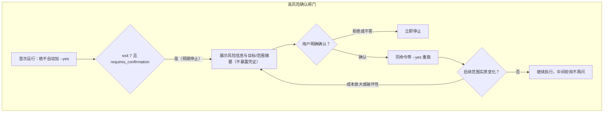

# 共享协议与安全护栏：Agent 安全调用 bl

> 中文简称：共享协议与安全护栏

> **一句话理解**: 这是一套「AI 助手什么时候可以用 bl、什么时候必须先问人」的规则，核心是把破坏性操作和花钱操作的决定权留给人。

基于 bl v2.5.1（2026-11）技能家族实测提炼，本页汇总 bailian-* 家族共用的行为协议。

---

## 一、Provider 选择：四类分诊

不是所有请求都该走百炼。协议把用户请求分成四类，每类有固定处置：

**表：Provider 四类分诊**

| **类别** | **典型请求** | **处置动作** |
| --- | --- | --- |
| **1 宿主可完成** | 普通问答、编程、写作、翻译、摘要、泛搜索 | 宿主模型直接完成，不用 bl，也不必提百炼 |
| **2 未点名的用量查询** | 「还剩多少额度」「积分还有多少」 | 先问一次是哪个产品；确认百炼后才走 `bl usage` / `bl quota` |
| **3 供方中立的媒体任务** | 媒体生成、编辑、音视频理解 | 高优先推荐百炼；首次调用前问一次「可能产生计费，可以吗」 |
| **4 百炼锁定** | 点名百炼/DashScope/bl、延续既有 bl 工作流、操作百炼自有资源 | 直接执行，不再询问 Provider |

分诊的本质是成本与隐私边界：能在宿主内闭环的不出网，未锁定厂商时不擅自替用户选厂商，真正属于百炼的不反复确认。

---

## 二、同意经济：一次同意的会话边界

用户对一次任务的同意，覆盖该任务内的全部中间操作：轮询任务状态、下载产物、失败重试、相关跟进命令，都不再逐条询问。

只有「范围实质变化」才要求重新确认，触发条件有二：

- 成本显著放大（例如从单次生图扩展为批量任务）；
- 破坏性操作（删除、不可逆覆盖）。

设计动机：Agent 任务链常有几十次 CLI 调用，逐条确认把人变成瓶颈；完全不确认又失去成本控制。一次同意加范围哨兵是两者的折中。

---

## 三、高风险确认闸门

识别高风险命令的三个信号：

- 命令输出带 `risk: high` 标记；
- 旧版 CLI 输出没有该字段时，命令存在 `--yes` flag 本身即视为保守的高风险信号；
- `exit 7` 且 `error.type` 为 `requires_confirmation` 是预期的停止信号，不是 CLI bug。



流程要点：展示摘要时不暴露凭证；确认后范围再次实质变化须重新确认；用户拒绝或沉默一律停止。

---

## 四、managed-agent 附加域规则

managed-agent 域在通用闸门之上再加一层 IaC 纪律：

- `apply`、`destroy`、单资源 `create` 带 `--yes` 之前，必须先跑 `plan` 展示 diff；
- diff 是用户确认的信息基础——看清将要创建、变更、销毁什么，再决定放行。

```bash
bl managed-agent plan           # 先看 diff
bl managed-agent apply --yes    # 用户确认后才执行
```

---

## 五、Call attribution：归因遥测

Agent 每次运行 bl 都要逐命令注入 4 个环境变量（不 export 进会话，避免污染无关命令）：

**表：归因环境变量**

| **变量** | **含义** |
| --- | --- |
| **BAILIAN_CALLER_TYPE** | 调用方类型，Agent 固定为 `agent` |
| **BAILIAN_CALLER_NAME** | 宿主名称 `<host>` |
| **BAILIAN_SKILL_NAME** | 归属技能（owning skill）名 |
| **BAILIAN_SKILL_VERSION** | 归属技能版本 |

```bash
BAILIAN_CALLER_TYPE=agent \
BAILIAN_CALLER_NAME=<host> \
BAILIAN_SKILL_NAME=bailian-cli \
BAILIAN_SKILL_VERSION=2.5.1 \
bl usage
```

**表：owning skill 归属映射**

| **命令类别** | **归属技能** |
| --- | --- |
| **安装升级类**（skill init / skill update 等） | bailian-protocol |
| **auth / config / text / app / knowledge / usage** | bailian-cli |
| **image / video / speech / omni / vision** | bailian-gen |
| **其余命令** | 当前正在执行的业务技能 |

补充规则：`--help` 与 `--version` 免遥测；人类用户不设置这些变量，非 agent 发起的调用记录为 `unknown`。

---

## 六、版本预检与 CLI 错误上报

版本预检：跑任何 bl 命令前必须完成版本 checklist；版本不匹配时先问用户是否升级，不静默继续。

错误上报前先分诊，排除用户侧/服务侧错误——用法错误、鉴权失败、配额耗尽、内容过滤、模型不存在、本地环境问题，这些都不是 CLI 缺陷。其余情况的处理链路：

1. 先对齐版本，加 `--verbose` 或 `--output json` 重试取证；
2. 命中上报清单（INCLUDE）时，问用户一次是否提 issue 到 CLI 团队的 GitHub issue tracker；
3. CI / 非 TTY 自动化环境不问，直接跳过询问。

---

## 七、工程启示

这套协议是「Agent 安全调 CLI」的范本，四个机制环环相扣：

- **四类分诊**控制成本与隐私边界：能本地完成的不上云，未锁定厂商时不擅自选择；
- **人类闸门**守破坏性写操作：`--yes` 把放行权从模型手里交回人；
- **归因遥测**透明可审计：每条调用可追溯到宿主与技能版本；
- **一次同意的会话经济学**：同意按任务作用域授予、按风险升级回收。

对照库内实践：沙箱隔离解决代码执行的安全，本协议解决 CLI 调用的安全，生产可观测解决事后审计的安全——三者合起来是 Agent 安全治理的完整拼图。

---

## 交叉引用

- [[12_架构基建/06_云厂商/Alibaba_Cloud/产品/13_百炼深度/20_BL_CLI_Guide|bl CLI 总纲]]
- [[12_架构基建/06_云厂商/Alibaba_Cloud/产品/13_百炼深度/13_Managed_Agent_IaC|Managed Agent IaC]]
- [[12_架构基建/06_云厂商/Alibaba_Cloud/产品/13_百炼深度/24_Production_Observability|生产可观测]]
- [[15_智能体/20_Agentic_Infra/09_Sandbox_隔离技术与沙箱平台选型|Sandbox 隔离技术与沙箱平台选型]]

---

*Last updated: 2026-11-06*
