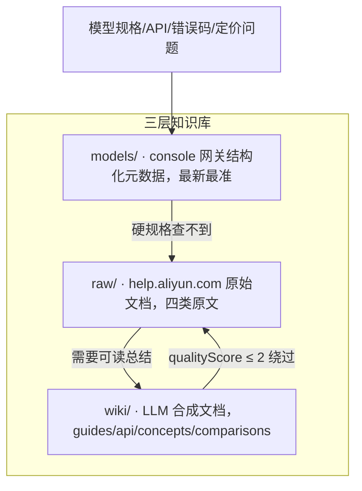

# 文档知识库三层架构：bailian-docs-llm-wiki

> 中文简称：文档知识库三层架构

> **一句话理解**: 把百炼官方文档加工成 AI 能直接查的资料库，模型规格、API、错误码、定价这类问题先查它，不靠模型的记忆瞎猜。

基于 bailian-docs-llm-wiki 技能（bl 家族 v2.5.1，2026-11）实测提炼。

---

## 一、背景与定位

bailian-docs-llm-wiki 把百炼官方文档做成 LLM 可直接查询的知识库技能。五类高频问题先查它：模型规格、API、错误码、应用开发、定价。

它与 bl CLI 的分工：`bl` 负责「执行」，docs-wiki 负责「回答关于百炼的事实问题」。LLM 对 API 参数、错误码、价格的记忆不可靠，这类问题必须落到可验证的文件上。

---

## 二、三层结构与优先级

**表：知识库三层结构**

| **层级** | **内容与来源** | **形态** | **定位** |
| --- | --- | --- | --- |
| **models/** | 百炼 console 网关 `listFoundationModels` 抓取的模型市场结构化元数据（对应模型广场页） | index.md、families.jsonl、models.jsonl、groups/ | 最新最准，冲突时最优先 |
| **raw/** | help.aliyun.com 爬取的原始文档 | model-user-guide、application-user-guide、model-api-reference、application-api-reference 四类 | 原文权威，优先级居中 |
| **wiki/** | LLM 合成的结构化文档 | guides 主题页、api 页、concepts 概念页、comparisons 对比页 | 可读性最好，优先级最低 |

两条硬规则：数据矛盾时优先级 **models > raw > wiki**；wiki 页 `qualityScore ≤ 2` 直接绕过、回退 raw 原文。



查询自上而下：先查结构化层拿硬规格，不够再读原文，最后才用合成页并受质量分门禁约束。

---

## 三、models 层三产物详解

models/ 层有三个核心产物，外加两个辅助文件：

- **index.md**：按主能力（primaryCapability）分桶的家族索引，人类可读的入口页；
- **families.jsonl**：一行一个家族，字段含 slug、primaryCapability、items 轻量摘要、detailPath；
- **models.jsonl**：一行一个主干模型，字段含 model、family、capabilities、features、contextWindow、prices、qpmInfo、profile 画像；
- **groups/<slug>.json**：家族全量数据，items 带 samples 扁平调用示例（如 `samples.openai.completionsAPI.python`）与 predictConfig 入参定义（与 Playground 对齐）；
- **meta.json**：爬取指纹缓存，仅供工具判断增量更新，不给用户引用。

表间关联（join 字段）：`models.jsonl[].family == families.jsonl[].slug`，拿到 slug 后经 detailPath 下钻到 groups/<slug>.json 取全量。

---

## 四、jq/grep 查询范式

结构化层的正确用法是用 jq/grep 精确过滤，而不是整库塞给模型：

```bash
# 列出上下文窗口 ≥ 1M 的模型
jq -c 'select(.contextWindow>=1000000)' models.jsonl

# 找支持 function-calling 的文本模型
grep '"function-calling"' models.jsonl

# 按场景画像选模型（如代码生成）
jq -c 'select(.profile.scenes | index("代码生成"))' models.jsonl

# 挑族内旗舰
jq -c 'select(.profile.familyTier=="flagship")' models.jsonl

# 按家族列推理系
jq -c 'select(.primaryCapability=="Reasoning")' families.jsonl
```

五个范式分别覆盖：硬规格阈值过滤、能力特征检索、场景画像匹配、族内定位、家族级浏览。组合起来就是一套可复现的选型查询语言。

---

## 五、三态语义

字段取值有三种状态，读数前先分清状态再下结论：

**表：字段三态语义**

| **状态** | **语义** | **处理方式** |
| --- | --- | --- |
| **字段缺失** | 未知——数据源没有这个信息 | 不能当作「不支持」，如实回答未知 |
| **null** | 不适用——仅出现在 familyTier、familyComparison | 正常语义，不是数据缺失 |
| **有值** | 已知 | 可信使用 |

三条补充纪律：

- `notSuitableFor: []` 表示「无已知限制」，不等于未知；
- `profileCompleteness == "structured-only"` 表示画像没读过文档，只信其中机械推导的字段；
- 硬规格（价格、QPM、contextWindow、openSource）永远以顶层结构化字段为准，不信合成页转述。

---

## 六、反幻觉与文档工程启示

这套知识库的反幻觉设计有三条强约束：

1. 回答必须基于实际文件内容，不凭印象编造 API、参数、错误码、定价；
2. 引用附带相对路径，读者可自行验证；
3. 质量分门禁：`qualityScore ≤ 2` 自动降级到 raw 原文，坏合成页没有出场机会。

来源可追溯同样制度化：每篇主题页末尾有「## 来源文档」小节，列出所依据的 raw 路径。

更大的启示是「结构化数据 > 原文 > 合成文档」的分层新鲜度治理：越靠前的层越准但越难读，越靠后的层越好读但越可能过期，用明确优先级与门禁把两者接起来。这套设计对任何 LLM 友好文档库都是范本，可直接迁移到库内 RAG 与文档治理实践。

---

## 交叉引用

- [[12_架构基建/06_云厂商/Alibaba_Cloud/产品/13_百炼深度/05_Model_Matrix_Plaza|模型矩阵与广场]]
- [[12_架构基建/06_云厂商/Alibaba_Cloud/产品/13_百炼深度/06_Model_Selection_Methodology|模型选型方法论]]
- [[12_架构基建/06_云厂商/Alibaba_Cloud/产品/13_百炼深度/17_Knowledge_Base_RAG|知识库 RAG]]
- [[12_架构基建/06_云厂商/Alibaba_Cloud/产品/13_百炼深度/20_BL_CLI_Guide|bl CLI 总纲]]
- [[12_架构基建/06_云厂商/Alibaba_Cloud/架构方案/13_架构方案_企业知识库RAG|架构方案：企业知识库 RAG]]

---

*Last updated: 2026-11-06*
