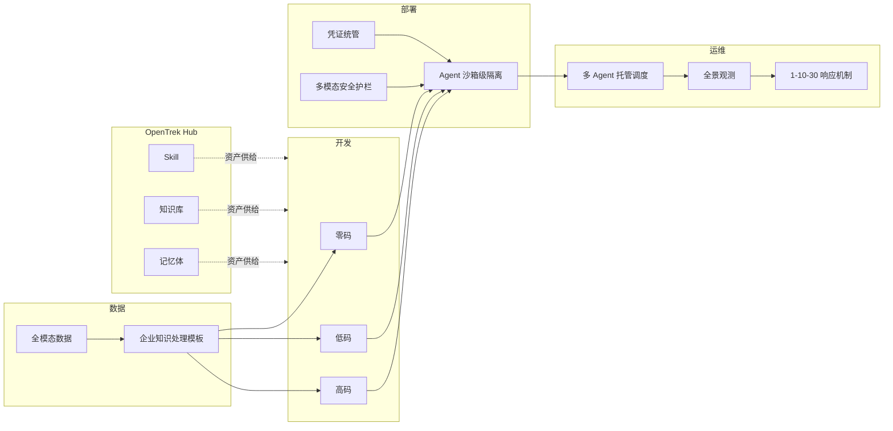

# OpenTrek 产品定位与四大卖点

> 中文简称：OpenTrek 产品定位与四大卖点

> **一句话理解**: OpenTrek 是阿里云卖给企业的「智能体工厂」——企业数据从一端进厂，可运行、可观测的智能体从另一端出厂，整条产线建在客户自己的环境里。

---

## 一、当前定位：企业级一站式智能体工厂

按官网产品页口径（2026-11 检索），OpenTrek 当前定位为**企业级一站式智能体工厂**，四个关键词逐个拆开：

- **全链路闭环**：覆盖「数据-开发-部署-运维」四个环节——企业数据进厂，可运行、可观测的智能体出厂，中间不换平台。
- **产品理念**：「让智能体落地更敏捷、运行更可靠」。前半句指向开发效率（三范式、天级交付），后半句指向生产稳定性（托管调度、全景观测、响应机制）。
- **部署边界**：以**私有化部署**与**阿里云专有云**为主要交付形态，面向数据不能出企业内网或政务外网的客户，这是它与公有云智能体服务的核心差异，四种形态全表见 [[12_架构基建/06_云厂商/Alibaba_Cloud/产品/14_OpenTrek/02_部署与行业/01_Deployment_Matrix|部署形态矩阵]]。
- **配套资产层**：OpenTrek Hub 作为 AI 资产管理平台，统一沉淀与管理开发过程中产生的 Skill、知识库、记忆体等资产，详见 [[12_架构基建/06_云厂商/Alibaba_Cloud/产品/14_OpenTrek/01_全景与演进/03_OpenTrek_Hub_Asset_Platform|OpenTrek Hub 资产管理平台]]。

```text
定位速记：智能体工厂（产线）+ OpenTrek Hub（资产仓库）
产线四段：数据 → 开发 → 部署 → 运维
交付形态：私有化部署 / 专有云
```

注意这一定位属于 2025-2026 年的「智能体工厂」代际；2022 年还有一代同名的「产业智能 OpenTrek」，两者技术内核几乎完全不同，检索与引用资料前先分清代际，见 [[12_架构基建/06_云厂商/Alibaba_Cloud/产品/14_OpenTrek/01_全景与演进/02_Evolution_2022_To_AgentFactory|两代演进]]。

---

## 二、四大卖点总表

官网口径的四大卖点是理解产品能力的索引，每一条都对应本系列的一个子目录：

| **卖点** | **具体内容** | **口径备注** |
| --- | --- | --- |
| **一站式高效开发** | 零/低/高码三范式统一纳管；Skill、知识库、记忆体资产统一管理；天级交付 | 「天级交付」为宣传口径 |
| **高质量数据转化** | 企业知识处理模板；全模态数据处理 | 官网口径 |
| **企业级安全合规** | Agent 沙箱级隔离；凭证统管；多模态安全护栏 | 官网口径 |
| **生产级运行稳定** | 多 Agent 托管调度；全景观测；1-10-30 响应机制；运维提效 30% | 「运维提效 30%」为宣传口径 |

宣传数字的处理建议：

- 「天级交付」：用真实需求（如基于内部 FAQ 搭建问答智能体）做端到端计时，并把「出 Demo」与「生产可用」分成两个口径分别记录。
- 「运维提效 30%」：要求给出基线定义（对比对象、统计周期、样本量），POC 阶段用自己的运维工单数据复测。
- 「1-10-30 响应机制」：官网未展开 1/10/30 的单位与含义，采购评估时应要求官方明确定义，避免写入 SLA 时产生歧义。

---

## 三、卖点一：一站式高效开发——产线不因人群分裂

零/低/高码三种开发范式在同一平台统一纳管：业务同学用零码模板搭智能体，工程师用高码做工程化开发，两种人群的产出进同一条部署与运维产线，而不是各建各的工具链。「一站式」的具体含义不是功能多，而是从开发到运维不需要中途换平台。

Skill、知识库、记忆体三类资产在开发侧统一管理，写一次、跨范式复用。「天级交付」为宣传口径，验收时按第二节的处理建议，用真实需求做端到端计时复测，区分「出 Demo」与「生产可用」两个口径。

深读导览：[[12_架构基建/06_云厂商/Alibaba_Cloud/产品/14_OpenTrek/03_智能体开发/01_Three_Paradigms|智能体开发三范式]]、[[12_架构基建/06_云厂商/Alibaba_Cloud/产品/14_OpenTrek/03_智能体开发/02_Zero_Code_Templates|零码模板]]、[[12_架构基建/06_云厂商/Alibaba_Cloud/产品/14_OpenTrek/03_智能体开发/03_Pro_Code_Engineering|高码工程化]]、[[12_架构基建/06_云厂商/Alibaba_Cloud/产品/14_OpenTrek/03_智能体开发/04_AI_Asset_Model|AI 资产模型]]。

---

## 四、卖点二：高质量数据转化——数据是产线第一段

企业知识处理模板与全模态数据处理（官网口径）把「数据-开发-部署-运维」四段中的第一段做实：文档、表格、图片等多模态企业数据经模板化处理转化为知识库，再供给智能体开发使用。数据段的质量直接决定下游智能体的上限，这也是 OpenTrek 把知识库构建、训练、评测纳入平台边界的原因。

深读导览：[[12_架构基建/06_云厂商/Alibaba_Cloud/产品/14_OpenTrek/07_数据与模型/01_Knowledge_Base_Three_Steps|知识库三步]]、[[12_架构基建/06_云厂商/Alibaba_Cloud/产品/14_OpenTrek/07_数据与模型/02_Training_Full_Spectrum|训练全谱系]]、[[12_架构基建/06_云厂商/Alibaba_Cloud/产品/14_OpenTrek/07_数据与模型/03_Evaluation_BadCase_Loop|评测与 BadCase 闭环]]。

---

## 五、卖点三：企业级安全合规——私有化客户的硬门槛

Agent 沙箱级隔离、凭证统管、多模态安全护栏（官网口径）分别对应三个风险面：智能体执行动作时的运行边界（沙箱隔离）、智能体调用外部系统时的身份凭据（凭证统管）、输入输出内容的风险（安全护栏）。对数据不能出内网的企业，这三项是选型时的硬性核对项，而非加分项。

深读导览：[[12_架构基建/06_云厂商/Alibaba_Cloud/产品/14_OpenTrek/05_生产运行/04_AgentRuntime_Sandbox|AgentRuntime 沙箱]]、[[12_架构基建/06_云厂商/Alibaba_Cloud/产品/14_OpenTrek/07_数据与模型/04_Security_Compliance|安全合规]]。

---

## 六、卖点四：生产级运行稳定——出厂只是开始

多 Agent 托管调度、全景观测、1-10-30 响应机制（官网口径）把运维段做实；「运维提效 30%」为宣传口径。「让智能体运行更可靠」这半句理念落在这一段：智能体出厂后进入托管运行，调度、观测、Token 治理共同构成运行时的稳定性底座。

深读导览：[[12_架构基建/06_云厂商/Alibaba_Cloud/产品/14_OpenTrek/05_生产运行/01_Hosted_Scheduling_Observability|托管调度与可观测]]、[[12_架构基建/06_云厂商/Alibaba_Cloud/产品/14_OpenTrek/05_生产运行/02_AI_Gateway|AI 网关]]、[[12_架构基建/06_云厂商/Alibaba_Cloud/产品/14_OpenTrek/05_生产运行/03_Token_Governance|Token 治理]]。

---

## 七、产品全景图与信源声明



横向主链路即「数据-开发-部署-运维」四段产线；OpenTrek Hub 悬在产线之上，向开发段持续供给 Skill、知识库、记忆体三类资产，运维段沉淀的新经验再回流 Hub，形成资产闭环。对应到卖点：卖点二锚定数据段，卖点一锚定开发段，卖点三锚定部署段，卖点四锚定运维段。

信源声明：

- 阿里云官网产品页 https://www.aliyun.com/product/opentrek（2026-11 检索）——当前定位、理念、四大卖点、部署形态。
- 百度百科词条——「一站式智能体工厂」定位的交叉印证。
- 深读导览与卖点-子目录的对应关系为本页分析视角整理，非官网内容。

---

## 交叉引用

- [[12_架构基建/06_云厂商/Alibaba_Cloud/产品/14_OpenTrek/01_全景与演进/02_Evolution_2022_To_AgentFactory|两代演进：从产业智能到智能体工厂]]
- [[12_架构基建/06_云厂商/Alibaba_Cloud/产品/14_OpenTrek/01_全景与演进/03_OpenTrek_Hub_Asset_Platform|OpenTrek Hub 资产管理平台]]
- [[12_架构基建/06_云厂商/Alibaba_Cloud/产品/14_OpenTrek/02_部署与行业/01_Deployment_Matrix|部署形态矩阵]]
- [[12_架构基建/06_云厂商/Alibaba_Cloud/产品/14_OpenTrek/README|OpenTrek 系列导读]]
- [[12_架构基建/06_云厂商/Alibaba_Cloud/README|阿里云]]

---

*Last updated: 2026-11-06*
