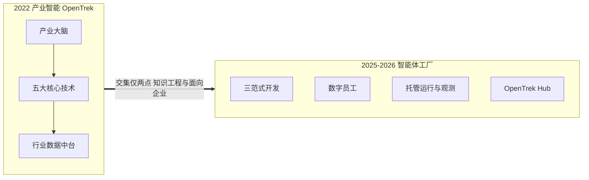

# OpenTrek 两代演进：从产业智能到智能体工厂

> 中文简称：两代演进：从产业智能到智能体工厂

> **一句话理解**: 「OpenTrek」这个名字在 2022 年和 2025 年先后指过两代完全不同的产品——前者是分析数据的「产业智能平台」，后者是生产智能体的「智能体工厂」。

---

## 一、代际速览：同名品牌，两代产品

「OpenTrek」在阿里云历史上先后指过两代差异极大的产品，检索与引用资料前必须先分清代际：

| **维度** | **2022 年：产业智能 OpenTrek** | **2025-2026 年：一站式智能体工厂** |
| --- | --- | --- |
| **发布背景** | 2022 阿里云峰会由曾震宇发布 | Agent 浪潮下推出（来源：官网产品页与百度百科词条） |
| **技术内核** | 基于产业大脑沉淀的五大核心技术：数字孪生、仿真推演、知识工程、决策优化、协同计算 | 零/低/高码三范式开发、Skill/知识库/记忆体资产管理、沙箱隔离与多 Agent 托管运行 |
| **服务形态** | 行业数据中台，推进企业数字化转型 | 私有化企业智能体平台 + OpenTrek Hub 资产管理 |
| **典型关键词** | 产业大脑、数据中台、数字化转型 | 智能体工厂、私有化、数字员工 |

两代产品只在「知识工程」「面向企业」两点上有交集，技术栈与目标场景几乎全部重做。把它当作同一产品的连续迭代，会系统性误读 2022-2023 年的新闻稿与案例。

---

## 二、2022 年：产业智能 OpenTrek 与五大核心技术

2022 阿里云峰会上，曾震宇发布产业智能 OpenTrek，定位为基于产业大脑沉淀的行业数据中台，服务企业数字化转型。其技术内核是五大核心技术，每项按公开常识定性说明（分析视角）：

| **核心技术** | **一句话说明（公开常识定性，分析视角）** |
| --- | --- |
| **数字孪生** | 把产线、设备、园区等物理实体在数字空间建成可实时映射的镜像，用于状态可视与推演 |
| **仿真推演** | 在数字镜像上模拟不同决策与参数下的系统演化，先仿真验证再实际落地 |
| **知识工程** | 把行业经验、专家规则、文档资料结构化为可计算的知识资产（如知识图谱） |
| **决策优化** | 在约束与目标下求解调度、排产、配置等决策的最优或近似最优方案（运筹优化脉络） |
| **协同计算** | 跨部门、跨企业、跨系统完成数据与计算的分布式协同，对应数据中台时代的协作需求 |

这一代产品的关键词是「分析智能」：数据进中台，分析结论与决策辅助出中台，落点在企业数字化转型的数据基建。

---

## 三、2025-2026 年：一站式智能体工厂

Agent 浪潮下，OpenTrek 品牌转向**企业级一站式智能体工厂**（来源：官网产品页与百度百科词条）：覆盖「数据-开发-部署-运维」全链路，以私有化部署与专有云为主要交付形态，配套 OpenTrek Hub 资产管理平台。当前定位与四大卖点的完整拆解见 [[12_架构基建/06_云厂商/Alibaba_Cloud/产品/14_OpenTrek/01_全景与演进/01_Product_Overview|产品定位与四大卖点]]。

这一代产品的关键词是「行动智能」：企业数据进厂，可运行、可观测的智能体出厂——产出物从「分析结论」变成了「会干活的数字员工」（见 [[12_架构基建/06_云厂商/Alibaba_Cloud/产品/14_OpenTrek/04_数字员工/01_Digital_Workforce|企业数字员工]]）。

---

## 四、演进图：从分析智能到行动智能

同一品牌从「分析智能」转向「行动智能」：左代输出分析结论与决策辅助，右代输出可运行的智能体与数字员工；两代之间没有平滑升级路径，而是目标场景的重做。

---

## 五、命名纠偏：营销口径与官方文档口径

> [!WARNING] 库内纠偏记录：警惕「OpenTrek-LLM」
> 库内已记录：AI Stack 营销材料中曾出现「OpenTrek-LLM」这一名称，而官方用户指南 V2.14.0 中未出现该名称。评估 OpenTrek 材料时，同样要区分**营销口径**与**官方文档口径**——营销物料（官网 Banner、大会 PPT、合作新闻稿）倾向造新词、叠卖点；官方文档（用户指南、发布说明）才是能力边界的可靠依据。

实操判据：

- 见到 OpenTrek 的新能力宣称，先查官方用户指南有无对应章节，再决定采信程度。
- 检索「OpenTrek」必须带时间过滤：2022-2023 年的结果大概率讲产业智能平台，与当前智能体工厂不是一回事。
- 「OpenTrek-LLM」等官方文档缺位的衍生命名，入库时一律标注「营销口径，待核实」。

---

## 六、演进启示与信源声明

演进启示（分析视角）：

- **品牌延续不等于产品延续**：同一品牌名下可以是两代目标场景完全不同的产品，品牌名不能当代际证据，必须叠加时间、发布人与文档源交叉验证；
- **「分析智能」到「行动智能」的行业缩影**：OpenTrek 的两代切换对应企业 AI 需求从「看清业务」到「替人干活」的迁移，与行业从数据中台走向 Agent 平台的节奏一致；
- **知识工程是贯穿线**：两代交集落在知识工程上——无论产出分析结论还是智能体，「把企业知识结构化」都是前提，这也是当前 OpenTrek 把知识库建设作为产线第一段的原因。

信源声明：

- 阿里云官网产品页 https://www.aliyun.com/product/opentrek（2026-11 检索）——当前「一站式智能体工厂」定位。
- 公开报道与历史资料——2022 阿里云峰会发布信息（发布人曾震宇、五大核心技术、行业数据中台）。
- 百度百科词条——「一站式智能体工厂」定位的交叉印证。
- 库内纠偏记录——「OpenTrek-LLM」命名问题（AI Stack 营销材料 vs 官方用户指南 V2.14.0）。
- 五大核心技术的一句话说明与演进启示为本页分析视角整理（按公开常识定性），非官方表述。

---

## 交叉引用

- [[12_架构基建/06_云厂商/Alibaba_Cloud/产品/14_OpenTrek/01_全景与演进/01_Product_Overview|OpenTrek 产品定位与四大卖点]]
- [[12_架构基建/06_云厂商/Alibaba_Cloud/产品/14_OpenTrek/01_全景与演进/03_OpenTrek_Hub_Asset_Platform|OpenTrek Hub 资产管理平台]]
- [[12_架构基建/06_云厂商/Alibaba_Cloud/产品/14_OpenTrek/04_数字员工/01_Digital_Workforce|企业数字员工]]
- [[12_架构基建/03_AI技术栈/02_AI技术栈_深入分析|AI 技术栈深入分析]]
- [[12_架构基建/06_云厂商/Alibaba_Cloud/README|阿里云]]

---

*Last updated: 2026-11-06*
