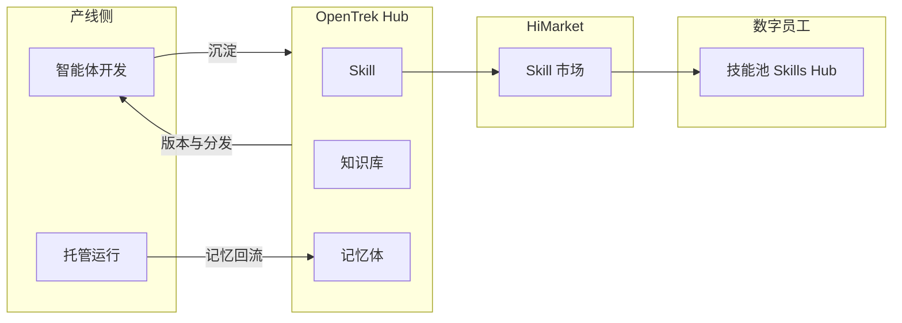

# OpenTrek Hub 资产管理平台

> 中文简称：OpenTrek Hub 资产管理平台

> **一句话理解**: Hub 是企业的「AI 资产仓库」——好的 Skill 和知识库沉淀一次、全公司复用，不用每个团队重造一遍。

---

## 一、定位：企业 AI 资产管理平台

官网一句话定位：Skill、知识库、记忆体等企业 AI 资产的统一沉淀、版本与分发平台。在「智能体工厂」的整体图景里，Hub 是悬在「数据-开发-部署-运维」产线之上的资产仓库：开发段从 Hub 取资产，运维段把跑得好的产出回流 Hub，形成资产闭环（全景图见 [[12_架构基建/06_云厂商/Alibaba_Cloud/产品/14_OpenTrek/01_全景与演进/01_Product_Overview|产品定位与四大卖点]]）。

三类资产各管一段：

| **资产类型** | **沉淀的是什么** | **典型来源** |
| --- | --- | --- |
| **Skill** | 可复用的技能与插件（提示词、工具调用封装） | 开发过程中验证有效的技能封装 |
| **知识库** | 处理成可供检索的企业知识 | 文档、表格等多模态数据加工 |
| **记忆体** | Agent 长期运行积累的记忆 | 用户偏好、业务规则等运行时沉淀 |

---

## 二、三个动词：沉淀、版本、分发

官网定位拆开是三个动词，每个动词对应一种治理能力：

1. **沉淀**：跑得好的 Skill、验证过的知识库、调教出的记忆体进 Hub，成为组织资产而非个人私货；
2. **版本**：资产有版本序列，更新可回滚，下游使用方不受上游随意变更的影响；
3. **分发**：资产按权限分发到需要的 Agent 与团队，一次建设、多处复用。

三个动词合起来回答的问题是：企业投在智能体上的试错成本，如何变成可累积、可交接的组织资本——没有这一层，每个智能体项目都从零开始（分析视角）。

---

## 三、治理价值：从个人私货到组织资产（定性）

| **没有 Hub** | **有 Hub** |
| --- | --- |
| **重复建设**：每个团队各写各的提示词与 Skill | **资产复用**：一次建设、多处调用，避免重复造轮子 |
| **资产随人走**：好东西留在个人手里，人走资产丢 | **组织级沉淀**：资产属于公司，可交接、可审计 |
| **变更失控**：资产改了什么、谁在用，没人说得清 | **版本可追溯**：版本序列与分发关系全留痕 |

三行对照就是 Hub 的治理价值（定性）：复用避免重复建设、组织级沉淀让资产可交接可审计、版本治理让变更受控——「避免重复建设」由口号变成机制。

---

## 四、记忆体：数字员工「越用越懂业务」的底座

记忆体值得单独强调：Agent 长期运行积累的记忆（用户偏好、业务规则）进 Hub 统一管理后，才能在 Agent 之间继承与审计——这是数字员工「越用越懂业务」的底座。数字员工的岗位技能与运行经验不再锁死在单个 Agent 实例里，而是作为资产可迁移、可复核（数字员工侧展开见 [[12_架构基建/06_云厂商/Alibaba_Cloud/产品/14_OpenTrek/04_数字员工/01_Digital_Workforce|企业数字员工]]）。

---

## 五、与 HiMarket、数字员工 Skills Hub 的关系

- **与 HiMarket 的关系**：Hub 是资产的「仓库与台账」，HiMarket 是资产的「货架与卖场」——仓库管版本与分发，市场管展示、试用与采纳（HiMarket 三件套见 [[12_架构基建/06_云厂商/Alibaba_Cloud/产品/14_OpenTrek/06_市场生态/01_HiMarket|HiMarket]]）；
- **与数字员工 Skills Hub 的关系**：数字员工的技能池从 HiMarket 取数——市场里的 Skill 是数字员工可挂载的技能来源，Hub 与 HiMarket 管供给，数字员工管使用；
- **与公有云生态市场的边界**（分析视角）：Hub 面向企业内部沉淀与内部分发，资产与使用数据都在企业内；要借公有云生态的广度，可以组合使用——外部市场的通用 Skill 引进后进 Hub 落成企业版本，再对内分发（对照见 [[12_架构基建/06_云厂商/Alibaba_Cloud/产品/13_百炼深度/16_MCP_Marketplace_Skills|百炼 MCP 市场与 Skills]]）。

Hub 居中：向左承接产线的沉淀与回流，向右经 HiMarket 把 Skill 供给数字员工的技能池——管供给的是 Hub 与市场，管使用的是数字员工。

---

## 六、运营要点与信源声明

运营要点（分析视角）：

1. **上架评审**：定最低门槛（文档、示例、责任人、安全检查），没有责任人的资产一律不上架；
2. **评分反馈**：试用必须留评分与评论，评分是推荐与淘汰的核心信号，防止市场变垃圾场；
3. **版本治理**：资产升级走版本序列，破坏性变更提前公告，给下游留迁移窗口。

运营指标看三样：上架数（供给活跃度）、试用转化率（需求匹配度）、复用次数（资产实际价值）——只看上架数的资产平台，一定会被 KPI 带成摆设。

信源声明：

- 阿里云官网产品页 https://www.aliyun.com/product/opentrek（2026-11 检索）——Hub 定位、三类资产、沉淀/版本/分发能力。
- 与 HiMarket、数字员工 Skills Hub 的关系表述继承自本系列「Hub 与 HiMarket」页的整理。
- 运营要点与运营指标为分析视角整理，非官网内容。

---

## 交叉引用

- [[12_架构基建/06_云厂商/Alibaba_Cloud/产品/14_OpenTrek/01_全景与演进/01_Product_Overview|OpenTrek 产品定位与四大卖点]]
- [[12_架构基建/06_云厂商/Alibaba_Cloud/产品/14_OpenTrek/01_全景与演进/02_Evolution_2022_To_AgentFactory|两代演进：从产业智能到智能体工厂]]
- [[12_架构基建/06_云厂商/Alibaba_Cloud/产品/14_OpenTrek/03_智能体开发/04_AI_Asset_Model|AI 资产模型]]
- [[12_架构基建/06_云厂商/Alibaba_Cloud/产品/14_OpenTrek/04_数字员工/01_Digital_Workforce|企业数字员工]]
- [[12_架构基建/06_云厂商/Alibaba_Cloud/产品/14_OpenTrek/06_市场生态/01_HiMarket|HiMarket]]
- [[12_架构基建/06_云厂商/Alibaba_Cloud/产品/13_百炼深度/16_MCP_Marketplace_Skills|百炼 MCP 市场与 Skills]]

---

*Last updated: 2026-11-06*
