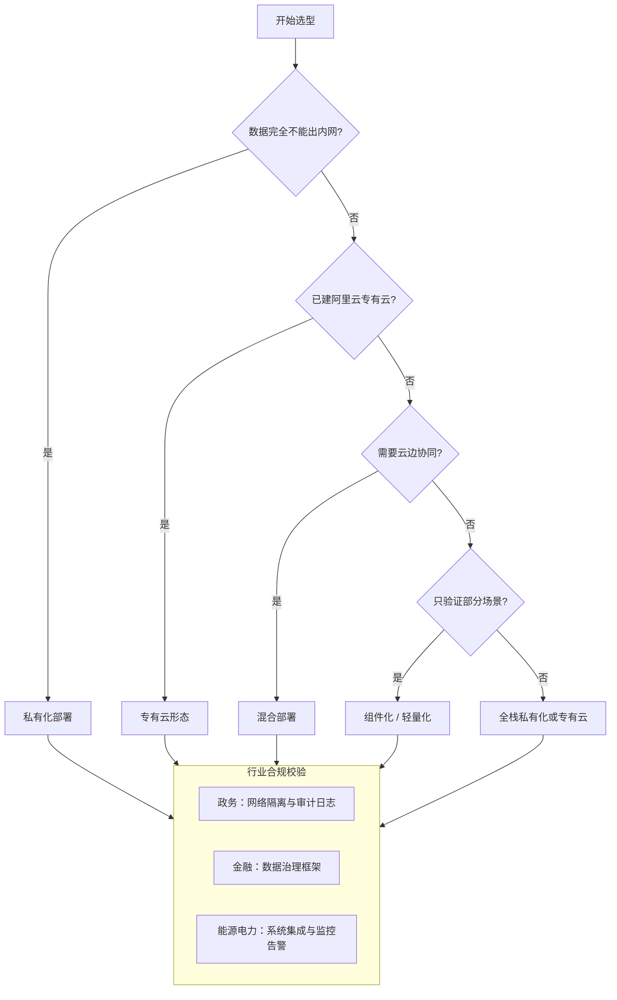

# OpenTrek 部署形态矩阵

> 中文简称：部署形态矩阵

> **一句话理解**: OpenTrek 既能整套装进企业自己的机房，也能拆开按需选购——选哪种，先看数据允许放在哪里，再看要全栈还是模块。

---

## 一、部署形态矩阵：数据边界 × 采购粒度

官网口径下 OpenTrek 提供四种部署形态，本质是「数据边界 × 采购粒度」两个轴的组合：

| **部署形态** | **底座与数据边界** | **适用场景** | **关键点** |
| --- | --- | --- | --- |
| **私有化部署** | 部署在企业内网，数据本地闭环 | 数据严禁出内网的企业与机构 | 安全边界最硬，运维责任在己方 |
| **专有云** | 阿里云专有云底座，平台部署在客户环境 | 政务、大型国企等已建专有云的客户 | 云产品化能力与数据不出域兼得 |
| **混合部署** | 云边协同，中心与边缘分工 | 分支机构多、边缘节点有算力的场景 | 按数据敏感度分流中心与边缘 |
| **组件化** | 按业务需求灵活选择组件 | 预算有限或仅需部分能力的场景 | 初次投入低，后续可渐进扩展 |

选型时先回答两个问题：数据允许放在哪里（决定前三行），以及要全栈还是要模块（决定是否组件化）。

两个轴的展开（分析视角）：

- **数据边界轴**：数据能不能出企业控制域，决定形态的安全上限——私有化最紧，专有云、混合逐级放宽；
- **采购粒度轴**：全栈采购还是按组件采购，决定初次投入与扩展节奏——组件化让验证期投入最小化。

---

## 二、四种形态逐项拆解

- **私有化部署**：整套平台落在企业内网，数据本地闭环，安全边界最硬；代价是平台升级、组件 License 与硬件扩容的运维责任在己方。
- **专有云**：跑在阿里云专有云底座上，平台部署在客户环境，云产品化能力与数据不出域兼得（专有云背景见 [[12_架构基建/06_云厂商/Alibaba_Cloud/专有云/README|阿里云专有云]]）。
- **混合部署**：云边协同，中心与边缘分工，按数据敏感度分流；适合分支机构多、边缘节点有算力的场景。
- **组件化**：按业务需求灵活选择组件，初次投入低、后续渐进扩展；市场化实例见 [[12_架构基建/06_云厂商/Alibaba_Cloud/产品/14_OpenTrek/02_部署与行业/05_ZStack_Partnership|ZStack 轻量化合作]]。

```text
运维口径提示（分析视角）：私有化与线下交付形态下，平台升级、组件 License 与硬件扩容的责任划分，需在采购合同中逐项明确。
```

---

## 三、选型问句与决策表

把部署形态与行业约束合并成一张决策表：

| **决策问题** | **若回答「是」** | **若回答「否」** |
| --- | --- | --- |
| **数据完全不能出内网？** | 私有化部署 | 看下一问 |
| **已建阿里云专有云？** | 专有云形态 | 看下一问 |
| **需要云边协同？** | 混合部署 | 看下一问 |
| **只想先验证部分场景？** | 组件化（可参考 ZStack 轻量化方案） | 全栈交付 |

四问按顺序收敛：前三问定形态，最后一问定粒度；问完仍不确定的，回到第一节的两个轴重新对齐（分析视角）。

---

## 四、部署决策树



决策树先按数据边界收敛形态，再进入行业合规校验；任何形态落地前，都应回到行业方案页逐项核对硬性门槛：[[12_架构基建/06_云厂商/Alibaba_Cloud/产品/14_OpenTrek/02_部署与行业/02_Government_Solution|政务行业方案]]、[[12_架构基建/06_云厂商/Alibaba_Cloud/产品/14_OpenTrek/02_部署与行业/03_Finance_Solution|金融行业方案]]、[[12_架构基建/06_云厂商/Alibaba_Cloud/产品/14_OpenTrek/02_部署与行业/04_Energy_Solution|能源与电力行业方案]]。

---

## 五、形态与卖点的对应（分析视角）

- 部署形态是四大卖点中「企业级安全合规」的物理载体：卖点能不能兑现，先看形态选对（卖点总表见 [[12_架构基建/06_云厂商/Alibaba_Cloud/产品/14_OpenTrek/01_全景与演进/01_Product_Overview|产品定位与四大卖点]]）；
- 组件化对应「按需验证」的采购路径，混合部署对应边缘算力利用——形态选择同时是成本结构选择；
- 私有化与专有云的取舍，本质是「自运维换最硬边界」还是「借云产品化能力保数据不出域」。

---

## 六、信源声明

- 阿里云官网产品页 https://www.aliyun.com/product/opentrek（2026-11 检索）——部署形态矩阵与行业方案要点。
- 两个轴的展开、选型决策表与形态-卖点对应为本页分析视角整理，非官网内容；行业监管细则以主管部门文件为准。

---

## 交叉引用

- [[12_架构基建/06_云厂商/Alibaba_Cloud/产品/14_OpenTrek/02_部署与行业/02_Government_Solution|政务行业方案]]
- [[12_架构基建/06_云厂商/Alibaba_Cloud/产品/14_OpenTrek/02_部署与行业/03_Finance_Solution|金融行业方案]]
- [[12_架构基建/06_云厂商/Alibaba_Cloud/产品/14_OpenTrek/02_部署与行业/04_Energy_Solution|能源与电力行业方案]]
- [[12_架构基建/06_云厂商/Alibaba_Cloud/产品/14_OpenTrek/02_部署与行业/05_ZStack_Partnership|ZStack 轻量化合作]]
- [[12_架构基建/06_云厂商/Alibaba_Cloud/产品/14_OpenTrek/01_全景与演进/01_Product_Overview|OpenTrek 产品定位与四大卖点]]
- [[12_架构基建/06_云厂商/Alibaba_Cloud/专有云/README|阿里云专有云]]
- [[12_架构基建/06_云厂商/Alibaba_Cloud/架构方案/16_架构方案_私有化部署|架构方案：私有化部署]]

---

*Last updated: 2026-11-06*
