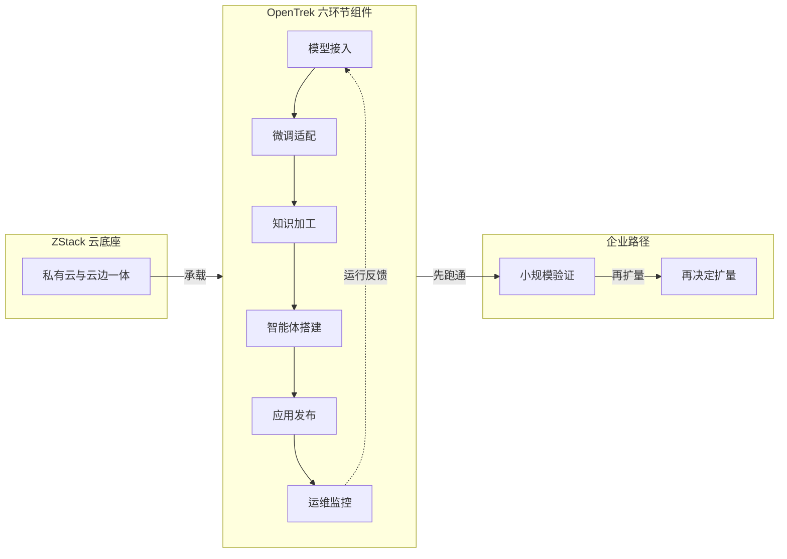

# OpenTrek 与 ZStack 轻量化合作

> 中文简称：ZStack 轻量化合作

> **一句话理解**: ZStack 出云底座、OpenTrek 出 AI 平台组件，企业不用一次买全套——先小规模跑通，再决定是否扩量。

---

## 一、合作速览：2026-10-20 联合发布

2026-10-20，ZStack 与阿里云联合发布**轻量化 AI 落地方案**，是 OpenTrek 生态合作中时间点明确的一例：

- **合作目标**：帮助企业以更低成本验证和推广 AI 应用——先小规模跑通，再决定是否扩大投入；
- **采购方式**：按需选择组件，不强制全栈采购；
- **合作基础**：ZStack 此前与阿里云已有云边一体合作，本次是在既有合作上的 AI 延伸。

```text
轻量化方案速记：ZStack（云底座）+ OpenTrek（模型与智能体平台）
六环节：模型接入 → 微调适配 → 知识加工 → 智能体搭建 → 应用发布 → 运维监控
采购方式：按需选组件，不强制全栈
```

该合作与部署矩阵中的「组件化」形态互为印证：轻量化的技术路径就是组件化采购，适合预算敏感、希望先验证再扩量的企业（见 [[12_架构基建/06_云厂商/Alibaba_Cloud/产品/14_OpenTrek/02_部署与行业/01_Deployment_Matrix|部署形态矩阵]]）。

---

## 二、分工与六环节组件化

分工：OpenTrek 提供可私有化部署的模型即服务与智能体平台，覆盖六个环节；ZStack 承担云底座。六环节与平台能力面的对应（对应关系为分析视角）：

| **环节** | **覆盖内容** | **对应的平台能力面（分析视角）** |
| --- | --- | --- |
| **模型接入** | 企业按需接入可用模型 | 模型即服务层 |
| **微调适配** | 模型按业务数据适配 | 数据与模型段：训练与微调 |
| **知识加工** | 企业数据加工为知识库 | 数据段：知识处理模板 |
| **智能体搭建** | 零/低/高码开发智能体 | 开发段：三范式 |
| **应用发布** | 智能体发布为可交付应用 | 部署段 |
| **运维监控** | 运行监控与告警 | 运维段：托管调度与观测 |

六环节本身就是「数据-开发-部署-运维」产线的组件化拆分——这正是「按需选购」可行的原因：环节边界清晰，才能拆开卖（分析视角）。

---

## 三、合作基础：云边一体的既有合作

ZStack 此前与阿里云已有云边一体合作，本次轻量化 AI 方案是在既有合作上的延伸。这意味着（分析视角）：

- 双方在云边协同场景已有工程与渠道协作基础，不是临时拼凑的市场合作；
- 目标客户群有重叠：已用 ZStack 私有云或云边方案的企业，增量只需补 AI 平台层组件；
- 对阿里云而言，这是 OpenTrek 触达中小规模私有云客户的渠道补充。

---

## 四、适用场景：谁该选轻量化路径（分析视角）

- **中小规模验证**：预算敏感、希望先跑通单场景再决定投入的企业；
- **已用 ZStack 私有云的客户**：云底座已在，增量只来自 AI 平台层组件，集成与运维成本低；
- **暂不适合**：强监管核心场景优先整栈私有化或专有云——组件拼装的安全边界与责任划分不如整栈清晰。

---

## 五、与整栈私有化的取舍

| **对比项** | **ZStack 轻量化方案** | **整栈私有化 / 专有云** |
| --- | --- | --- |
| **初次投入** | 低，按组件选购 | 高，全栈采购与实施 |
| **扩展路径** | 先验证后扩，渐进式 | 一步到位，平台统一 |
| **责任边界** | 多组件责任需逐项划清 | 整栈厂商责任相对集中 |
| **适用对象** | 中小规模、已用 ZStack 私有云 | 强合规与大型企业 |

取舍要点（分析视角）：轻量化买的是「低成本试错权」，整栈买的是「统一平台确定性」——先用轻量化验证场景价值，再决定是否迁移到整栈，是预算受限时的合理路径。



ZStack 提供云底座，OpenTrek 六环节组件按需落在其上，企业先小规模验证、再决定扩量——这条路径就是部署矩阵中「组件化」形态的市场化实例。

---

## 六、信源声明

- 公开报道——2026-10-20 ZStack 与阿里云联合发布轻量化 AI 落地方案（含云边一体合作背景、六环节覆盖范围、按需选组件采购方式）。
- 阿里云官网产品页 https://www.aliyun.com/product/opentrek（2026-11 检索）——OpenTrek 平台能力面（用于六环节对应关系翻译）。
- 适用场景、取舍表与六环节能力面对应为本页分析视角整理，非官方表述。

---

## 交叉引用

- [[12_架构基建/06_云厂商/Alibaba_Cloud/产品/14_OpenTrek/02_部署与行业/01_Deployment_Matrix|部署形态矩阵]]
- [[12_架构基建/06_云厂商/Alibaba_Cloud/产品/14_OpenTrek/02_部署与行业/04_Energy_Solution|能源与电力行业方案]]
- [[12_架构基建/06_云厂商/Alibaba_Cloud/产品/14_OpenTrek/01_全景与演进/01_Product_Overview|OpenTrek 产品定位与四大卖点]]
- [[12_架构基建/06_云厂商/Alibaba_Cloud/产品/14_OpenTrek/08_选型与视角/01_Family_Fit|家族适配选型]]
- [[12_架构基建/06_云厂商/Alibaba_Cloud/产品/14_OpenTrek/08_选型与视角/03_Implementation_Playbook|实施手册]]
- [[12_架构基建/06_云厂商/Alibaba_Cloud/产品/13_百炼深度/README|百炼深度系列]]
- [[12_架构基建/06_云厂商/Alibaba_Cloud/README|阿里云]]

---

*Last updated: 2026-11-06*
