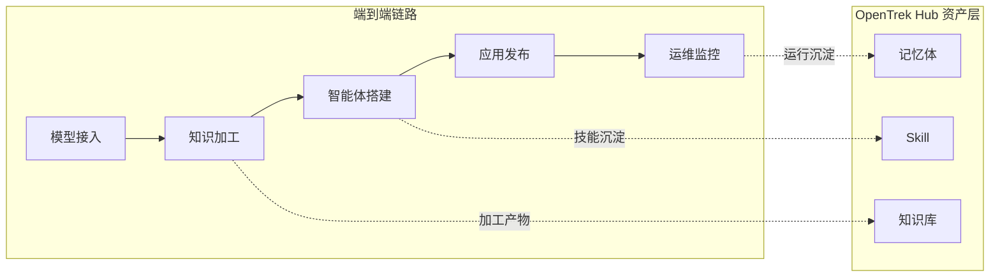

# OpenTrek 三范式统一纳管总览

> 中文简称：三范式统一纳管总览

> **一句话理解**: 业务人员拖拽、运营配置、工程师写代码，都在同一个 OpenTrek 平台上造智能体，产物进同一个资产库。

---

## 一、三范式对比：零码、低码、高码

官网口径为「零码至高码三种范式统一纳管」，三种范式面向不同人群与复杂度：

| **维度** | **零码** | **低码** | **高码** |
| --- | --- | --- | --- |
| **使用者** | 业务人员，可视化搭建 | 运营/分析人员，配置为主 | 工程师，工程化开发 |
| **扩展方式** | 角色模板开箱即用 | 配置 + 少量脚本扩展 | 完整代码工程接入纳管 |
| **适用场景** | 标准化岗位型智能体 | 需定制流程与轻度逻辑 | 复杂逻辑、性能与集成要求高 |
| **产物去向** | 智能体应用 + 资产 | 智能体应用 + 资产 | 智能体应用 + 可复用组件 + 资产 |

三者的边界是滑动而非割裂：零码起步的智能体，随需求变复杂可升级到低码、再由高码纳管，资产全程不迁移。

本目录后续三页分别展开各范式的细节：零码范式与角色模板、低码与高码的工程化协作、三类 AI 资产（Skill、知识库、记忆体）的统一模型。

---

## 二、统一纳管的含义

「统一纳管」是三范式的关键定语，含义有三层：

- **一个平台服务三类人群**：业务、运营、工程师在同一个平台工作，而不是各用各的工具链再手工拼接。
- **产物进同一资产库**：无论哪种范式产出的 Skill、知识库、智能体，都进入统一资产管理（OpenTrek Hub），可被其他范式复用。
- **治理口径一致**：权限、审计、安全策略对三种范式一视同仁，避免「零码应用绕过安全审查」的漏洞。

对照反例：企业里零码工具、低码平台、自研框架三套并存时，资产互不流通、治理各自为政——这是智能体规模化最常见的失败模式，也是「统一纳管」要解的问题。

---

## 三、端到端内置能力链

OpenTrek 内置从模型接入到运维监控的端到端链路，开发团队不需要在环节之间自行拼装工具链：

链路各环节均有平台内置能力承接：知识加工对应企业知识处理模板与全模态处理，运维监控对应多 Agent 托管调度与全景观测。三范式分别作用于「智能体搭建」这一环——零码用模板、低码用配置、高码用代码工程，但消费与沉淀的都是同一层资产。

---

## 四、天级交付：宣传口径与验证方法

「天级交付」为官网**宣传口径**，指从需求到上线以天计。

验证方法建议：选一个真实需求做端到端计时，并把「出 Demo」与「生产可用（含权限、审计、监控配置）」分成两个口径分别记录，避免把演示速度当成交付承诺。

两个实操提醒（分析视角）：

- 交付耗时的瓶颈通常不在搭建环节，而在数据准备与知识加工——分环节计时才能定位真实耗时分布。
- 三范式首次交付速度不同：零码模板起步最快；高码工程首次接入纳管有基建成本，第二次起才体现资产复用收益。

---

## 五、与百炼应用构建的对照（分析视角）

OpenTrek 与百炼都能构建智能体应用，定位差异如下。注意：这是基于两边公开材料的**分析视角**，阿里云官方并未给出两者的分工口径，选型结论应以官方确认为准：

| **维度** | **百炼** | **OpenTrek** |
| --- | --- | --- |
| **平台形态** | 公有云控制台应用编排 | 私有化部署的统一纳管平台 |
| **数据边界** | 数据上云（公有云侧处理） | 数据留在客户环境 |
| **开发范式** | 控制台编排 + API 调用 | 零/低/高码三范式统一纳管 |
| **适配客户** | 数据可上云的企业 | 数据敏感、需私有化落地的企业 |

便于记忆的判断：数据可上云时优先评估百炼；必须私有化时，OpenTrek 是阿里侧的对位选项。

---

## 六、范式选择的团队配置建议

| **团队配置** | **推荐起步范式** | **演进路径** |
| --- | --- | --- |
| **无工程师的业务部门** | 零码 + 角色模板 | 先跑通标准场景，复杂逻辑再引入 IT 支持 |
| **有少量技术人员的运营团队** | 低码 | 配置起步，用脚本逐步扩展 |
| **有平台/应用工程团队** | 高码纳管 | 工程化为主，零码供业务自助 |
| **混合大团队** | 三范式并用 | 按人群分层使用，资产统一入库 |

配置原则：范式选择本质是人力结构问题——让业务侧自助完成多数标准场景，工程师聚焦少数复杂集成与治理。

---

## 七、信源声明

- 阿里云官网产品页：[https://www.aliyun.com/product/opentrek](https://www.aliyun.com/product/opentrek)（2026-11 检索）——三范式、三类资产、端到端能力、天级交付表述。
- 「天级交付」为宣传口径，官网未附统计方法；验证建议与实操提醒为本页分析视角。
- 与百炼的对照为基于公开材料的分析视角，非阿里云官方分工口径。

---

## 交叉引用

- [[12_架构基建/06_云厂商/Alibaba_Cloud/产品/14_OpenTrek/03_智能体开发/02_Zero_Code_Templates|零码与角色模板]]
- [[12_架构基建/06_云厂商/Alibaba_Cloud/产品/14_OpenTrek/03_智能体开发/03_Pro_Code_Engineering|低码与高码工程化]]
- [[12_架构基建/06_云厂商/Alibaba_Cloud/产品/14_OpenTrek/03_智能体开发/04_AI_Asset_Model|AI 资产模型：Skill、知识库、记忆体]]
- [[12_架构基建/06_云厂商/Alibaba_Cloud/产品/14_OpenTrek/01_全景与演进/01_Product_Overview|OpenTrek 产品全景]]
- [[12_架构基建/06_云厂商/Alibaba_Cloud/产品/14_OpenTrek/05_生产运行/01_Hosted_Scheduling_Observability|多 Agent 托管调度与全景观测]]
- [[12_架构基建/06_云厂商/Alibaba_Cloud/产品/07_MaaS平台_百炼与千问AI平台|MaaS 平台：百炼与千问 AI 平台]]
- [[12_架构基建/06_云厂商/Alibaba_Cloud/产品/13_百炼深度/16_MCP_Marketplace_Skills|百炼 MCP 市场与技能]]

---

*Last updated: 2026-11-06*
